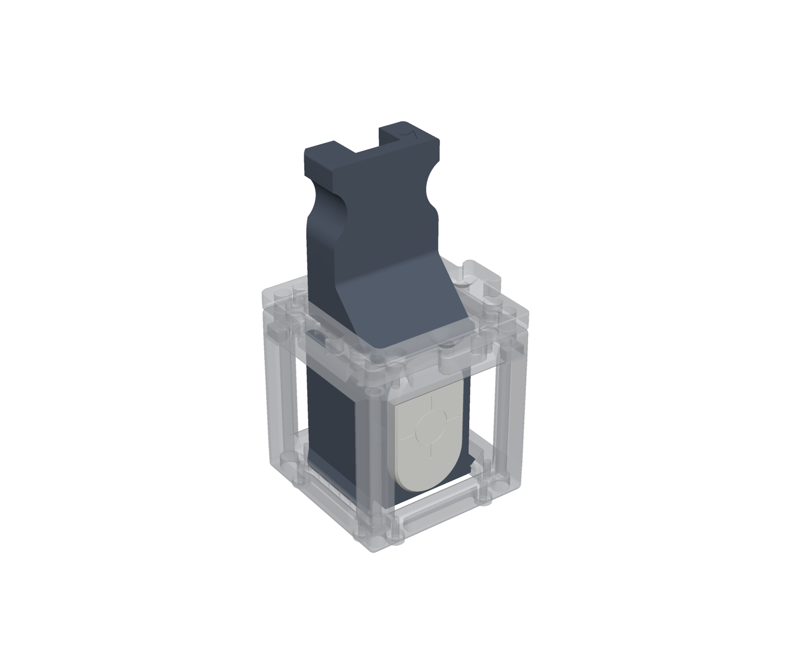
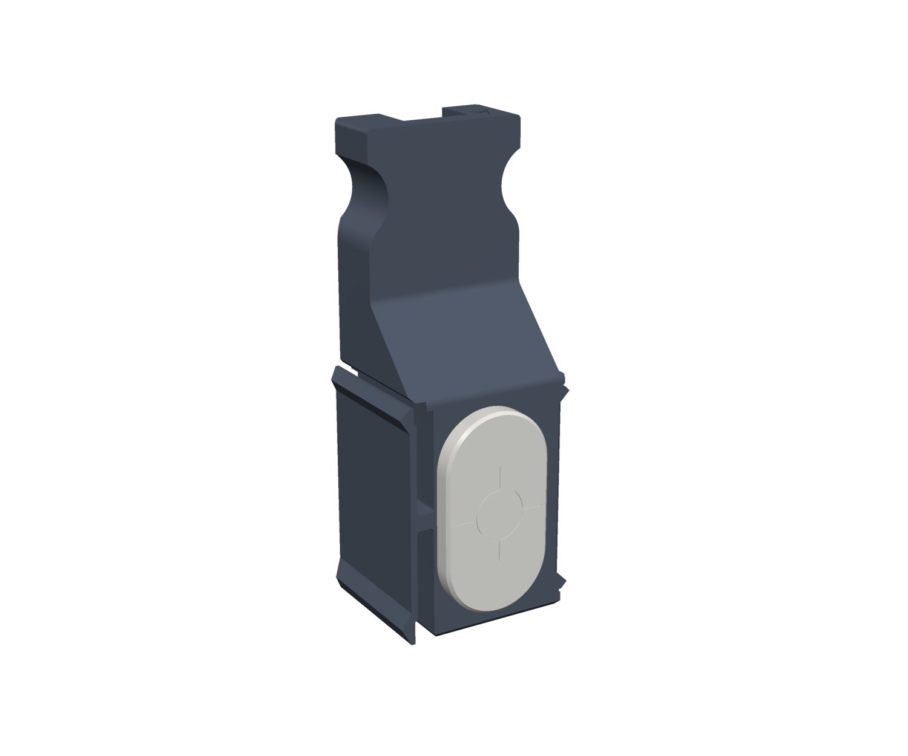
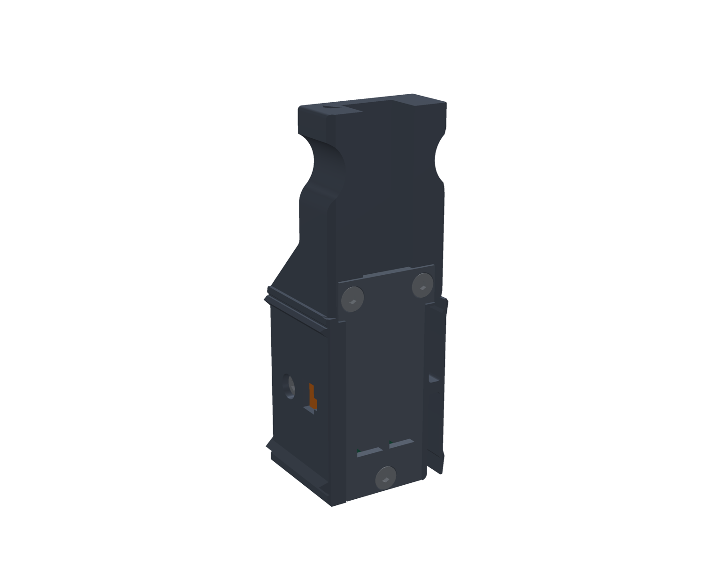
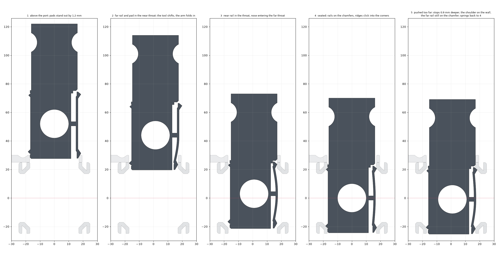
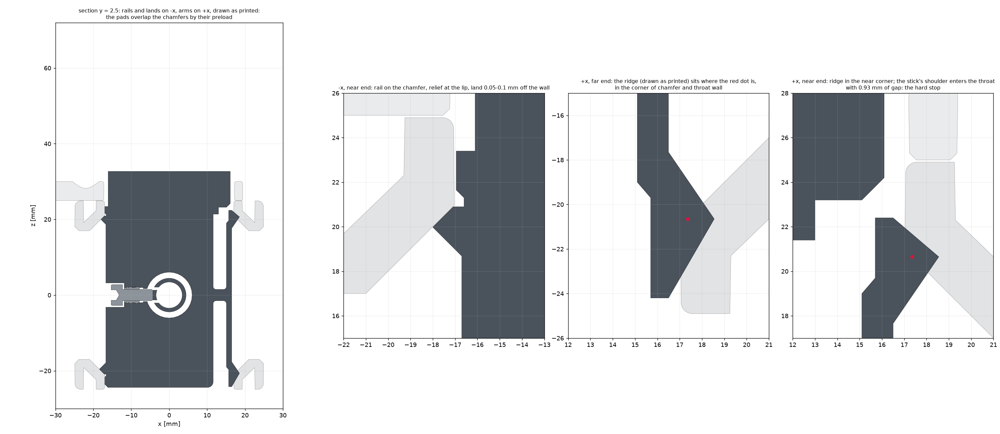
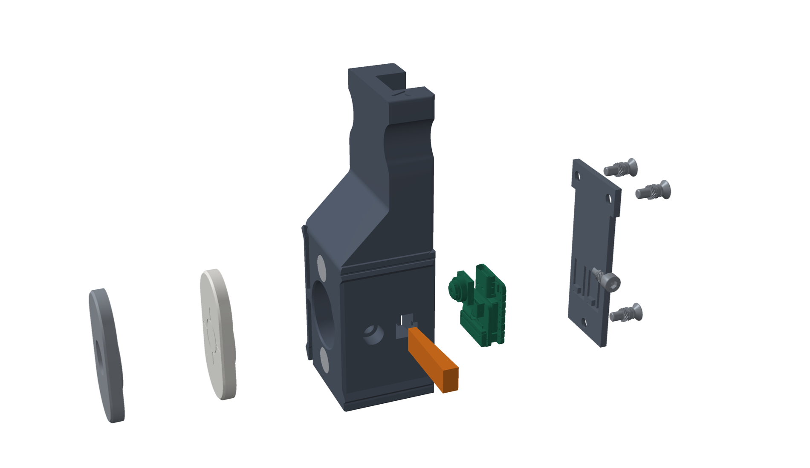
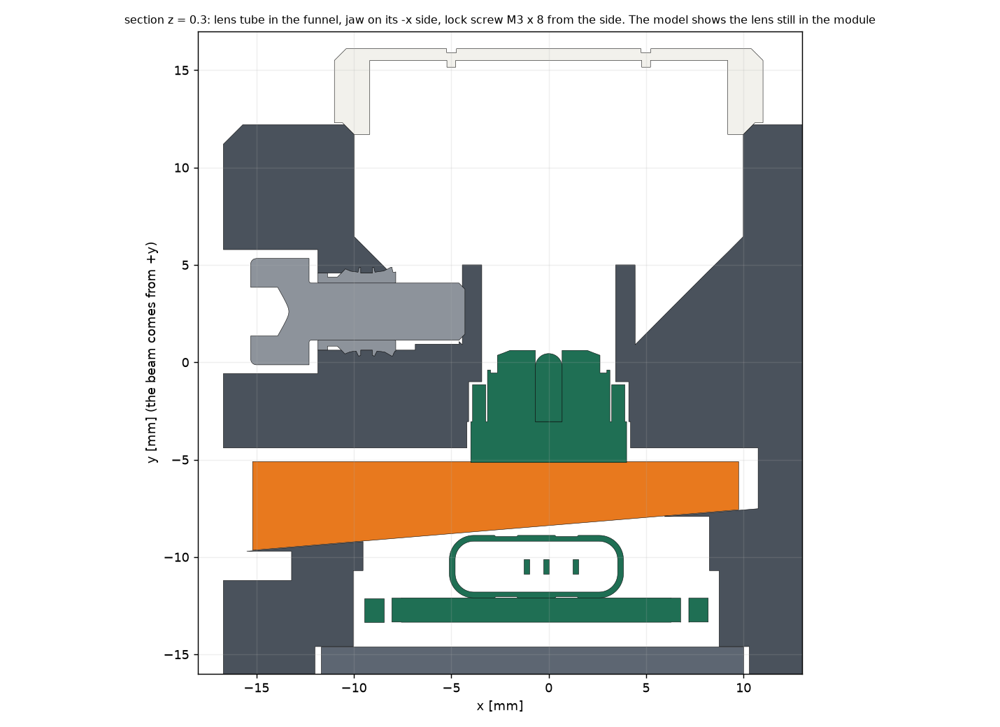

# XIAO beam target camera

Sources, STL files and Inventor parts: [openuc2-xiao-target-camera](https://github.com/openUC2/openuc2-xiao-target-camera).

A beam target for the openUC2 cube: a XIAO ESP32-S3 Sense in a printed tool. It slides into an empty cube from the top (with or
without a puzzle piece) or from the side, clicks into the cube's 45 degree edge chamfers and looks along the optical axis. The camera
sees a magnetic screen with a reticle (about 12 x 9 mm field), or the bare chip behind a magnetic ND cap. The 4 fold symmetry of the cube
lets the tool calibrate itself: read the beam from the top and from the side.

| Front | Back |
| --- | --- |
|  |  |

Status: the first print of the seat and the snap fit works. The changes of 2026-11-06 (screwed cover, more clearance around the board, external lens holder) are not printed yet.

## How it locates

Two rigid rails on one side sit on two chamfers like a V block and fix x and z. Two long flexure arms on the other side click into the two opposite
chamfers and push the rails home. Two rigid lands stand 0.05-0.1 mm off the throat walls and limit the rotation about the beam. If you push too far, the stick's
shoulder meets the near throat wall 0.9 mm past the seat, and the springs bring the tool back.

Details, numbers and checks: [design note](https://github.com/openUC2/openuc2-xiao-target-camera/blob/master/docs/xiao_target.md).

## Print

The STL files are in [`stl/`](https://github.com/openUC2/openuc2-xiao-target-camera/tree/master/stl). No supports.

| file | part | material | orientation |
| --- | --- | --- | --- |
| `PRT - 9040 - CAMTARXIA - V04.stl` | chassis | PETG (not PLA: the arms bend 1.7 %) | on the front face |
| `PRT - 9041 - CAMTARCOV - V04.stl` | back cover | PETG | on the back face |
| `PRT - 9033 - CAMTARKEY - V04.stl` | wedge key | PETG | on its side |
| `PRT - 9034 - CAMTARSCR - V04.stl` | screen cap | white PETG | on the screen |
| `PRT - 9035 - CAMTARNDF - V04.stl` | ND cap (optional) | PETG | on the front |

## Parts to buy

| what | count |
| --- | --- |
| Seeed Studio XIAO ESP32-S3 Sense | 1 |
| NdFeB magnet 8 x 3 mm | 4, or 6 with the ND cap (2 in the chassis, 2 per cap) |
| Ruthex thread insert M3 (RX-M3Sx4.0) | 4 |
| M3 x 10 countersunk screw, ISO 10642 | 3 |
| M3 x 8 cylinder head screw, ISO 4762 | 1 (lens lock) |
| USB-C cable with a slim plug, up to 12.4 x 6.6 mm | 1 |

## Assemble

1. Flash the firmware first: the buttons are out of reach afterwards.
2. Glue the magnets, mind the poles (section 5 of the [design note](https://github.com/openUC2/openuc2-xiao-target-camera/blob/master/docs/xiao_target.md)). Press in the four thread inserts: three in the back, one in the recess in the left wall.
3. Unscrew the lens completely from the camera module.
4. Put the module into its seat from the back and lay the XIAO into the pocket. No microSD card.
5. Push the wedge key in from the left until it stops, firm, not hard.
6. Put the cover on and fit its three M3 x 10 screws.
7. Slide the lens into the tube from the front, its rear end about 4 mm in front of the sensor, and tighten the lock screw in the left wall gently: it presses a thin jaw on the lens.
8. Plug in USB-C from the back of the stick, put the screen cap on and look at the live image. Loosen the lock, take the cap off and move the lens until the reticle is sharp; repeat a few times.
9. Push the tool into an empty cube until it clicks. To take it out, hold the cube, tip the stick toward the arms by 1-2 degrees and pull.

