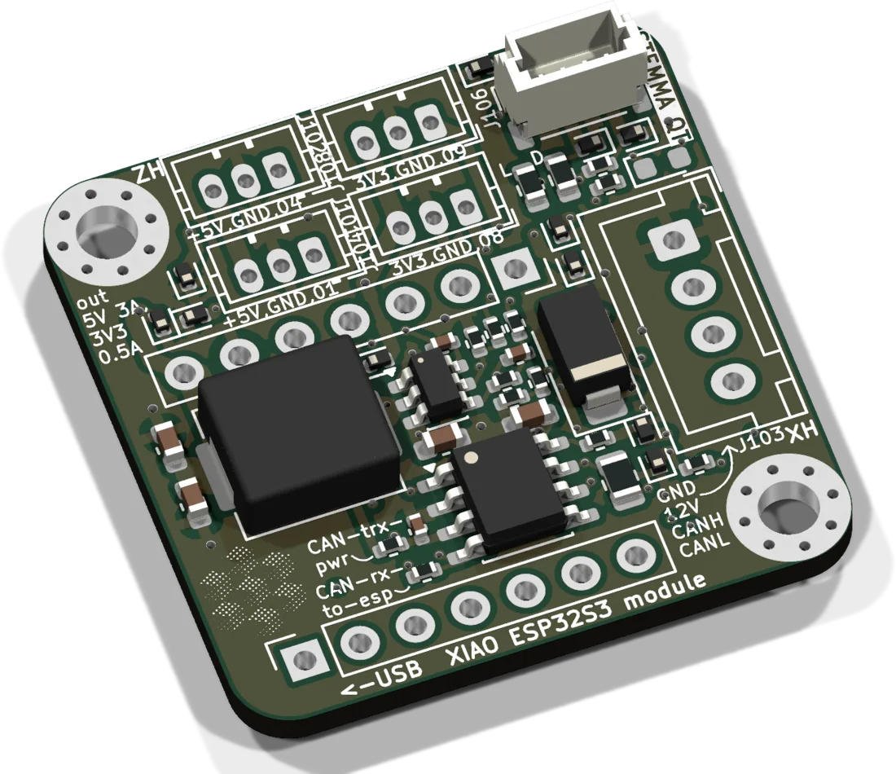
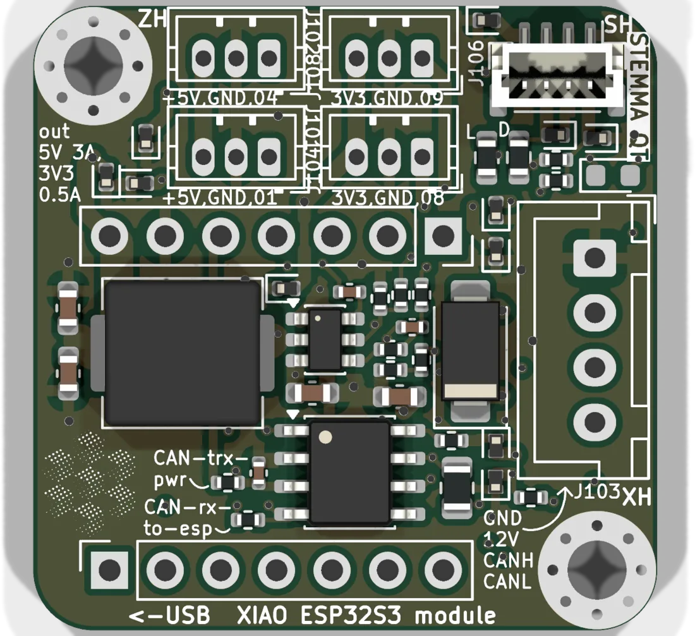

# CAN GPIO board



The smallest way to get your own hardware onto the FRAME bus. The board is a carrier for a XIAO ESP32-S3 with the same power and CAN front end as the [stepper backpack](../stepper-backpack/README.md), and it breaks the remaining pins out to small jacks. In the FRAME it reads the emergency-stop state and the objective collision sensor. It is also the board to start from for a new satellite.

| | |
|---|---|
| Current revision | Rev. A-2, 2026-04-06 |
| Controller | Seeed XIAO ESP32-S3 |
| Supply | 12 V from the bus, on-board buck to 5 V (TPS54302), 3.3 V from the XIAO (max. 700 mA) |
| Firmware | `UC2_canopen_slave_gpio`, in the [web flasher](../flashing.md) as "GPIO / E-stop satellite" |
| CAN node | 60 |
| Sources | [KiCad project](https://github.com/openUC2/FRAME-electronics-hardware/tree/main/kicad/can-gpio-esp) · [schematic PDF](https://github.com/openUC2/FRAME-electronics-hardware/blob/main/kicad/can-gpio-esp/OUTPUTS/for-humans/can-gpio-esp.pdf) {/* · <a href={require("./ibom-can-gpio-esp.html")} target="_blank">iBOM</a> */} |

## Connectors



| Ref | Type | Pin 1 → 3 (4) | XIAO pin |
|---|---|---|---|
| J103 | JST XH 4 | GND, +12 V, CAN_H, CAN_L | bus |
| J101 | JST ZH 3 | GPIO1, GND, **5 V** | D0 |
| J102 | JST ZH 3 | GPIO4, GND, **5 V** | D3 |
| J104 | JST ZH 3 | GPIO8, GND, 3.3 V | D9 |
| J108 | JST ZH 3 | GPIO9, GND, 3.3 V | D10 |
| J106 | JST SH 4 (STEMMA QT) | GND, 3.3 V, SDA, SCL | D4, D5 |

The ZH jacks have the pinout of the endstop jack on the stepper backpack (signal, GND, supply), so the same cables fit. Two of them supply 5 V and two 3.3 V. The signal level is 3.3 V on all of them. The XIAO pins are not 5 V tolerant.

The I2C lines have 2.2 kΩ pull-ups on the board.

## XIAO pinout

| XIAO pin | ESP32-S3 GPIO | On the board | In the firmware |
|---|---|---|---|
| D0 | 1 | J101 | digital output 1 |
| D1 | 2 | CAN RX | CAN RX |
| D2 | 3 | CAN TX | CAN TX |
| D3 | 4 | J102 | digital output 2 |
| D4 | 5 | I2C SDA, J106 | I2C bridge |
| D5 | 6 | I2C SCL, J106 | I2C bridge |
| D6 | 43 | header only | free (UART0 TX) |
| D7 | 44 | header only | free (UART0 RX) |
| D8 | 7 | header only | digital input 1 (E-stop) |
| D9 | 8 | J104 | free |
| D10 | 9 | J108 | collision sensor, ADC |

## Solder jumpers

| Jumper | When closed |
|---|---|
| JP502 | 120 Ω CAN termination. Close only at a physical end of the bus. |
| JP503 | CAN activity LED |
| JP501 | puts the CAN transceiver into standby (listen only) |
| JP101 | bridges the 12 V and 5 V nets, to run the board from 5 V. Never connect 12 V with this closed. |

## Firmware

| | |
|---|---|
| Env | `UC2_canopen_slave_gpio` |
| Pin map | [`main/config/UC2_canopen_slave_gpio/PinConfig.h`](https://github.com/youseetoo/uc2-esp32/blob/main/main/config/UC2_canopen_slave_gpio/PinConfig.h) |
| Bus | CANopen, 500 kbit/s, node 60 |
| USB | serial JSON over USB-CDC |

Flash it as described in [Flashing the firmware](../flashing.md). From the master, address the board with `"node":60`:

```json
{"task":"/digitalout_act","node":60,"digitaloutid":1,"digitaloutval":1}
{"task":"/gpio_get","node":60}
{"task":"/i2c_act","node":60,"addr":68,"write":[36,0],"read":6,"delay":10,"stop":1}
```

`/gpio_get` returns the collision detector state (raw and filtered ADC value, threshold, trip flag) and the E-stop input. The I2C bridge forwards up to 35 bytes written and 40 bytes read per call, which is enough to talk to most STEMMA QT sensors from ImSwitch without writing firmware. All fields: [serial command reference](../../../sw/interface/reference/serial-commands.md#digital-io).

## Using it for your own satellite

Copy `main/config/UC2_canopen_slave_gpio`, give the env a name and a node ID that is not in the [table of default IDs](../../../sw/interface/reference/boards-and-node-ids.md#default-node-ids), and enable the controllers you need. [Add a CAN satellite](../../../sw/interface/how-to/add-can-satellite.md) walks through the bus side.

{/* iBOM switched off for now
## iBOM
<iframe width="100%" style={{aspectRatio: "16 / 9"}} src={require("./ibom-can-gpio-esp.html")} title="CAN GPIO board iBOM"></iframe>
*/}

---

Boards: [shop.openuc2.com](https://shop.openuc2.com). Questions: [openuc2.discourse.group](https://openuc2.discourse.group).
