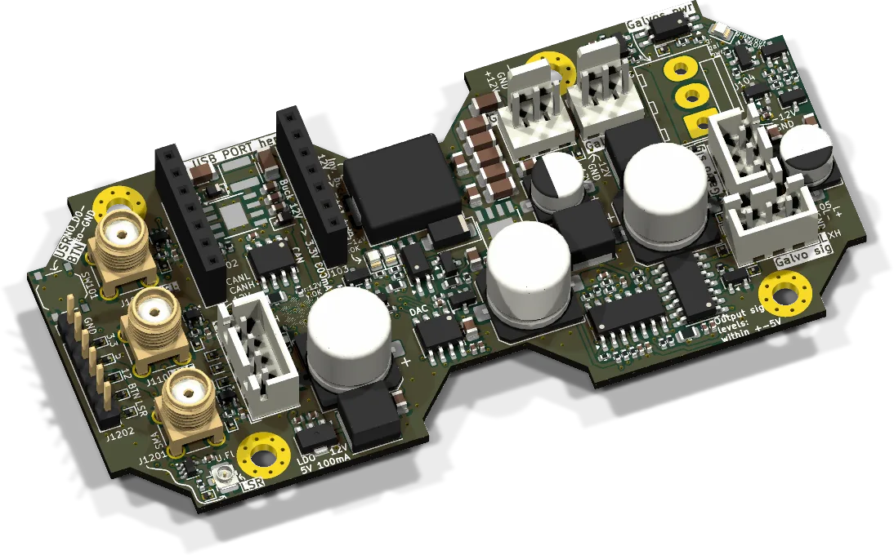
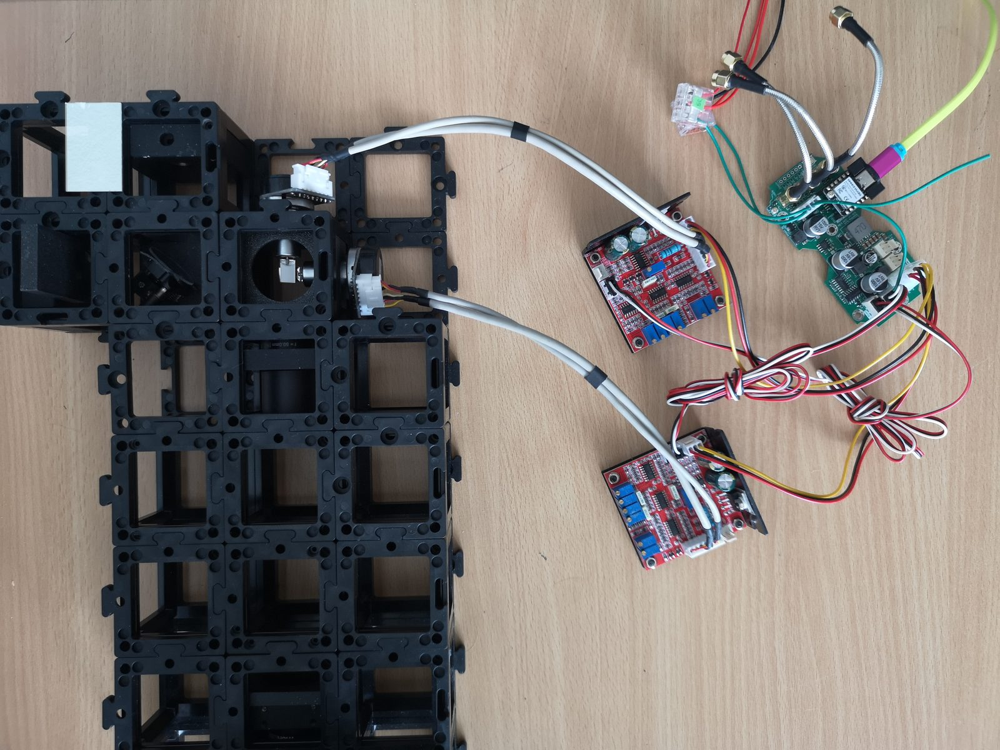
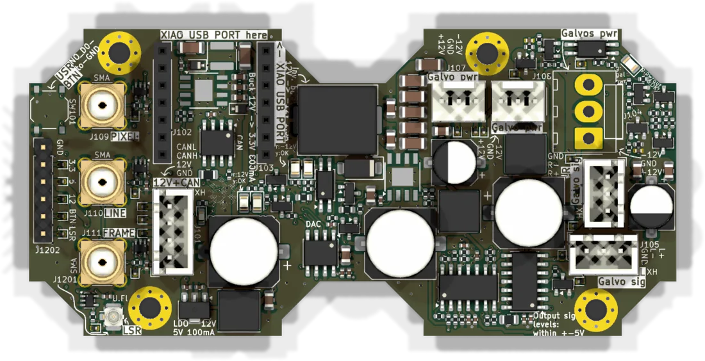
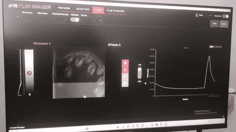

# Galvo interface



Drives the two driver boards of a galvo mirror pair. A XIAO ESP32-S3 generates the scan pattern and writes it to a 12-bit dual DAC. Op-amps turn the DAC voltage into the differential ±10 V signal that common galvo drivers expect. In sync with the scan, the board puts out pixel, line and frame triggers for a detector or a FLIM card. It also supplies the galvo drivers with ±12 V.

How to use it in a setup is covered in the [galvo add-on](../../../../usage/disc/galvo-addon/README.md). This page is the board reference.

| | |
|---|---|
| Current revision | Rev. B, 2026-09-25. Rev. A (2025-05) is electrically the same, with other reference designators and two extra holes. |
| Controller | Seeed XIAO ESP32-S3 |
| DAC | MCP4822, 2 × 12 bit, SPI |
| Outputs | X and Y, differential, ±10 V. Three 50 Ω trigger outputs. One 50 Ω laser blanking output. |
| Supply | 12 V from the bus. On board: 3.3 V, 5 V for the DAC and an inverting converter for −12 V. ±12 V are passed on, switched, to the galvo drivers. |
| Firmware | `UC2_canopen_slave_galvo`, in the [web flasher](../flashing.md) as "Galvo satellite" |
| CAN node | 40 |
| Sources | [KiCad project](https://github.com/openUC2/FRAME-electronics-hardware/tree/main/kicad/galvo-interface) · [schematic PDF](https://github.com/openUC2/FRAME-electronics-hardware/blob/main/kicad/galvo-interface/OUTPUTS/for-humans/galvo-interface.pdf) {/* · <a href={require("./ibom-galvo-interface.html")} target="_blank">iBOM</a> */} |



## Signal path

```text
XIAO ──SPI──> MCP4822 ──> op-amps (gain, offset, inverter) ──> X+ / X−, Y+ / Y−
  ├── pixel, line, frame ──> 50 Ω buffers ──> SMA
  ├── laser ──> 50 Ω buffer ──> U.FL
  └── CAN ──> SN65HVD230 ──> bus
```

Both DAC channels are written first and then latched together with LDAC, so X and Y change at the same instant.

## Connectors



Reference designators are those of Rev. B. On Rev. A they have an extra zero (J101 is J1001 there, and so on).

| Ref | Type | Pin 1 → n | Use |
|---|---|---|---|
| J101 | JST XH 4 | GND, +12 V, CAN_H, CAN_L | bus. 12 V and GND alone are enough to run the board from USB. |
| J105 | 3-pin | GND, L−, L+ | signal to galvo driver "L" |
| J106 | 3-pin | GND, R−, R+ | signal to galvo driver "R" |
| J107, J108 | 3-pin, 2.54 mm | −12 V, GND, +12 V | supply for the two galvo drivers |
| J104 | 3-pin, 3.96 mm | +12 V, GND, −12 V | same supply on the larger plug some drivers use. Note the reversed order. |
| J109 | SMA | pixel trigger | |
| J110 | SMA | line trigger | |
| J111 | SMA | frame trigger | |
| J1201 | U.FL | laser blanking | |
| SW101 | push button | D0 to GND | free for firmware use |

Check the pin order against the print on your galvo drivers before plugging in the supply. Swapping +12 V and −12 V destroys them.

## XIAO pinout

| XIAO pin | ESP32-S3 GPIO | Function |
|---|---|---|
| D0 | 1 | push button (enable the pull-up) |
| D1 | 2 | pixel trigger |
| D2 | 3 | line trigger |
| D3 | 4 | frame trigger |
| D4 | 5 | CAN TX |
| D5 | 6 | DAC LDAC |
| D6 | 43 | laser blanking |
| D7 | 44 | CAN RX |
| D8 | 7 | DAC SCK |
| D9 | 8 | DAC CS |
| D10 | 9 | DAC SDI |

## Solder jumpers

| Function | Rev. A | Rev. B |
|---|---|---|
| 120 Ω CAN termination. Close only at a physical end of the bus. | JP2001 | JP201 |
| CAN activity LED | JP2002 | JP202 |

## Firmware

| | |
|---|---|
| Env | `UC2_canopen_slave_galvo` |
| Pin map | [`main/config/UC2_canopen_slave_galvo/PinConfig.h`](https://github.com/youseetoo/uc2-esp32/blob/main/main/config/UC2_canopen_slave_galvo/PinConfig.h) |
| Scanner code | [`main/src/scanner/GalvoController.cpp`](https://github.com/youseetoo/uc2-esp32/blob/main/main/src/scanner/GalvoController.cpp) |
| Bus | CANopen, 500 kbit/s, node 40 |
| USB | serial JSON over USB-CDC |

Flash it as described in [Flashing the firmware](../flashing.md). If the XIAO does not accept the upload, hold BOOT while plugging it in.

Coordinates are DAC counts, 0 to 4095, with 2048 in the middle:

```json
{"task":"/galvo_act","galvo":{"x":2048,"y":2048}}
{"task":"/galvo_act","stop":true}
```

Raster scans and point lists are described in the [serial command reference](../../../sw/interface/reference/serial-commands.md#galvo_act) and in the add-on's [scan parameters](../../../../usage/disc/galvo-addon/reference/scan-parameters.md) and [trigger outputs](../../../../usage/disc/galvo-addon/reference/trigger-outputs.md).

## Bring-up

1. Connect 12 V. Without CAN the board still runs, controlled over USB.
2. Connect each galvo driver with its 3-pin supply and its signal cable.
3. Flash the firmware and start a slow scan.
4. Look at the pixel trigger on an oscilloscope to confirm the timing.
5. Tune the trim pots on the galvo drivers for minimal overshoot.



*A 512 × 512 scan, recorded with a FLIM LABS detector and pulsed laser.*

{/* iBOM switched off for now
## iBOM
<iframe width="100%" style={{aspectRatio: "16 / 9"}} src={require("./ibom-galvo-interface.html")} title="Galvo interface iBOM"></iframe>
*/}

---

Boards: [shop.openuc2.com](https://shop.openuc2.com). Questions: [openuc2.discourse.group](https://openuc2.discourse.group).

## Stand-alone scanner firmware (openUC2-LaserScanner)

Before the scanner became part of uc2-esp32 there was a small dedicated firmware. It has no CAN support, but it is short and a good starting point for experiments with the render loop. Source: [openUC2/openUC2-LaserScanner](https://github.com/openUC2/openUC2-LaserScanner/blob/main/src/main.cpp).

:::warning
Sometimes the XIAO cannot be flashed immediately, for this you have to press boot and reset while firmware is flashed - or erase the firmware first using this tool: https://espressif.github.io/esptool-js/
:::


| Layer                   | Key files                 | Function                                                                                                                                                                                               |
| ----------------------- | ------------------------- | ------------------------------------------------------------------------------------------------------------------------------------------------------------------------------------------------------ |
| **Application**         | `src/main.cpp`            | Instantiates `SPIRenderer`, updates parameters in a `while(1)` loop, and calls `start()`; disables the watchdog and raises log level to warn for GPIO. ([GitHub][1])                                   |
| **Render Engine**       | `src/SPIRenderer.{h,cpp}` | Converts image geometry into DAC samples, handles SPI transfers, and asserts pixel/line/frame triggers with single–cycle GPIO writes. Implements `setParameters()`, `draw()`, `start()`. ([GitHub][2]) |
| **Board-select macros** | same header               | `IS_XIAO`, `IS_XIAO_UC2GALVOBOARD` choose the correct pin map at compile time. ([GitHub][3])                                                                                                           |
| **Build system**        | `platformio.ini`          | Two build environments: **esp32dev** (generic) and **UC2\_3\_Xiao** (Seeed XIAO ESP32-S3). Both use ESP-IDF with Arduino component; UART at 921 kbit s⁻¹. ([GitHub][4])                                |

### 1  File structure

```
openUC2-LaserScanner
├── src/                 # C++ sources
│   ├── main.cpp         # app_main() entry point
│   ├── SPIRenderer.cpp  # raster engine
│   └── SPIRenderer.h
├── include/             # (optional) extra headers
├── lib/                 # third-party libs, e.g. UC2-CAN
├── python/              # helper scripts (ILDA, LUT generation)
├── KICAD/               # electrical design
├── platformio.ini       # build targets
└── sdkconfig.*          # pre-tuned IDF configs
```

### 2  Build flow (PlatformIO)

1. Select **UC2\_3\_Xiao**  in *platformio.ini*.
2. `pio run` → ESP-IDF CMake → compile + link with Arduino component.
3. `pio run -t upload` flashes over USB-CDC (921 kbit s⁻¹).
4. Partition scheme `custom_partition_esp32s3.csv` reserves PSRAM cache and 1 MiB for OTA.

### 3  Runtime tasks

| Task                          | Core affinity | Duty                                                                         |
| ----------------------------- | ------------- | ---------------------------------------------------------------------------- |
| **mainTask (app\_main)**      | core 0        | parameter sweep, calls renderer, yields 10 ms to scheduler.                  |
| **IDF idle0/1**               | core 0/1      | housekeeping (watchdog disabled for main).                                   |
| Additional tasks (*optional*) | —             | CAN listener, WebSocket, or CLI can be added; use `xTaskCreatePinnedToCore`. |

The code presently runs everything in the foreground; heavy processing (e.g. CAN command parsing) should be off-loaded to a FreeRTOS task to keep the raster loop deterministic.

### 4  SPIRenderer workflow

```text
constructor()
  ├─ configure GPIO for laser, LDAC, triggers
  ├─ initialise SPI3 @20 MHz (XIAO) or HSPI (generic)
  └─ pre-compute nX, nY from (X_MIN…X_MAX)/STEP

start()
  └─ draw()

draw()
  for each frame
    assert all triggers high    ← frame start
    for X = X_MIN…X_MAX
      for Y = Y_MIN…Y_MAX
        clear triggers
        hold LDAC low
        SPI out 16-bit word to DAC-A (X)
        SPI out 16-bit word to DAC-B (Y)
        release LDAC                ← both axes latch simultaneously
        set pixel trigger, delay tPixelDwelltime µs
    issue line trigger each X-loop
  clear all triggers              ← frame end
```

* **Timing** – `esp_rom_delay_us()` delivers sub-µs waits; replace with a hardware timer ISR for dwell times &lt;5 µs.
* **Throughput** – one SPI transaction per axis, LDAC latched once per pixel → 2 × 16 bits @ 20 MHz ≈ 1.6 µs transfer; 512×512 raster ≈ 0.42 s per frame exclusive of galvo settling.
* **Triggers** – 50 Ω back-termination; rising edge marks *start* of integration for FLIM/PMT cards.

### 5  Customisation hooks

| Use case                 | Modification                                                                                                                        |
| ------------------------ | ----------------------------------------------------------------------------------------------------------------------------------- |
| **Different image size** | call `setParameters()` with new limits/step; renderer recomputes nX/nY without reallocating.                                        |
| **External control**     | add a CAN listener task that writes into a shared parameters struct guarded by a mutex; call `renderer->start()` from that task.    |
| **Scan patterns**        | replace the two nested `for` loops with a lookup table of `(x,y)` pairs (e.g. spiral, Lissajous).                                   |
| **Higher speed**         | use queued (`spi_device_queue_trans`) DMA transfers and toggle LDAC from SPI post-trans callback to overlap SPI and galvo settling. |

### 6  Pin map (compile-time)

| Signal          | GPIO (UC2-Galvo) | GPIO (bare XIAO) |
| --------------- | ---------------- | ---------------- |
| **MOSI**        | 9                | 7                |
| **SCK**         | 7                | 8                |
| **CS**          | 8                | 9                |
| **LDAC**        | 6                | 6                |
| **TRIG PIXEL**  | 2                | 2                |
| **TRIG LINE**   | 3                | 3                |
| **TRIG FRAME**  | 4                | 4                |
| **LASER blank** | 43               | 43               |

Defined in `SPIRenderer.h`; switch boards via `-DIS_XIAO_UC2GALVOBOARD` or `-DIS_XIAO` build flag. ([GitHub][3])

### 7  Extending the firmware

* **Finite-state machine** – wrap the renderer in a state class (IDLE, SCANNING, PAUSED).
* **Streaming points** – replace the nested loops by a ring buffer filled by CAN/UART for arbitrary point lists.
* **Persistent settings** – store last used scan parameters to NVS (`nvs_flash.h`) and recall on boot.
* **Web OTA** – enable `esp_https_ota` component and reserve second app partition (already present in `custom_partition_esp32s3.csv`).

---

[1]: https://raw.githubusercontent.com/openUC2/openUC2-LaserScanner/main/src/main.cpp "raw.githubusercontent.com"
[2]: https://raw.githubusercontent.com/openUC2/openUC2-LaserScanner/main/src/SPIRenderer.cpp "raw.githubusercontent.com"
[3]: https://raw.githubusercontent.com/openUC2/openUC2-LaserScanner/main/src/SPIRenderer.h "raw.githubusercontent.com"
[4]: https://raw.githubusercontent.com/openUC2/openUC2-LaserScanner/main/platformio.ini "raw.githubusercontent.com"
