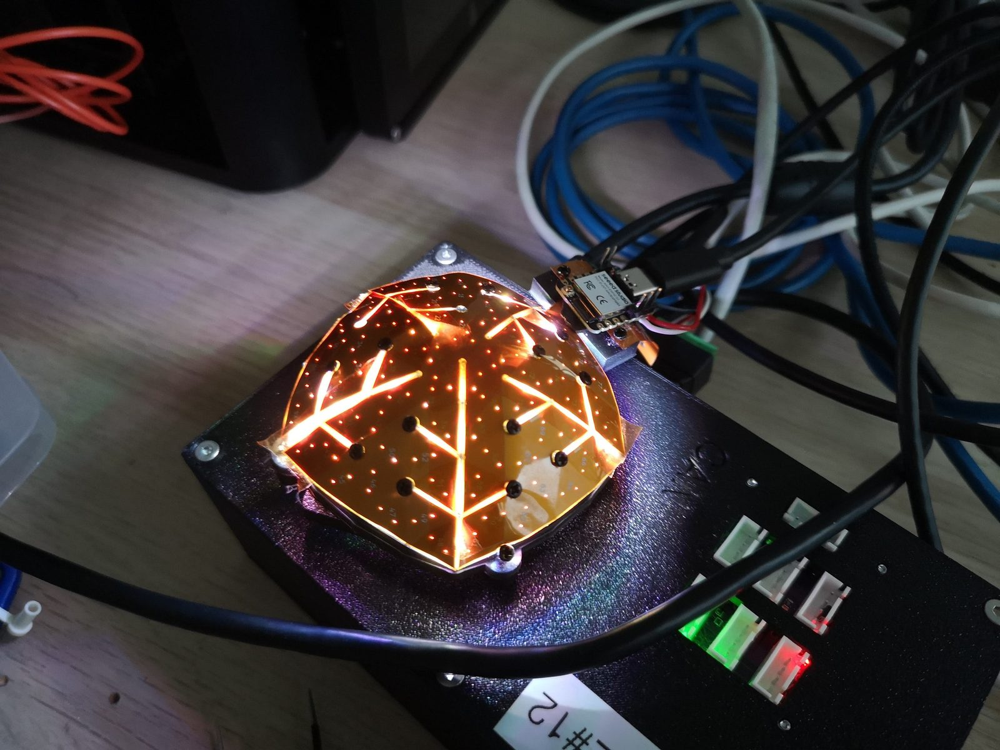
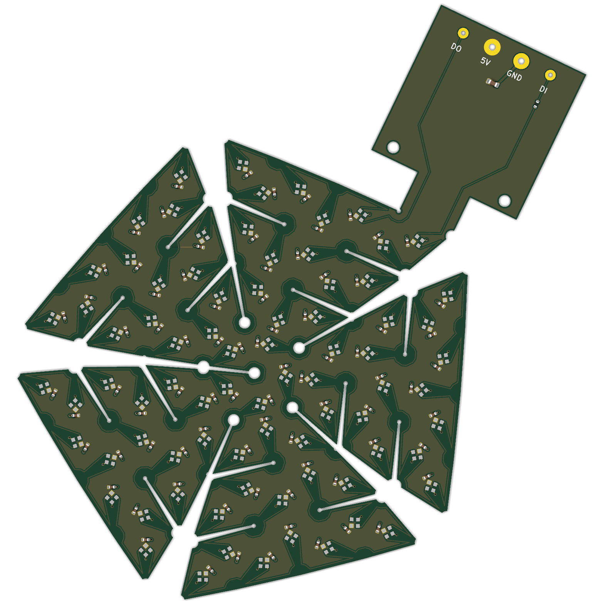
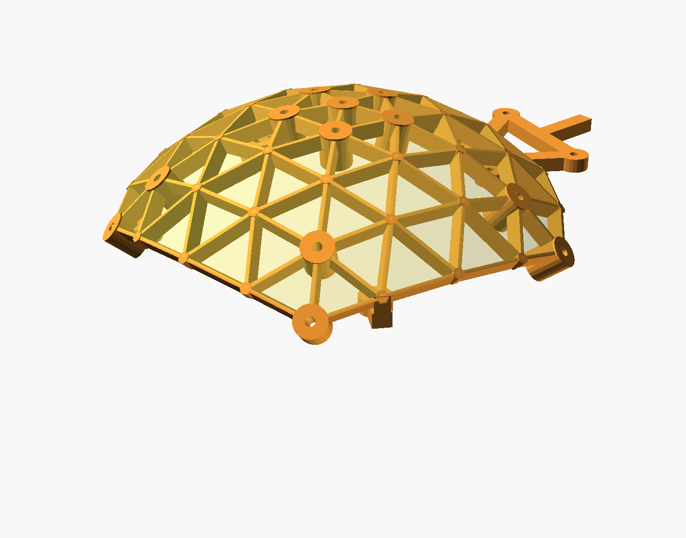

# Geodesic LED dome

:::caution Experimental
This is a prototype, not a product. It is here because it shows how quickly an idea can become hardware: one Python script writes the KiCad board, the assembly files, the LED coordinates and the printable holder. The first board has been folded and lights up. There is no dedicated firmware or ImSwitch support yet.
:::

A two-layer flex PCB that is cut so that it folds into a geodesic dome. Every facet carries one addressable RGB LED, and every LED looks at the centre of the sphere, where the sample is. Each LED lights the sample from a different, known angle: brightfield, darkfield, DPC and Fourier ptychography from one light source, up to 81° from the optical axis. The flat [illumination board](../illumination/README.md) of the FRAME does the same with four rings.

| | |
|---|---|
| Status | Rev. A, autumn 2026, first samples built |
| LEDs | 221 × SK6812-EC20 in one chain, the same LED as on the illumination board |
| Dome | 76 mm diameter, LEDs 38.2 mm from the focus |
| Illumination angle | 0 to 81° from the axis (NA up to 0.99) |
| Board | 2-layer flex, 114 × 150 mm flat, 0.11 mm thick |
| Supply | 5 V. All LEDs at full white would draw about 8 A, so brightness has to be limited in software. |
| Sources | [generator script, board and holder](https://github.com/openUC2/FRAME-electronics-hardware/tree/main/kicad/openuc2-geodesic-ledring) |

## How it is made

The facets of the dome are unfolded into five petals that hang off the top. Edges that stay connected are fold lines, all others are laser-cut slits. Copper runs across the folds on both layers: +5 V on the inside with the LEDs, a ground plane on the outside. The data line walks once around the whole outline, so data in and data out both end up on the connector tail.

The flex is screwed with M2 screws onto a 3D-printed frame that has a thin rib under every edge and leaves every LED free.

Size, maximum angle and LED density are parameters of the script. A flatter dome with a smaller NA gets a larger radius and more LEDs within the angle that the objective actually uses. The script also writes `led_positions.csv` with the real position and angle of every LED, which is what a reconstruction needs.

## Wiring

Four solder pads on the tail:

| Pad | Function |
|---|---|
| DI | data in, 3.3 to 5 V logic, 470 Ω series resistor on the board |
| GND | ground |
| 5V | +5 V, use wire of AWG 22 or thicker |
| DO | end of the chain, for a loop-back test or a following device |

To the controller it is an ordinary SK6812 / NeoPixel chain with 221 pixels in GRB order. Any board with a NeoPixel output can drive it for a test, for example the [standalone board](../uc2-standalone-board/README.md) or a bare XIAO. Mind the current: the 5 V has to come from a supply that can deliver it, not from a USB port.

## More

Build, ordering and assembly instructions are in the [README of the project](https://github.com/openUC2/FRAME-electronics-hardware/blob/main/kicad/openuc2-geodesic-ledring/README.md). Progress notes are on the [in-progress page](../../../in-progress/led-dome/README.md).

---

Questions and ideas: [openuc2.discourse.group](https://openuc2.discourse.group).
