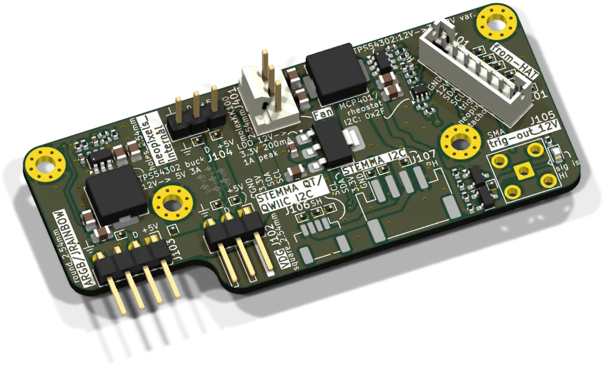
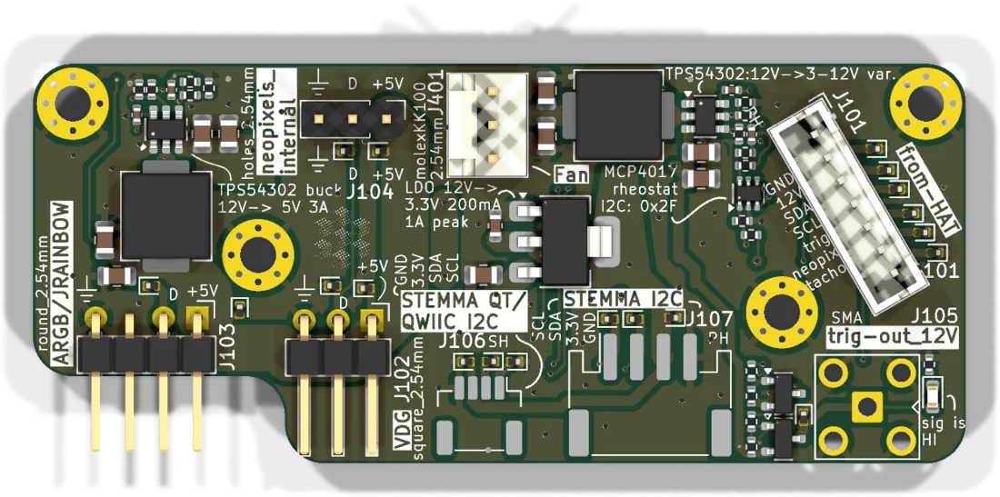

# HAT+ panel board

The [HAT+](../hat-plus/README.md) sits on the Raspberry Pi inside the base. The panel board brings the signals that users plug things into out to the housing: the camera trigger, a fan, addressable LEDs and an I2C expansion port. It has no microcontroller. Everything on it is driven by the ESP32 on the HAT+ through one 7-pin cable.

| | |
|---|---|
| Current revision | Rev. B, 2026-04-06 |
| Supply | 12 V from the HAT+. Own bucks for 5 V / 3 A (LEDs) and the fan, LDO for 3.3 V |
| Firmware | none of its own. Uses the HAT+ firmware `UC2_canopen_master`. |
| Sources | [KiCad project](https://github.com/openUC2/FRAME-electronics-hardware/tree/main/kicad/hat-panelboard) · [schematic PDF](https://github.com/openUC2/FRAME-electronics-hardware/blob/main/kicad/hat-panelboard/OUTPUTS/for-humans/hat-panelboard.pdf) {/* · <a href={require("./ibom-hat-panelboard.html")} target="_blank">iBOM</a> */} |

## Connectors

| Ref | Type | Pin 1 → n | Use |
|---|---|---|---|
| J101 | JST PH 7 | GND, +12 V, SDA, SCL, camera trigger, NeoPixel, fan tacho | from the HAT+ (J2201 there, same pin order) |
| J105 | SMA | trigger, GND | trigger into the camera |
| J401 | 3-pin fan header | GND, fan supply, tacho | fan |
| J102, J103 | 3-pin, 2.54 mm | +5 V, data, GND | addressable LEDs. J102 is the plain "VDG" header, J103 the keyed ARGB style used on PC mainboards. J104 is a third, unpopulated footprint. |
| J107 | JST PH 4 (STEMMA) | SCL, SDA, 3.3 V, GND | I2C expansion |
| J106 | JST SH 4 (STEMMA QT) | SCL, SDA, 3.3 V, GND | I2C expansion |

## Signals and where they come from

| Signal | HAT+ ESP32 GPIO | Notes |
|---|---|---|
| I2C SDA / SCL | 21 / 22 | pull-ups are on the HAT+. The fan potentiometer is on this bus too. |
| camera trigger | 27 | |
| NeoPixel data | 19 | continues the chain that starts at the status LED on the HAT+ |
| fan tacho | 33 | open-drain output of the fan |

## Camera trigger

The ESP32 pin is a 3.3 V output. Industrial cameras such as the HIKROBOT models used in the FRAME have an opto-isolated input that wants at least 5 V. The panel board therefore switches a 12 V level onto the SMA jack (NPN stage driving a P-channel MOSFET), which goes to the high side of the camera's optocoupler. The series resistor is inside the camera.

Only the trigger *into* the camera (Line 0) is implemented. Camera outputs (Line 1, Line 2) are not wired on this revision.

Cable for HIKROBOT cameras: opto input, pin 2 (yellow), to the SMA centre. Opto ground, pin 5 (white), to the SMA shield.

## Fan

The fan header gives a variable supply voltage instead of PWM. A buck converter makes roughly 3 to 12 V. Its feedback divider contains an MCP4017 digital potentiometer (I2C address 0x2F, 128 steps), so the ESP32 sets the fan speed with one I2C write. The tacho signal goes back to the HAT+.

## LED headers

5 V, up to 3 A in total, from the board's own buck. The data line carries 3.3 V logic. The two header styles exist because ARGB accessories for PCs come with either plug. Electrically they are the same.

## STEMMA

3.3 V and I2C, 200 mA continuous. Do not enable additional pull-ups on the module you connect.

{/* iBOM switched off for now
## iBOM
<iframe width="100%" style={{aspectRatio: "16 / 9"}} src={require("./ibom-hat-panelboard.html")} title="Panel board iBOM"></iframe>
*/}

---

Boards: [shop.openuc2.com](https://shop.openuc2.com). Questions: [openuc2.discourse.group](https://openuc2.discourse.group).
