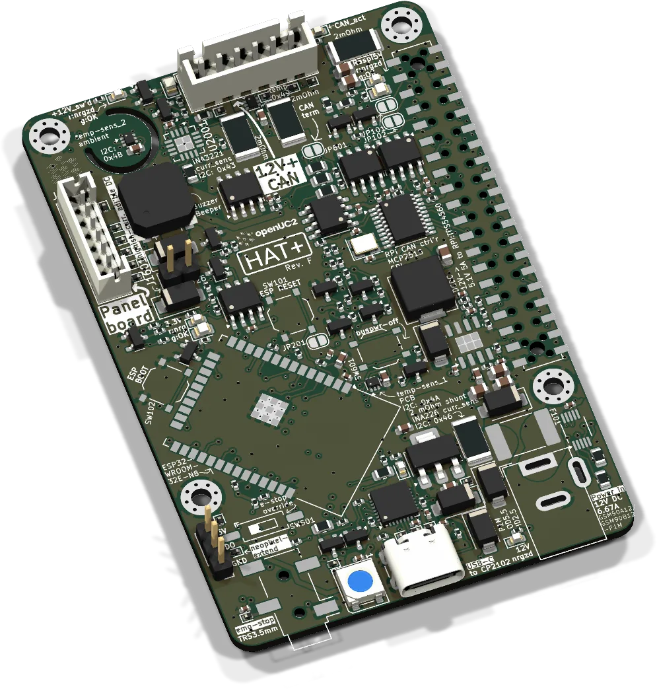
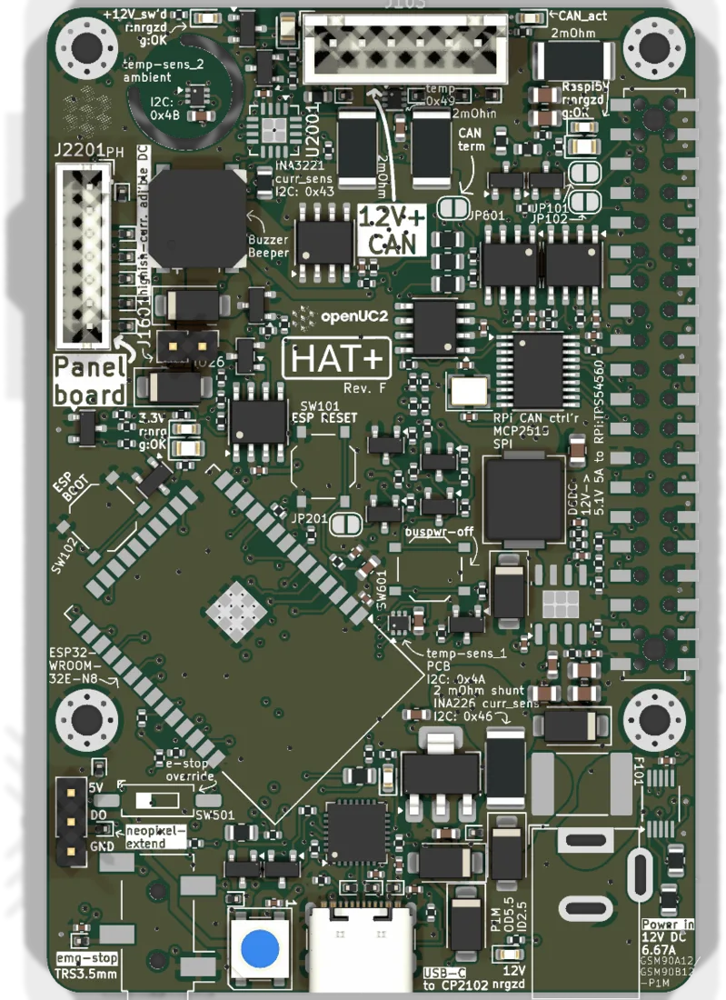

# HAT+



The mainboard of the FRAME. It plugs onto the 40-pin header of a Raspberry Pi 5 (an NVIDIA Jetson with the same header works too) and does three jobs:

- **Power.** 12 V come in through the barrel jack. A 5.1 V / 5 A buck feeds the Pi through the header, so the Pi needs no supply of its own.
- **Safety.** The 12 V that go out to the motors, lasers and LEDs pass a switch that opens on emergency stop, on a button on the board, or on command from the ESP32 or the Pi.
- **Bus master.** An ESP32 on the HAT runs the CANopen master. ImSwitch on the Pi sends it serial JSON, and it routes every command to the right satellite. The Pi also has its own CAN controller (MCP2515) on the same bus.

| | |
|---|---|
| Current revision | Rev. F, 2026-10-21. Rev. D and E ("v2") are in FRAMEs shipped so far. |
| Controller | ESP32-WROOM-32E, 8 MB flash, USB-C through a CP2102 |
| Supply | 12 V DC, barrel jack 5.5 / 2.5 mm, 7 A resettable fuse. Recommended: MeanWell GSM90A12-P1M. |
| Firmware | `UC2_canopen_master`, in the [web flasher](../flashing.md) as "HAT+ ESP32 (CAN master)" |
| CAN node | 1 |
| Serial | 921600 baud, on USB-C and in parallel on the Pi's UART (pins 8 / 10) |
| Sources | [KiCad project](https://github.com/openUC2/FRAME-electronics-hardware/tree/main/kicad/hatplus-for-raspberrypi-5) · [schematic PDF](https://github.com/openUC2/FRAME-electronics-hardware/blob/main/kicad/hatplus-for-raspberrypi-5/OUTPUTS/for-humans/hatplus-for-raspberrypi-5.pdf) {/* · <a href={require("./ibom-hatplus-for-raspberrypi-5.html")} target="_blank">iBOM (Rev. F)</a> */} |

The detailed description, section by section (power path, emergency stop, sensors, buzzer, Linux setup, solder jumpers), is on the [v2 page](./v2/README.md). The first series is documented under [v1](./v1/README.md).



## ESP32 pinout

Same on Rev. D, E and F.

| GPIO | Function |
|---|---|
| 4 | bus power off when high |
| 17 | CAN TX |
| 18 | CAN RX |
| 19 | NeoPixel data (status LED on the board, continues to the panel board) |
| 21, 22 | I2C SDA, SCL: sensors, panel board |
| 25 | buzzer |
| 27 | camera trigger, to the [panel board](../hat-panelboard/README.md) |
| 33 | fan tacho, from the panel board |
| 34 | emergency-stop sense |
| 35 | ALERT from the temperature and current sensors |

All other GPIOs are on test points. The Raspberry Pi side (UART, SPI to the MCP2515, bus-power pin, auto-program lines) is in the [v2 page](./v2/README.md#31-raspberry-pi-interface-physical-pin-numbers).

## Bus connector

| Revision | Jack | Pin 1 → n |
|---|---|---|
| up to E | JST XH 4 | GND, +12 V switched, CAN_H, CAN_L |
| F | JST XH 6 (J103) | GND, +12 V (1), GND, +12 V (2), CAN_H, CAN_L |

One XH contact carries 3 A. That was the limit for a fully equipped FRAME, so Rev. F brings the 12 V out on two pin pairs and measures both. The matching 6-pin input is on the [connector hub](../wiring-boards/README.md#connector-hub) from Rev. E on. A 4-pin plug still fits the 6-pin jack after one of its coding noses is cut off.

The cable to the panel board is a JST PH 7 (J2201): GND, +12 V, SDA, SCL, camera trigger, NeoPixel, fan tacho.

## Emergency stop

A 3.5 mm TRS jack takes an external box with a normally-closed stop button between tip and ring. An LED in the box can be connected between tip and sleeve (3.3 V, 20 mA at most, resistor in the box). Without a closed contact there is no bus power. From Rev. D on there is an override switch (SW501) for running the board without a stop box on the bench. It defeats the emergency stop, so it does not belong in a machine that is in use.

## Solder jumpers (Rev. D to F)

| Jumper | When closed |
|---|---|
| JP801 | 120 Ω CAN termination. Open by default. Close it if the HAT+ is at one physical end of the bus. |
| JP802 | CAN activity LED |
| JP101, JP102 | connect the Pi's I2C-1 to the ESP32's I2C bus |
| JP201 | ESP32 and Pi can no longer switch bus power off. For troubleshooting only. |
| JP601 | bus power always on, emergency stop included. For troubleshooting only. |

## Firmware

| | |
|---|---|
| Env | `UC2_canopen_master` |
| Pin map | [`main/config/UC2_canopen_master/PinConfig.h`](https://github.com/youseetoo/uc2-esp32/blob/main/main/config/UC2_canopen_master/PinConfig.h) |
| Bus | CANopen master, node 1, 500 kbit/s |
| Default routing | motors A / X / Y / Z to nodes 10 to 13, lasers 0 to 3 to node 20, LED array and laser 4 to node 30, galvo to node 40, digital I/O to node 60 |

Flash it over the USB-C port of the HAT as described in [Flashing the firmware](../flashing.md). In a FRAME running ImSwitch OS, the Pi can also do it without a cable through its UART and the auto-program lines.

Check that it is alive (921600 baud):

```json
{"task":"/state_get"}
{"task":"/route_get"}
{"task":"/state_act","power":1}
```

The last line switches bus power on, `"power":0` switches it off. The routing table and all node IDs are explained in [Boards, roles & node IDs](../../../sw/interface/reference/boards-and-node-ids.md). Talking to the bus from Linux without the ESP32: [CANopen from the Raspberry Pi](../../../sw/interface/tutorials/canopen-from-raspberry-pi.md).

## Revisions

| Rev. | Date | Changes |
|---|---|---|
| [v1](./v1/README.md) | 2024-11 to 2025 | first series. CAN termination on JP1001. |
| D ("[v2](./v2/README.md)") | 2025-08 | current and temperature sensors, emergency-stop sense on the ESP32, override switch for the stop loop, matching panel board |
| E | 2026-04 | EEPROMs for HAT+ identification fixed |
| F | 2026-10 | 6-pin bus jack with two 12 V outputs, three-channel current sensor (INA3221) to monitor them, third temperature sensor, ESP32 module with external antenna |

{/* iBOM switched off for now
## iBOM (Rev. F)
<iframe width="100%" style={{aspectRatio: "16 / 9"}} src={require("./ibom-hatplus-for-raspberrypi-5.html")} title="HAT+ iBOM"></iframe>
*/}

---

Boards and complete FRAMEs: [shop.openuc2.com](https://shop.openuc2.com). Questions: [openuc2.discourse.group](https://openuc2.discourse.group).
