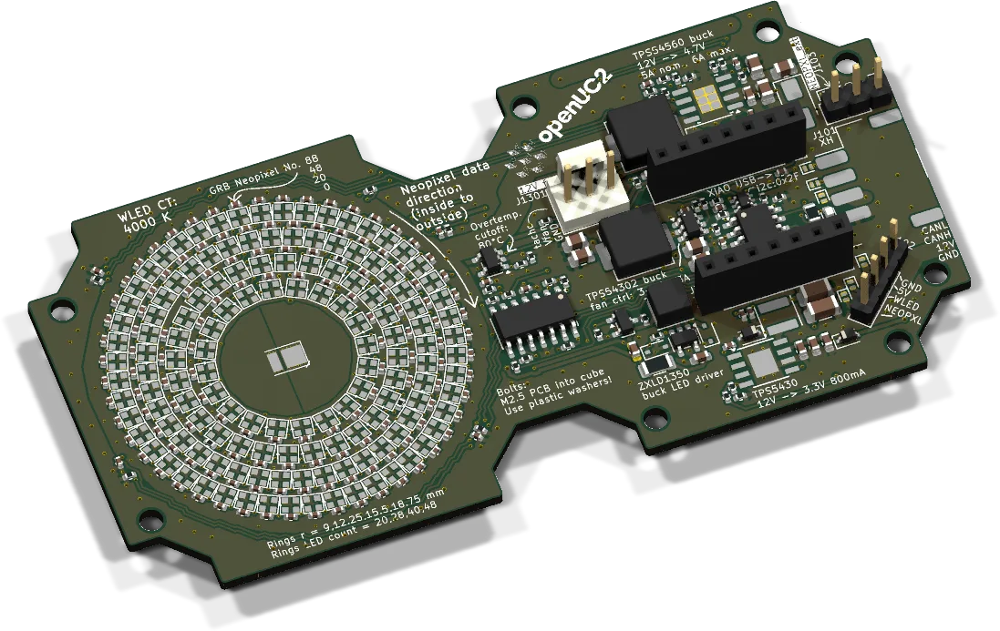
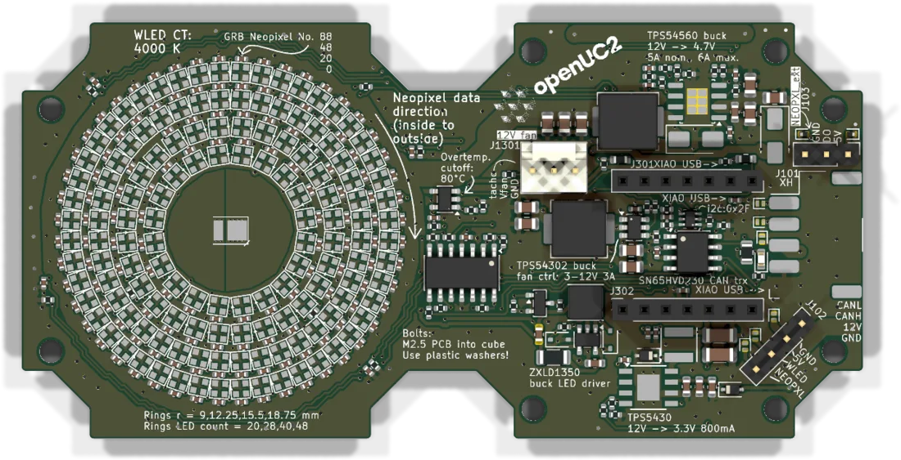

# Illumination board



The light source above the sample. Four concentric rings of addressable RGB LEDs give brightfield, darkfield, DPC and other angle-coded patterns. A white 4000 K power LED in the centre does plain brightfield. A XIAO ESP32-S3 drives both and listens on CAN.

| | |
|---|---|
| Current revision | Rev. F, 2026-10-21 (adds the strobe switch). Rev. D and E are in shipped FRAMEs. |
| Controller | Seeed XIAO ESP32-S3 |
| RGB LEDs | 136 × SK6812-EC20 in 4 rings |
| White LED | 3-chip 2835, constant current 100 mA (ZXLD1350), PWM dimmed |
| Supply | 12 V from the bus. On-board buck (TPS54560) makes 4.7 V / 5 A for the LEDs |
| Firmware | `UC2_canopen_slave_led`, in the [web flasher](../flashing.md) as "LED / illumination satellite" |
| CAN node | 30. One node for both: the rings are the LED array, the white LED is laser id 4 on the masters. |
| Sources | [KiCad project](https://github.com/openUC2/FRAME-electronics-hardware/tree/main/kicad/illumination) · [schematic PDF](https://github.com/openUC2/FRAME-electronics-hardware/blob/main/kicad/illumination/OUTPUTS/for-humans/illumination.pdf) {/* · <a href={require("./ibom-illumination.html")} target="_blank">iBOM</a> */} |

## LED rings

| Ring | LEDs | Radius |
|---|---|---|
| inner ("Zernike") | 20 | 9.0 mm |
| middle | 28 | 12.25 mm |
| big | 40 | 15.5 mm |
| outer | 48 | 18.75 mm |

The data line runs from the inside to the outside, so LED index 0 is on the inner ring. The centre of the board is open for the white LED and its optics.

All 136 LEDs at full white would draw about 5.4 A, more than the 5 A the buck delivers. Keep full-white patterns below full brightness, or light only some of the rings. The LED rail is 4.7 V on purpose: the 3.3 V data signal from the XIAO is then still read as high by the SK6812.

## Connectors



| Ref | Type | Pin 1 → n | Use |
|---|---|---|---|
| J101 | JST XH 4, SMD side entry | CAN_L, CAN_H, +12 V, GND | bus. The pad numbers of this footprint run the other way round than on the through-hole jacks of the other boards. Go by the silkscreen, not by the pin number. |
| J102 | 4-pin header | GND, +5 V, DIM_WLED, NEOPIXEL | LED rail and both control signals, for driving an external light source or feeding signals in |
| J103 | 3-pin header (VDG) | +5 V, data, GND | NeoPixel chain continues here |
| J1301 | 3-pin fan header | GND, fan supply, tacho | fan. Supply voltage set by an MCP4017 digital potentiometer on I2C. |

## XIAO pinout

| XIAO pin | ESP32-S3 GPIO | Function |
|---|---|---|
| D0 | 1 | I2C SDA (fan potentiometer) |
| D1 | 2 | thermistor 1 (ADC) |
| D2 | 3 | NeoPixel data |
| D3 | 4 | white LED dimming (PWM, 10 kHz to 1 MHz) |
| D4 | 5 | CAN TX |
| D5 | 6 | CAN RX |
| D6 | 43 | I2C SCL |
| D7 | 44 | fan tacho |
| D8 | 7 | Rev. F: STROBE. Up to Rev. E: thermistor 4. |
| D9 | 8 | thermistor 3 (ADC) |
| D10 | 9 | thermistor 2 (ADC) |

The thermistors are 10 kΩ NTCs on the board, buffered by an LM324. Up to Rev. D, D0 and D1 were touch pads. They were removed in Rev. E.

## White LED strobe (Rev. F)

For stop-motion imaging while the stage moves, Rev. F can overdrive the white LED in short pulses. A MOSFET (Q101, gate on D8) pulls the LED cathode straight to ground and bypasses the constant-current driver.

- The peak current is not regulated. It is (12 V − V<sub>f</sub>) / (R103 + R105 + LED), roughly 0.3 to 0.5 A depending on the LED.
- The LED is rated 120 mA DC and 240 mA pulsed. Keep pulses at 10 to 20 µs and the duty cycle below 1 %.
- Pull DIM_WLED low first (driver off), then fire STROBE from a hardware timer (RMT or MCPWM). A software delay is not precise enough and a stuck-high pin kills the LED.
- R105 is fitted with 0 Ω for maximum light. 1 to 4.7 Ω lowers the peak.

## Solder jumpers

| Jumper | When closed |
|---|---|
| JP801 | 120 Ω CAN termination. Close only at a physical end of the bus. |
| JP802 | CAN activity LED |

## Firmware

| | |
|---|---|
| Env | `UC2_canopen_slave_led` |
| Pin map | [`main/config/UC2_canopen_slave_led/PinConfig.h`](https://github.com/youseetoo/uc2-esp32/blob/main/main/config/UC2_canopen_slave_led/PinConfig.h) |
| Bus | CANopen, 500 kbit/s, node 30 |
| USB | serial JSON over USB-CDC |

The pin map still lists D8 as the fourth thermistor. Strobe on D8 is a Rev. F hardware feature.

Flash it as described in [Flashing the firmware](../flashing.md). Test commands, over USB or through the master:

```json
{"task":"/ledarr_act","led":{"action":"rings","radius":3,"r":0,"g":255,"b":0}}
{"task":"/ledarr_act","led":{"action":"halves","region":"left","r":255,"g":255,"b":255}}
{"task":"/ledarr_act","led":{"action":"off"}}
{"task":"/laser_act","LASERid":4,"LASERval":300}
```

The last line dims the white LED through the master. Directly on the board's USB port it is `LASERid` 0. All pattern options are in the [serial command reference](../../../sw/interface/reference/serial-commands.md#ledarr_act).

{/* iBOM switched off for now
## iBOM
<iframe width="100%" style={{aspectRatio: "16 / 9"}} src={require("./ibom-illumination.html")} title="Illumination board iBOM"></iframe>
*/}

---

Boards: [shop.openuc2.com](https://shop.openuc2.com). Questions: [openuc2.discourse.group](https://openuc2.discourse.group).
