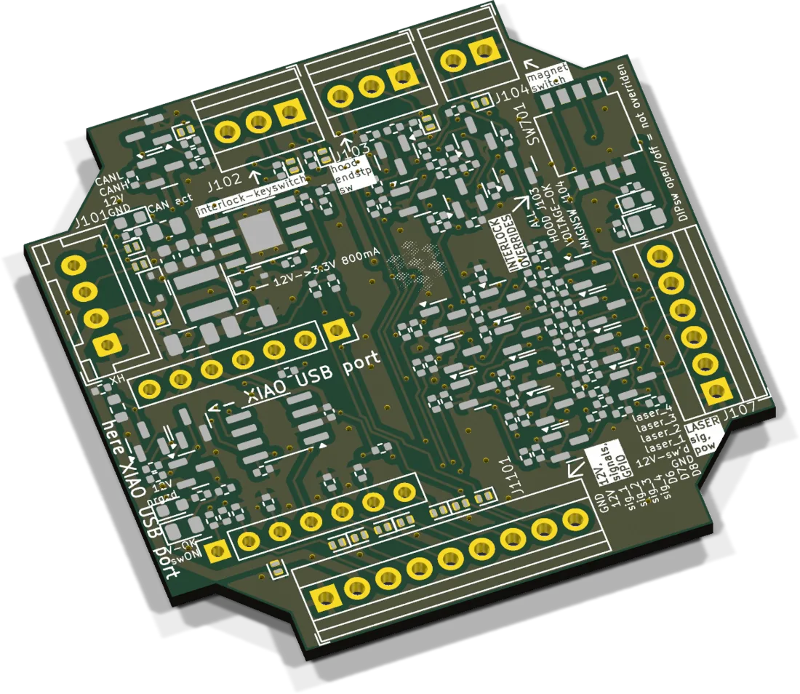
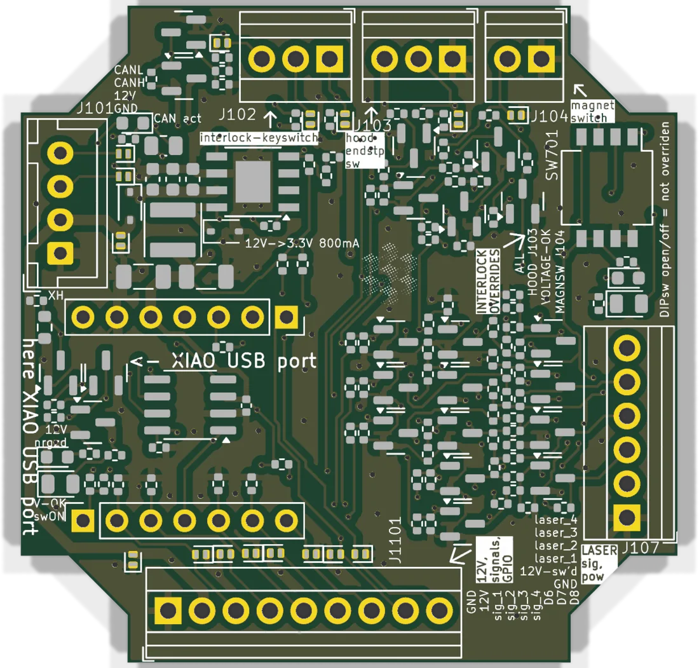

# Laser interface



Four PWM channels for lasers or LED drivers, controlled over CAN. Between the XIAO and the output terminal sits an interlock built from logic gates: the signals only reach the laser while the keyswitch is on, the hood is closed and the 12 V supply is healthy. The firmware cannot override it.

| | |
|---|---|
| Current revision | Rev. A, 2025-02-24 |
| Controller | Seeed XIAO ESP32-S3 |
| Outputs | 4 × PWM, 0 / 3.3 V (low = off), plus switched 12 V for the laser |
| Supply | 12 V from the bus |
| Firmware | `UC2_canopen_slave_laser`, in the [web flasher](../flashing.md) as "Laser satellite" |
| CAN node | 20. Channels 0 to 3 are laser ids 0 to 3 on the HAT+ master. |
| Sources | [KiCad project](https://github.com/openUC2/FRAME-electronics-hardware/tree/main/kicad/laser-interface) · [schematic PDF](https://github.com/openUC2/FRAME-electronics-hardware/blob/main/kicad/laser-interface/OUTPUTS/for-humans/laser-interface.pdf) {/* · <a href={require("./ibom-laser-interface.html")} target="_blank">iBOM</a> */} |

## Connectors



| Ref | Type | Pin 1 → n | Use |
|---|---|---|---|
| J101 | JST XH 4 | GND, +12 V, CAN_H, CAN_L | bus |
| J107 | 6-pin terminal | GND, 12 V switched, laser 1, 2, 3, 4 | to the laser driver, behind the interlock |
| J102 | 3-pin terminal | LED cathode, LED anode / switch, switch | keyswitch and its red LED |
| J103 | 3-pin terminal | GND, signal, 3.3 V | hood endstop. Signal must be high for "safe". |
| J104 | 2-pin terminal | GND, switch | magnet (reed) switch. Closed = safe. |
| J1101 | 9-pin terminal | GND, 12 V, signal 1 to 4, D6, D7, D8 | raw XIAO pins, before the interlock |

## XIAO pinout

| XIAO pin | ESP32-S3 GPIO | Function |
|---|---|---|
| D0 | 1 | in: low when the interlock has tripped (enable the pull-up). Out: pull low to light the keyswitch LED. |
| D1 | 2 | signal 1 (laser 0) |
| D2 | 3 | signal 2 (laser 1) |
| D3 | 4 | CAN TX |
| D4 | 5 | signal 3 (laser 2) |
| D5 | 6 | signal 4 (laser 3) |
| D6 | 43 | free, on J1101 |
| D7 | 44 | free, on J1101 |
| D8 | 7 | free, on J1101 |
| D9 | 8 | in: low while the interlock is powered (keyswitch on) |
| D10 | 9 | CAN RX |

## Interlock

The interlock is armed by turning the keyswitch on. From then on it watches its sources. If one of them goes unsafe it latches: the signals to the laser are cut and the red LED lights, both the one on the board next to the output terminal and the one at the keyswitch. It stays latched until the keyswitch is turned off and on again.

| LED | Meaning |
|---|---|
| green, at the output terminal | interlock powered, signals pass |
| red, at the output terminal and at the keyswitch | tripped, reset with the keyswitch |
| green, below the XIAO | 12 V to the laser is on |

### Sources

- **Keyswitch (J102).** Single-pole switch whose key can only be removed in the off position. It switches less than 1 mA at 3.3 V and connects pins 2 and 3 when on. The LED goes between pin 2 (anode) and pin 1 (cathode). 200 Ω are on the board, so a red LED runs at about 7 mA.
- **12 V monitor (internal).** If the bus drops below 11.3 V, the 12 V to the laser is switched off and the interlock trips. This is how the board notices an emergency stop: the HAT+ cuts bus power, and the laser is dark before the supply has collapsed.
- **Hood endstop (J103).** The signal has to be high. Low or floating trips the interlock. 3.3 V and GND are on the jack, so an optical endstop can be used.
- **Magnet switch (J104).** A reed switch in the base and a magnet in the hood. Open contacts trip the interlock.

### Overrides

Not every microscope has all four safety devices. DIP switch SW701 bypasses individual sources. With all four switches off, everything is active.

| SW701 | When ON |
|---|---|
| 1 | magnet switch J104 ignored |
| 2 | 12 V monitor ignored, 12 V to the laser always on |
| 3 | hood endstop J103 ignored |
| 4 | whole interlock bypassed, including the keyswitch. Signals always pass. The 12 V monitor still switches the laser supply. |

Switch 4 turns the board into a plain PWM output. Do not ship a laser system like that.

## Solder jumpers

| Jumper | When closed |
|---|---|
| JP301 | 120 Ω CAN termination. Close only at a physical end of the bus. |
| JP302 | CAN activity LED |
| JP1101, JP1102, JP1103 | 4.7 kΩ pull-up on D6, D7, D8 |

## As a general CAN-to-GPIO board

J1101 carries the XIAO pins before the interlock, together with unswitched 12 V. Signals 1 to 4 have fixed 4.7 kΩ pull-downs, D6 to D8 get a pull-up when their jumper is closed. For new designs that only need a few GPIOs on the bus, the [CAN GPIO board](../can-gpio/README.md) is the smaller choice.

## Firmware

| | |
|---|---|
| Env | `UC2_canopen_slave_laser` |
| Pin map | [`main/config/UC2_canopen_slave_laser/PinConfig.h`](https://github.com/youseetoo/uc2-esp32/blob/main/main/config/UC2_canopen_slave_laser/PinConfig.h) |
| Bus | CANopen, 500 kbit/s, node 20, channels on object sub-indices 1 to 4 |
| USB | serial JSON over USB-CDC |

Flash it as described in [Flashing the firmware](../flashing.md). A test over USB or through the master:

```json
{"task":"/laser_act","LASERid":1,"LASERval":512}
```

If nothing comes out, look at the LEDs first. A tripped interlock is the usual reason.

{/* iBOM switched off for now
## iBOM
<iframe width="100%" style={{aspectRatio: "16 / 9"}} src={require("./ibom-laser-interface.html")} title="Laser interface iBOM"></iframe>
*/}

---

Boards: [shop.openuc2.com](https://shop.openuc2.com). Questions: [openuc2.discourse.group](https://openuc2.discourse.group).
