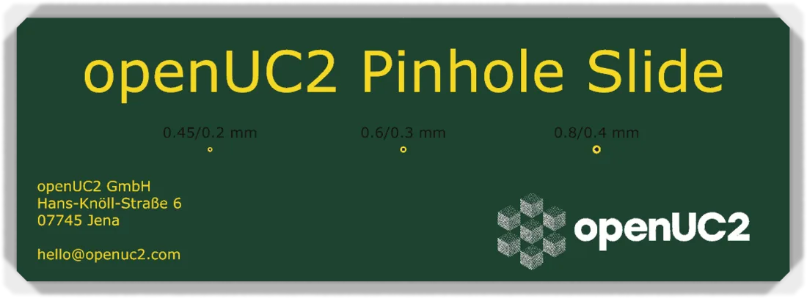
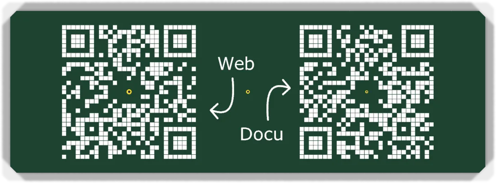
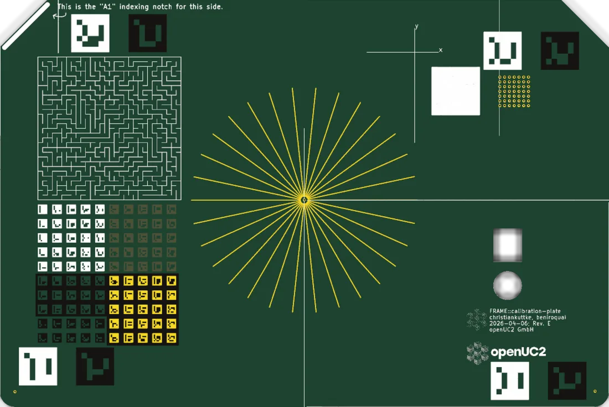
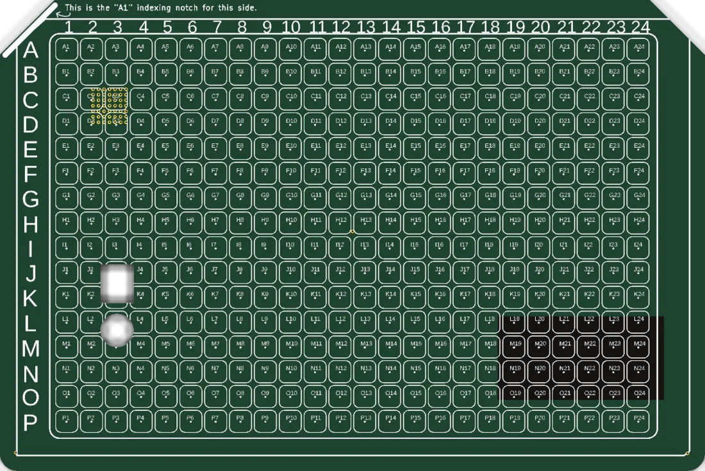
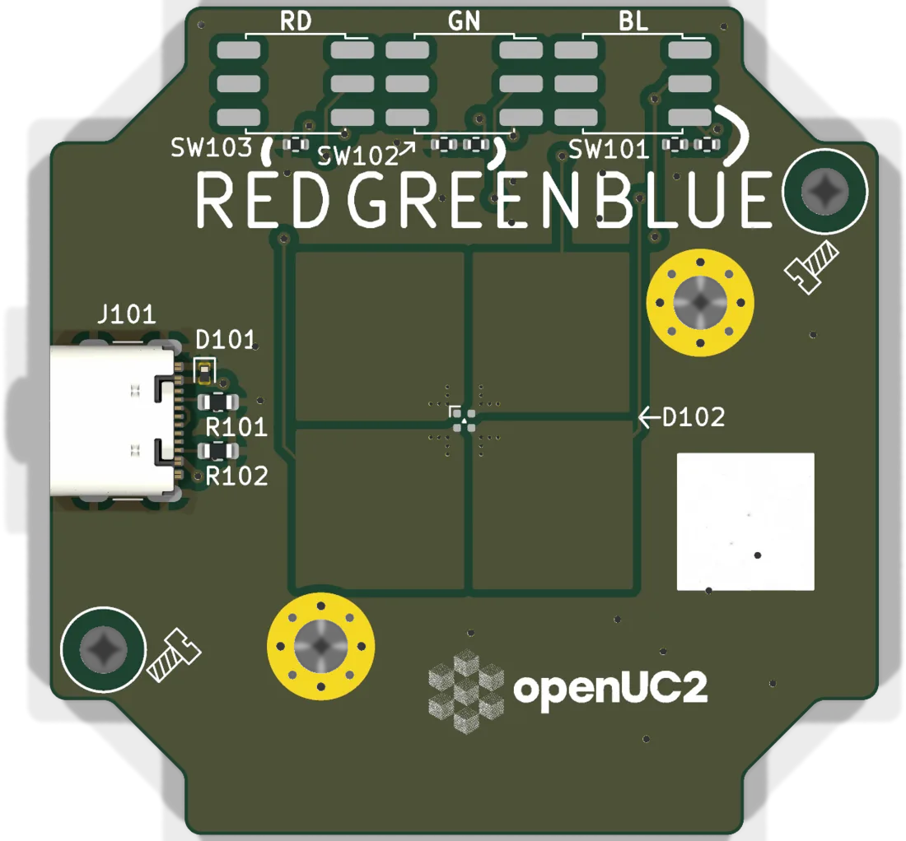
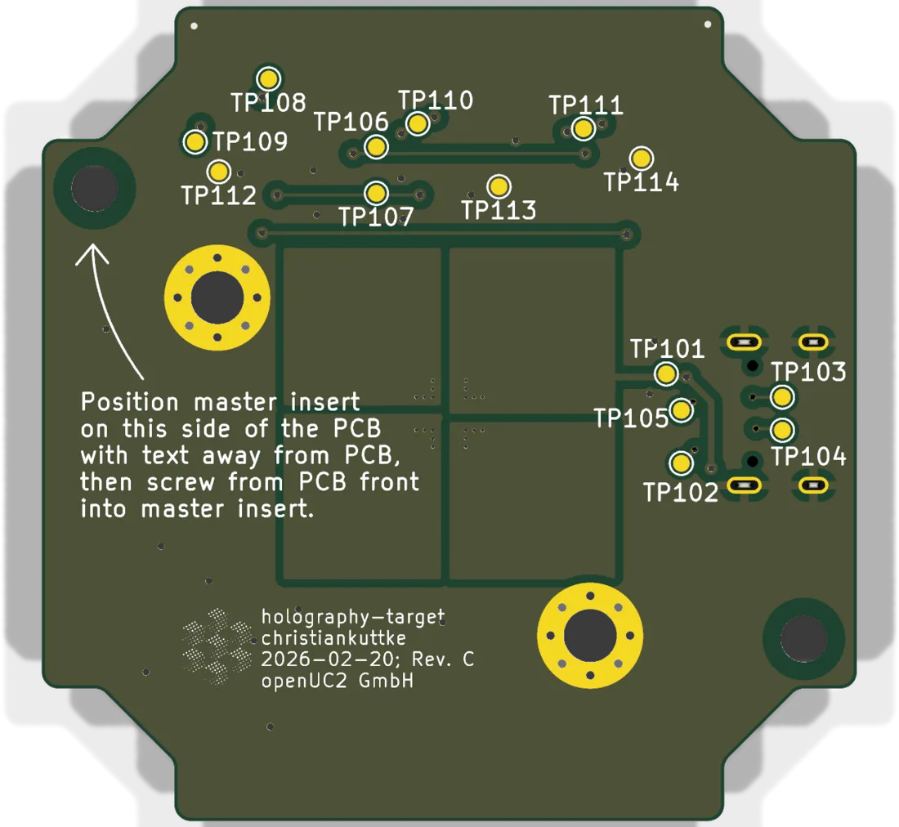

# PCB targets

A PCB fab drills holes to a few hundredths of a millimetre and prints copper and solder mask with about the same accuracy, for a few euros a board. That makes a circuit board a cheap precision target. These three boards are made that way. Only the last one carries any electronics.

| Board | Size | Used for |
|---|---|---|
| [Pinhole slide](#pinhole-slide) | 76 × 26 mm | stage calibration in the FRAME, and as our business card |
| [Calibration plate](#calibration-plate) | 127.76 × 85.48 mm | mapping stage coordinates to physical positions in ImSwitch |
| [Holography target](#holography-target) | fits in one cube | red, green and blue point source of the HoloBox |

All three are 1.6 mm FR4. Design files are in the [hardware repository](https://github.com/openUC2/FRAME-electronics-hardware/tree/main/kicad).

## Pinhole slide

A board with the outline of a microscope slide and three plated holes. Light only gets through the holes, so in transmitted light each one is a bright disc on a black background.

| Label on the board | Hole | Copper ring |
|---|---|---|
| 0.45/0.2 mm | 0.2 mm | 0.45 mm |
| 0.6/0.3 mm | 0.3 mm | 0.6 mm |
| 0.8/0.4 mm | 0.4 mm | 0.8 mm |

The 0.3 mm hole sits exactly in the centre of the slide. Its position is therefore the same whichever way round the slide is put into the holder, and that is the hole the stage calibration looks for: the FRAME scans around it, finds the centre of the bright spot and stores the offset between stage coordinates and the sample holder. The procedure is in [Calibrate the stage](../../../../usage/pro/frame/guides/day-2/calibrate-stage/README.md).

The front carries our address, the back two QR codes to the website and to these docs. We hand it out as a business card, which is the reason there is always one within reach when a stage needs calibrating.

| | |
|---|---|
| Revision | Rev. A, 2025-09-22 |
| Sources | [KiCad project](https://github.com/openUC2/FRAME-electronics-hardware/tree/main/kicad/pinhole-slide) |

## Calibration plate

The same idea in the size of a multiwell plate (ANSI/SLAS 1-2004 footprint, 3.18 mm corner radius, chamfer at A1). It goes into the stage in place of a well plate and gives ImSwitch known features all over the travel range, so that stage positions can be mapped to physical positions automatically.

What is on it:

- ArUco markers in the four corners, each as a bright and a dark version, to find and orient the plate with a low-magnification objective
- a field of small ArUco markers in four contrast combinations (silkscreen, copper, bare board, solder mask)
- a star of lines that all point to the centre of the plate, with a drilled hole in the middle for transmitted light
- a 7 × 7 grid of 0.3 mm holes
- a maze, for testing stitching and tracking on a pattern that does not repeat
- on the back, the outlines and names of all 384 wells (A1 to P24) at their nominal positions

The features are sized for a field of view of about 1 mm.

Since Rev. E the plate has no electrical connection. It is lit by the microscope.

| | |
|---|---|
| Revision | Rev. E, 2026-04-05 |
| Sources | [KiCad project](https://github.com/openUC2/FRAME-electronics-hardware/tree/main/kicad/calibration-plate) · [drawing PDF](https://github.com/openUC2/FRAME-electronics-hardware/blob/main/kicad/calibration-plate/OUTPUTS/for-humans/calibration-plate.pdf) |

## Holography target

The light source of the inline holographic microscope in the [HoloBox](../../../../usage/disc/holobox/index.md). In-line holography needs light that is coherent enough to interfere with itself. A laser does that, and so does an LED if it is small and far away. This board has a single miniature RGB LED (Everlight 18-038T) in the optical axis of the cube. Its emitting areas are a fraction of a millimetre across, so it works as a quasi-coherent point source without a separate pinhole, and in three wavelengths.

- Power comes from USB-C (5 V only, no data).
- Each colour has its own latching push switch on the top edge: RD, GN, BL. Press to switch on, press again to switch off. Colours can be combined.
- Series resistors set about 10 mA per colour. There is no dimming.
- The outline fills the inside of one cube. The board is screwed to a cube insert from the front; the text on the back shows the orientation.

| | |
|---|---|
| Revision | Rev. C, 2026-02-20 (switch pinout corrected) |
| Sources | [KiCad project](https://github.com/openUC2/FRAME-electronics-hardware/tree/main/kicad/holography-target) · [schematic PDF](https://github.com/openUC2/FRAME-electronics-hardware/blob/main/kicad/holography-target/OUTPUTS/for-humans/holography-target.pdf) |

---

Boards and boxes: [shop.openuc2.com](https://shop.openuc2.com). Questions: [openuc2.discourse.group](https://openuc2.discourse.group).
