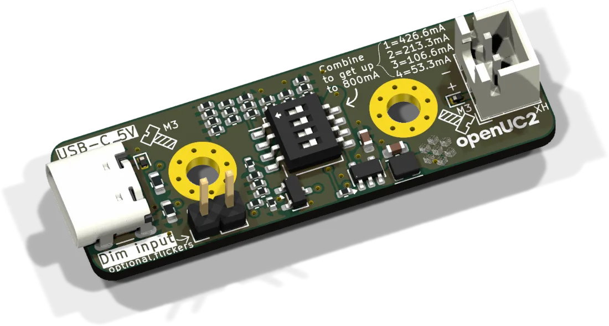
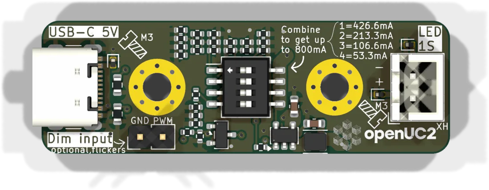

# USB star-LED driver

A light source for the Discovery boxes that needs nothing but a USB-C charger or power bank. It drives one high-power LED on a star-shaped aluminium PCB at a constant current that is set with a DIP switch. There is no microcontroller and no firmware.

| | |
|---|---|
| Current revision | Rev. A, 2026-03-28 |
| Input | USB-C, 5 V. Only power is taken, there is no data connection. |
| Driver | PAM2804, synchronous step-down, constant current |
| Output | one LED die (forward voltage up to 4.4 V), 53 to 800 mA, max. about 3.5 W |
| Sources | [KiCad project](https://github.com/openUC2/FRAME-electronics-hardware/tree/main/kicad/standalone-usb-starled-driver) · [schematic PDF](https://github.com/openUC2/FRAME-electronics-hardware/blob/main/kicad/standalone-usb-starled-driver/OUTPUTS/for-humans/standalone-usb-starled-driver.pdf) {/* · <a href={require("./ibom-standalone-usb-starled-driver.html")} target="_blank">iBOM</a> */} |

## Connectors

| Ref | Type | Pins | Use |
|---|---|---|---|
| J102 | USB-C | | 5 V in |
| J103 | 2 pads / terminal | LED +, LED − | star LED |
| J101 | 2 solder holes | GND, dim | optional dimming input |

## Setting the current

SW101 has four switches with binary weights. The LED current is the sum of all switches that are ON.

| Switch | Adds |
|---|---|
| 1 | 426.6 mA |
| 2 | 213.3 mA |
| 3 | 106.6 mA |
| 4 | 53.3 mA |

All ON gives 800 mA, all OFF turns the LED off. Check the datasheet of your LED before going high: many small star LEDs are 350 mA parts, and at 800 mA the star needs a heatsink. A plain USB port without negotiation delivers 500 mA at 5 V, which is not enough for the upper settings. Use a charger.

## Dimming

Voltage on pin 2 of J101 reduces the LED current and switches the LED off. For PWM dimming from a microcontroller use about 500 Hz. At 1 kHz and above the resolution near full brightness gets coarse.

For computer-controlled LEDs in a box, the [standalone board](../uc2-standalone-board/README.md) has three of these drivers built in, dimmed by the ESP32.

{/* iBOM switched off for now
## iBOM
<iframe width="100%" style={{aspectRatio: "16 / 9"}} src={require("./ibom-standalone-usb-starled-driver.html")} title="USB star-LED driver iBOM"></iframe>
*/}

---

Boards and LEDs: [shop.openuc2.com](https://shop.openuc2.com). Questions: [openuc2.discourse.group](https://openuc2.discourse.group).
