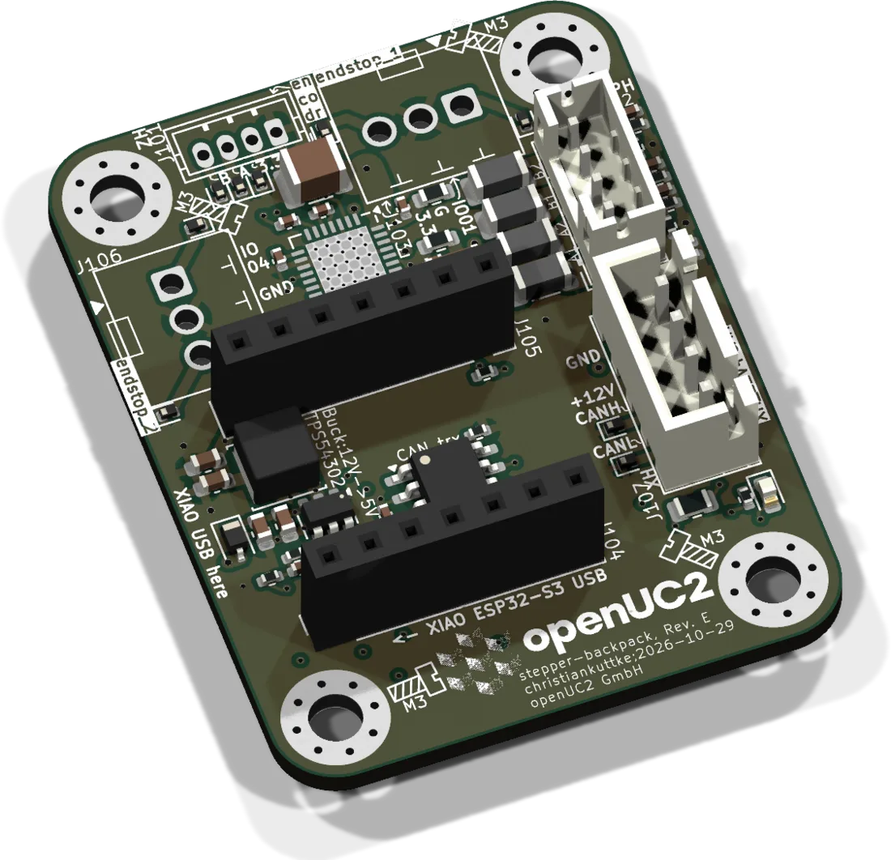
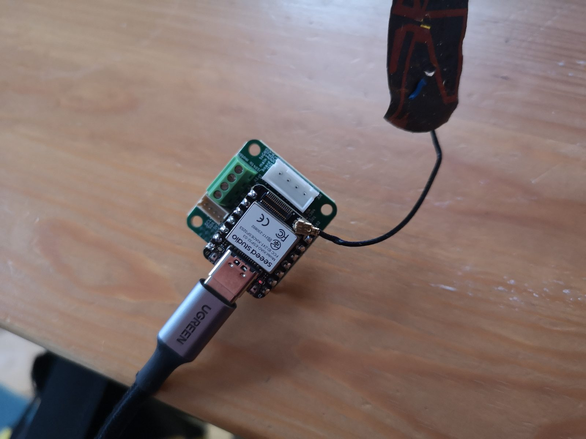
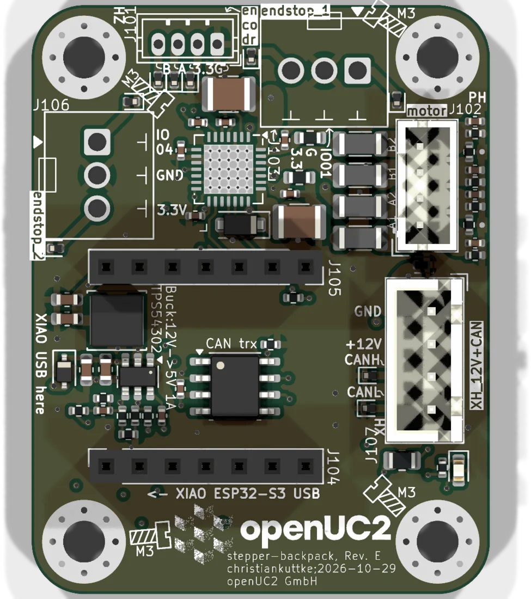

# Stepper backpack



One board per motor. It screws to the back of a NEMA 11 stepper, takes 12 V and CAN from a single 4-pin cable and does the rest locally: a TMC2209 drives the coils, a XIAO ESP32-S3 generates the steps, runs homing and reports the position back to the master. The FRAME uses four of them (A, X, Y, Z).

| | |
|---|---|
| Current revision | Rev. E, 2026-10-29. Rev. C and D are the ones in FRAMEs shipped so far; the differences are listed [below](#revisions). |
| Controller | Seeed XIAO ESP32-S3, plugged into two 7-pin headers |
| Driver | TMC2209, UART-configured, 0.2 Ω sense resistors |
| Supply | 12 V from the bus. An on-board buck (TPS54302) makes 5 V, the XIAO makes 3.3 V |
| Firmware | `UC2_canopen_slave_motor`, in the [web flasher](../flashing.md) as "Motor satellite" |
| CAN node | 11 after flashing. Convention: 10 = A, 11 = X, 12 = Y, 13 = Z |
| Sources | [KiCad project](https://github.com/openUC2/FRAME-electronics-hardware/tree/main/kicad/stepper-backpack) · [schematic PDF](https://github.com/openUC2/FRAME-electronics-hardware/blob/main/kicad/stepper-backpack/OUTPUTS/for-humans/stepper-backpack.pdf) {/* · <a href={require("./ibom-stepper-backpack.html")} target="_blank">iBOM</a> */} |

## Mounting

- Three M2.5 screws with roughly 2.5 mm standoffs between motor and board. The board stays inside the outline of the motor.
- Up to Rev. D the encoder chip (AS5600) sits on the board and reads a diametric magnet glued to the end of the motor shaft. The gap matters: keep to the standoff length.
- Plug the XIAO in with its USB port pointing to the edge marked "XIAO USB here".



*An early revision with the XIAO plugged in. Up to Rev. D the motor coils go to a screw terminal, Rev. E has a JST PH jack.*

## Connectors



| Ref (Rev. E) | Type | Pin 1 → n | Use |
|---|---|---|---|
| J107 | JST XH 4 | GND, +12 V, CAN_H, CAN_L | bus in. There is only one jack: daisy-chain through a [connector hub](../wiring-boards/README.md) |
| J102 | JST PH 4 | OA1, OA2, OB1, OB2 | motor coils A and B |
| J103 | 3-pin terminal | signal, GND, 3.3 V | endstop 1 |
| J106 | 3-pin terminal | signal, GND, 3.3 V | endstop 2 |
| J101 | JST ZH 4 | GND, 3.3 V, A, B | external encoder (Rev. E) |

FRAME motor cable colours on J102: blue, red, green, black.

Endstops are expected to pull the signal to GND when triggered. Optical endstops work, 3.3 V is on the jack.

## XIAO pinout

| XIAO pin | ESP32-S3 GPIO | Rev. C / D | Rev. E |
|---|---|---|---|
| D0 | 1 | endstop | endstop 1 |
| D1 | 2 | CAN RX | CAN RX |
| D2 | 3 | CAN TX | CAN TX |
| D3 | 4 | TMC2209 DIAG (StallGuard) | endstop 2 |
| D4 | 5 | I2C SDA to AS5600 | encoder A |
| D5 | 6 | I2C SCL to AS5600 | encoder B |
| D6 | 43 | UART to TMC2209 | UART to TMC2209 |
| D7 | 44 | UART from TMC2209 | UART from TMC2209 |
| D8 | 7 | DIR | DIR |
| D9 | 8 | STEP | STEP |
| D10 | 9 | driver enable | driver enable |

The two UART lines are joined through a resistor into the single PDN_UART pin of the TMC2209.

## Motor current

The sense resistors are 0.2 Ω. With that, the `vsense` bit of the TMC2209 selects the range:

| `vsense` | Peak | RMS |
|---|---|---|
| 0 | 1.4 A | 1.0 A |
| 1 | 0.8 A | 0.55 A |

The actual run and hold current is set in firmware within that range (`/tmc_act`, see [serial commands](../../../sw/interface/reference/serial-commands.md)).

## Solder jumpers

All are open when the board leaves the factory. Reference designators changed between revisions, so check the silkscreen of your board.

| Function | Rev. C / D | Rev. E |
|---|---|---|
| 120 Ω CAN termination. Close only on the board at the physical end of the bus. | JP502 | JP401 |
| CAN activity LED, lights while the bus is dominant | JP503 | JP402 |
| Bridge the 12 V and 5 V nets, to run the board from 5 V. Never connect 12 V with this closed. | JP101 | JP101 |

Rev. C can be converted back to the old 5 V + I2C bus. The procedure is in the [repository README](https://github.com/openUC2/FRAME-electronics-hardware#converting-rev-c-from-12vcan-to-5vi2c). Nothing current uses that bus any more.

## Firmware

| | |
|---|---|
| Env | `UC2_canopen_slave_motor` (FastAccelStepper). `UC2_canopen_slave_accelmotor` is the same board with the AccelStepper back-end. |
| Pin map | [`main/config/UC2_canopen_slave_motor/PinConfig.h`](https://github.com/youseetoo/uc2-esp32/blob/main/main/config/UC2_canopen_slave_motor/PinConfig.h) |
| Bus | CANopen, 500 kbit/s |
| USB | serial JSON over USB-CDC, works without a bus for bench tests |

The pin map in the firmware matches Rev. C / D: StallGuard DIAG on D3, one endstop on D0. On Rev. E, D3 is the second endstop and D4 / D5 carry the encoder's A / B signals, so `tmc_pin_diag` and the encoder pins have to be changed in `PinConfig.h` before building for that revision.

Flash it as described in [Flashing the firmware](../flashing.md), then give the board its node ID. How to wire it into a running system: [Add a CAN satellite](../../../sw/interface/how-to/add-can-satellite.md).

A quick test over USB, without a master:

```json
{"task":"/motor_act","motor":{"steppers":[{"stepperid":1,"position":1000,"speed":2000,"isabs":0}]}}
```

## Revisions

| Rev. | Date | Changes |
|---|---|---|
| C | 2025-08 | 12 V + CAN on the XH jack instead of 5 V + I2C |
| D | 2025-08 | production revision of the first FRAME series |
| E | 2026-10 | flatter and larger outline. No encoder chip on board, a ZH jack for an external A/B encoder instead. Two endstop inputs on separate GPIOs, the DIAG line to the XIAO is gone. Smaller sense resistors. |

{/* iBOM switched off for now
## iBOM
<iframe width="100%" style={{aspectRatio: "16 / 9"}} src={require("./ibom-stepper-backpack.html")} title="Stepper backpack iBOM"></iframe>
*/}

---

Boards and complete motor assemblies: [shop.openuc2.com](https://shop.openuc2.com). Questions: [openuc2.discourse.group](https://openuc2.discourse.group).
