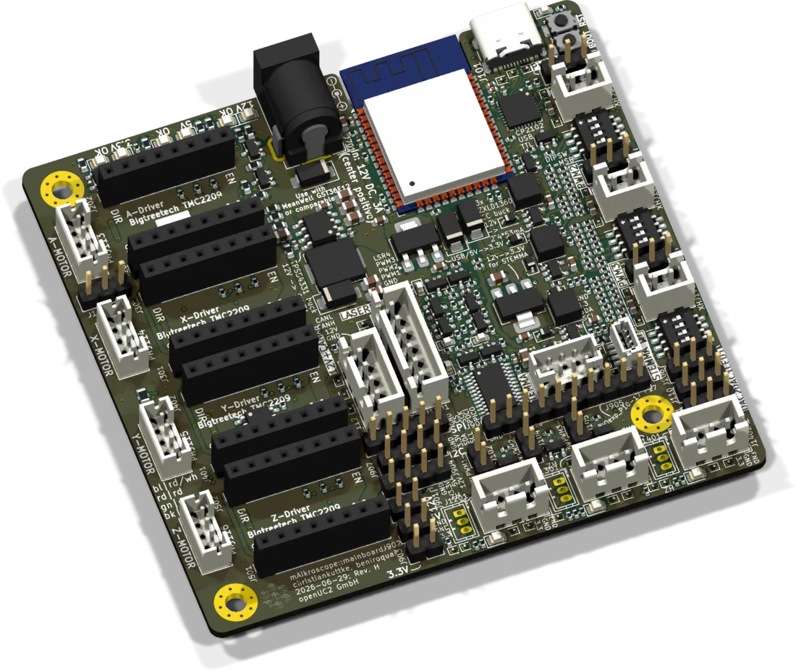
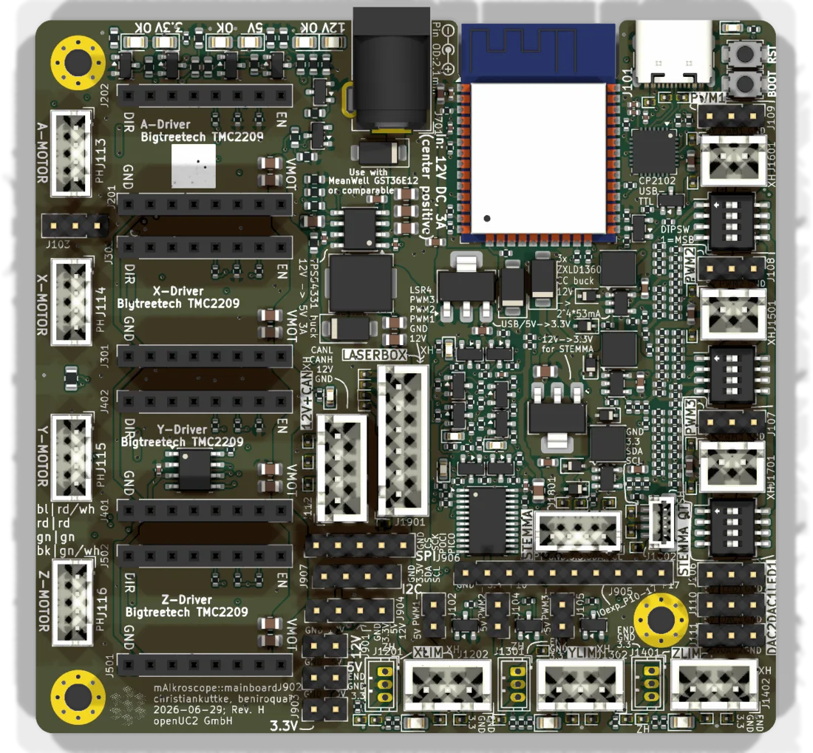

# Standalone board



The controller for the Discovery boxes and for any small setup that does not need a Raspberry Pi. One board, one 12 V supply, one USB cable: an ESP32 drives up to four stepper motors, three high-power LEDs, a laser, a NeoPixel matrix and reads three endstops. Since Rev. G it also has the FRAME's 12 V + CAN jack, so the same satellites can be attached to it. In the KiCad repository the project is called `mainboard`. Firmware and shop call the current generation "v4".

| | |
|---|---|
| Current revision | Rev. H, 2026-06-29. ESP32-WROOM-32 soldered on the board, stepper drivers configured over UART. |
| Previous | Rev. G: ESP32 DevKitC plugged into headers, microstepping fixed by solder bridges. Older generations: [v3](./schematics-v3.md), [v2](./schematics-v2.md). |
| Controller | ESP32-WROOM-32, USB-C through a CP2102 |
| Motors | 4 slots for BigTreeTech TMC2209 modules (A, X, Y, Z) |
| Light | 3 × ZXLD1360 constant-current drivers up to 800 mA, laser header with 4 PWM lines, NeoPixel header |
| Supply | 12 V DC barrel jack |
| Firmware | `UC2_canopen_standalone_v4` or `UC2_4`, see [Firmware](#firmware) |
| Sources | [KiCad project](https://github.com/openUC2/FRAME-electronics-hardware/tree/main/kicad/mainboard) · [schematic PDF](https://github.com/openUC2/FRAME-electronics-hardware/blob/main/kicad/mainboard/OUTPUTS/for-humans/mainboard.pdf) {/* · <a href={require("./ibom-mainboard.html")} target="_blank">iBOM</a> */} |

The quickest reference is the board itself: every jack is labelled on the silkscreen. The most complete one is the schematic, which is full of the designer's notes.



## ESP32 pinout

| GPIO | Function | Goes to |
|---|---|---|
| 0 | Z step | driver slot Z |
| 1, 3 | TXD0, RXD0 | CP2102 (USB, flashing) |
| 2 | PWM 3 | pin header, amplified header, laser header, LED driver 3 |
| 4 | PWM 2 | pin header, amplified header, laser header, LED driver 2 |
| 5 | SPI CS | pin header |
| 12 | PWM 1 | pin header, amplified header, laser header, LED driver 1 |
| 13 | LED 1 | NeoPixel header |
| 14 | Y step | driver slot Y |
| 15 | A step | driver slot A |
| 16 | X step | driver slot X |
| 17 | laser 4 | laser header |
| 18, 19, 23 | SPI SCK, MISO, MOSI | pin header |
| 21, 22 | I2C SDA, SCL | I/O expander, STEMMA jacks, pin header |
| 25 | DAC 1 | pin header |
| 26 | UART to the stepper drivers (or DAC 2) | all four driver slots |
| 27 | I/O expander interrupt | |
| 32 | CAN TX | CAN transceiver, 12 V + CAN jack |
| 33 | CAN RX | CAN transceiver, 12 V + CAN jack |
| 34 | UART from the stepper drivers | all four driver slots |
| 35 | free, input only | test point |

GPIO 26 can be either the UART to the drivers or the second DAC, not both. If you need DAC 2, the driver slots have to be converted back to fixed microstepping, see [below](#going-back-to-fixed-microstepping).

### I/O expander

Slow signals sit on an XL9535 port expander at I2C address 0x27. The firmware handles it, so in commands they behave like ordinary pins.

| Expander pin | Function |
|---|---|
| P00 | enable for all stepper drivers. Low switches the drivers off: saves power, loses the microstep position. |
| P01, P02, P03, P04 | DIR for X, Y, Z, A |
| P05, P06, P07 | endstop X, Y, Z |
| P10 to P17 | unused, on 2.54 mm solder holes |

SDA and SCL have 4.7 kΩ pull-ups to 3.3 V on the board. Do not add a second set on a module you connect.

## Stepper drivers

The slots are made for BigTreeTech TMC2209 modules. On Rev. H each driver is connected to the ESP32 by UART. Microstepping, current and StallGuard are set by the firmware at boot. The four drivers share the UART and are told apart by an address that is hard-wired per slot:

| UART address | Axis | Slot |
|---|---|---|
| 0 | A | next to the 12 V input jack |
| 1 | X | |
| 2 | Y | |
| 3 | Z | farthest from the input jack |

Motor jacks are JST PH 4 on Rev. H (2.54 mm pin headers before):

| Pin | 1 | 2 | 3 | 4 |
|---|---|---|---|---|
| Driver output | A1 | A2 | B1 | B2 |
| FRAME cable | blue | red | green | black |

One coil is swapped compared to Rev. G, so a motor may turn the other way after a board swap. Flip the direction in the firmware settings.

### Going back to fixed microstepping

Needed for other driver modules such as a plain A4988, or if GPIO 26 has to be DAC 2. Each slot can be converted on its own. For slot A: break R201 (0 Ω), bridge JP201, JP202 and JP203, break R108 and R109. The other slots have the same parts under their own numbers. The instructions are printed on the stepper-driver sheet of the schematic.

## Star-LED drivers

PWM 1 to 3 each feed a ZXLD1360 buck driver that runs one high-power LED at constant current. This is the same circuit as on the [USB star-LED driver](../starled-driver/README.md), supplied from 12 V here, so two LEDs in series work as well.

The maximum current of each channel is set with a 4-way DIP switch. The switches add up:

| Switch | Adds |
|---|---|
| 1 | 426.6 mA |
| 2 | 213.3 mA |
| 3 | 106.6 mA |
| 4 | 53.3 mA |

The ESP32 dims below that maximum with PWM. Use a PWM frequency between 10 kHz and 1 MHz: the driver low-pass filters the signal into a DC level, so the LED does not flicker and cameras see no banding. The price is a lower limit. Below about 10 % the LED becomes unstable and then goes off. If you need less light, lower the DIP switch setting rather than the duty cycle.

## Laser header

JST XH 6: 12 V on pin 1, GND on pin 2, then the four signals (PWM 1 to 3 and laser 4), each behind a buffer that survives a short to ground. The pin order matches the laser modules we ship, so a straight 6-pin cable connects them. Check the engraving on the laser housing if you use another make.

## Endstops

X, Y and Z each have an XH 3 and a ZH 3 jack in parallel:

| Pin | 1 | 2 | 3 |
|---|---|---|---|
| | signal | GND | 3.3 V |

An endstop that is not triggered connects signal to 3.3 V. Triggered, it connects signal to GND, and the red LED next to the jack lights. The expander can raise its interrupt line (GPIO 27) on the edge, which makes homing react quickly.

## STEMMA and STEMMA QT

JST PH 4 and JST SH 4 with 3.3 V and I2C in the Adafruit pinout. They have their own 12 V to 3.3 V regulator (200 mA continuous, 1 A peak). The cables we sell do not follow Adafruit's colour code, but the pins are in the right place.

## CAN

A JST XH 4 jack with the FRAME pinout (GND, +12 V, CAN_H, CAN_L) and an SN65HVD230 transceiver on GPIO 32 / 33. With the hybrid firmware the board is the CAN master: its own motors and lasers stay local, an [illumination board](../illumination/README.md) (node 30) and a [galvo interface](../galvo-interface/README.md) (node 40) are reached over the bus. It can also be turned into a four-axis satellite of a FRAME: [Standalone v4 as satellite](../../../sw/interface/how-to/standalone-v4-as-satellite.md).

## Firmware

| | `UC2_canopen_standalone_v4` | `UC2_4` |
|---|---|---|
| In the [web flasher](../flashing.md) | Standalone v4 + CAN (hybrid) | Standalone v4 |
| CAN | master, node 1, 500 kbit/s | not used |
| TMC2209 over UART | yes | no |
| Use it for | Rev. H, and any board with CAN satellites | Rev. G and older v4 boards with fixed microstepping |
| Pin map | [`PinConfig.h`](https://github.com/youseetoo/uc2-esp32/blob/main/main/config/UC2_canopen_standalone_v4/PinConfig.h) | [`PinConfig.h`](https://github.com/youseetoo/uc2-esp32/blob/main/main/config/UC2_4/PinConfig.h) |

Rev. H needs the UART to set microstepping, so flash the hybrid firmware even if nothing is connected to the CAN jack.

Serial is 115200 baud over USB-C. A first test:

```json
{"task":"/state_get"}
{"task":"/motor_act","motor":{"steppers":[{"stepperid":1,"position":1000,"speed":2000,"isabs":0}]}}
{"task":"/laser_act","LASERid":1,"LASERval":512}
```

More in [First serial command](../../../sw/interface/tutorials/first-serial-command.md) and the [serial command reference](../../../sw/interface/reference/serial-commands.md).

## Before you plug things in

- Disconnect 12 V before changing motor cables. Pulling a motor from a powered driver can kill the driver.
- The NeoPixel header (GND, data, 5 V) is not keyed. Check the polarity of LED matrix cables.
- USB alone powers the ESP32 but not motors and LEDs.

{/* iBOM switched off for now
## iBOM
<iframe width="100%" style={{aspectRatio: "16 / 9"}} src={require("./ibom-mainboard.html")} title="Standalone board iBOM"></iframe>
*/}

---

Boards, motors and LEDs: [shop.openuc2.com](https://shop.openuc2.com). Questions: [openuc2.discourse.group](https://openuc2.discourse.group).
