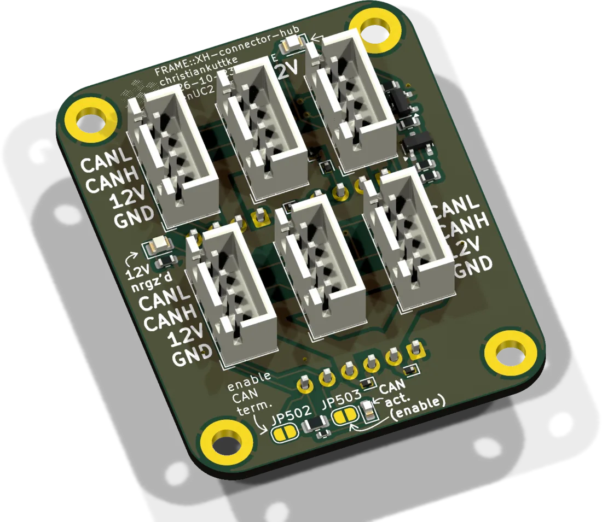
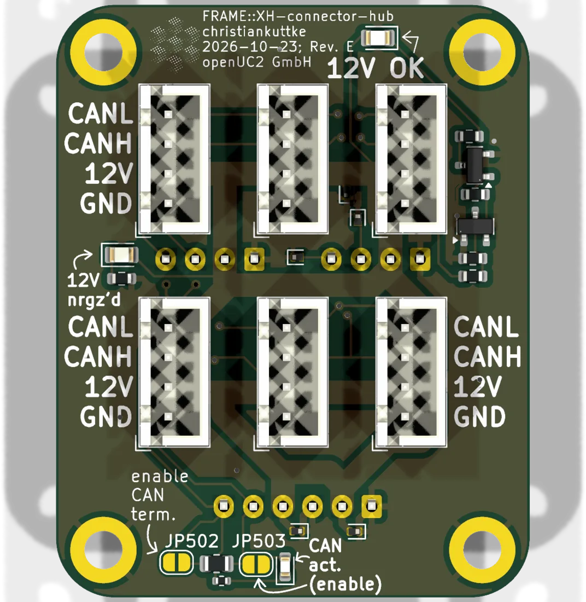
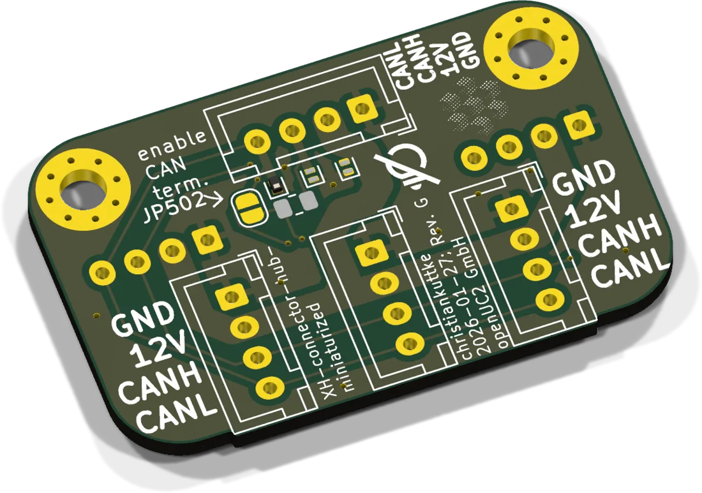
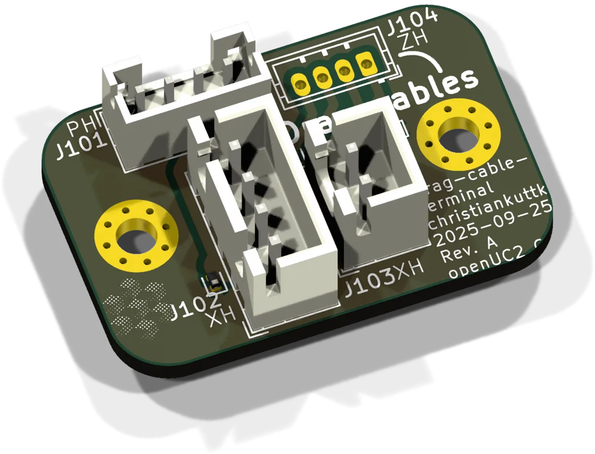
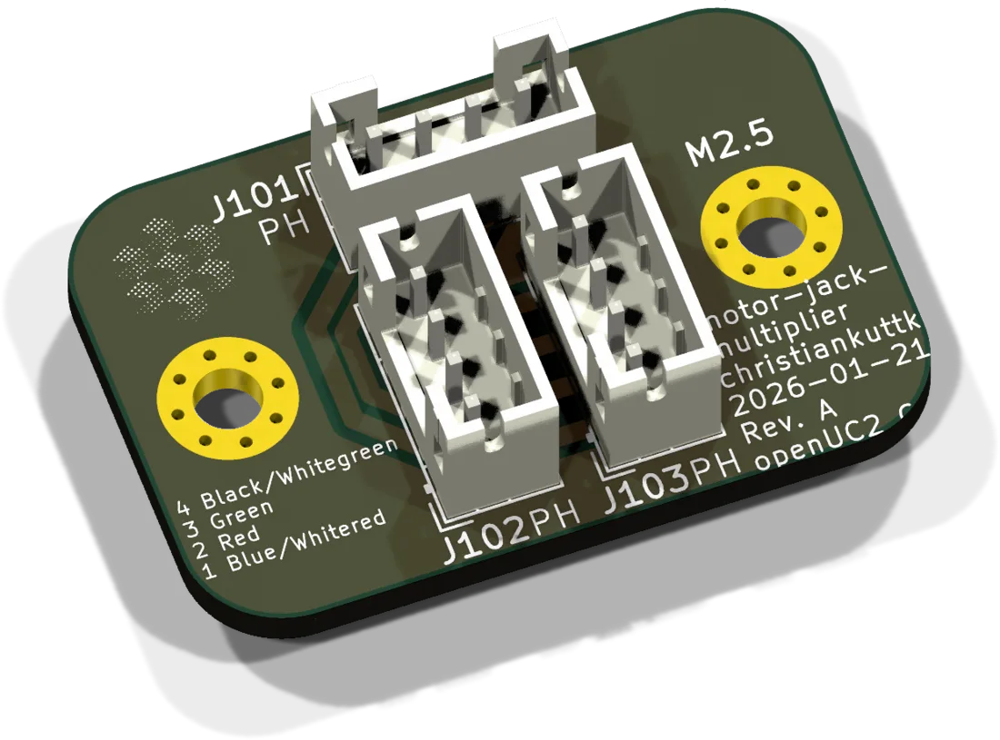
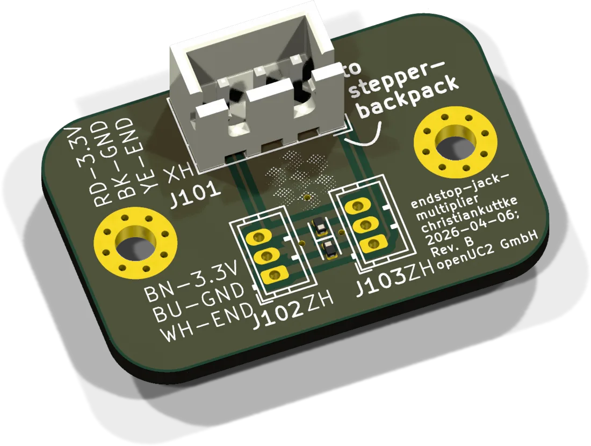

# Bus and wiring boards

These boards carry no controller and need no firmware. They exist so that the wiring inside a FRAME can be plugged together from standard cables instead of being soldered.

Every bus jack on every board uses the same pinout:

| JST XH 4 | 1 | 2 | 3 | 4 |
|---|---|---|---|---|
| | GND | +12 V | CAN_H | CAN_L |

## Connector hub

The "CAN extension board". A CAN bus should be a line with short stubs, and the satellites only have one bus jack each. The hub is where the line gets its branches: one input from the HAT+, eight 4-pin outputs for satellites.

| | |
|---|---|
| Current revision | Rev. E, 2026-10-23 |
| Input | J108, JST XH 6: GND, +12 V, GND, +12 V, CAN_H, CAN_L. Two pin pairs for the supply, because one XH contact is good for 3 A. This matches the 6-pin bus jack of the HAT+ from Rev. F on. |
| Outputs | 8 × JST XH 4. Six on the front, two facing the inside of the machine. |
| Protection | TVS diodes on 12 V and on both CAN lines |
| LEDs | green: 12 V present and above threshold. Red: 12 V present. |
| Sources | [KiCad project](https://github.com/openUC2/FRAME-electronics-hardware/tree/main/kicad/XH-connector-hub) · [schematic PDF](https://github.com/openUC2/FRAME-electronics-hardware/blob/main/kicad/XH-connector-hub/OUTPUTS/for-humans/XH-connector-hub.pdf) {/* · <a href={require("./ibom-XH-connector-hub.html")} target="_blank">iBOM</a> */} |

| Jumper | When closed |
|---|---|
| JP502 | 120 Ω CAN termination |
| JP503 | CAN activity LED |

Up to Rev. D there was a seventh front port. It was removed to make the back port easier to solder.

## Connector hub, miniaturized

Six XH 4 jacks, all in parallel, on a board small enough to sit inside a module. For places where a few satellites share one cable run. Rev. G, 2026-01-27. Termination: JP501 on the front or JP502 on the back, either one closes the same 120 Ω.

[KiCad project](https://github.com/openUC2/FRAME-electronics-hardware/tree/main/kicad/XH-connector-hub-miniaturized) · [schematic PDF](https://github.com/openUC2/FRAME-electronics-hardware/blob/main/kicad/XH-connector-hub-miniaturized/OUTPUTS/for-humans/XH-connector-hub-miniaturized.pdf)

## Drag-cable terminal

Moving parts are connected through flexible drag cables. This board terminates such a cable at either end and splits it back into the standard jacks. Rev. A, 2025-09-25.

| Ref | Type | Pin 1 → n |
|---|---|---|
| J101 | JST PH 4 | GND, GND, +12 V, +12 V (drag cable, power) |
| J104 | JST ZH 4 | hood switch 1, hood switch 2, CAN_H, CAN_L (drag cable, signals) |
| J102 | JST XH 4 | GND, +12 V, CAN_H, CAN_L (standard bus jack) |
| J103 | JST XH 2 | hood switch 1, hood switch 2 |

The hood switch pair is meant for the safety-hood contact that feeds the interlock of the [laser interface](../laser-interface/README.md#sources).

[KiCad project](https://github.com/openUC2/FRAME-electronics-hardware/tree/main/kicad/drag-cable-terminal) · [schematic PDF](https://github.com/openUC2/FRAME-electronics-hardware/blob/main/kicad/drag-cable-terminal/OUTPUTS/for-humans/drag-cable-terminal.pdf)

## Motor jack multiplier

Three JST PH 4 jacks in parallel. One goes to a [stepper backpack](../stepper-backpack/README.md), the other two to the two z-axis motors, so that both run from one driver. Rev. A, 2026-01-21.

| Pin | 1 | 2 | 3 | 4 |
|---|---|---|---|---|
| Wire | blue (or white/red) | red | green | black (or white/green) |

Two motors in parallel share the driver current. Set the current on the backpack accordingly. There is no ground on this board, the screw holes are only connected to each other.

[KiCad project](https://github.com/openUC2/FRAME-electronics-hardware/tree/main/kicad/motor-jack-multiplier) · [schematic PDF](https://github.com/openUC2/FRAME-electronics-hardware/blob/main/kicad/motor-jack-multiplier/OUTPUTS/for-humans/motor-jack-multiplier.pdf)

## Endstop jack multiplier

Joins two endstops onto one input of a stepper backpack: two JST ZH 3 inputs and one JST XH 3 that looks, to the cable, like an ordinary endstop switch board. Rev. B, 2026-04-06.

| Pin | 1 | 2 | 3 |
|---|---|---|---|
| Signal | endstop | GND | 3.3 V |
| openUC2 cable | yellow | black | red |
| Panasonic PNP sensor | white | blue | brown |

[KiCad project](https://github.com/openUC2/FRAME-electronics-hardware/tree/main/kicad/endstop-jack-multiplier) · [schematic PDF](https://github.com/openUC2/FRAME-electronics-hardware/blob/main/kicad/endstop-jack-multiplier/OUTPUTS/for-humans/endstop-jack-multiplier.pdf)

{/* iBOM switched off for now
## iBOM of the connector hub
<iframe width="100%" style={{aspectRatio: "16 / 9"}} src={require("./ibom-XH-connector-hub.html")} title="Connector hub iBOM"></iframe>
*/}

---

Boards and cables: [shop.openuc2.com](https://shop.openuc2.com). Questions: [openuc2.discourse.group](https://openuc2.discourse.group).
