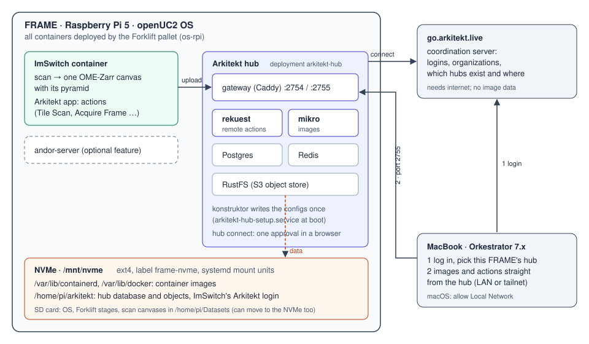

# Arkitekt hub on a FRAME

:::caution In progress
This is a working state from November 2026, not a released feature. It runs on one test FRAME
and needs manual steps. Branches and open points are listed at the end.
:::

## The idea

[Arkitekt](https://arkitekt.live) connects microscopes, analysis tools and people. A
**hub** stores the images (*mikro*) and passes on remote actions (*rekuest*). A
**coordination server** (go.arkitekt.live) only holds logins, organizations, and which hubs exist
and where to reach them.

Each FRAME runs **its own hub**, installed with the rest of the system by the openUC2 OS pallet:

- **ImSwitch** registers with the hub as an Arkitekt app. It offers actions such as *Tile Scan*
  and *Acquire Frame*, and after a scan it uploads the canvas (one OME-Zarr image with its
  pyramid) to mikro.
- **Orkestrator** (the Arkitekt desktop app) logs in at go.arkitekt.live, picks the FRAME's hub,
  and then gets images and actions **straight from the FRAME**, over the local network or the
  tailnet. Image data never leaves the lab.
- The hub's database, objects and container images live on an **NVMe**, not on the SD card.



## What runs where

| Part | Where | Deployed by |
|---|---|---|
| ImSwitch (with the Arkitekt client, arkitekt 16) | container `imswitch` | pallet deployment `imswitch`, feature `arkitekt` keeps its login in `/home/pi/arkitekt/imswitch` |
| Hub: gateway (Caddy, ports 2754/2755), rekuest, mikro, Postgres, Redis, RustFS | compose project `arkitekt-hub` | pallet deployment `arkitekt-hub` |
| Hub configs, certificate, keys | `/home/pi/arkitekt/arkitekt-hub` | `konstruktor hub create`, once, from `arkitekt-hub-setup.service` at boot |
| Container images, hub data | NVMe at `/mnt/nvme` | systemd mount units (not yet in the pallet) |
| Logins, organizations | go.arkitekt.live | Arkitekt |

## Setting up a FRAME

1. **NVMe.** Format it with the label `frame-nvme`, then mount it and bind-mount
   `/var/lib/containerd`, `/var/lib/docker` and `/home/pi/arkitekt` onto it with systemd mount
   units. Docker and containerd get `RequiresMountsFor=` for those paths. An `/etc/fstab` line
   does not work on openUC2 OS: `/etc` is an overlay mounted after systemd reads fstab.
2. **Pallet.** Switch to the os-rpi branch with the hub, then enable it:
   ```sh
   forklift plt switch github.com/openUC2/os-rpi@feat/arkitekt-hub
   forklift plt enable-depl arkitekt-hub
   forklift plt enable-depl-feat imswitch arkitekt
   forklift plt stage && sudo reboot
   ```
3. **Connect the hub** once. Open the printed link and accept the hub into your organization:
   ```sh
   konstruktor hub connect --in /home/pi/arkitekt/arkitekt-hub --server go.arkitekt.live --no-open
   ```
4. **ImSwitch.** Add an `arkitekt` block to the setup file, then press *Connect* in the Arkitekt
   panel and approve this FRAME's hub:
   ```json
   "arkitekt": {"enabled": true, "appName": "frame-<name>", "url": "https://go.arkitekt.live",
                "autoConnect": true, "useMikro": true,
                "uploadExperiments": true, "deleteAfterUpload": false}
   ```
5. **Orkestrator.** Log in at go.arkitekt.live and pick the hub named `openuc2-<name>`. On macOS,
   allow Orkestrator under *Privacy → Local Network*. Check that
   `curl -k https://<frame address>:2755/mikro/ht` prints `200` on the Mac.

## First measurements

Synthetic scan, 10 × 10 RGB tiles of 3072 × 2048 pixels, 12 bit (3.8 GB raw), written with
ImSwitch's own OME-Zarr writer, then its pyramid. Same ImSwitch image, Raspberry Pi 5 with 8 GB.

| Step | NVMe | SD card |
|---|---|---|
| Write the 100 tiles | 83 s | 418 s |
| Build the pyramid (5 levels) | 35 s | 546 s |
| Total, including flushing to disk | **127 s** | **977 s** |
| CPU time spent waiting for the disk | 1 % | 69 % |

The NVMe is about 7.7 times faster for the scan itself. The CPU now spends its time on the work,
not on waiting. Peak memory was 1.1 GB in both runs, and the Pi did not throttle.

SD cards differ a lot. On FRAME ID10 the same pyramid took 128 s on its card, and the whole way
from the end of the scan to the image in mikro took 6.5 minutes (259 s of it for the upload).
The upload to mikro on the NVMe has not been measured yet.

## Known limits

- **Every scan is stored twice**, once as ImSwitch's canvas and once as mikro's re-encoded copy,
  unless `deleteAfterUpload` is on. mikro does not downscale on the server, so ImSwitch uploads
  its pyramid.
- **Orkestrator** is macOS arm64 only so far. It draws at most 64 layers, so a scan has to be one
  canvas, not one image per tile.
- **The hub's addresses are fixed when it connects.** After an IP change run
  `konstruktor hub connect … --reach this-network`, or reserve the DHCP lease.
- **Forklift removes compose projects it does not know.** Start the hub only through the pallet
  deployment, never with `konstruktor up`.
- Logins and token refresh need go.arkitekt.live, so the FRAME needs internet. A local coordination
  server (`konstruktor coord create`) would work offline but has not been tried.
- Docker publishes ports 2754 and 2755 on every interface, whatever the firewall zones say.

## Open work

- Bring the hub branch up to date with `edge`, and merge it.
- Put the NVMe setup into the pallet, as a deployment that can be enabled.
- Merge ImSwitch PR #333 (`feat/arkitekt-hub-mikro`) and pin the image built from it.
- Show the hub's connect link in the machine portal, so no terminal is needed.
- Test the boot path end to end: setup unit, connect, upload, reboot.

| | |
|---|---|
| ImSwitch | branch `feat/arkitekt-hub-mikro`, PR #333 |
| Pallet | os-rpi branch `feat/arkitekt-hub`, package `deployments/arkitekt-hub.pkg` |
