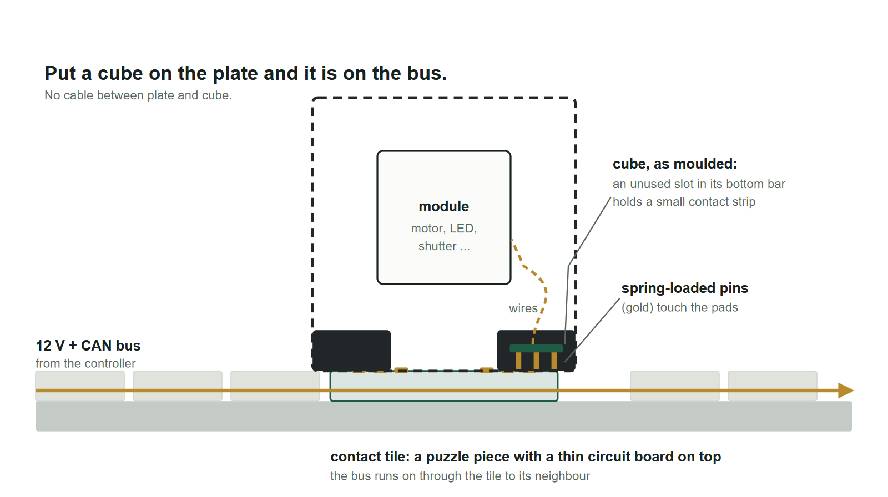
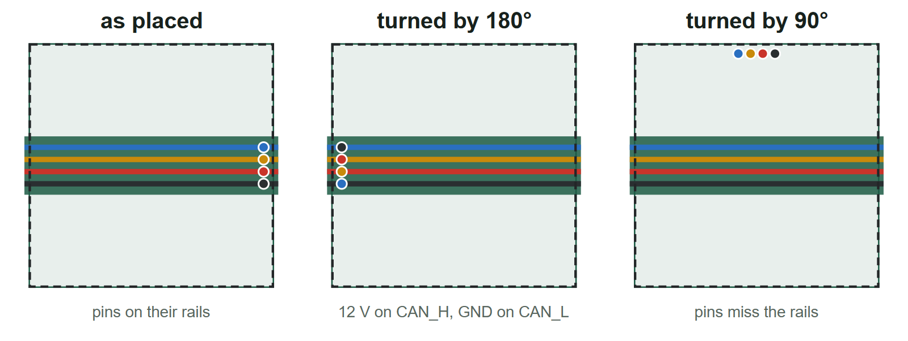
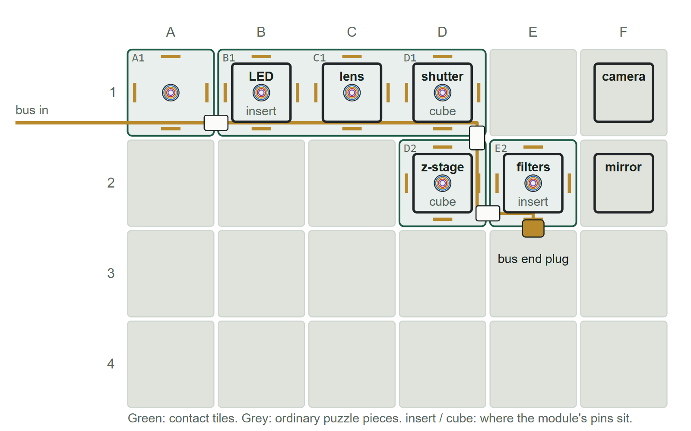
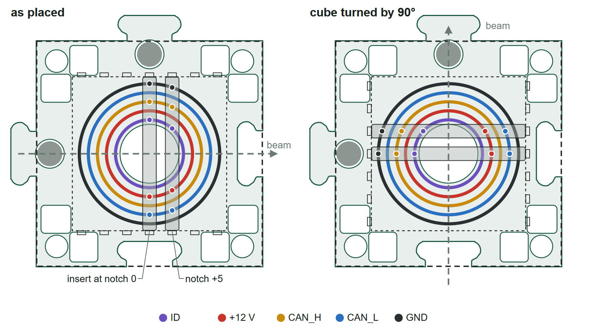
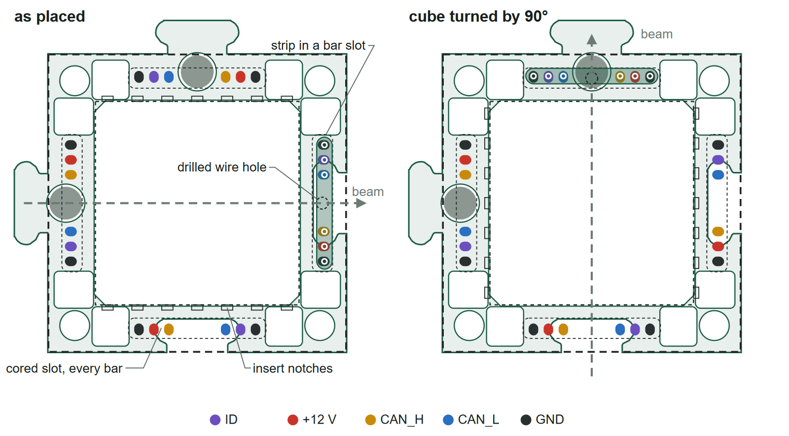
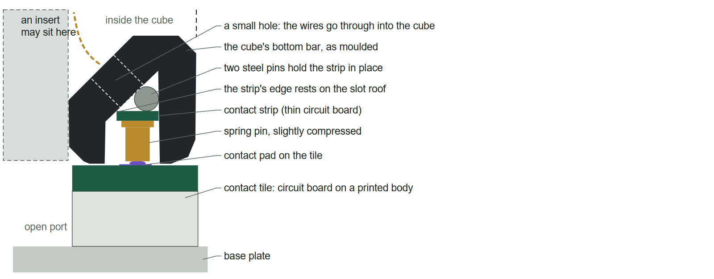

# Cables-free bus contacts for cubes

**Status:** concept worked out, checked against the CAD of the moulded cube; the first test parts are being prepared.
Nothing is built yet.

Many of our electronics (motors, LEDs, lasers, shutters, galvos) already talk over one shared CAN bus with 12 V power.
Today every module needs a cable to that bus. We are working on contacts that connect a cube to the bus **as soon as it
is put on the base plate**: spring-loaded gold pins in the cube touch pads in the base. No cable, no plug, and the
cube can still be lifted off and put down in any of its four orientations.

## What we want

- CAN and 12 V reach a module when its cube stands on the plate.
- **No wrong connection**, whichever way the cube is turned. Plus and minus must never meet the wrong contact.
- A **firm contact**, also after many placements. Mostly signals, plus a little power for small motors (about 1 A
  per cube).
- **Cheap and easy to make.** Ordinary cubes, inserts and puzzle pieces keep working next to the electrified ones.

## Why not just two rails?

Our first prototype put long probes in a milled slot of a cube and a strip of copper rails in the base. It works, but
only in one orientation: turn the cube by 180° and the pins land on the rails in reverse order (12 V on a CAN line),
turn it by 90° and they miss the rails.

So the contacts have to look the same from all four sides.

## The base: a contact tile

The base side is a **contact tile**: a puzzle piece of the usual size with a thin circuit board on top. It sits in
the puzzle layer next to ordinary pieces, so a plate can be electrified where it is needed and nowhere else. The 12 V
and CAN lines run through the tile to its neighbour, a few tiles in a row can be one longer piece, and the last tile
gets a termination plug.

Every tile also tells the module **where it stands**. A tiny memory chip on the tile holds a unique number, and the
module reads it over one extra contact. The controller then knows "the LED module is in C3" without any
configuration, and two identical modules on one plate get different CANopen node numbers.

## Two ways to put the pins on the cube

We looked at two places for the pins and are testing both ideas. Both use the same tile and the same kind of
spring pin, and both work in all four orientations.

### In the insert: rings

Five gold rings (ID, +12 V, CAN_H, CAN_L, GND) run around the centre of the tile. A ring looks the same from every
side, so a pin touches the right ring however the cube stands. The pins sit on a small foot in the bottom tab of the
insert, so the cube itself stays unchanged.

The catch: a pin's distance from the centre depends on where the insert sits in the cube. Thin inserts only
work at the centre notch and the two next to it, and light can pass the tile only through a 13 mm hole in the middle.

### In the cube: a strip in the slot we already have

Each of the four bars on the bottom of the moulded cube has a hollow slot, open to the bottom and about 23 mm
long. It does not hold anything, which makes it a free place for a small contact strip. The strip carries six pins,
and the tile carries the same pad group four times, turned by 90° each, so every orientation finds its own pads.
Any insert works at any notch, and the cube's 34 mm opening stays free.

The strip is held by **two small steel pins** that lie in the corner of the slot, which positions them without a
jig. The only change to the cube is a **small drilled hole** that lets five thin wires from the strip into the cube,
to the module. The section below shows what sits where.

We first planned to mill the slot and fill it with a printed wedge. Drilling one hole is much easier, and the steel
pins give a more reproducible result, so this is the version we will build first. For the very first test, we
check the fit of the steel pins on a few real cubes before we order any boards.

## How a module connects

A cube with a motor, a shutter or a small LED driver gets a pigtail of five thin wires from its strip and ends
in a small plug. A module that already carries its own electronics (a camera, a motor board) plugs in directly.
There is no space for a connector inside the slot itself.

## Staying safe

The contacts are open, so a dropped screw could touch two of them. We plan for that:

- Ground is the outermost contact, so a cube that is put down tilted touches ground first.
- A fuse or a self-resetting limiter protects each tile, so a short trips one tile and nothing else.
- The CAN chip in the module is chosen to survive 12 V on its bus pins; the one on our boards today only tolerates 16 V.
- A module protects itself against reversed polarity and against pulling the bus down when it is put down.
- Pins touch **vertically**: the cube stands on its corner bosses, which are higher than the pins, so the pins land
  on their pads when the cube sinks into the puzzle pieces and never drag across other contacts.

## Which way?

| | Pins in the insert (rings) | Pins in the cube (strip) |
| --- | --- | --- |
| Changes to the cube | none | one drilled hole |
| All four orientations | yes | yes |
| Where the insert can sit | centre notch and the two next to it | anywhere |
| Light through the tile | 13 mm hole | the full 34 mm opening |
| Wiring inside the cube | none, the pins belong to the insert | five wires from the strip |
| One bus node per | insert | cube |

We favour the strip in the cube for modules that sit in a cube (motors, stages, shutters), and keep the rings for
inserts that carry their own electronics. Both can live on the same tile.

## What is checked so far

- The strip, its two steel pins and the hole fit the CAD of the moulded cube, with no collisions.
- The spring pins compress by about 0.75 mm in the cube, within their working range of 0 to 1.0 mm.
- The tile fits the puzzle layer and the pads clear the screws and tie rods.
- A contact strip and a panel of them are drawn and ready to be ordered from a board maker.

## Next

- Order the first strips and steel pins, drill a few cubes and measure the real fit.
- Build a test tile with both the rings and the pads.
- Measure contact resistance over many placements, in all four orientations, and run CAN and a motor over the
  contacts.
- Decide the tile's cell ID, how tiles join across a plate, and which plate is the first one to electrify.

Questions or ideas? Write to [support@openuc2.com](mailto:support@openuc2.com).
