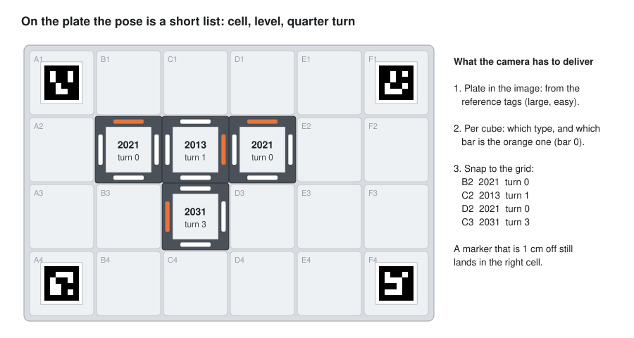
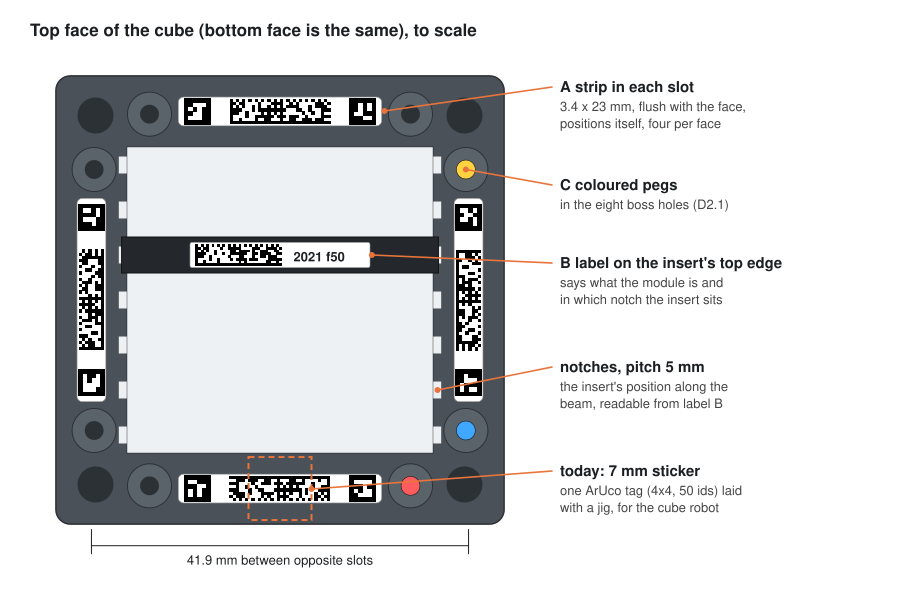
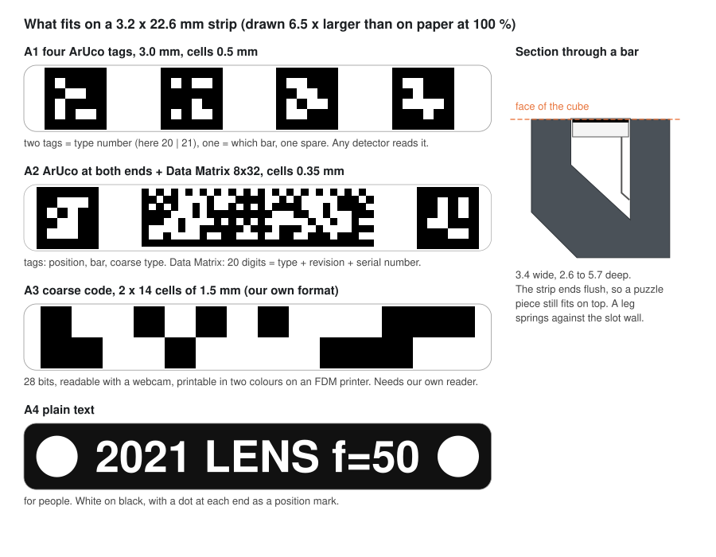

# Markers on cubes: which module is it, and where does it stand?

**Status:** a collection of ideas (November 2026). Nothing here is built, except the paper stickers our cube robot
already uses. Dimensions of the cube are measured on its CAD. The numbers on how well a camera reads a code come from
a quick simulation, not from a real camera yet.

A camera (or a phone) looks at a setup and should tell us, for every cube:

1. **What it is.** "A lens cube, f = 50 mm", which is one entry in OptiKit, our parts library.
2. **Which one exactly** (optional). A serial number, for example to keep a measured focal length or a loan record.
3. **Where it stands and how it is turned.**

What we would use it for: turn a photo of a setup into an OptiKit design, draw the beam path over a live image, let
the cube robot find and pick cubes, check that a kit box is complete, and give students feedback on what they built.

## Two things that make the task easier

**On the plate, the pose is a short list.** A cube on the base plate sits in a cell of the 50 mm grid, on a level, in
one of four quarter turns. The camera does not have to measure 0.1 mm. It has to find the plate (a few large reference
tags), read the cube and decide which cell and which turn. A marker that is found 1 cm off still lands in the right
cell. Only cubes that stand freely on a table, and the robot's gripper, need a real position in millimetres.

**The identity belongs to the insert, not to the cube.** The moulded cube is the same for every module. What makes a
lens cube a lens cube is the insert, and the notch it sits in decides the focus. So a complete answer has two parts: a
marker on the cube (where is the cube, how is it turned) and a marker on the insert (what is it, in which notch). For
modules we sell as one unit, the cube marker alone is enough.

## Where a marker can go

| place | size | good | not so good |
| --- | --- | --- | --- |
| **A** the slot in each bar | 3.4 x 23 mm, 2.6 to 5.7 mm deep, four on the top face and four on the bottom face | a strip positions itself (no jig), ends flush so everything still stacks, is protected from scratching, can be taken out again; four strips 41.9 mm apart give a much steadier angle than one small tag | only 3.4 mm wide, so the code cells are small; hidden when something is stacked on top |
| **B** the top edge of the insert | about 4 x 34 mm on a thin insert, more on a lens insert | identifies the insert itself and shows its notch (5 mm steps) through the top opening | every insert type has a different edge (spring lugs, screws): to be checked part by part |
| **C** the eight boss holes | D2.1 mm, 7 mm deep | coloured pegs, readable by eye and by a simple camera | few combinations, colours depend on the light; we have to check what the holes are for |
| the lands beside a slot | two strips of 2.2 mm per bar | direct laser marking or print, no extra part | very narrow, only a line code or text |
| the outer rim of a cube half (side view) | about 7.9 mm high, not measured yet | visible from the side and on a stacked cube | needs a sticker or a print, a neighbouring cube hides it |
| inside the slot, not visible | same slot | an NFC tag, read by a phone | no pose |

The side faces of the cube have no slots (measured on the CAD of the cube: the slots are in the four bars of the top
and of the bottom face). The bottom slots are the place we want to use for the
[cube bus contacts](../cube-bus/README.md), so the **top slots are the natural place for markers**.

Anything that stands proud of the face collides with a puzzle piece or a plate on top. A marker therefore has to end
flush with the face, or be a sticker thinner than about 0.15 mm.

## What fits on a strip

| layout | carries | camera needs | remark |
| --- | --- | --- | --- |
| A1 four ArUco tags of 3 mm | type number as two tags (up to 1 000 000 with the 1000-tag dictionary), which bar | 0.5 mm cells | read by OpenCV as it is |
| A2 two ArUco tags + Data Matrix 8x32 | tags: position, bar, coarse type; Data Matrix: 20 digits (type, revision, serial number) | 0.35 mm cells for the Data Matrix | our favourite: found from far, read completely from near |
| A3 coarse code, 2 x 14 cells | 28 bits | 1.5 mm cells | works with a webcam and with two-colour FDM printing, but needs our own reader |
| A4 plain text | whatever fits in about 14 characters | a person | at least one of the four strips should be this |

All four strips of a face carry the same type, plus a number 0 to 3 for the bar. One visible strip is then enough for
type and quarter turn, two strips give a good position. This also survives a knob, a cable or a hand over part of the
cube.

**How many camera pixels per cell?** In a simulation (blur of 0.6 pixel, noise, reduced contrast, random turn; 60 tags
or 20 codes per setting) a 4x4 ArUco tag was found every time from 3 pixels per cell (87 % at 2.5, 45 % at 2), a Data
Matrix 8x32 from 2.5 pixels per cell (85 % at 2). For a real camera we would plan with 4.

| camera | pixels per mm | today's sticker (0.875 mm cells) | A1 (0.5 mm) | A2 Data Matrix (0.35 mm) | A3 (1.5 mm) |
| --- | --- | --- | --- | --- | --- |
| cube robot: 12 MP, 0.9 m above, 47 cm wide view | 8.6 | 7.5 px, fine | 4.3 px, fine | 3.0 px, at the limit | 13 px |
| Full HD webcam over one 6 x 4 plate (35 cm) | 5.5 | 4.8 px, fine | 2.7 px, too few | 1.9 px, no | 8 px, fine |
| phone, 12 MP, one plate fills the picture | 11.5 | 10 px | 5.8 px, fine | 4.0 px, fine | 17 px |

So the small codes need a 12 MP camera or a phone. With a webcam only the coarse code or today's sticker works.

**Angle.** With a corner found to about 0.2 pixel, one 5.25 mm tag gives the turn of the cube to roughly 0.25°. Four
strips 41.9 mm apart give about 0.03°, because the points are eight times further apart (rough estimate).

## How to make the markers

| way | smallest cell we expect | effort | remark |
| --- | --- | --- | --- |
| printed label (paper or polyester), laid with a jig | 0.3 mm | lowest | what the cube robot uses today; wears, and by hand it sits too far off (4 of 20 simulated picks missed, 0 of 20 with the jig) |
| label in the bottom of the slot or on a strip | 0.3 mm | low | protected, positioned by the slot |
| two-layer engraving sheet (white core, black top), cut and engraved on a laser cutter | 0.3 mm | low, hundreds per sheet | matte, no ink, strip and code in one step; our first choice to try |
| strip printed in two colours (FDM) | 0.8 to 1 mm | low | only the coarse code A3 |
| strip printed in resin (SLA), then UV-printed or laser-marked | 0.3 mm | medium | a spring leg can be part of the strip |
| UV printer directly on the cube, cubes in a tray | about 0.2 mm lines; white ink is the weak point | medium, good for series | bosses stand 2 mm above the face, the print head must clear them; ABS yellows under UV light |
| laser marking directly on the cube | 0.2 mm | low per cube, needs the right laser | contrast on black plastic depends on the plastic and the laser (UV lasers are the usual choice); only the 2.2 mm lands are flat. To be tested on real cubes |
| pad printing at the moulder | 0.3 mm | per series | the same picture on every cube, so only position marks, not the type |
| change in the mould | | high, once | a flat label pocket or position marks on every cube; the type cannot be moulded in |

The type changes per module and the cube is the same for all, so the type should be on a part that is added when the
module is assembled (a strip or a label). Marks that are equal on every cube (position marks, "this is bar 0") could be
moulded or printed at the moulder.

## Without a camera

- **NFC tag** in a slot or under the strip. A phone opens the OptiKit page of the module, and every tag has its own
  unique number from the factory. No position. On the bottom face the aluminium plate is close and may disturb the
  tag, the top face is better.
- **The cube bus.** The [contact tile](../cube-bus/README.md) already tells a module in which cell it stands, and
  the four turned pad groups tell the quarter turn. A passive cube (a lens, a mirror) could carry only a small memory
  chip on its strip and would be found the same way, with no camera at all. Costs a strip and a chip per cube.
- **Coloured pegs** (C in the sketch): eight holes, a few colours, a pattern that reads differently in each quarter
  turn. Cheap and readable by eye, for a classroom rather than for a robot.

## Which number goes on the marker?

OptiKit names are text, for example `openuc2.detector.cam_obj`, and a record also has the article reference
(`sku`), which holds the Inventor number of the part that is sold, for example `ASS - 2021 - CUBLEND40F50 - V04`.

- **Type: the four-digit number** (2021). It is short (fits in two small tags or 14 bits), people already use it, and
  it is printed on the part list. A table made from the OptiKit library translates it to the OptiKit name. The name
  can then change without reprinting a marker.
- **Serial number, only where we need it:** a running number per type is enough. With the type and a revision it fits
  the 20 digits of a Data Matrix 8x32 (10 digits fit the shorter 8x18).
- **A full UUID** (16 bytes) needs a Data Matrix 12x36 (checked with an encoder). In a 3.2 mm strip its cells would be
  0.27 mm, too fine for a camera above the plate. Better: the UUID stays in the database and the marker holds type and
  serial number. An NFC tag has room for a UUID and a link.
- **For phones:** the full OptiKit link as a QR code is about 9 mm wide at least. That belongs on the box, on a side
  label or in an NFC tag, not in the slot.

## What exists already

- **Our cube robot** (`openuc2-cube-robot`): one ArUco tag (4x4, 50 different tags, 5.25 mm) on a 7 mm sticker on the
  top face, a 12 MP camera 0.9 m above the table. Works, but 50 tags are too few for a catalogue, and the sticker
  needs a jig.
- **[AI-Driven Robotics for Optics](https://arxiv.org/abs/2505.17985)** (Uddin et al., MIT, 2025): a robot arm builds
  and aligns free-space setups. Every printed housing carries 6x6 ArUco tags on its top and side, two 4K cameras
  23 cm apart look from above, the robot places parts to about 0.5 mm and 0.2°. The tags are as large as the housings
  allow, which is the "not compact" problem. Tag size and reading rates are not given. Code is public.
- **[AprilTag 3](https://github.com/AprilRobotics/apriltag)** (Krogius, Haggenmiller, Olson, 2019): tag families with
  free layouts. One family has about 48 700 tags (enough for all four-digit numbers), one leaves the middle of the tag
  free, and round ones exist. Interesting for us: a "tag" whose cells lie on the bars around the opening.
- **[ArUco and ChArUco in OpenCV](https://docs.opencv.org/4.x/d5/dae/tutorial_aruco_detection.html)**: the reference
  tags on the plate and the small tags on the strips, no extra software.
- **[Fractal markers](https://uco.es/investiga/grupos/ava/?p=76)** (Romero-Ramirez et al., 2019): tags nested in tags,
  found from far and from near and with parts hidden. The same idea as our "tags for finding, small code for reading".
- **Rectangular codes for narrow places:** Data Matrix has rectangular sizes from 8x18 cells, the
  [extension DMRE](https://e-d-c.info/projekte/dmre.html) (ISO/IEC 21471) adds longer ones such as 8x64, and the
  [rectangular Micro QR code](https://en.wikipedia.org/wiki/Rectangular_Micro_QR_Code) (ISO/IEC 23941) starts at 7
  cells high. Industry laser-marks Data Matrix codes of 2 to 3 mm on electronic and medical parts every day, read by
  a reader at close range.
- **Markers inside printed parts:** [InfraredTags](https://arxiv.org/abs/2202.06165) (a code printed inside the part
  with a filament that lets infrared light pass, read by an infrared camera) and
  [BrightMarker](https://groups.csail.mit.edu/hcie/files/research-projects/brightmarker/2023-UIST-BrightMarker-paper.pdf)
  (the same with fluorescent filament, better contrast, tracked in real time), both from MIT. An option for printed
  inserts and housings, not for the moulded cube. Overview of such methods:
  [Ubiquitous Metadata](https://arxiv.org/abs/2407.11748) (Dogan, 2024).
- **No marker at all:** we have the CAD of every module, and methods that find the pose of a known CAD model in an
  image exist (FoundationPose and others). From outside, though, all cubes look alike, and lenses and mirrors are hard
  for these methods. Useful later to refine a pose that a marker has found. Not looked at in detail.
- Also not looked at in detail: STag and TopoTag (tags made for a steadier pose).

We found no published work on markers for the parts of a modular optics kit.

## What we would try first

1. **Print the four layouts on label paper**, lay them into the top slots of a few cubes and photograph them with the
   cube robot's camera, a webcam and a phone. Count how often each one is read, in room light and in a darkened lab.
2. **Reference tags on the plate** (on free puzzle pieces or on the rim), and the short program that turns "tags seen"
   into the list "cell, turn, type".
3. **Cut strips from engraving sheet** on the laser cutter and check the fit in the slots of real cubes (the slot has
   a draft).
4. **Lay a label on the top edge of a lens insert** and see whether the notch can be read through the top opening.
5. Generate the table "number to OptiKit name" from the library.

## Open questions

- Which plastic are the moulded cubes made of, and does a laser leave a readable mark on it?
- What are the D2.1 holes in the bosses for, and are they free?
- Is the outer rim of a cube half flat enough for a side label, and how much of it does a neighbour hide?
- Codes in a dark lab: is room light enough, or do we need infrared light and a print that reflects it?
- Do we want a serial number on every cube, or only on the ones with electronics or calibration data?
- The cube robot reads tag numbers 0 to 49 today. Which layout replaces its sticker without a second camera?

Questions or ideas? Write to [support@openuc2.com](mailto:support@openuc2.com).
