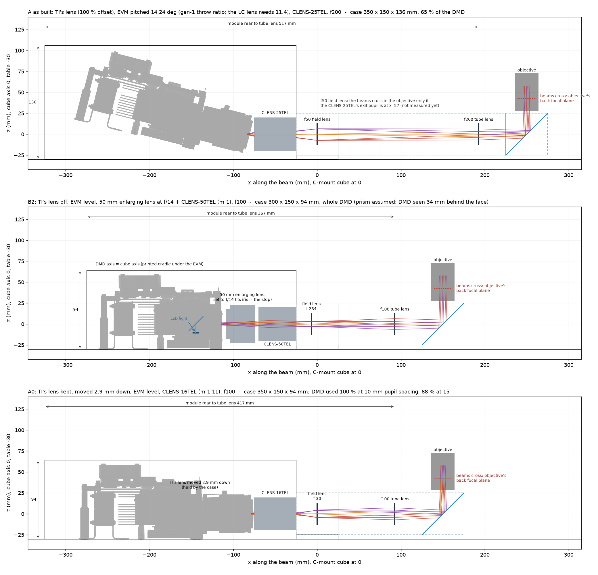
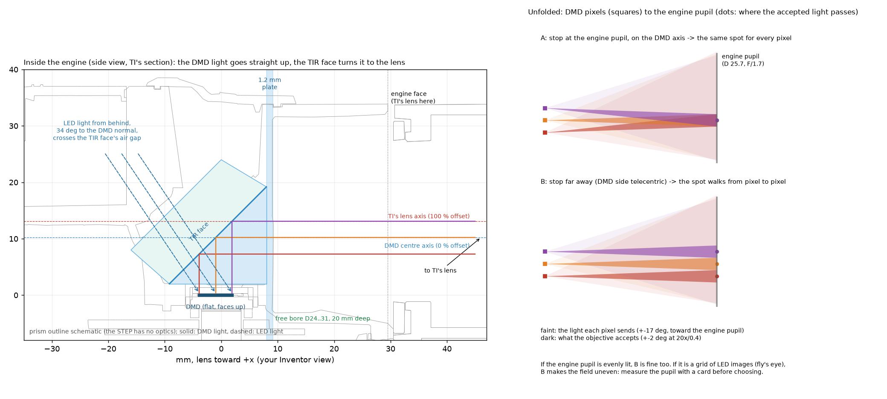
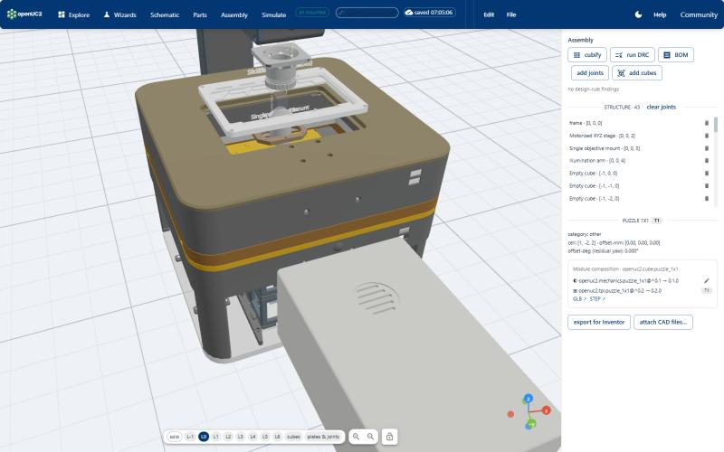

# Patterned LED illumination with the DLP4710

**Status:** optics worked out in theory; two relay layouts compared; the prototype starts once the evaluation module
is here.

We are building a module that projects light patterns, in blue, green or red, through the FRAME's objective into the
sample. It uses TI's DLP4710EVM-LC: a full-HD micromirror chip (1920 x 1080 mirrors at 5.4 µm) in a projector engine
with three LEDs. The LEDs are already inside the engine, so no fibre or laser is needed. Unlike our
[openSIM](../opensim/README.md), which uses coherent laser light to double the resolution, this module is for
incoherent patterns: stimulating chosen cells, exciting fluorescence only in a region of interest, bleaching
patterns, stripes for optical sectioning, and calibration grids.

## What to expect

| | |
| --- | --- |
| colours | blue 455 nm, green 520 nm (broad, used with a band-pass filter), red 624 nm |
| patterns | any pattern from a PC over HDMI, up to 1440 binary patterns per second; stored stripe patterns up to about 2500 per second, with trigger in and out for the camera |
| one DMD pixel at the sample (f180 tube lens) | 1.35 µm (4x), 0.54 µm (10x), 0.27 µm (20x), 0.14 µm (40x) |
| pattern field | 2.6 x 1.5 mm (4x) to 0.26 x 0.15 mm (40x): larger than the camera image with every objective |
| light at the sample | blue, estimated: about 0.6 W/cm² with a 10x/0.25, 1.5 W/cm² with a 20x/0.40 (to be measured) |

Each colour comes with its own dichroic and filters (for example a 495 nm long-pass for blue excitation of GFP or
GCaMP, or a dual-band dichroic to image GCaMP in blue while stimulating ChrimsonR in red).

## The design

The engine sends its picture through a projection lens that looks up from below the chip (100 % offset), which
would force us to tilt the whole module. We compared two ways to get a straight, compact module:

- **TI's lens off:** a 50 mm enlarging lens and a C-mount lens relay the chip 1:1 into the focus of the FRAME's tube
  lens. The enlarging lens's own aperture ring matches the light cone to the objective. Module about 300 x 150 x 95 mm.
- **TI's lens kept:** the case holds TI's lens 2.9 mm lower, centred on the chip, and a 16 mm C-mount lens takes the
  picture from there. It needs no knowledge of the optics inside the engine.

## Inside the engine

The chip lies flat and sends its light straight up; a prism turns it toward the lens, while the LED light comes in
from behind at 34° through the same prism. Each pixel sends a wide cone, of which the microscope uses only a narrow
part. Where we put the aperture decides whether every pixel uses the same part of that cone, which keeps the field
evenly lit.

## In the FRAME

A placeholder of the module already sits in the FRAME configurator, in front of the OPM, for quotes and planning.

Next: measure the engine's light cone and the chip's depth on the real module, choose the layout, then design the
case.
