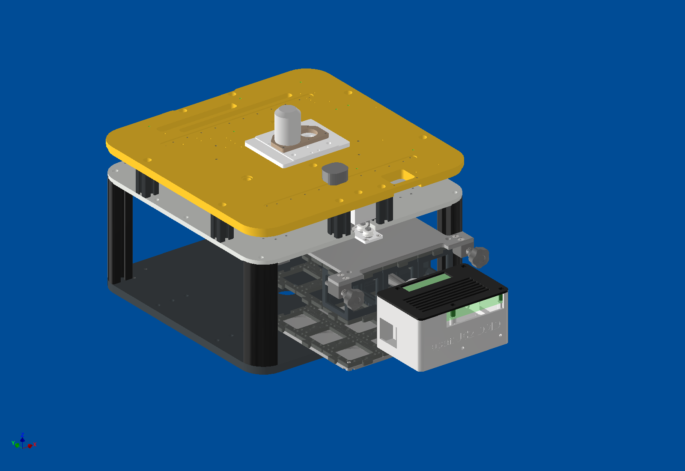
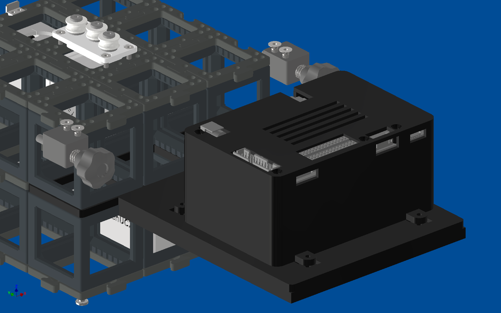
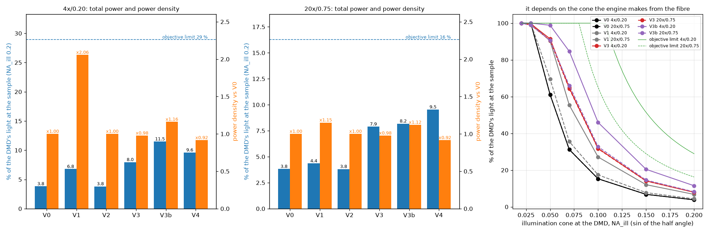
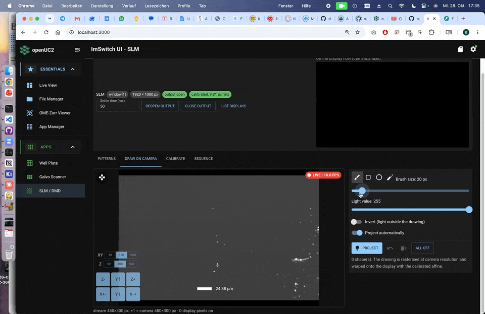
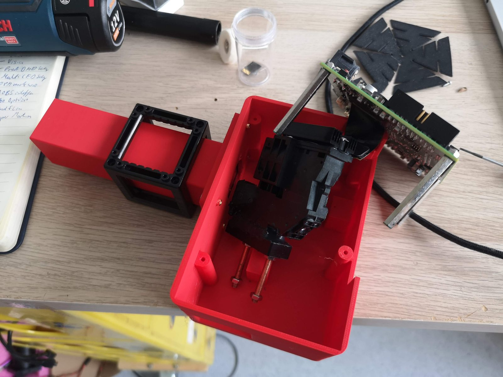
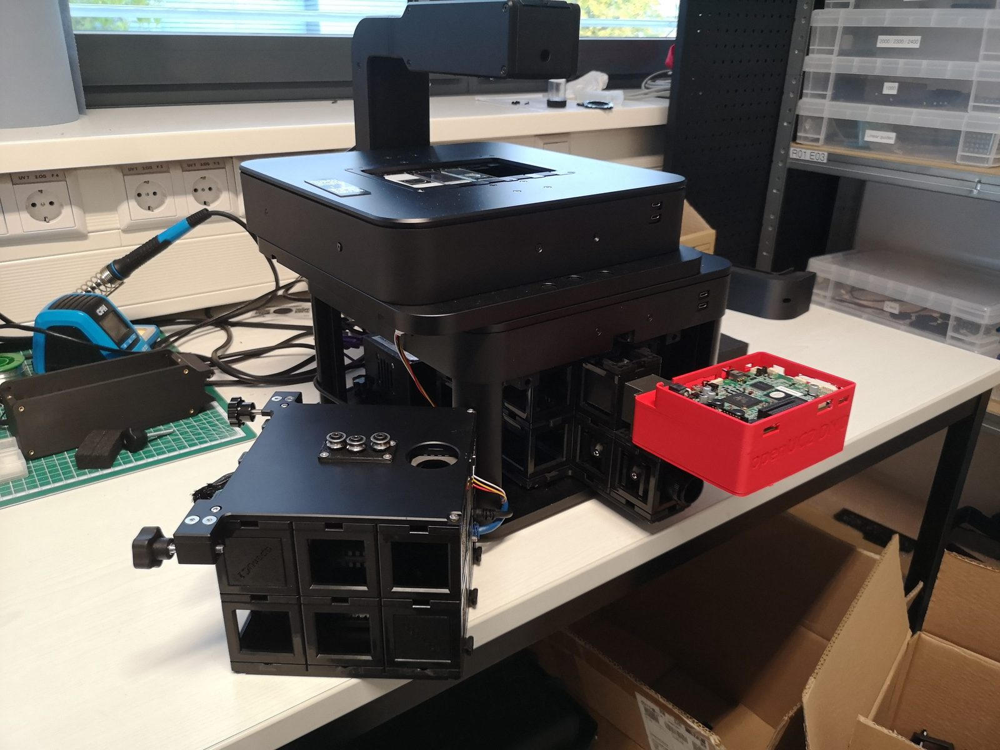
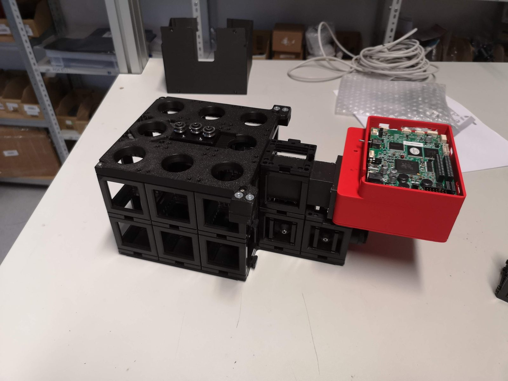

# DLP projector in the FRAME OPM

**Status:** case and fibre adapters designed; the fit in the FRAME is checked in CAD.

We are adding patterned illumination, for example photostimulation of selected cells, to the FRAME. A DLP projector
engine from EKB Technologies sits at the focus of the 180 mm tube lens in the upper layer of the OPM, so its micromirror
pattern is imaged into the sample through the objective.

## The design

- A printed case holds the projector engine and its driver board; all connectors stay accessible.
- The case rests on the standard puzzle pieces and cubes of the OPM and slides along the optical axis for focusing;
  two knurled clamps lock it.
- Light comes in by fibre: there are adapters for both SMA and FC/PC fibre connectors.

## Simulation: how much light reaches the sample

We compared several illumination layouts. Depending on the layout and the objective, about 4 % to 12 % of the light on
the micromirror chip reaches the sample. The cone of light coming from the fibre matters most.

## In Action

In ImSwitch we have a little tool that is helping you align the camera image to the slm:

Evaulation board in the module:

in Frame: 

