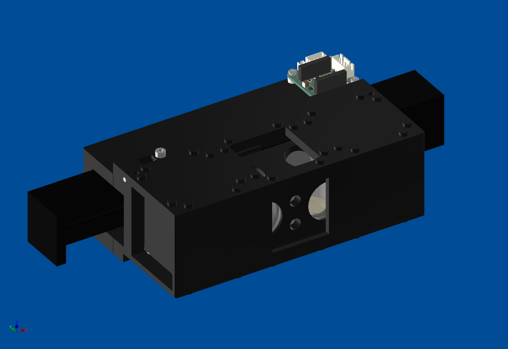
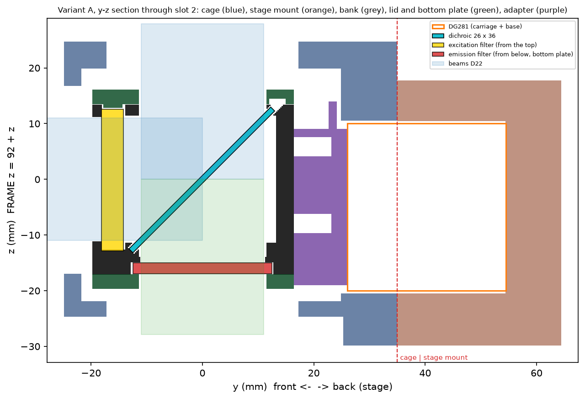
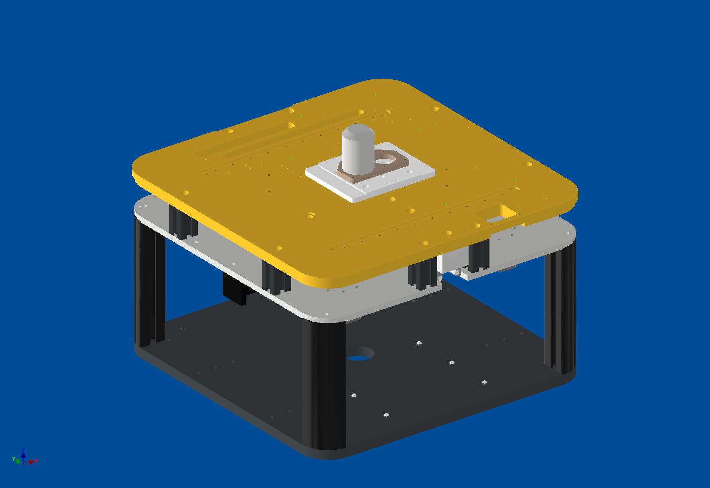

# Motorised filter changer for the OPM

**Status:** rev C designed (larger dichroics, mounted emission filters, separate stage mount); a variant with built-in
LEDs was added.

Instead of one multiband filter set, a linear stage moves a bank of **four complete filter sets** across the optical
axis of the OPM. Each slot holds an excitation filter, a dichroic and an emission filter.

## The design

- A DG281 linear stage (150 mm) with a stepper motor moves the filter bank; the motor sits at the back.
- Filters: 1 inch excitation and emission filters, 26 × 36 mm dichroics. The excitation filters drop in from the top;
  the emission filters sit on a screwed bottom plate.
- The module is 60 mm high including the puzzle pieces, so normal cubes fit above and below it.
- The stage mount is a separate part held by long screws, so it could later be made in metal.
- **Variant B** carries one LED per filter set directly on the bank, following a cube-switching design published in
  Light: Science & Applications (2023).

## In the FRAME

The module sits in the upper layer of the OPM. It is narrower than 250 mm and slides in and out of the FRAME with the
OPM. In CAD we checked all four filter positions and the sliding against the FRAME parts: no collisions.

