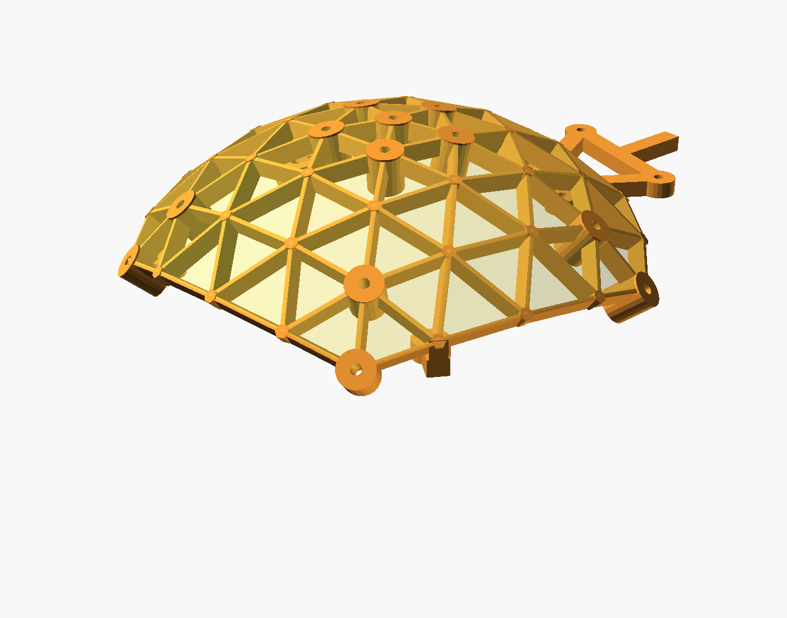
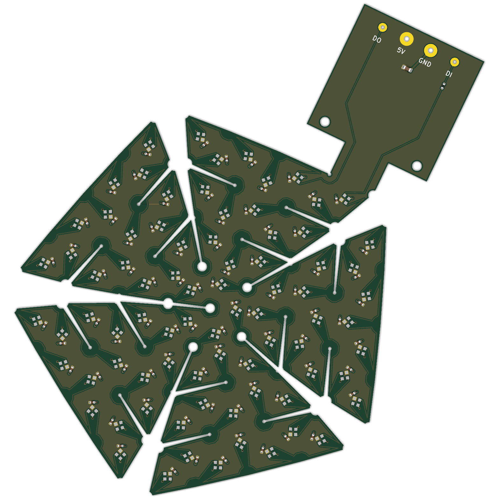

# Geodesic LED dome

**Status:** board, assembly files and holder are generated and checked. Next: order and fold the first board.

A flexible circuit board that folds into a dome, with one addressable LED on every facet. Every LED points at the
sample, so each one lights it from a different angle: brightfield, darkfield, oblique illumination and Fourier
ptychography from one light source.

## Key numbers

| | |
| --- | --- |
| LEDs | 221 (SK6812, individually addressable, one chain) |
| dome | 76 mm diameter, LEDs 38 mm from the sample |
| illumination angles | up to 81° from the axis (NA up to 0.99) |
| board | 2-layer flex PCB, 114 × 150 mm flat before folding |

## How it is made

One script generates everything: the KiCad board, the manufacturing and assembly files, the list of all LED positions
and angles (for the reconstruction software), and a 3D-printable holder the flex board is screwed to. Size and maximum
angle are parameters: a flatter dome with a smaller NA gets denser LEDs.

