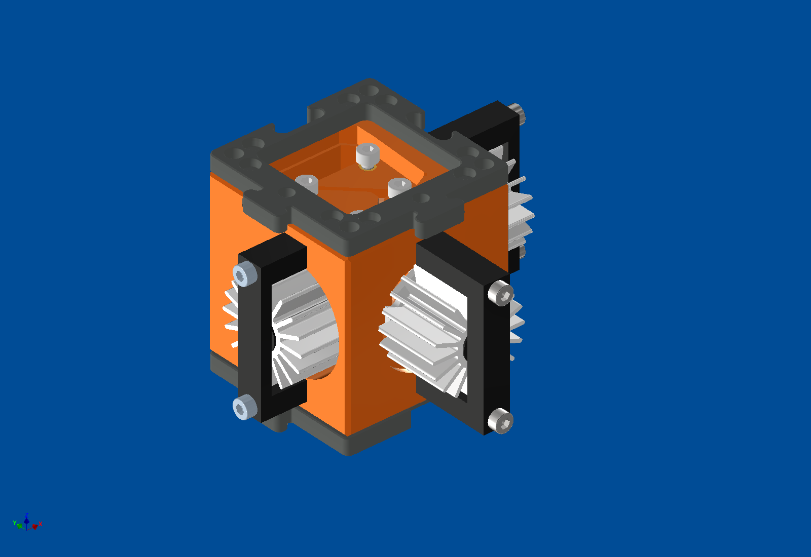
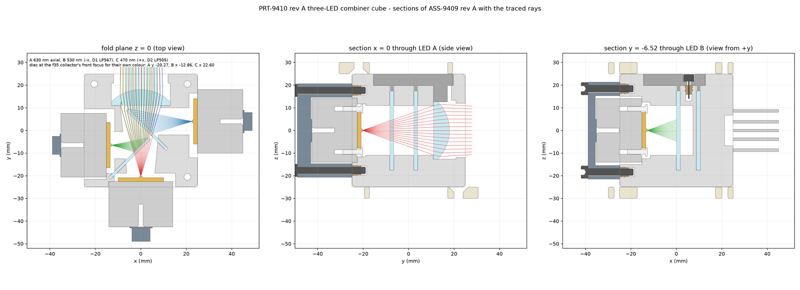
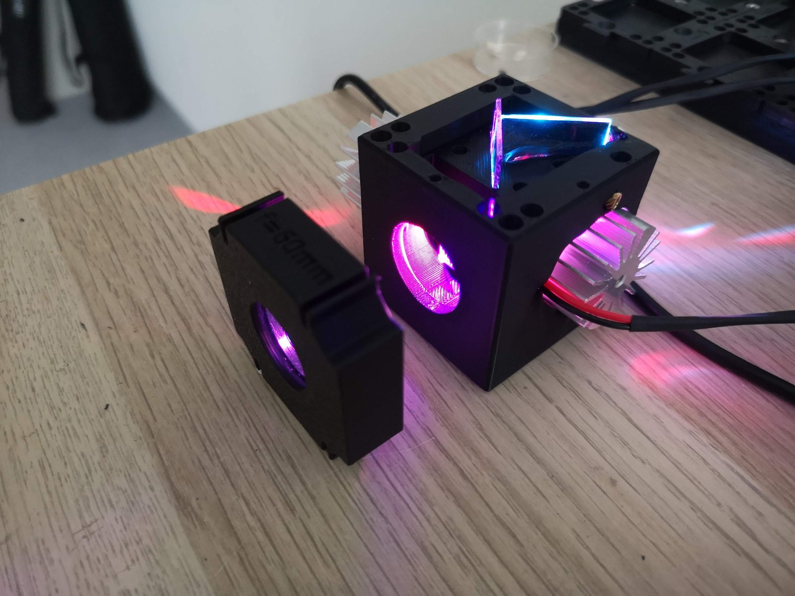

# Three-colour LED cube

**Status:** rev A designed after a first print and its review.

One cube that combines three LEDs (red 630 nm, green 530 nm, blue 470 nm) into one beam for fluorescence excitation.
Two dichroic plates join the colours, so no X-cube is needed, and a 35 mm collector lens sends all three along the same
path.

## The design

- The LEDs sit on round heat sinks; the two side LEDs can be shifted a little before they are clamped, for alignment.
- The dichroics (24 × 35 mm) slide in from the top; the collector lens can be changed through a cut-out.
- Puzzle pieces on both faces, so the cube connects to the rest of the setup like any other UC2 cube.
- Printed in resin first, milled later.

## Simulation

We traced each colour through the cube. Each LED sits at the collector's focus for its own colour, so all three beams
leave the cube on the same axis.

## In the FRAME

The cube is meant for the LED fluorescence path of the FRAME OPM, in place of separate LED cubes and a combiner, and it
can work together with the [filter changer](../filter-changer/README.md).

