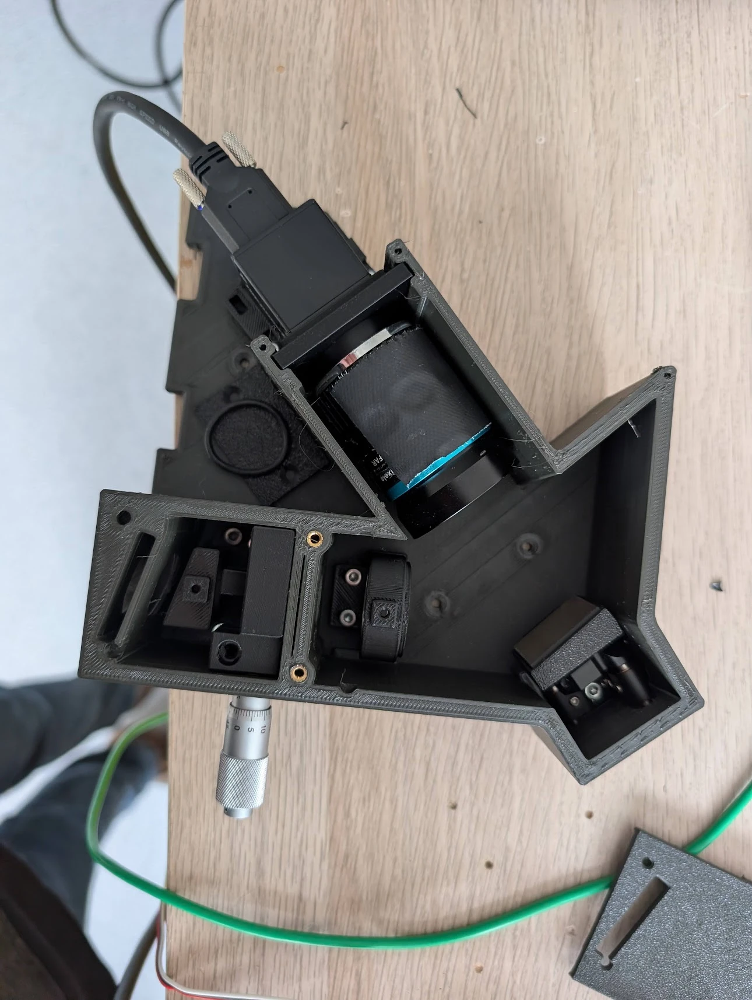
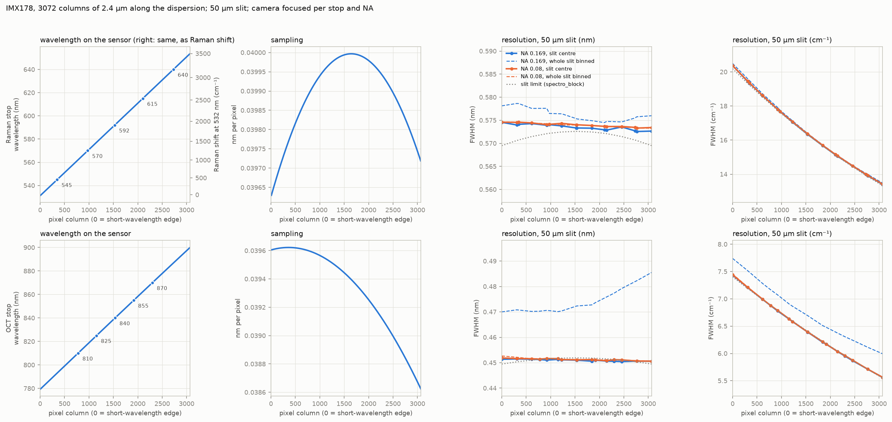
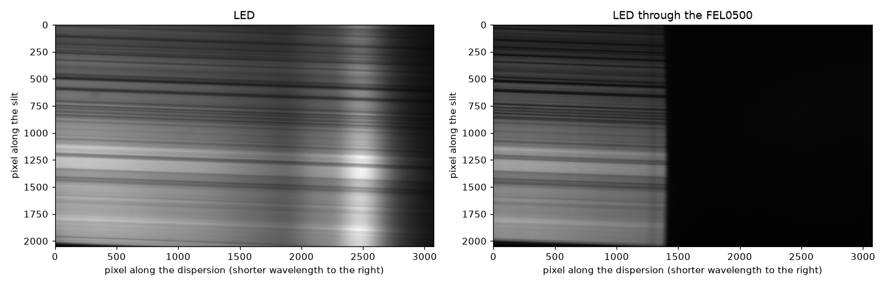

# openRAMAN spectrometer block

**Status (16 November 2026): prototype.** The block is printed and assembled and has seen its first light. We are now
calibrating it and collecting data. The slit is the next part to replace.

The openRAMAN is our cube version of the open-source OpenRAMAN starter edition. The spectrometer is one printed block
on the puzzle grid of a 6 × 4 base plate. The same block also serves our low-cost OCT: a second grating holder turns
the grating to the OCT angle.

## What is inside

- **Entrance:** an edge filter on a slide, and an achromat (BFL 20 mm) that focuses onto the slit.
- **Slit:** two blades on a printed flexure holder. A micrometer sets the width; a second screw sets the position.
- **Collimator:** a 35 mm achromat (Thorlabs AC254‑035‑A).
- **Grating:** 1200 lines/mm, on a kinematic mount.
- **Camera:** a 100 mm C‑mount lens (Berrybase CLENS‑100TEL) on a HIK MV‑CE060‑10UM (3072 × 2048 pixels, 2.4 µm).
- **Housing:**
  - The camera sits **outside** the closed housing: no heat at the optics, and the cables stay outside.
  - The housing follows the beam path and is light‑tight; the lid closes everything.
- **Inserts:** the lenses and the slit holder are inserts that are screwed down from the top. A different lens needs a
  new insert, not a new block.

## Simulation

Optiland model from the slit to the camera sensor (design values, not measured):

| collimator + camera lens | on the sensor | per pixel | resolution at a 50 µm slit |
| --- | --- | --- | --- |
| 35 mm + 100 mm (as built) | about 61 nm wide, e.g. 562–623 nm = 990–2750 cm⁻¹ at 532 nm | 0.020 nm | 0.8 nm (26 cm⁻¹) |
| 35 mm + 50 mm | about 123 nm wide | 0.040 nm | 0.8 nm |

- The collimator sets the resolution; the camera lens sets how much of the spectrum fits on the sensor.
- With the 100 mm lens the fingerprint region (400–1800 cm⁻¹, 544–588 nm at 532 nm) fits on the sensor. The grating has
  to be turned to that window.

## First spectra (15 November 2026)

Two frames: a white LED alone, and the same LED through a Thorlabs FEL0500 long‑pass filter (500 nm). No wavelength or
intensity standard was recorded yet, so the spectral axis below is in **camera pixels** and the values are **relative**.
Shorter wavelengths are to the right (the filter blocks the right part).

Analysis script and data: `analysis/led_fel0500_20261115.py` and `data/2026-11-15/` in the openuc2‑openraman
repository.

What the frames show:

- **Filter edge** (on the relative transmission, which cancels the LED spectrum):
  - 50 % at pixel 1398; it falls from 90 % to 10 % over 40 pixels (32–42 along the slit). The filter passes about 69 %
    above the edge in this frame.
  - At the design dispersion (0.020 nm per pixel) that is 0.8 nm, the same as the image of a 50 µm slit (about 41
    pixels). The resolution looks as designed. The width still includes the filter's own edge, so it is an upper limit;
    a line source measures it properly (see calibration).
- **Curved slit image:** the edge position bows by 16 pixels from the top to the middle of the sensor. The slit image is
  slightly curved (a "smile"), which is normal for this kind of spectrometer. Before rows are summed, each row has to be
  shifted by its own amount, or the lines broaden.
- **LED spectrum:** a peak at pixel 2474 and a dip at pixel 1847.
  - For a white phosphor LED these are usually the blue peak and the valley before the phosphor band, about 30–40 nm
    apart. Here they are 627 pixels apart, which would mean about 0.05 nm per pixel instead of the design 0.020.
  - We do not trust this until it is calibrated: it depends on which LED was used.
- **Exposure:** the frames are 8‑bit and the LED frame reaches 254 of 255. Use the camera's 12‑bit mode and stay below
  about 80 % of full scale.

### The stripes along the slit

- **Size:** the intensity varies by 10–12 % rms along the slit. The strongest period is about 290 rows, i.e. about
  0.24 mm along the slit (camera lens / collimator = 2.9 × magnification).
- **They change with wavelength.** The pattern at the long‑wavelength end does not match the pattern at the
  short‑wavelength end (correlation −0.2). A simple variation of the slit width would scale all wavelengths alike.
  These stripes behave like diffraction from the blade edges: the blades act like a weak grating along the slit.
- **Consequence:** a flat‑field correction cannot remove them. Summing many rows averages them out mostly, but a
  residual ripple stays in the spectrum. A clean slit is the fix.

## A better slit

| option | effort | notes |
| --- | --- | --- |
| **Precision slit in a mount** (e.g. Thorlabs S50RD, Ø1/2", 50 µm) | buy | laser‑cut in a thin metal foil, clean and parallel edges; the block already has a holder design for this mount size |
| **Laser‑cut or etched metal slits** (stainless‑steel slit plates, 25–200 µm) | buy, cheap | sold for DIY spectroscopy; glue onto the existing slit insert instead of the blades; check edge quality under a microscope |
| **Multimode fibre as the slit** (50 µm core, SMA/FC patch cable) | small printed adapter | the fibre end sits in the slit plane: a round, clean entrance with no blade edges, and the light comes from the sample through the fibre. Throughput is lower than a long slit |
| **Photo‑plotted film or chrome‑on‑glass mask** | order from a PCB film / mask service | a 50 µm clear line on black; film is very cheap, chrome on glass is cleaner |
| **Better blades** | DIY | double‑edge razor blades or scalpel blades have honed edges; snap‑off blades have rough edges from the snapping. Clean the edges and set the gap with a feeler gauge |

Our recommendation: order a precision slit (or a set of etched slits) for the next measurements. In parallel, build the
fibre input, which is also the natural way to bring light from a microscope or probe.

## Calibration plan

**1. Before every measurement series**

- Dark frame at the same exposure (lid closed, laser off).
- Camera in 12‑bit mode, gain fixed, maximum below about 80 % of full scale.
- Average several frames; for long integrations add frames (the camera's longest exposure is 1 s).

**2. Wavelength axis (pixel → nm).** Use a lamp with known lines, several lines across the sensor, and fit a 2nd‑ or
3rd‑order polynomial per row (this also measures the smile).

- **Neon glow lamp** (NE‑2 indicator lamp, costs almost nothing): lines at 585.25, 588.19, 594.48, 597.55, 603.00,
  607.43, 609.62, 614.31, 616.36, 621.73, 626.65, 630.48, 633.44, 638.30 and 640.22 nm. This covers the Raman window at
  532 nm excitation. AutoOpenRaman does the same with a neon panel lamp, switched by the software.
- **Compact fluorescent lamp** for the blue–green window used in the LED test: Hg 435.83, 546.07, 576.96, 579.07 nm;
  phosphor lines near 487.7, 542.4 and 611.6 nm.
- The width of a single neon line (in pixels) gives the **real resolution** and checks the focus of the camera lens.

**3. Raman shift axis.**

- Measure the laser line itself (with the edge filter out, at low power) to set 0 cm⁻¹.
- Check with a Raman standard:
  - **Cyclohexane** (ASTM E1840): 801.3, 1028.3, 1266.4 and 1444.4 cm⁻¹;
  - **Acetonitrile** (as AutoOpenRaman uses): 918, 1376, 2253 and 2942 cm⁻¹;
  - **Polystyrene:** 1001.4, 1031.8 and 1602.3 cm⁻¹.

**4. Relative intensity.**

- A tungsten‑halogen lamp at a known colour temperature (about 3000 K) behaves like a black body: divide its measured
  spectrum by the Planck curve to get the instrument response.
- A calibrated standard (e.g. NIST SRM 2241 for 532 nm excitation) is the accurate but expensive route.
- Absolute values need a calibrated lamp or detector and are not planned for now.

## Software: ImSwitch

ImSwitch already drives the HIK camera (`HikCamManager`) and our lasers. What is missing is the spectrometer itself.
Next steps:

1. **Spectrometer controller (as an ImSwitch plugin):**
   - camera in 12‑bit, a row region of interest around the slit image;
   - dark subtraction, averaging and frame adding, removal of cosmic‑ray spikes (median of frames);
   - live spectrum plot in the web interface.
2. **Calibration in the controller:**
   - store the pixel → nm polynomial per row (smile correction) and the laser wavelength, and show nm or cm⁻¹;
   - a "calibrate" button that switches a neon lamp on (relay or a free output of the UC2‑ESP32), finds the lines, fits
     and saves.
3. **Laser and shutter** through the existing laser controller, so that dark, signal and calibration frames are taken
   in one sequence.
4. **REST endpoints** (acquire, calibrate, get spectrum) for notebooks. Save spectra with their metadata (exposure,
   averages, calibration, laser power) as HDF5 or CSV + JSON.
5. **Processing** in Python with RamanSPy, as AutoOpenRaman does: crop, despike, smoothing, baseline removal,
   normalisation.
6. **Later:** Raman maps with the XY stage and the z stage of the FRAME.

## Next steps

- [ ] neon lamp spectrum → wavelength axis, real resolution, smile
- [ ] LED and filter frames again in 12‑bit with a dark frame
- [ ] order a precision slit; build the fibre input
- [ ] turn the grating to the fingerprint window (about 544–590 nm for 532 nm excitation)
- [ ] first Raman spectra of standards (cyclohexane, polystyrene, paracetamol tablet)
- [ ] spectrometer plugin in ImSwitch

## Related work

[AutoOpenRaman](https://thestacks.org/publications/resource-autoopenraman) (Arcadia Science, 2025) automates an OpenRAMAN
with a motorised stage, a shutter and a neon calibration lamp:

- **Calibration:** neon lines for a rough axis, then acetonitrile for the fine Raman shift calibration.
- **Software:** a PyQt GUI on µManager / Pycro‑Manager.
- **Processing:** RamanSPy.

Code: [github.com/Arcadia‑Science/2024‑auto‑openraman](https://github.com/Arcadia-Science/2024-auto-openraman).

## Earlier: the printed slit stage

Before the blade holder we designed a printed flexure stage that moves a purchased slit ±1 mm across the slit (two thin
leaves, driven by a micrometer screw, no friction or backlash).

