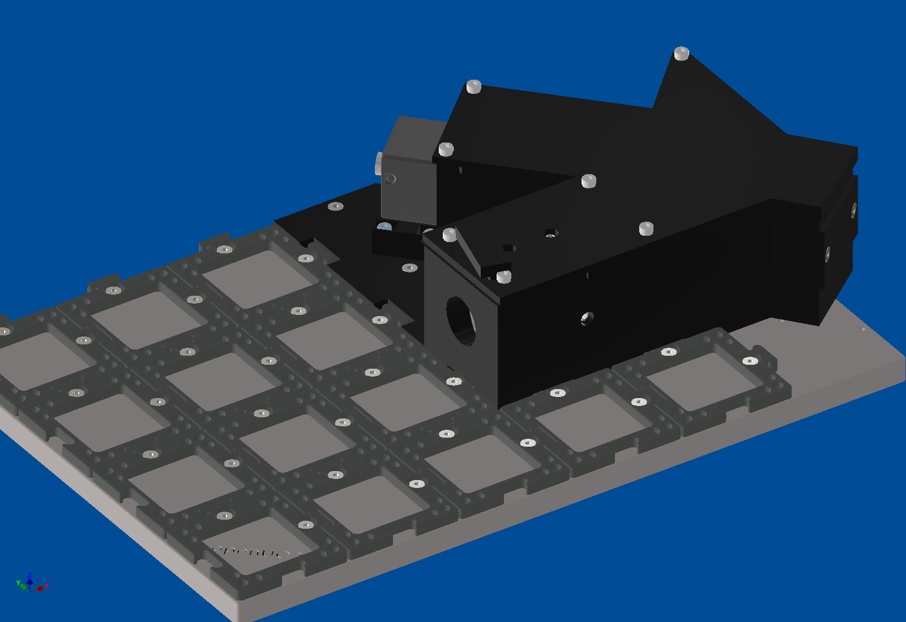
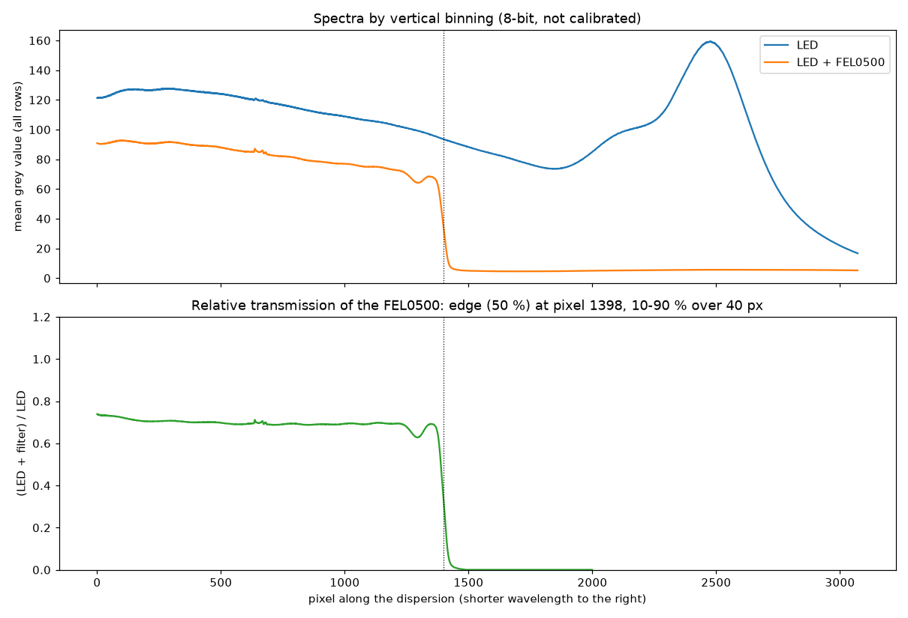
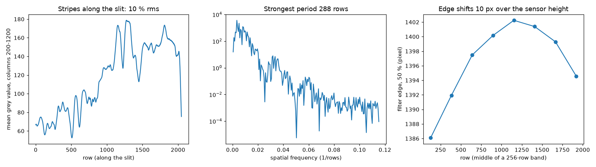
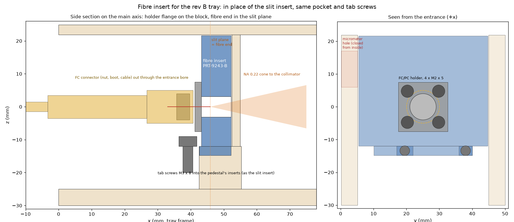
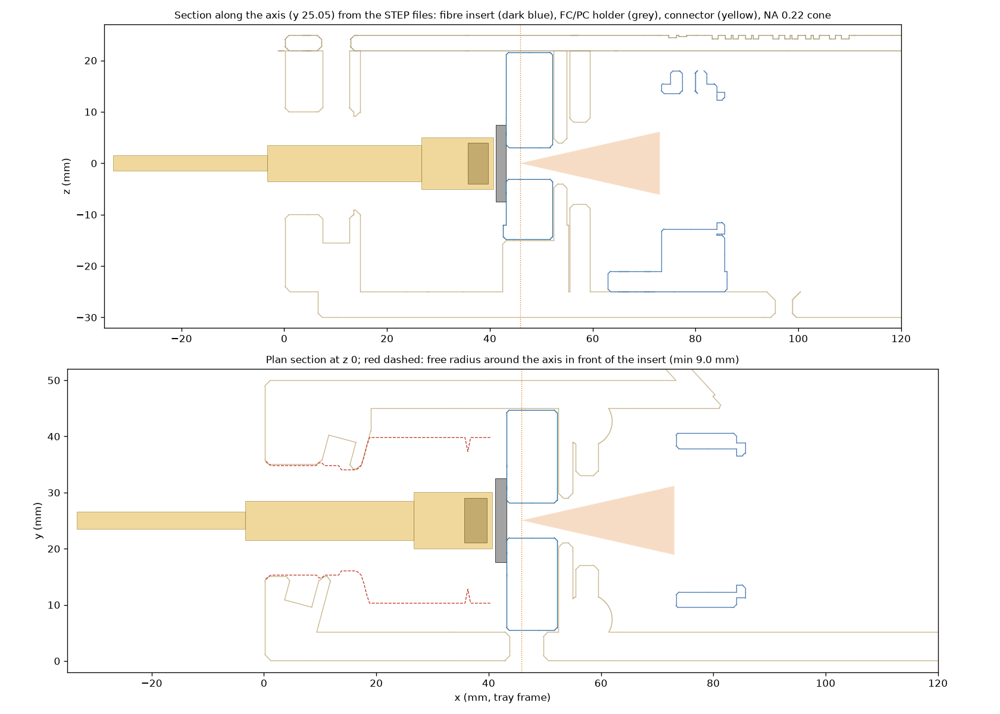
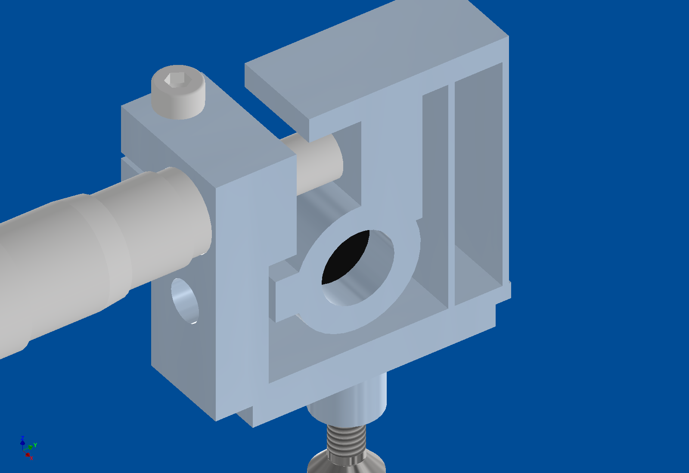
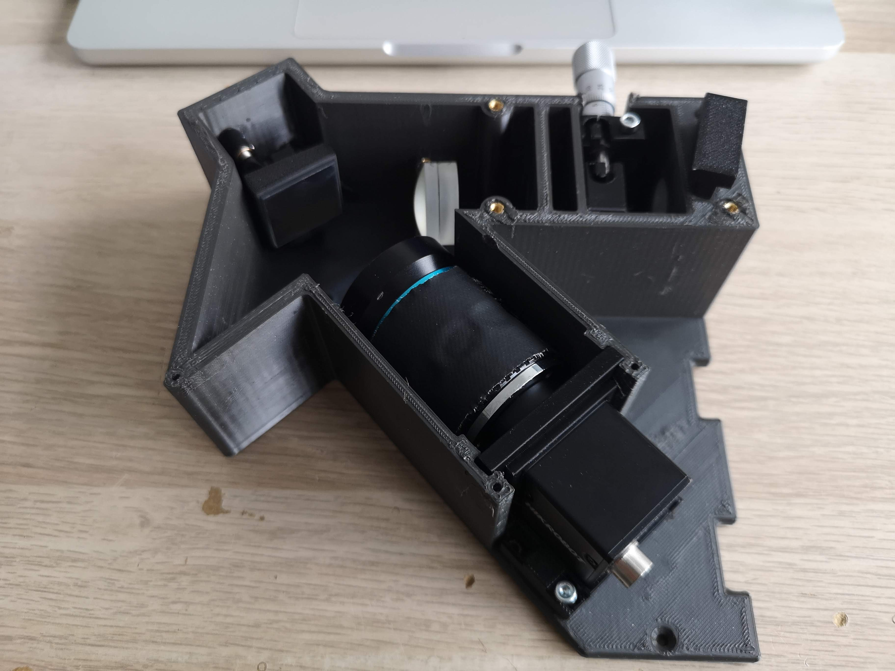
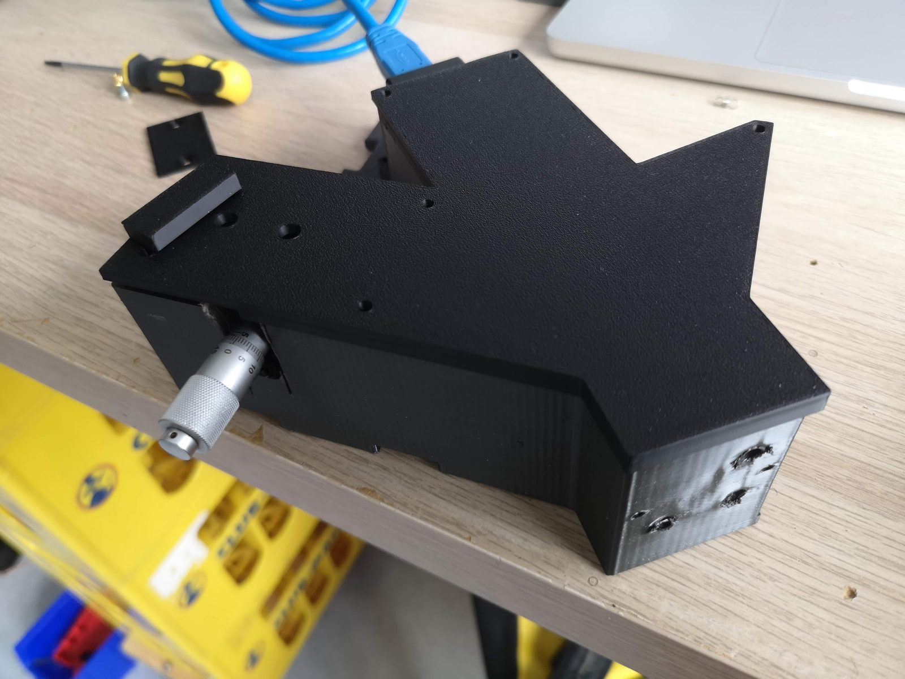

# openRAMAN spectrometer block

**Status (17 November 2026): prototype.** The block is printed and assembled and has seen its first light. We are now
calibrating it and collecting data. The slit is the next part to replace; a fibre input is designed as the alternative.

The openRAMAN is our cube version of the open-source OpenRAMAN starter edition. The spectrometer is one printed block
on the puzzle grid of a 6 × 4 base plate. The same block also serves our low-cost OCT: a second grating holder turns
the grating to the OCT angle.

## What is inside

- **Entrance:** an edge filter on a slide, and an achromat (BFL 20 mm) that focuses onto the slit.
- **Slit:** two blades on a printed flexure holder. A micrometer sets the width; a second screw sets the position. A
  fibre insert can take its place (see [Fibre input](#fibre-input)).
- **Collimator:** a 35 mm achromat (Thorlabs AC254‑035‑A).
- **Grating:** 1200 lines/mm, on a kinematic mount.
- **Camera:** a 100 mm C‑mount lens (Berrybase CLENS‑100TEL) on a HIK MV‑CE060‑10UM (3072 × 2048 pixels, 2.4 µm).
- **Housing:**
  - The camera sits **outside** the closed housing: no heat at the optics, and the cables stay outside.
  - The housing follows the beam path and is light‑tight; the lid closes everything.
- **Inserts:** the lenses and the slit holder are inserts that are screwed down from the top. A different lens needs a
  new insert, not a new block.

## Simulation

Optiland model from the slit to the camera sensor (design values, not measured):

| collimator + camera lens | on the sensor | per pixel | resolution at a 50 µm slit |
| --- | --- | --- | --- |
| 35 mm + 100 mm (as built) | about 61 nm wide, e.g. 562–623 nm = 990–2750 cm⁻¹ at 532 nm | 0.020 nm | 0.8 nm (26 cm⁻¹) |
| 35 mm + 50 mm | about 123 nm wide | 0.040 nm | 0.8 nm |

- The collimator sets the resolution; the camera lens sets how much of the spectrum fits on the sensor.
- With the 100 mm lens the fingerprint region (400–1800 cm⁻¹, 544–588 nm at 532 nm) fits on the sensor. The grating has
  to be turned to that window.

## First spectra (15 November 2026)

Two frames: the white flash LED of a phone (Pixel 9, a blue LED with a yellow phosphor) alone, and the same LED through
a Thorlabs FEL0500 long‑pass filter (500 nm). The grating was at a not yet calibrated angle (the blue–green part of the
spectrum, not the Raman window). No wavelength or intensity standard was recorded yet, so the spectral axis below is in
**camera pixels** and the values are **relative**. Shorter wavelengths are to the right (the filter blocks the right
part).

Analysis script and data: `analysis/led_fel0500_20261115.py` and `data/2026-11-15/` in the openuc2‑openraman
repository.

What the frames show:

- **Filter edge** (on the relative transmission, which cancels the LED spectrum): 50 % at pixel 1398; it falls from
  90 % to 10 % over 40 pixels (32–42 along the slit). The filter passes about 69 % above the edge in this frame.
- **LED spectrum:** the blue peak at pixel 2474 and the valley before the phosphor band at pixel 1847.
- **Dispersion: about 0.045 nm per pixel, not the design 0.020.** Two features give the same number:
  - filter edge (500 nm) to the blue peak (a phone flash LED peaks near 450 nm): 1076 pixels for about 50 nm;
  - blue peak to the valley (about 30 nm apart for such LEDs): 627 pixels.

  At 0.020 nm per pixel the blue peak would be at 478 nm, which no phosphor LED has. So the sensor sees about
  140 nm of spectrum instead of 61 nm, and a 50 µm slit is only about 18 pixels wide.

  Possible causes, to be checked: the grating's line density (a 600 lines/mm grating gives 0.040), or a different camera
  lens or focal length than the 100 mm. The laser lines settle it (see [Aligning the grating](#aligning-the-grating)).
- **Resolution:** the 40‑pixel edge is about 1.8 nm at this dispersion. Most of that is likely the filter's own edge,
  so it is only an upper limit. A narrow line (laser or neon) measures the resolution properly.
- **Curved slit image:** the edge position bows by 16 pixels from the top to the middle of the sensor. The slit image is
  slightly curved (a "smile"), which is normal for this kind of spectrometer. Before rows are summed, each row has to be
  shifted by its own amount, or the lines broaden.
- **Exposure:** the frames are 8‑bit and the LED frame reaches 254 of 255. Use the camera's 12‑bit mode and stay below
  about 80 % of full scale.

### The stripes along the slit

- **Size:** the intensity varies by 10–12 % rms along the slit. The strongest period is about 290 rows, i.e. about
  0.24 mm along the slit (camera lens / collimator = 2.9 × magnification).
- **They change with wavelength.** The pattern at the long‑wavelength end does not match the pattern at the
  short‑wavelength end (correlation −0.2). A simple variation of the slit width would scale all wavelengths alike.
  These stripes behave like diffraction from the blade edges: the blades act like a weak grating along the slit.
- **Consequence:** a flat‑field correction cannot remove them. Summing many rows averages them out mostly, but a
  residual ripple stays in the spectrum. A clean slit is the fix.

## A better slit

| option | effort | notes |
| --- | --- | --- |
| **Precision slit in a mount** (e.g. Thorlabs S50RD, Ø1/2", 50 µm) | buy | laser‑cut in a thin metal foil, clean and parallel edges; the block already has a holder design for this mount size |
| **Laser‑cut or etched metal slits** (stainless‑steel slit plates, 25–200 µm) | buy, cheap | sold for DIY spectroscopy; glue onto the existing slit insert instead of the blades; check edge quality under a microscope |
| **Multimode fibre as the slit** (50 µm core, SMA/FC patch cable) | small printed adapter | the fibre end sits in the slit plane: a round, clean entrance with no blade edges, and the light comes from the sample through the fibre. Throughput is lower than a long slit |
| **Photo‑plotted film or chrome‑on‑glass mask** | order from a PCB film / mask service | a 50 µm clear line on black; film is very cheap, chrome on glass is cleaner |
| **Better blades** | DIY | double‑edge razor blades or scalpel blades have honed edges; snap‑off blades have rough edges from the snapping. Clean the edges and set the gap with a feeler gauge |

Our recommendation: order a precision slit (or a set of etched slits) for the next measurements. In parallel, build the
fibre input, which is also the natural way to bring light from a microscope or probe.

## Fibre input

The fibre insert (PRT‑9243‑B, SPCFIBINS) takes the place of the slit insert. It uses the same pocket and the same two
M3 × 8 screws from the top, so the tray stays as it is.

- **Holder:** the openUC2 FC/PC fibre holder from the CAD library (15 × 15 mm flange, M8 × 0.75 thread) is screwed to the
  insert's front face with four M2 × 5 (self‑tapping in the print).
- **Fibre end in the slit plane:** an FC/PC connector puts the fibre end 2.7 mm beyond the flange's underside. The
  insert's front face therefore sits 2.7 mm in front of the slit plane. The fibre core is the entrance slit: a 50 µm
  core is about as wide as the 50 µm slit, but round and with clean edges, so it shows no stripes.
- **Light‑tight:** above the pedestal the insert is one solid block from wall to wall and up to the lid, up to the
  partition. It also covers the micrometer and key holes in the side wall from the inside.
- **Light path:** a fibre with NA 0.22 fills the 35 mm collimator to 16 mm. The grating takes up to NA 0.24, so nothing
  is cut off. On the sensor a 50 µm core is a band about 60 rows high (105 µm: about 125 rows).
- **Cable:** the lens insert and the edge‑filter slide come out. The connector sits in the lens bay and the cable leaves
  through the entrance bore; the free radius there is 9 mm, the connector's boot needs 3.5.
- **Assembly:** screw the holder onto the insert, drop the insert in, tighten the two tab screws, then plug the fibre in.
  The hex key for tab screw 1 passes where the connector's nut will be.
- **Print:** FDM, black PETG, standing on its back face, no support. 12.4 cm³.
- **Focus:** the fibre end is fixed. The collimator insert moves ±1.5 mm in its slots, and the camera lens does the fine
  focus.
- **Status:** all checks pass, on the parameters and on the STEP files (light, stray light through the side holes, fit
  in the tray). Not printed yet.

Files in openuc2‑openraman:
- `fibre_insert.py`: parameters and checks;
- `build_fibre_insert.py`: the part and the block assembly ASS‑9258 in Inventor;
- `check_fibre_insert.py`: the checks on the STEP files;
- `INVENTOR/D_block_3x3/PRT - 9243 - SPCFIBINS - V04 - B` (.ipt, .stp, .stl).

An SMA holder from the same library has the same four holes but a different fibre‑end depth: measure it before using it.

## Aligning the grating

The grating sits on a wedge holder in the kinematic mount. The wedge sets the coarse angle: A for Raman, B for OCT. The
mount's two adjusters, reached through the holes in the back wall, do the rest:
- the adjuster that turns the grating about the vertical axis moves the spectrum **along** the sensor (wavelength);
- the other one moves it **up and down** (rows).

**What you need:** the camera live in ImSwitch (spectrometer app, raw view) and one or two known lines. Use the lasers
(488, 520, 532 or 635 nm), sent in by scattering them off a white card in front of the entrance. Never shine a laser
straight into the entrance: it saturates the camera, and keep laser safety in mind with the lid off. Use the lowest power
and a short exposure.

1. **Focus.**
   - Before mounting, focus the camera lens at infinity (on a distant object).
   - Then slide the collimator insert in its slots until a line is narrowest, and lock it.
   - Fine‑tune with the camera lens's focus ring.
2. **Lines upright.** Turn the camera in its cradle until a line in the middle of the sensor is parallel to the pixel
   columns. Near the top and bottom edges the line stays slightly curved (the smile).
3. **Height.** With the second adjuster, centre the light band in the rows. With a fibre the band is narrow, so this
   matters.
4. **Measure the dispersion.** Put two known lines on the sensor at the same time and divide their wavelength
   difference by their pixel distance. For example, 488 and 520 nm are 711 pixels apart at 0.045 nm/px, or 1600 pixels
   at 0.020.
5. **Work out the target.** With dispersion D (nm/px) and the window centre λc you want, a line λ belongs at

   `pixel = 1536 + (λc − λ) / D`

   (shorter wavelengths to the right, 1536 = sensor centre). Find out how many pixels one turn of the adjuster moves a
   line, then turn by the difference. If the line would leave the sensor first, hand over to a second line that is
   already coming in.
6. **Example, Raman at 532 nm and 0.045 nm/px:**
   - put the 532 nm line (filter out, low power) near pixel 2950;
   - the window is then about 527–665 nm (0–3750 cm⁻¹), and the 635 nm laser shows at about pixel 660, a direct check.

   At the design 0.020 nm/px the window is only 61 nm: centre it at about 566 nm for the fingerprint region.
7. **Lock and record.** Mark the adjuster's position. Then run the wavelength calibration (next section).

The ImSwitch spectrometer app shows the line's current and target position live while you turn.

## Calibration plan

**1. Before every measurement series**

- Dark frame at the same exposure (lid closed, laser off).
- Camera in 12‑bit mode, gain fixed, maximum below about 80 % of full scale.
- Average several frames; for long integrations add frames (the camera's longest exposure is 1 s).

**2. Wavelength axis (pixel → nm).** Use a lamp with known lines, several lines across the sensor, and fit a 2nd‑ or
3rd‑order polynomial per row (this also measures the smile).

- **Neon glow lamp** (NE‑2 indicator lamp, costs almost nothing): lines at 585.25, 588.19, 594.48, 597.55, 603.00,
  607.43, 609.62, 614.31, 616.36, 621.73, 626.65, 630.48, 633.44, 638.30 and 640.22 nm. This covers the Raman window at
  532 nm excitation. AutoOpenRaman does the same with a neon panel lamp, switched by the software.
- **Compact fluorescent lamp** for the blue–green window used in the LED test: Hg 435.83, 546.07, 576.96, 579.07 nm;
  phosphor lines near 487.7, 542.4 and 611.6 nm.
- The width of a single neon line (in pixels) gives the **real resolution** and checks the focus of the camera lens.

**2b. Without a neon lamp: lasers and RGB LEDs (what we have now).**

- **Laser lines** (488, 520, 532, 635 nm) are narrow and bright.
  - Diode lasers differ from their nominal wavelength by a few nm from unit to unit, and drift by about 0.2–0.3 nm per
    °C. Measure each one once with a reference spectrometer and store the value.
  - With three lines across the window, fit a 2nd‑order polynomial; with two, a straight line (good enough for a first
    axis).
- **NeoPixel ring (WS2812‑type RGB LEDs):** switch R, G and B on one at a time.
  - The bands are broad (about 15–35 nm wide). Their position is found by matching each measured band to a reference
    spectrum of the same ring, measured with another spectrometer.
  - Expect about 0.5–1 nm accuracy. The green LED in particular shifts with current and temperature, so calibrate at
    the same brightness and after a minute of warm‑up.
  - Good for a quick check; the laser lines are better for the fit.
- The ImSwitch calibration wizard (below) does both: it switches the sources, finds the lines or matches the bands, fits,
  shows the residual of every point and saves the result.

**3. Raman shift axis.**

- Measure the laser line itself (with the edge filter out, at low power) to set 0 cm⁻¹.
- Check with a Raman standard:
  - **Cyclohexane** (ASTM E1840): 801.3, 1028.3, 1266.4 and 1444.4 cm⁻¹;
  - **Acetonitrile** (as AutoOpenRaman uses): 918, 1376, 2253 and 2942 cm⁻¹;
  - **Polystyrene:** 1001.4, 1031.8 and 1602.3 cm⁻¹.

**4. Relative intensity.**

- A tungsten‑halogen lamp at a known colour temperature (about 3000 K) behaves like a black body: divide its measured
  spectrum by the Planck curve to get the instrument response.
- A calibrated standard (e.g. NIST SRM 2241 for 532 nm excitation) is the accurate but expensive route.
- Absolute values need a calibrated lamp or detector and are not planned for now.

## Software: ImSwitch

A first version of a spectrometer module exists on the ImSwitch branch `feat/spectrometer` (17 November 2026; not merged,
not yet run on the real camera, lasers or LED ring). It is built into ImSwitch rather than as a plugin, because plugins
do not receive the setup file yet.

- **Processing (plain numpy, also usable in a notebook):**
  - row region around the slit image, dark subtraction;
  - averaging or frame adding (for more than the camera's 1 s);
  - cosmic‑ray removal, per‑row smile shift, rows combined;
  - pixel → nm polynomial with residuals; nm → cm⁻¹ from the laser wavelength.
- **Manager and controller** with REST endpoints: live spectrum and raw region, camera settings (exposure, gain, bit
  depth), dark, acquire, save (HDF5 or CSV + JSON with metadata, the raw region as `.npy`), calibration get/set.
- **Web app "Spectrometer":**
  - live raw region and live spectrum, axis in pixels, nm or cm⁻¹;
  - camera settings and dark;
  - the calibration wizard: NeoPixel R/G/B against stored reference spectra, the 488 and 635 nm lasers, the 520 nm laser
    switched by hand, lamp line lists;
  - the alignment helper for the grating (see above), and saving.
- **Checked** with a simulated instrument and with the frames of 15 November: the pipeline gives the same edge, plateau
  and LED peak as the analysis above.
- **Design note** `docs/SPECTROMETER.md` in that branch: how the same data path extends to
  - Raman: laser line and cm⁻¹, processing with RamanSPy;
  - OCT: resampling to linear k, FFT per line;
  - multispectral imaging with the galvo scanner: one spectrum per scan point, stored as a data cube.

Next steps for the software:

1. Run it on the real camera, the lasers and the LED ring; load the measured reference spectra and laser wavelengths.
2. Laser and shutter in one sequence with dark, signal and calibration frames.
3. Raman standards (acetonitrile, cyclohexane) as calibration sources in the wizard.
4. Processing with RamanSPy (BSD‑3), as AutoOpenRaman does: crop, despike, smoothing, baseline removal, normalisation.
5. Later: Raman maps with the XY and z stages of the FRAME, and galvo scanning.

**Can we take over the AutoOpenRaman software?**
- It is MIT‑licensed, so reusing its code is allowed as long as the licence notice is kept.
- Its GUI (PyQt on µManager / Pycro‑Manager) does not fit ImSwitch's web interface.
- What is worth taking over is its calibration procedure (neon, then acetonitrile) and its processing with RamanSPy.
- The module above copies no code from it.

## Next steps

- [ ] two laser lines on the sensor → real dispersion (0.045 or 0.020 nm/px?), check the grating's lines/mm and the
      camera lens
- [ ] align the grating to the Raman window (protocol above)
- [ ] wavelength axis from the lasers (neon lamp later), real resolution from a line's width, smile
- [ ] LED and filter frames again in 12‑bit with a dark frame
- [ ] order a precision slit; print the fibre insert and try a 50 µm fibre
- [ ] first Raman spectra of standards (cyclohexane, polystyrene, paracetamol tablet)
- [x] spectrometer module in ImSwitch (first version, branch `feat/spectrometer`) → test on the hardware

## Related work

[AutoOpenRaman](https://thestacks.org/publications/resource-autoopenraman) (Arcadia Science, 2025) automates an OpenRAMAN
with a motorised stage, a shutter and a neon calibration lamp:

- **Calibration:** neon lines for a rough axis, then acetonitrile for the fine Raman shift calibration.
- **Software:** a PyQt GUI on µManager / Pycro‑Manager.
- **Processing:** RamanSPy.

Code: [github.com/Arcadia‑Science/2024‑auto‑openraman](https://github.com/Arcadia-Science/2024-auto-openraman).

## Earlier: the printed slit stage

Before the blade holder we designed a printed flexure stage that moves a purchased slit ±1 mm across the slit (two thin
leaves, driven by a micrometer screw, no friction or backlash).

