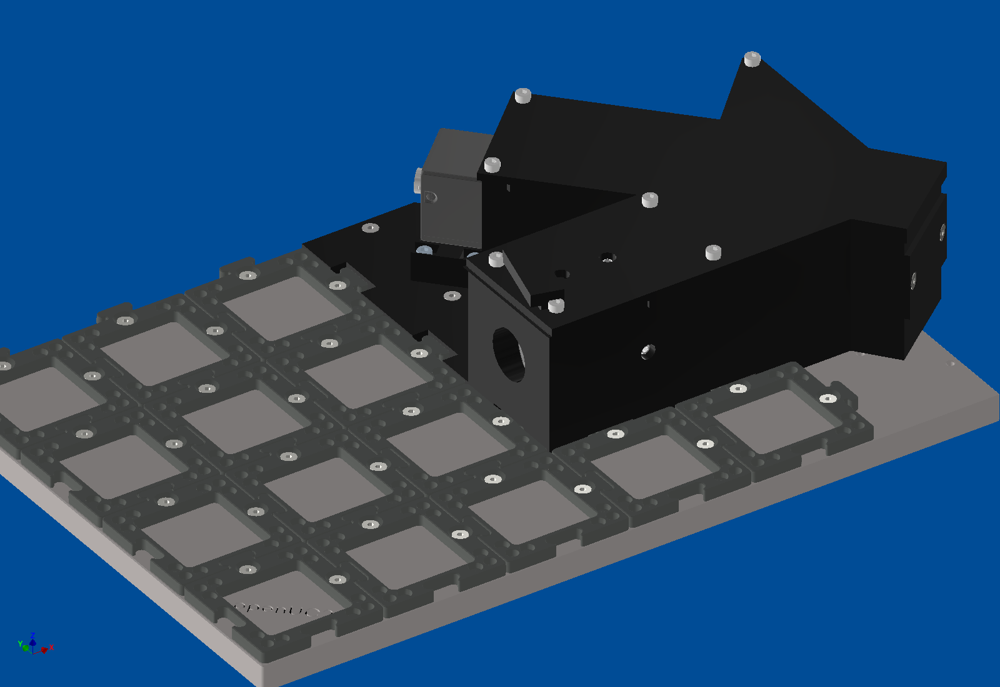
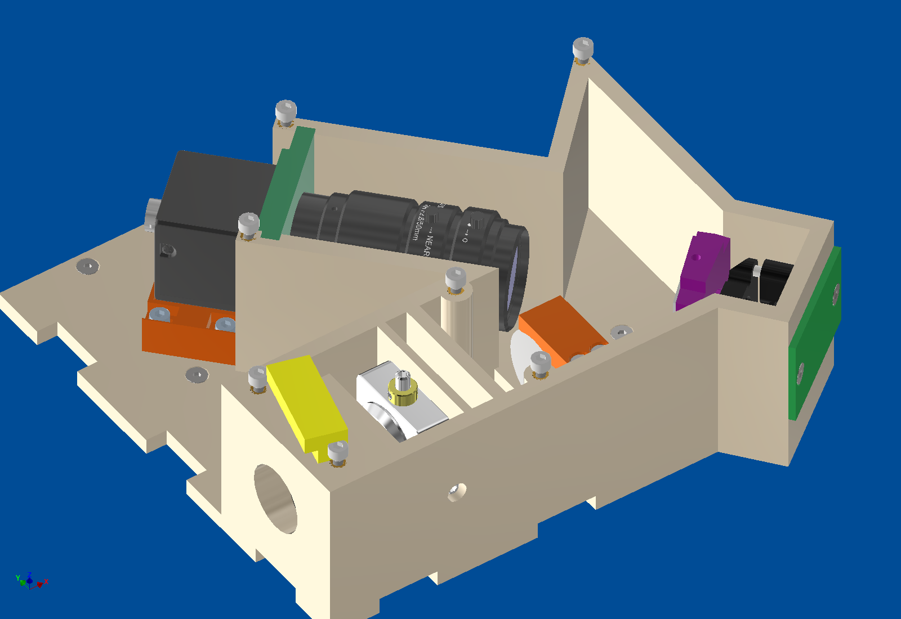
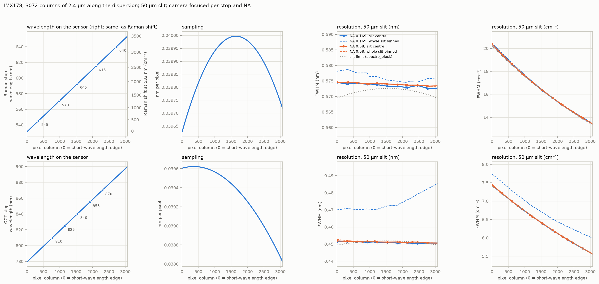
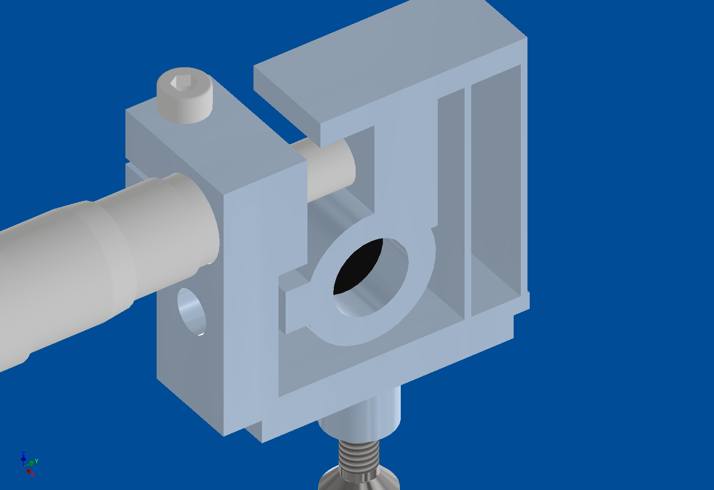

# openRAMAN spectrometer block

**Status:** the first block is printed and fits. A printed replacement for the slit's translation stage is designed.

The openRAMAN is our cube version of the open-source OpenRAMAN starter edition. The spectrometer is one printed block
on the puzzle grid of a 6 × 4 base plate. The same block also serves our low-cost OCT: a second grating holder turns
the grating to the OCT angle.

## What is inside

- An edge filter, a 19 mm lens that focuses onto a 50 µm slit, a 50 mm achromat as collimator, a 1200 lines/mm grating
  on a kinematic mount, and the camera lens.
- The camera sits **outside** the closed housing: no heat at the optics, and the cables stay outside.
- The housing follows the beam path and is light-tight; the lid closes everything.

## Simulation

Optiland model from the slit to the camera sensor:

- **Raman:** 531–654 nm, about 0.04 nm per pixel, 0.57 nm resolution (14–19 cm⁻¹).
- **OCT** (840 nm): 779–900 nm, 0.45 nm resolution.

## Latest: a printed slit stage

The XY stage we planned for the slit is out of stock. Instead, a printed flexure stage moves the slit ±1 mm across the
slit: two thin leaves guide it and a micrometer screw drives it. There is no friction and no backlash, so the slit can
be set to a few micrometres.

