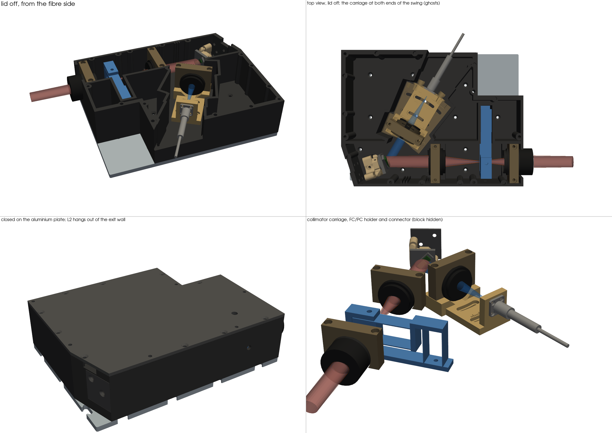
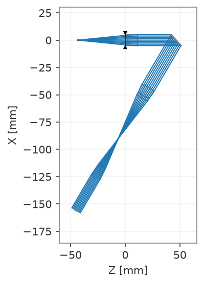
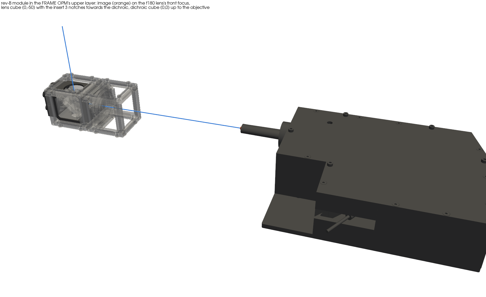

# openSIM with the DLP2000

**Status:** rev B designed; next are printing and the first optical tests.

We are rebuilding the openSIM (structured illumination microscopy) around the small DLP2000 projector chip from TI's
DLPDLCR2000EVM. A single-mode fibre (488 nm or 635 nm) lights the micromirror chip. The stripe pattern on the chip is
relayed into the microscope, and a mask in the Fourier plane keeps only the light that forms the stripes.

## What is new

- **One printed block** on an aluminium plate holds everything: fibre collimator, the DLP chip on a kinematic mount,
  the relay lenses and the Fourier mask on a small flexure stage.
- **Swinging fibre arm:** the collimator sits on a carriage that turns ±8° about the chip, so the illumination angle
  can be set on the bench for each colour.
- **1:1 relay with 50 mm lenses:** the second lens hangs out of the block in a tube, which makes it easy to adjust.
- **Electronics:** the adapter board was redrawn in KiCad with parts the board maker can assemble.

## Simulation

We model the projector chip as a tilted mirror plus a grating in Optiland and trace the light from the fibre into the
microscope. Below: the beam through the collimator, the chip and the relay at 488 nm.

## In the FRAME

The block goes into the upper layer of the FRAME's OPM. A tube lens images the Fourier plane into the back focal
plane of the objective, as for the larger DLP projector ([see that page](../dmd-opm/README.md)).

