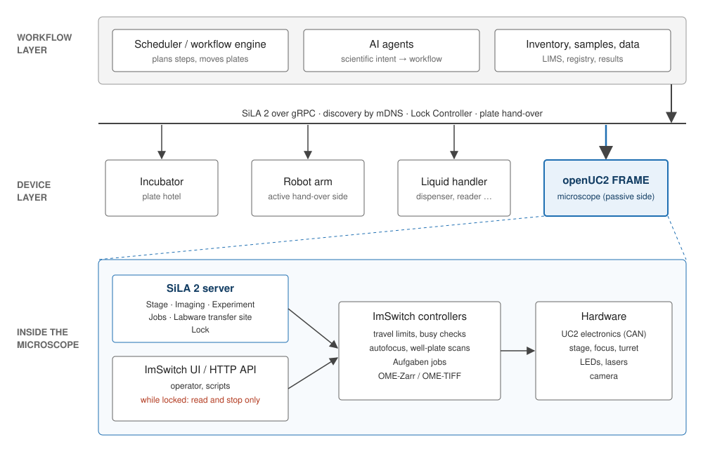
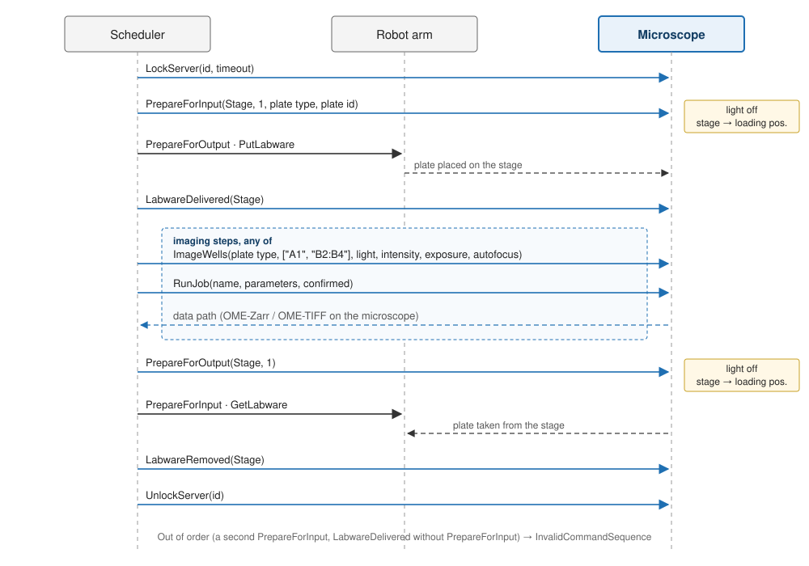
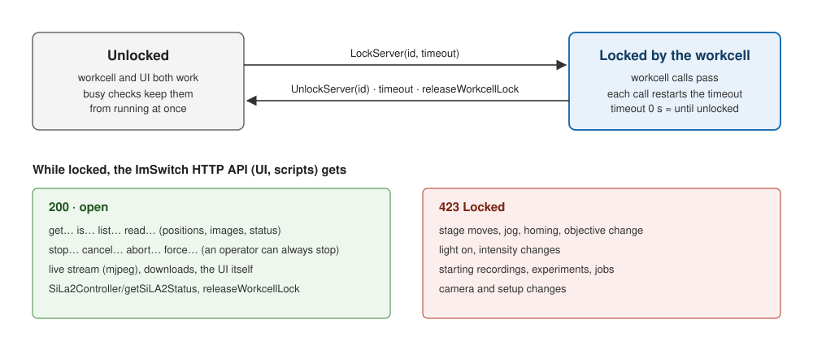

# Architecture

*Explanation. For commands and settings see the [reference](../reference/sila-features.md).*

## Two layers, one boundary

A workcell has a **workflow layer** - the scheduler, inventory and sample registry, and more
and more AI agents that turn a scientist's intent into steps - and a **device layer** of
incubators, robots, liquid handlers and microscopes. SiLA 2 is the boundary between them: each
device describes its features (commands, properties, units, errors) and the workflow layer calls
them over gRPC.

The FRAME is a device. It does not know about the other stations, the plate's history or the
next step; the scheduler does. What the FRAME knows, and nothing above it can know, is its
instrument: where its stage is allowed to go, where a plate sits on it, which objective is in,
which saved jobs it can run. That split decides what the SiLA features contain: functions with
units and refusals, not workflow logic.

A device-level AI interface (an LLM talking to the microscope directly) skips the workflow
layer and with it the context an agent needs - which plate, which samples, what runs next on
the other stations. Agents belong on the workflow layer and reach the microscope through the
same SiLA features as the scheduler.

## Inside ImSwitch

The SiLA server runs inside ImSwitch, in its own thread with its own event loop, next to the
HTTP API that serves the ImSwitch UI.

- Every SiLA command calls the **same ImSwitch controllers** as the UI. Stage travel limits,
  "something else is running" refusals and the OME-Zarr / OME-TIFF writers apply to both.
- Blocking hardware calls run in worker threads, so a long move or exposure does not stall
  other SiLA calls such as the live position stream.
- Refusals become **defined errors** (`StageLimitReached`, `InstrumentBusy`, …) a scheduler
  can branch on, instead of a generic failure.
- Long actions - homing, autofocus, objective change, well-plate imaging, jobs - are
  **observable commands**: the scheduler starts them, gets progress and collects the result.

## The plate hand-over

SiLA standardises the hand-over as a pair of features: the robot (active side) implements
*Labware Transfer Manipulator Controller*, the device that receives or gives the plate (passive
side) implements *Labware Transfer Site Controller*. The scheduler calls *Prepare For Input* on
the microscope and *Put Labware* on the robot, then tells the microscope *Labware Delivered*;
taking the plate back mirrors it.

For the microscope, *Prepare* means: switch every light off and drive the stage to the taught
**loading position**, where the gripper reaches the stage insert without touching the objective.
The microscope keeps track of the sequence and refuses calls out of order, so a scheduler bug
cannot make it move under a gripper that is still holding a plate.

Teaching happens once per instrument (loading position) and once per plate type (plate origin:
where well A1 sits on the stage). Both are saved in the setup file, so a restart does not lose
them. With the plate origin and the plate type's well layout, "image B2 to B4" becomes stage
positions.

## The lock

A workflow that has placed a plate and started imaging must not be disturbed by someone
jogging the stage in the ImSwitch UI. The scheduler therefore locks the microscope with the SiLA
standard *Lock Controller*. While locked:

- the ImSwitch HTTP API, and with it the UI and scripts, may read and stop - an operator can
  always stop the instrument - but requests that move, light up or start something are refused
  with *423 Locked*;
- acquisitions and jobs refuse to start from anywhere but the workcell;
- the lock times out after the workcell's last call (or never, with timeout 0), and an operator
  can free a lock left by a crashed workcell.

Between SiLA clients the lock is advisory. The SiLA framework would require the lock identifier
on every call to a covered feature, even when nothing is locked, which breaks clients that never
lock. In a workcell the scheduler is the only SiLA client, so the lock protects against the case
that matters: the person at the UI.

## Testing every command {#testing-every-command}

The check client (`imswitch-sila-check`) is a SiLA client that calls every command and checks
every refusal, the way a scheduler would. It runs in continuous integration against the virtual
microscope, and by hand against a real FRAME in rounds: first nothing that moves, then motion and
light, then homing. Every command is either run or reported as skipped, so a new command without
a test shows up as a failure. The idea came from connector development at UniteLabs: build the
server, build a client that exercises every endpoint, and iterate until both agree.

A check written by the people who wrote the server shares their blind spots. So the server was
also tested as an outsider sees it: a coding agent with no access to ImSwitch, given only the
UniteLabs client tutorial and the running virtual microscope, found the server by discovery,
read its feature definitions and wrote its own client for all 85 elements. It found eight faults
the built-in check had missed - moves and autofocus not refused during a scan, malformed input
reported as an undefined error instead of a validation error, a timed-out lock not announced to
subscribers, the server-initiated connection mode failing - and a list of integrator complaints:
travel limits, loading position, light state and exposure could not be read back. All are fixed
and now part of the built-in check.

## Limits

- No plate-presence sensor: *Labware Delivered* is taken on trust.
- One handover position and one internal position (the stage).
- The lock is advisory between SiLA clients.
- The SiLA side has been tested against the virtual microscope; hardware runs are next.
