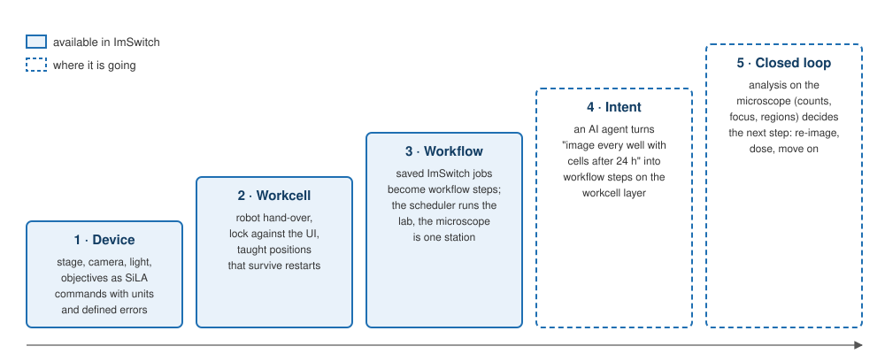

# Vision: the microscope as a station in the automated lab

*Explanation.*

Most microscopes are islands. Someone carries the plate over, sets up the scan by hand, copies
the data off afterwards. In an automated lab the plate arrives by robot at three in the
morning, the scan is one step of a longer protocol, and the result decides what happens next.
For that the microscope has to be a good citizen of the lab: reachable, predictable, safe to
drive from software it has never met.

## 1 · Device

Every function of the FRAME - stage, focus, illumination, camera, objectives - is a SiLA 2
command with units, documented parameters and named refusals. A scheduler written by someone
else can discover it, read what it does and branch on what went wrong. This is the foundation;
it exists in ImSwitch today.

## 2 · Workcell

A robot can hand plates over using the SiLA standard sequence. The microscope switches its
light off and clears the way before a gripper comes near, refuses calls out of order, and keeps
its taught positions across restarts. A lock stops the ImSwitch UI from interfering with a
running workflow while still letting an operator stop the instrument. Also in ImSwitch today.

## 3 · Workflow

Acquisitions that go beyond a snap - loops over wells, channels, autofocus, analysis - are built
once in ImSwitch's job editor (Aufgaben) and saved. The scheduler then runs them by name as a
workflow step, with parameters. The microscope contributes its expertise as reusable steps; the
lab's workflow tool decides when to run them. Available today; the next work is making jobs
easier to parametrise from the workflow side.

## 4 · Intent

A scientist writes "image every well that has cells after 24 h, at 20x, in two channels". An
AI agent on the workflow layer turns that into steps across the whole workcell: fetch the plate,
run the job, return the plate. It can do so reliably only because every device below it
describes itself precisely and refuses what is unsafe - the work of steps 1 to 3. The agent sits
on the workflow layer, not on the microscope: it needs the context of samples, inventory and the
other stations, which no single device has.

## 5 · Closed loop

ImSwitch already analyses images during a job: counting objects, measuring focus, finding
regions. Reported back to the workflow, these results let the lab decide the next step on its
own - re-image a well that was out of focus, dose a well where cells grew, move on when a
condition is met. The microscope becomes a sensor in an experiment that steers itself.

## What makes an instrument ready for this

From building this we look for the same things in every device we connect, and design the FRAME
to meet them:

| Property | Why |
|---|---|
| Open, documented interface (SiLA 2), no vendor lock | Any scheduler can drive it |
| Units and constraints on every parameter | No guessing µm vs steps or ms vs s |
| Named refusals instead of silent failure | The workflow can react: wait, re-teach, alert |
| Safety in the device, not in the caller | Travel limits, light off at hand-over, lock against the UI |
| Long actions observable, with progress | The scheduler can plan and time out |
| Taught positions stored on the device | A restart does not need a technician |
| A test client that exercises every command | Integration is checked, not hoped for |
| Simulation of the device | Workflows are developed before the hardware arrives |

The FRAME, its electronics and ImSwitch are open source, so each of these can be checked in the
code - and extended by the people who use it.
