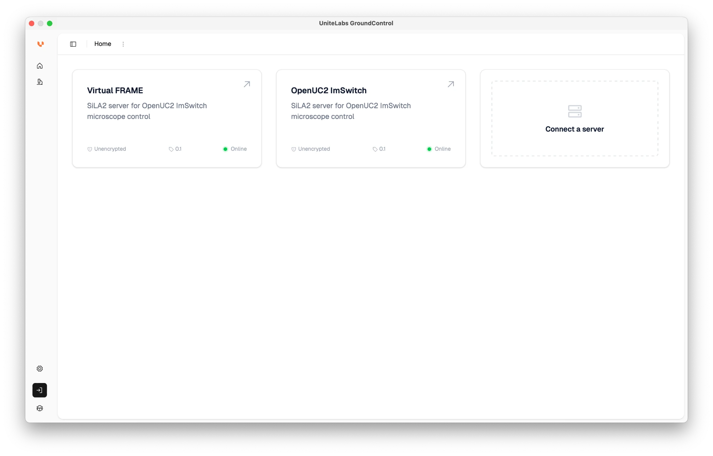

# Try the FRAME in GroundControl

*How-to.* [GroundControl](https://docs.unitelabs.io/get-started/setup/groundcontrol) is the
UniteLabs desktop app. It finds SiLA 2 servers on the lab network and lets you read their
values and run their commands by hand. It is the quickest way to see the FRAME the way the
workcell will see it, before any workflow is written.

You need:

- GroundControl, from UniteLabs, on a computer in the same network as the FRAME.
- The FRAME's SiLA server switched on with discovery (`"discovery": true`, the default), see
  [Connect a FRAME to a workcell](./connect-frame-to-workcell.md#1-switch-the-sila-server-on).
  The virtual microscope from the [tutorial](../tutorials/virtual-workcell.md) works as well.
- ImSwitch from 27 November 2026 or later. Older versions announced the address `127.0.0.1`,
  and GroundControl then connected to itself (see [Troubleshooting](#troubleshooting)).

## 1. Find the FRAME

Open GroundControl. On **Home** every SiLA server that announces itself on the network gets a
card with its `serverName`, description, version and **Online**. *Unencrypted* means the server
runs without TLS, which is fine on a closed lab network.

If the FRAME is missing, the network does not pass multicast (guest Wi-Fi, VPN, another VLAN).
Use **Connect a server** with the FRAME's address and port `50052` instead.

## 2. Read its properties

Open the card. The right column shows the server UUID, its version and the features:

| Feature | Try |
|---|---|
| SiLA Service | Server Name, Implemented Features |
| Stage Controller | Position, Loading Position, Travel Limits |
| Imaging Controller | Detectors, Illumination, Objectives, Exposure Times |
| Experiment Controller | Labware, Calibrated Labware, Experiment Status |
| Job Controller | Jobs |
| Labware Transfer Site Controller | Available Handover Positions |
| Lock Controller | Is Locked |

Pick a property and press **Run**. The response appears below with the time it took. Positions
are in µm, exposure times in ms.

## 3. Run a command

Commands that neither move nor switch light on are safe to try with a sample on the stage:

1. **Imaging Controller → Snap Image** with a `Detector` from the Detectors property and
   `MaxSize` 512. The response has the width, the height and the JPEG image.
2. The same command with a detector that does not exist. The response is the defined error
   *Unknown Device* with the reason (`No detector 'nope'. Available: …`). A workflow gets exactly
   this and can branch on it.
3. **Lock Controller → Lock Server** with a lock identifier and a timeout of 60 s, then look at
   the ImSwitch UI: moves are refused with *423 Locked* until **Unlock Server** or the timeout.

Moves, homing, illumination, the plate hand-over and jobs work the same way. Run them only with
the stage free and nobody looking into the light path, as in the check rounds of
[Connect a FRAME to a workcell](./connect-frame-to-workcell.md#check).

## Where is the Swagger UI? {#swagger}

GroundControl has no Swagger page; it talks to the FRAME over SiLA (gRPC). The browsable
Swagger UI belongs to the REST API of a **UniteLabs Platform** tenant, in the UniteLabs cloud or
on premises with UniteLabs Desktop; UniteLabs sets up the tenant and its access. The FRAME shows
up there once it is connected to the tenant, through GroundControl signed in to the tenant or
through a server-initiated connection from the FRAME (`cloudEndpoint` in the `sila2` block, see
the [reference](../reference/sila-features.md#setup)). Ask UniteLabs which one your tenant uses.

ImSwitch's own HTTP API, which the ImSwitch UI uses, has its Swagger UI on the FRAME itself:
`http://<frame>:8001/imswitch/api/docs`.

## Troubleshooting {#troubleshooting}

| Symptom | Cause and fix |
|---|---|
| The card says *Online*, but every request ends in *Error* after a few ms | GroundControl connects to the address the FRAME announced. ImSwitch before 27 November 2026 announced `127.0.0.1`, so GroundControl connected to its own computer. Update ImSwitch, then quit GroundControl and open it again: it keeps the connection it made first. |
| Properties or commands are missing after an ImSwitch update | GroundControl keeps the feature definitions it read first. Quit and reopen it; if they are still missing, remove the server in GroundControl and let discovery add it again. |
| An old server (e.g. a virtual FRAME that is no longer running) still shows *Online* | GroundControl counts a server as online while something answers on its address and port. An old entry with `127.0.0.1:50052` looks online whenever any SiLA server runs on your own computer. Remove it. |
| The FRAME does not appear | Multicast is blocked; use **Connect a server** with address and port. Check `"discovery": true`. |
