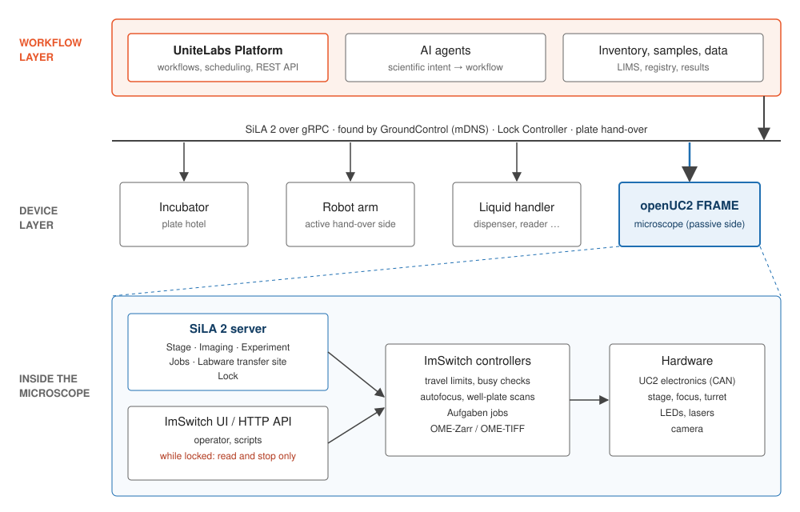

# The FRAME in a UniteLabs workcell

An openUC2 FRAME running ImSwitch can be one station in a **lab-automation workcell**: a robot
arm brings a well plate from the incubator, the microscope images it, the robot takes it on to
the next device. In a [UniteLabs](https://unitelabs.io) workcell the UniteLabs Platform runs the
workflow and talks to every device over [SiLA 2](https://sila-standard.com), the open standard
for laboratory devices.

ImSwitch brings its own SiLA 2 server, built with the
[UniteLabs connector development kit](https://docs.unitelabs.io/) (`unitelabs-cdk`). To the
UniteLabs tools the FRAME therefore looks like any other UniteLabs connector:

| UniteLabs tool | What it does with the FRAME |
|---|---|
| **GroundControl** (desktop app) | Finds the FRAME on the lab network, lists its features, reads every property and runs every command by hand: [Try the FRAME in GroundControl](./how-to/try-in-groundcontrol.md) |
| **UniteLabs Platform** (cloud tenant or on premises) | Runs workflows that use the FRAME next to the other devices; its REST API (with a browsable Swagger UI) reaches the FRAME once it is connected to the tenant |
| **`unitelabs-sila`** (Python SiLA client) | What our check client and the tutorial client are written with; see the UniteLabs tutorial [Build a SiLA client](https://docs.unitelabs.io/connector-development/tutorial/build-a-sila-client/) |

The microscope is the *passive* device in this picture. It does not plan the experiment; it
exposes what it can do - move, focus, illuminate, image, run saved acquisition jobs, take and
release a plate - with units, clear refusals and a lock, so that the workflow can drive it.
ImSwitch keeps what only the instrument knows: its stage frame and travel limits, the taught
positions, its objectives and its saved jobs.

| You want to | Start here |
|---|---|
| See it work without hardware | [A plate through the virtual microscope](./tutorials/virtual-workcell.md) |
| Click through it in UniteLabs GroundControl | [Try the FRAME in GroundControl](./how-to/try-in-groundcontrol.md) |
| Put a FRAME into a workcell | [Connect a FRAME to a workcell](./how-to/connect-frame-to-workcell.md) |
| Look up a command, error or setting | [SiLA features of ImSwitch](./reference/sila-features.md) |
| Understand the design and the plan | [Architecture](./explanation/architecture.md) · [Vision](./explanation/vision.md) |

## What the microscope offers

| Feature | For |
|---|---|
| Stage Controller | Position, moves in µm, travel limits, loading position, homing, stop |
| Imaging Controller | Snap (JPEG preview), save (OME-TIFF), exposure, illumination, autofocus, objectives |
| Experiment Controller | Plate types, plate origin, move to a well, image a list of wells, any ImSwitch experiment |
| Job Controller | Run a saved ImSwitch job (Aufgaben) by name with parameters |
| Labware Transfer Site Controller | SiLA standard plate hand-over with a robot |
| Lock Controller | SiLA standard lock: the workcell claims the microscope, the ImSwitch UI can only watch and stop |

Every element is described in the [reference](./reference/sila-features.md).

## Contents

| Type | Pages |
|---|---|
| Tutorial | [A plate through the virtual microscope](./tutorials/virtual-workcell.md) |
| How-to | [Try the FRAME in GroundControl](./how-to/try-in-groundcontrol.md), [Connect a FRAME to a workcell](./how-to/connect-frame-to-workcell.md) |
| Reference | [SiLA features of ImSwitch](./reference/sila-features.md) |
| Explanation | [Architecture](./explanation/architecture.md), [Vision](./explanation/vision.md) |
