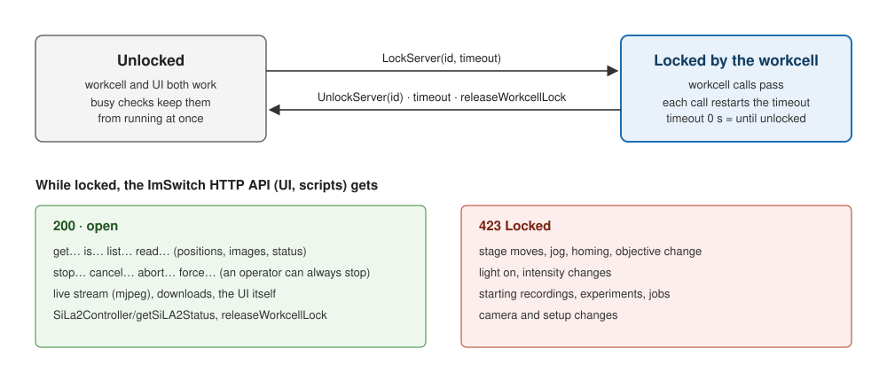

# SiLA features of ImSwitch

*Reference.* Positions are µm in the ImSwitch user frame (the frame the UI shows), except the
loading position (device frame, as stored in the setup). Times are ms unless noted. An empty
detector or illumination name means the first one of the setup. Observable commands report
progress and return when done.

## Stage Controller

`org.openuc2/microscopy/StageController/v1`

| Element | Kind | Parameters → responses | Errors |
|---|---|---|---|
| Position | property | → Position `{X, Y, Z}` | NotAvailable |
| LivePosition | observable property | → Position, twice per second | NotAvailable |
| TravelLimits | property | → list of `{Axis, Minimum, Maximum}`; axes without limits are not listed | NotAvailable |
| LoadingPosition | property | → Position where hand-over drives the stage | NotAvailable |
| MoveTo | command | X, Y → Position (Z stays) | StageLimitReached, InstrumentBusy, NotAvailable |
| MoveFocusTo | command | Z → Position | StageLimitReached, InstrumentBusy, NotAvailable |
| MoveBy | command | X, Y, Z (relative; 0 = axis stays) → Position | StageLimitReached, InstrumentBusy, NotAvailable |
| MoveToLoadingPosition | command | → Position | InstrumentBusy, NotAvailable |
| TeachLoadingPosition | command | current position becomes the loading position, saved | NotAvailable |
| Home | observable command | → Position; Z first and lifted, then X, Y to the end switches | NotAvailable, InstrumentBusy |
| Stop | command | stops every axis | NotAvailable |

## Imaging Controller

`org.openuc2/microscopy/ImagingController/v1`

| Element | Kind | Parameters → responses | Errors |
|---|---|---|---|
| Detectors | property | → cameras that take images | |
| ExposureTimes | property | → list of `{Detector, ExposureTime}` | |
| IlluminationSources | property | → list of LED / laser names | |
| Illumination | property | → list of `{Source, Enabled, Intensity, MinimumIntensity, MaximumIntensity, Units, Wavelength}` | |
| Objectives | property | → list of `{Slot, Name, Magnification, NumericalAperture, PixelSize}` | NotAvailable |
| CurrentObjective | property | → slot index | NotAvailable |
| SnapImage | command | Detector, MaxSize (px, 0 = full) → Width, Height, Image (JPEG, 8 bit, min–max scaled) | UnknownDevice, NotAvailable |
| SaveImage | command | Detector, Name → FilePath (OME-TIFF at full bit depth in `<data>/SiLA`) | UnknownDevice, NotAvailable |
| SetExposureTime | command | Detector, ExposureTime (ms) | UnknownDevice, NotAvailable |
| SetIllumination | command | Source, Intensity (units and range of the source), Enabled | UnknownDevice, NotAvailable, ValidationError |
| SwitchOffIllumination | command | every source off | |
| Autofocus | observable command | Range (±µm, ≤ 1000), Step (µm) → FocusPosition; refused while a scan runs | NotAvailable, InstrumentBusy |
| MoveToObjective | observable command | Slot → CurrentObjective; the turret moves, Z follows the focus offset | NotAvailable, InstrumentBusy, UnknownDevice |

## Experiment Controller

`org.openuc2/microscopy/ExperimentController/v1`

| Element | Kind | Parameters → responses | Errors |
|---|---|---|---|
| Labware | property | → plate load names the microscope knows | NotAvailable |
| CalibratedLabware | property | → plate types with a taught origin | |
| ExperimentStatus | property | → idle, running, paused, stopping | NotAvailable |
| LastDataPath | property | → folder of the last experiment | NotAvailable |
| ExperimentSchema | property | → JSON schema of StartExperiment's input | |
| SetPlateOrigin | command | Labware, Well; the stage is centred over the well; saved | UnknownDevice, NotAvailable |
| MoveToWell | command | Labware, Well → Position | UnknownDevice, PlateNotCalibrated, StageLimitReached, InstrumentBusy, NotAvailable |
| ImageWells | observable command | Labware, Wells (at least one, e.g. `["A1", "B2:B4"]`), Illumination, Intensity, ExposureTime, Autofocus → DataPath (one OME-Zarr per well; light off afterwards; the stage stays at the last well) | UnknownDevice, PlateNotCalibrated, InstrumentBusy, NotAvailable, ValidationError |
| StartExperiment | command | Experiment (JSON, as ImSwitch's `startWellplateExperiment`) → Name; returns at once | InstrumentBusy, NotAvailable, ValidationError |
| PauseExperiment, ResumeExperiment, StopExperiment | command | | NotAvailable |

## Job Controller

`org.openuc2/microscopy/JobController/v1` — runs jobs saved in the ImSwitch Aufgaben app.

| Element | Kind | Parameters → responses | Errors |
|---|---|---|---|
| Jobs | property | → saved jobs and bundled examples | NotAvailable |
| JobStatus | property | → idle, running, paused, finished, failed, aborted | NotAvailable |
| RunJob | observable command | Name, Parameters (JSON object or empty), Confirmed → DataPath (empty without images) | UnknownDevice, InstrumentBusy, NotConfirmed, JobFailed, NotAvailable, ValidationError |
| AbortJob | command | stops the running job, the stage and the light | NotAvailable |

## Labware Transfer Site Controller

`org.silastandard/instruments.labware.transfer/LabwareTransferSiteController/v1` — the passive
side of the SiLA standard hand-over. One handover position (default `Stage`, sub-position 1),
one internal position.

| Element | Kind | Parameters | Does |
|---|---|---|---|
| AvailableHandoverPositions | property | | `[{Position: "Stage", SubPosition: 1}]` |
| NumberOfInternalPositions | property | | 1 |
| PrepareForInput | observable command | HandoverPosition, InternalPosition, LabwareType, LabwareUniqueID | light off, stage to the loading position; refused while a plate is on the stage |
| LabwareDelivered | command | HandoverPosition | the plate is on the stage |
| PrepareForOutput | observable command | HandoverPosition, InternalPosition | light off, stage to the loading position |
| LabwareRemoved | command | HandoverPosition | the stage is empty |

Out of order: `InvalidCommandSequence`. An unknown handover position or an internal position
other than 1: validation error. Busy: `InstrumentBusy`.

## Lock Controller

`org.silastandard/core/LockController/v2`

| Element | Kind | Parameters | Errors |
|---|---|---|---|
| IsLocked | observable property | | |
| LockServer | command | LockIdentifier, Timeout (s; 0 = until unlocked) | ServerAlreadyLocked |
| UnlockServer | command | LockIdentifier | ServerNotLocked, InvalidLockIdentifier |

While locked, the ImSwitch HTTP API answers *423 Locked* to requests that move, switch light or
start something; reads (`get…`, `is…`, `list…`) and stops (`stop…`, `cancel…`, `abort…`) stay
open. The timeout runs from the workcell's last call. Between SiLA clients the lock is
advisory.

## Errors

| Error | Meaning |
|---|---|
| StageLimitReached | The target lies outside the stage travel limits |
| InstrumentBusy | Another acquisition, job or calibration runs |
| UnknownDevice | No camera, light, labware, well, objective or job of that name |
| NotAvailable | The setup has no hardware or controller for this |
| PlateNotCalibrated | No taught origin for this plate type |
| NotConfirmed | The job has ask-first steps; run it with Confirmed |
| JobFailed | The job ended failed or aborted, or asked an operator question |
| InvalidCommandSequence | Hand-over calls out of order |
| ValidationError (SiLA) | Malformed input: bad JSON, an empty well list, an intensity out of range, an unknown handover position |

## Setup keys {#setup}

`sila2` block of the setup JSON:

| Key | Default | Meaning |
|---|---|---|
| `enabled` | `true` | Start the server |
| `serverName`, `serverDescription`, `serverVersion`, `vendorUrl` | | Reported to clients |
| `serverHost`, `serverPort` | `0.0.0.0`, `50052` | Bind address |
| `serverUUID` | derived from host name and port | Fixed server UUID |
| `discovery` | `true` | mDNS announcement, with the address of each network interface |
| `tls`, `certificateChain`, `privateKey` | off | TLS |
| `cloudEndpoint`, `cloudPort` | none, 443 | UniteLabs cloud connection; none = local network only |
| `handoverPositionName` | `Stage` | Name of the handover position |
| `plateOrigins` | `{}` | Written by SetPlateOrigin |

The loading position is `sampleLoadingPositionX/Y/Z` in the positioner's `managerProperties`.

## HTTP endpoints

| Endpoint | Does |
|---|---|
| `GET SiLa2Controller/getSiLA2Status` | Server state, UUID, address, lock, plate on the stage, plate origins |
| `POST SiLa2Controller/releaseWorkcellLock` | Frees a lock left by a crashed workcell |
| `GET PositionerController/getSampleLoadingPosition` | The loading position (device frame) |
| `POST PositionerController/setSampleLoadingPosition` | Teach it (`useCurrent=true`, or `x`, `y`, `z`) |

## Check client flags

`imswitch-sila-check [--list] [--host H --port P | --discover --name N | --discover --uuid U] [--tls --ca CA.pem] …`

Needs only the `unitelabs-sila` Python package, so it runs on any computer that reaches the
microscope.

| Flag | Adds |
|---|---|
| `--list` | Only lists the SiLA servers announcing themselves on the network |
| (none) | Properties, every feature definition, snaps, exposure, the refusals, the lock; nothing moves, no light |
| `--motion` | Small relative moves, loading position, MoveToWell, the objective, the hand-over |
| `--light` | Illumination at `--intensity` |
| `--motion --light` | Autofocus, ImageWells, RunJob (`--job`) |
| `--teach` | Overwrites the plate origin and the loading position; toggles the server-initiated connection mode and sets it back |
| `--home` | Homing |
| `--json FILE` | Writes the results |
