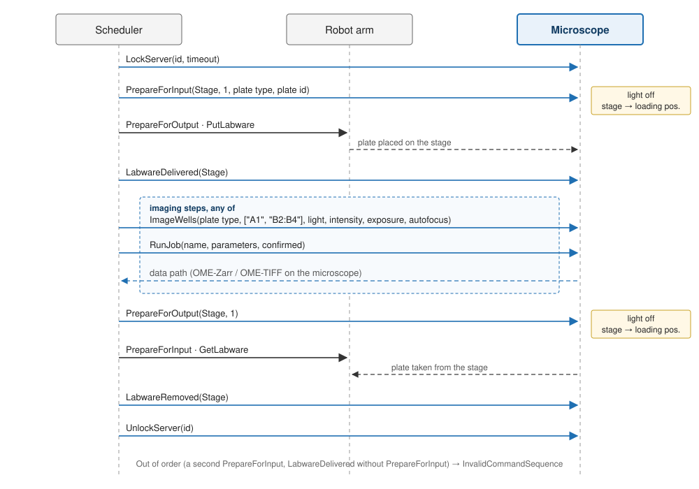

# A plate through the virtual microscope

*Tutorial, about 20 minutes, no hardware.* You start ImSwitch's virtual microscope with its
SiLA 2 server, let the check client call every command, and then write the client a workcell
scheduler would be: lock the microscope, take a plate, image two wells, give the plate back.

You need a Python environment with ImSwitch installed (see
[ImSwitch installation](../../../imswitch/README.md)). The SiLA parts come with it
(`unitelabs-cdk`, `unitelabs-sila`).

## 1. A setup with SiLA switched on

Copy the virtual microscope setup and switch the SiLA server on: add `"SiLa2"` to
`availableWidgets` and a `sila2` block.

```bash
cp imswitch/_data/user_defaults/imcontrol_setups/example_virtual_microscope.json virtual_sila.json
```

In `virtual_sila.json`:

```json
"availableWidgets": [ "...", "SiLa2" ],
"sila2": { "serverName": "Virtual FRAME", "serverPort": 50052 }
```

## 2. Start it

```bash
python -m imswitch --no-ssl --http-port 8001 --config-file virtual_sila.json
```

The log shows the server, its UUID and port:

```text
INFO [SiLa2Manager] SiLA2 server 'Virtual FRAME' 4ea338a2-… on 0.0.0.0:50052 (tls=False, discovery=True, cloud=off)
```

The UUID stays the same after a restart (it is derived from host name and port), so a workcell
finds the microscope again. With `discovery` on, the server announces itself over mDNS.

## 3. Let the check call everything

`imswitch-sila-check` connects like any SiLA client, reads every property and calls every
command, including the refusals (an unknown camera, a plate handed over twice, a wrong lock).
On the virtual microscope nothing can break, so allow motion, light and teaching:

```bash
imswitch-sila-check --port 50052 --motion --light --teach --intensity 10
```

```text
[ok  ] StageController.Position                                {"X": 0.0, "Y": -1000.0, "Z": 0.0}
[ok  ] ImagingController.SnapImage                             {"Width": 256, "Height": 192, "Image": "<22886 bytes>"}
[ok  ] ImagingController.SnapImage                             UnknownDevice: No detector 'no-such-camera'. …
…
[skip] StageController.Home                                    needs --home
61 ok, 0 failed, 1 skipped
```

On a real FRAME you start without any flag; see the
[how-to](../how-to/connect-frame-to-workcell.md#check).

## 4. One plate, as a scheduler would run it

Save as `first_plate.py`:

```python
"""One plate through the microscope, as a workcell scheduler would run it."""
import asyncio

from sila.client import Client, ClientConfig

HOST, PORT = "127.0.0.1", 50052
PLATE = "corning_96_wellplate_360ul_flat"
STAGE = {"Position": "Stage", "SubPosition": 1}  # the microscope's hand-over position


async def finish(execution):
    """Wait for an observable command and return its responses."""
    while not execution.done:
        await asyncio.sleep(0.2)
    return await execution.get_responses()


async def main():
    config = ClientConfig(hostname=HOST, port=PORT, tls=False, default_timeout=60_000)
    async with Client(config) as scope:
        print("Connected to", await scope.SiLAService.ServerName.read())

        # 1. Claim the microscope: the ImSwitch UI can now only watch and stop.
        await scope.LockController.LockServer(LockIdentifier="first-plate", Timeout=300)
        try:
            transfer = scope.LabwareTransferSiteController
            experiment = scope.ExperimentController

            # 2. Hand the plate over (the robot would put it between these two calls).
            await finish(await transfer.PrepareForInput(
                HandoverPosition=STAGE, InternalPosition=1,
                LabwareType=PLATE, LabwareUniqueID="plate-001"))
            await transfer.LabwareDelivered(HandoverPosition=STAGE)

            # 3. Image two wells. Needs a taught plate origin (see the how-to);
            #    on the virtual microscope, teach one here.
            if PLATE not in await experiment.CalibratedLabware.read():
                await experiment.SetPlateOrigin(Labware=PLATE, Well="A1")
            result = await finish(await experiment.ImageWells(
                Labware=PLATE, Wells=["A1", "A2"], Illumination="",
                Intensity=10.0, ExposureTime=20.0, Autofocus=False))
            print("Images in", result.DataPath)

            # 4. Hand the plate back.
            await finish(await transfer.PrepareForOutput(HandoverPosition=STAGE,
                                                         InternalPosition=1))
            await transfer.LabwareRemoved(HandoverPosition=STAGE)
        finally:
            await scope.LockController.UnlockServer(LockIdentifier="first-plate")


asyncio.run(main())
```

```bash
python first_plate.py
```

```text
Connected to Virtual FRAME
Images in /home/you/ImSwitchConfig/data/ExperimentController/20261125_231748
```

The folder holds one OME-Zarr image per well, which opens in napari, Fiji or the ImSwitch file
manager.



## 5. Watch the lock from the UI

Run the script again and, while it runs, try to jog the stage in the ImSwitch UI
(`http://localhost:8001/imswitch/ui/index.html`). The request is refused with *423 Locked*; the
live view, positions and the stop buttons keep working. After `UnlockServer` the UI is free
again.

## What you did

- Ran the microscope as a SiLA 2 server and found every command with the check client.
- Drove the standard plate hand-over and an imaging step from a scheduler-like client.
- Saw the lock keep the UI from moving the stage under a running workflow.

Next: [connect a real FRAME to a workcell](../how-to/connect-frame-to-workcell.md).
