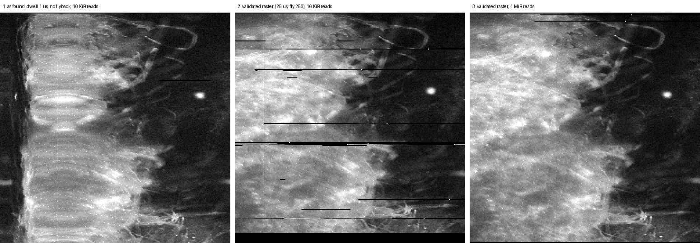

# Stripes, dots and lines in FLIM images

*Understanding-oriented. What a bench test on 17 November 2026 found when FLIM LABS images of
the galvo scanner showed streaks, dots and lines. Setup: FLIM LABS card, XIAO galvo board
(firmware `UC2_canopen_slave_galvo_debug`, commit 439395b), FLIM Imager on a Mac, PLF
reconstruction, laser at 40 MHz, 256 × 256 pixels. What each scan parameter does is in
[Scan parameters](../reference/scan-parameters.md).*

## What you see, and what to do

| what you see | cause | what to do |
|---|---|---|
| A dark band at the left edge, the first ~25 columns squeezed | The board ran a dwell of 1 µs with no pre-blank, overscan or fly-back | Load the recommended values and save them on the board, see [the scan configuration](#the-scan-configuration-on-the-board) |
| Column 0 much brighter than the rest | PLF puts all photons between the line pulse and the first pixel pulse into column 0 | Set the left offset to 1 in FLIM Imager |
| Black horizontal streaks, mostly in bright areas | The FLIM card's buffer overflowed because the computer read the USB data too slowly: photons were lost | FLIM Imager with the 1 MiB USB reads, see [data lost on the USB link](#data-lost-on-the-usb-link) |
| A single very bright pixel near the end of a line, black after it | Same overflow, but pixel pulses were lost too, so the line ended early | Same |
| A faint, sheared lattice of brighter pixels, about every 10 pixels | The 1 kHz FreeRTOS tick delays some pulses of the software pixel clock | `hw_pixel_clock: 1`, see [the 1 ms dot lattice](#the-1-ms-dot-lattice) |
| Faint vertical lines at columns 32, 96, 160 and 224 | The scan loop feeds the task watchdog every 64 samples, just before a pixel pulse | `hw_pixel_clock: 1`, see [brighter columns](#brighter-columns-32-96-160-and-224) |

A quick test separates the computer from the scanner: load the computer (for example a large
compile) while FLIM Imager runs. If the streaks multiply, the cause is on the computer's
side, not the galvo's.

## How FLIM LABS turns triggers into pixels

In PLF mode (pixel, line, frame) the FLIM card records the galvo's three trigger outputs
together with the photons, and FLIM Imager sorts the photons into pixels:

- A **pixel** is the time between two pixel pulses. The dwell sets how many photons a pixel
  collects; the width of the pulse does not.
- A **line pulse** resets the pixel counter to 0, so an error never carries over into the
  next line.
- Photons between the line pulse and the first pixel pulse go to **column 0**.
- Photons after the last pixel pulse go to column nx, which does not exist, so they are
  dropped together with the last image sample.

One line with the recommended values (25 µs per sample):

| part of the line | samples | time | mirror and triggers | photons go to |
|---|---|---|---|---|
| pre-blank | 64 | 1.6 ms | Y has just stepped; X holds at the start of the ramp; line pulse (and frame pulse on line 0) at the start | column 0 |
| lead-in overscan | 32 | 0.8 ms | X ramp starts | column 0 |
| image | 256 | 6.4 ms | X ramps from x_min to x_max, one pixel pulse per sample | columns 1-255 |
| lead-out overscan | 32 | 0.8 ms | X ramps on past x_max | dropped |
| fly-back | 256 | 6.4 ms | X eases back to the start of the ramp | dropped |
| settle | 128 | 3.2 ms | X holds at the start of the ramp | dropped |
| **one line** | **768** | **19.2 ms**, measured 19.26 ms | | |

The image therefore has 255 usable columns: crop column 0 with a left offset of 1.

## The scan configuration on the board

The board had a stored configuration with a dwell of 1 µs and no pre-blank, overscan or
fly-back:

- One sample takes about 22 µs in the current firmware (the loop and the DAC write over SPI).
  With a 1 µs dwell every sample was late (the status showed 12 824 timing overruns after
  51 lines). The scan then ran as fast as it could, about 22 µs per pixel, and each pixel's
  time depended on whatever else the processor was doing.
- Without fly-back the mirror was told to jump from x_max back to x_min within one sample.
  It could not follow, so the first pixels of each line were taken while it was still
  moving: a dark, squeezed band about 25 columns wide at the left edge.

The validated raster (August 2026, the recommended values in
[Scan parameters](../reference/scan-parameters.md#recommended-values-for-flim)) fixes both.
Two things put the old values back:

- A `/galvo_act` with a `config` only changes the running scan. The board keeps it only after
  a separate `{"task": "/galvo_act", "save": true}`. During the test the board rebooted and
  came back with its stored 1 µs configuration.
- ImSwitch starts the scan at boot with the values of its setup file (`autoStartScan`). A
  setup file with `"sample_period_us": 1` writes the 1 µs dwell to the board at every start.

## Data lost on the USB link

The FLIM card streams about 33 MB/s. On macOS FLIM Imager uses its own USB driver
(`native-zest`), which read the data in one 16 KiB request at a time. Between two requests
nothing drained the card. Whenever the reading thread paused a little longer, the card's
buffer overflowed:

- **Photons are lost first.** The geometry stays correct, but a stretch of a line has no
  photons: black streaks, mostly where the image is bright and the data rate is highest.
- **Longer pauses also lose pixel pulses.** The line's pixel counter then ends early, and all
  photons of the overscan, fly-back and settle land in one pixel: a "cut line", one pixel with
  up to 50 000 counts followed by black. FLIM Imager's cumulative view adds these up into
  isolated white dots.

The test that settles it keeps the galvo unchanged and only loads the computer (4 frames
per condition):

| computer load | USB request size | photon gaps per frame | cut lines per frame |
|---|---|---|---|
| idle | 16 KiB | 13.5 | 1.5 |
| all 8 cores busy | 16 KiB | 100.2 | 12.5 |
| all 8 cores busy | 1 MiB | 3.8 | 3.5 |
| idle | 1 MiB | 2.5 | 0.25 |

A photon gap is a run of at least 6 empty pixels in a lit row. A cut line is a pixel above
2000 counts followed by empty pixels.

The fix is one constant in FLIM Imager's driver (`src-tauri/flim-lib/src/zest/native.rs`,
`BULK_SPAN = 64 * CHUNK`). Each request now spans up to 1 MiB, so the USB host controller
keeps draining the card while the thread is paused. On 17 November 2026 this change was in a
local checkout only: a FLIM Imager build without it still shows the streaks. The losses left
under full load would need two or more requests in flight.



## The 1 ms dot lattice

With the software pixel clock the scan task waits in a loop until the next sample is due,
then sends the pixel pulse and writes the DAC. The task runs on core 0, where the FreeRTOS
tick interrupt fires every millisecond. When a tick falls on the moment a pixel pulse is due,
the pulse comes late, by up to about 12 µs. The pixel before it lasts longer and collects up
to about 50 % more photons. The next two or three pixels are slightly shorter while the loop
catches up. A brighter pixel means a longer pixel, not a different place on the sample.

At 25 µs per sample the tick comes every 40 samples. A line is programmed as 768 samples but
lasts 770.25 (the Y DAC write and the line pulse at the start of each line add 56 µs). From
one line to the next the tick therefore moves 10.25 samples along the line, and the dots form
a sheared lattice. Its shortest steps are 1 pixel left per 4 lines and 9 pixels right per 3
lines. Whether a tick hits a pulse depends on where it falls within the 25 µs sample, which
shifts by a quarter sample per line, so dots appear in about two of every four lines.

The evidence comes from 21 frames recorded with the software clock and 3 with the hardware
clock:

- Folding each frame at the 1 ms period with an assumed line length gives a brightest phase
  13 % above its row at a line length of 770.25 samples, and about 1 % at any other length
  (panel d).
- Pixels more than 25 % above their row neighbours form the lattice (panel a).
- With the RMT hardware pixel clock (`hw_pixel_clock: 1`) the pulses come from the RMT
  peripheral, which keeps its own time; a late loop only moves the mirror a fraction of a
  pixel later. In the same test the lattice was gone: no peak at any line length (panels b
  and d).


## Brighter columns 32, 96, 160 and 224

The scan loop feeds the task watchdog every 64 samples, right after the wait and before the
pixel pulse. That takes about 2 µs, so the pulses at samples 128, 192, 256 and 320 of every
line come late. Columns 32, 96, 160 and 224 are about 9 % brighter and the columns after them
about 6 % darker (panel c). The sample counter restarts with every line, so these are
vertical lines, not dots. The hardware pixel clock removes them too (±1 %). For the software
clock, feeding the watchdog after the DAC write instead of before the pulse would fix them.

## Ruled out

- **The laser switched by the console.** On the XIAO galvo board the laser output is GPIO43,
  which is also the transmit pin of the console UART. A burst of 20 console commands in 1 s
  caused no dropout.
- **Polling the board during a scan.** Cut lines per frame were the same with and without a
  status request every 0.5 s.

## Still open

- **Hardware pixel clock with the 1 MiB driver.** The first test with the RMT clock used the
  old 16 KiB driver: 2.3 cut lines per frame against 0 with the software clock, 3 frames
  each. The idle rate of that driver was 1.5 per frame, so the difference is within the
  noise. Repeat it: if the lattice is gone and cut lines do not increase, make
  `hw_pixel_clock: 1` the default.
- **Firmware.** Feed the watchdog outside the pulse path, and build the galvo firmware as a
  release build instead of the debug build.
- **Firmware: replies after a reboot.** With `auto_start` the busy-waiting scan task (core 0,
  priority 23) starves the serial reply task on the same core. For about 4 minutes after a
  reboot the board answers commands late or not at all, and the console shows task-watchdog
  warnings for IDLE0. Read the console log, wait, then send the save command on its own.
- **One reboot during the test**, cause unknown.
- **Faster frames.** Only a third of each line is image (256 of 768 samples). A shorter
  fly-back and settle need a check of the left edge first.

## Reproduce the analysis

The scripts are in
[`docs/usage/disc/galvo-addon/_flim_sync`](https://github.com/openUC2/docs/tree/master/docs/usage/disc/galvo-addon/_flim_sync):

| file | what it does |
|---|---|
| `grab_plf_frames.py` | records PLF frames from FLIM Imager's headless server (`flim-server`, port 5249) into a `.npy` file |
| `plf_artefacts.py` | prints photon gaps, cut lines, the watchdog columns and the tick lattice for each file |

```bash
python grab_plf_frames.py run.npy 8 20
python plf_artefacts.py run.npy --dwell 25 --line 768 --img-start 96
```

`--line` is pre + 2 × overscan + nx + fly-back + settle, and `--img-start` is pre + overscan.
A run with the software clock prints `tick: L=770.25 ... excess` well above the noise. With
the hardware clock there is no peak.
