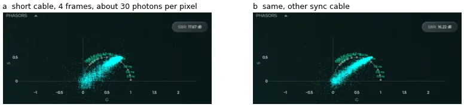

# Signal cables and a second peak in the decay

*Understanding-oriented. A bench test on 24 and 25 November 2026: the TCSPC histogram of a
2.5 ns calibration slab showed a second, smaller peak after the main one. Setup: FLIM LABS
card, 488 nm pulsed laser, galvo scanner on the 7 × 4 plate, Thorlabs long-pass emission
filter, PLF reconstruction. The cause was the coax cable from the detector to the card.*

## In short

- The second peak is an **echo** of each photon pulse on the cable from the detector to the
  card. The card counts the echo as a second photon, one cable round trip later.
- Its delay followed the cable: **12.2 ns** with the long cable, **6.4 ns** with the short
  one. A **new cable** removed it.
- Two cables joined by a barrel made the echo almost as large as the photon pulse: every
  photon was counted twice.
- The laser, the optics and the objective were not involved: changing the repetition rate,
  the objective and the excitation filter did not move the second peak.
- A cable change also moves the whole decay in time. **Calibrate again after changing any
  cable.**

## What the second peak looked like

On the 2.5 ns slab the main peak decays as expected. A second peak with the same shape sits
a fixed time later and is 8-10 % as high:

The delays and heights were read from the screenshots (about ±0.3 ns):

| test | laser | second peak after the main one | height of the second peak |
|---|---|---|---|
| long cable, daylight | 40 MHz | 12.0 ns | 9 % |
| long cable, daylight | 20 MHz | 12.4 ns | 9 % |
| long cable, covered | 20 MHz | 12.2 ns | 9 % |
| long cable | 80 MHz | not visible: 12.2 ns is one period (12.5 ns), so it lands on the main peak | - |
| short cable | 40 MHz | 6.4 ns | 10 % |
| short cable, other sync cable | 40 MHz | 6.3 ns | 9 % |
| short cable, other objective | 40 MHz | 6.4 ns | 9 % |
| short cable, SP490 short-pass after the laser | 40 MHz | 6.3 ns | 8 % |
| two cables joined by a barrel | 40 MHz | 6.4 ns | 89 % |
| new cable | 40 MHz | none | - |

## How the tests narrowed it down

| suspect | test | result | verdict |
|---|---|---|---|
| a second laser pulse half a period later | 20 and 80 MHz instead of 40 MHz | the delay stayed at about 12.2 ns, not half the period (25 ns at 20 MHz) | not the laser |
| a reflection in the optics | another objective; geometry | no change; a delay of 12 ns needs 3.7 m of free-space path, the beam path on the plate is well under 1 m | not the optics |
| daylight | cover on (20 MHz) | the flat floor under the decay dropped from 12 % to 4 % of the peak, the second peak stayed at 9 % | daylight makes the floor, not the peak |
| broad laser emission | 490 nm short-pass after the laser | the second peak stayed (8 %) | not the laser spectrum |
| the sync cable from the laser to the card | another sync cable | the whole decay moved 1.5 ns earlier, the delay between the peaks stayed | not the sync cable |
| the cable from the detector to the card | a shorter cable | the delay halved, from 12.2 to 6.4 ns | **this cable** |
| | two cables joined by a barrel | second peak 89 % as high, count rate about twice as high | |
| | a new cable | no second peak | |

## Why a cable makes a second peak

Each photon produces a short electrical pulse at the detector. The pulse runs down the coax
to the card. Where the cable meets something that does not have the same impedance (the
card's input, a barrel connector, a cable of a different type), part of the pulse is
reflected and runs back. At the detector it is reflected again and arrives at the card one
round trip later.

In a cable with solid polyethylene insulation (RG-58, RG-174, RG-316) a pulse travels about
20 cm per nanosecond, so a round trip takes about 10 ns per metre of cable:

| delay of the second peak | cable length for that round trip |
|---|---|
| 12.2 ns | about 1.2 m |
| 6.4 ns | about 0.64 m |

The card does not see a difference between a photon pulse and its echo. Whenever the echo is
still above the card's threshold, it is counted as one more photon, a round trip later. With
the old cables that happened for 8-10 % of the photons. A barrel between two cables reflects
much more strongly, so nearly every pulse came back above the threshold: two equal peaks, and
the count rate doubled (2.77 M counts/s, against 1.43 M counts/s with the new cable shortly
after).

The new cable most likely has the impedance the detector and the card expect (50 Ω), so
almost nothing is reflected.

:::note ✏️ TODO - Benedict
Add the type and length of the old long, old short and new detector cable, and the
detector model. The delays above predict about 1.2 m and 0.64 m for the two old cables.
:::

## What the echo does to the lifetimes

- **Intensity.** Each echo is counted as a photon, so the intensity is 8-10 % too high, and
  twice as high with the joined cables.
- **Phasors.** The echo adds a delayed copy of the decay, which pulls the phasor of every
  pixel inside the universal circle. A calibration with the 2.5 ns slab corrects this, as
  long as the echo stays the same between the calibration and the measurement. It does not
  if a cable is changed, re-plugged or bent differently.
- **Fits.** A tail fit that does not know about the echo reads the second peak as part of the
  decay.

A cable change also moves the whole decay: with the other sync cable the main peak arrived
1.5 ns earlier. At 40 MHz that is a phase change of 22°, a large lifetime error if the old
calibration is still used. **Calibrate again after changing or re-plugging any cable**,
the detector cable and the laser sync cable alike.

## Why the phasors were scattered

A 2.5 ns lifetime at 40 MHz belongs at g = 0.72, s = 0.45 on the universal circle. The
clouds above run from there towards the origin, with a lot of spread. Two things cause
that, not the cable:

- **Few photons per pixel.** At about 600 000-870 000 counts/s, a 12.5 µs dwell and 4 frames,
  a pixel collects only 30-45 photons. That gives a phasor spread of roughly ±0.1 in g and s.
  About 1000 photons per pixel bring it down to about ±0.02: more frames, a longer dwell, or
  binning pixels (Bins in FLIM Imager).
- **Background in dim pixels.** Light that does not come from the laser pulse (daylight,
  detector dark counts) has no lifetime and pulls a pixel's phasor towards the origin. The
  dimmer the pixel, the stronger the pull. The edges of the field are dimmer than the centre,
  so the cloud stretches towards the origin. Measure covered, and leave out dim pixels with an
  intensity threshold.

## Choosing and checking the cables

- Use **50 Ω coax** with the connectors of the detector and the card (SMA) at both ends.
  Do not use 75 Ω video or TV cables, or cables of unknown type.
- Use **one continuous cable** per signal: no barrels, adapters or T-pieces in the line.
- Keep the cables short, and keep them **the same** from day to day. Label the detector
  cable and the sync cable.
- After any change, check a mono-exponential sample (the calibration slab) in the TCSPC view:
  one peak, no bump after it, and the count rate as before.
- Calibrate again after any cable change.
- The flat floor under the decay is light that is not timed to the laser: measure with the
  cover on and the room light off. In these tests daylight raised it from 4 % to 12 % of the
  peak at 20 MHz, and to 31 % at 40 MHz.
- A short-pass (here SP490) after the laser blocks the laser's weaker emission at longer
  wavelengths, which the emission filter would let through. It did not affect the second peak.

## Related

- [Stripes, dots and lines in FLIM images](./flim-image-artefacts.md): image artefacts from
  the scan configuration, the USB link and the pixel clock.
- [Scan parameters](../reference/scan-parameters.md)
