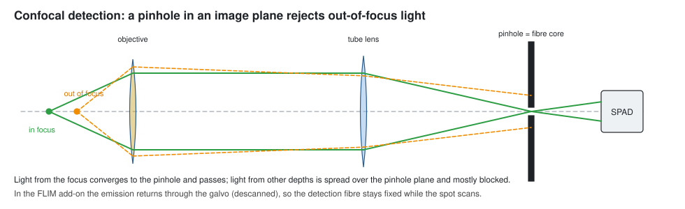
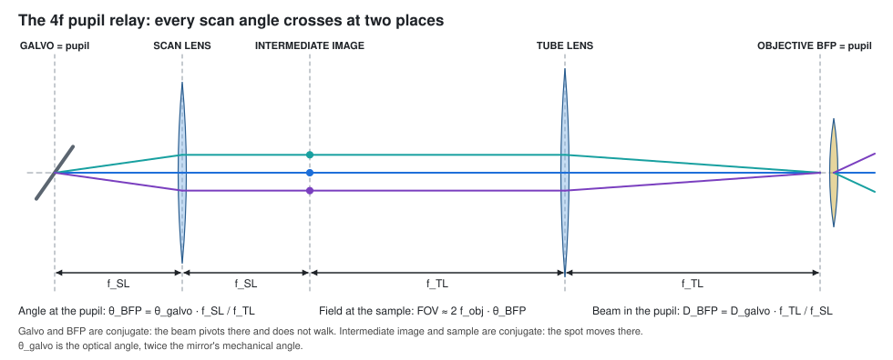

# How laser scanning works

*Understanding-oriented. Read this to know why the scanner is built the way it is. Most of
it comes from the openUC2 FLIM laser-scanning workshop ("One point at a time").*

## Why scan one point at a time?

A camera records intensity at all pixels in parallel. It is very hard to add another
dimension to that, such as a spectrum or a fluorescence lifetime. A **point scanner**
trades this parallelism for richness per pixel. It parks the focused laser on one
position, records everything about that spot (here the arrival times of single photons for
the lifetime), and moves to the next pixel. Together with FLIM LABS this gives a
fluorescence lifetime per pixel at a fraction of the usual price.

The second gift of point scanning is **optical sectioning**.

A pinhole in an image plane passes the light that comes from the focus and blocks most of
the light from other depths:

- **Sectioning:** you get a true 3D stack, not a blurred one.
- **Resolution:** up to √2 better laterally with a closed pinhole, paid for with photons.
- **Cost:** one pixel at a time, so you need a scanner.

In the FLIM add-on the **core of the detection fibre is the pinhole**. How strong the
sectioning is depends on the objective NA, the magnification onto the fibre and the core
size (see [Choose an objective](../how-to/choose-an-objective.md)).

## Two conditions that must both be true

1. **The galvo is imaged into the objective's back focal plane (BFP).** Then tilting the
   mirror rotates the beam about the centre of the objective pupil. The focus moves
   sideways in the sample, and the beam does not walk across the pupil.
2. **The beam fills the pupil and is centred in it.** The NA you get is the NA you light
   up, so the beam size sets the spot size and the centring sets the power and the
   symmetry.

## The 4f pupil relay

The scan lens (f_SL) and the tube lens (f_TL) form a telescope. All scan angles cross at
**two** places: at the galvo, and at its image, the BFP. Galvo and pupil are conjugate;
intermediate image and sample are conjugate; the beam is telecentric in the sample space.

For small angles:

$$
\theta_\text{BFP} = \theta_\text{galvo}\,\frac{f_\text{SL}}{f_\text{TL}},
\qquad
x_\text{sample} \approx f_\text{obj}\,\theta_\text{BFP},
\qquad
\text{FOV} \approx 2\,f_\text{obj}\,\theta_\text{BFP}
$$

θ_galvo is the **optical** angle: a mirror turned by 1° deflects the beam by 2°. Changing
the relay focal lengths changes the field of view for the same galvo signal.

## The same telescope as a beam expander

The telescope also widens the beam:

$$
D_\text{BFP} = D_\text{laser}\,\frac{f_\text{TL}}{f_\text{SL}},
\qquad
D_\text{pupil} = 2\,\text{NA}\,f_\text{obj},
\qquad
f_\text{obj} = \frac{f_\text{TL, nominal}}{M_\text{obj}}
$$

Set D_BFP equal to D_pupil, solve for the ratio f_TL / f_SL, pick the two nearest library
focal lengths, and let the 50 mm grid place them.

| | workshop build | FLIM add-on (OPM-0004) |
|---|---|---|
| beam at the galvo | 2.0 mm | about 2.0 mm (fibre collimator f 11.2) |
| scan lens f_SL | 50 mm | 50 mm |
| tube lens f_TL | 200 mm | 160 mm |
| pupil magnification | 4x | 3.2x |
| beam in the BFP | 8.0 mm | 6.4 mm |
| objective | 20x / 0.4, f 10 mm, pupil 8 mm | 4x / 0.10, f 45 mm, pupil 9 mm; or 10x / 0.30, pupil 12 mm |
| mechanical scan angle | ±5° (±10° optical) | keep to about ±2° (±4° optical), see below |

The numbers of the FLIM add-on are in [Optical layout](../reference/optical-layout.md).
Why the usable scan angle is smaller than the galvo could do is explained in
[Optical quality and limits](./optical-quality-and-limits.md).

## Eight modules, one line

The workshop builds the scanner as a row of modules and aligns them in this order, laser
first, always. The FLIM add-on packs the same modules into its cubes:

| module | function | in the FLIM add-on |
|---|---|---|
| M1 excitation arm | a clean, collimated beam of known diameter | 488 nm fibre + collimator on an XY holder, excitation filter |
| M2 emission arm | pinhole + single-photon detector | emission filter, coupling lens, detection fibre (core = pinhole) on an XY holder |
| M3 junction | merges excitation and emission, kinematic | the junction dichroic (the one mount you may touch later) |
| M4 scanner | two voltages → two angles; this plane is the pupil | galvo pair: mirror A (x), 7.4 mm, mirror B (z) |
| M5 scan lens | angle → position at the intermediate image | f50, one cell after the galvo |
| M6 tube lens | re-collimates, magnifies, relays the galvo into the BFP | f160, four cells after the scan lens |
| M7 beamsplitter | folds the beam into the objective, keeps a camera path | kinematic splitter under the objective; widefield camera of the FRAME |
| M8 objective + sample | diffraction-limited spot, collects the emission | the FRAME objective and stage |

Two workshop tips carry over directly:

- **Align the emission arm with light going backwards**: it is far easier to send a visible
  laser out of the pinhole than to hunt for photons into it. That is the red fibre laser
  in the detection fibre (tutorial step 3).
- **Use the widefield camera** to find the sample and focus. Hunting for focus with a single
  point detector is miserable.

This is how it looks in the FRAME:

## Descanned detection

The fluorescence from the focus goes back through the objective, the splitter, the tube
lens and the scan lens to the galvo. The galvo undoes the scan, so behind it the emission
travels along the fixed axis of the excitation, whatever the scan angle. The junction
dichroic separates it from the excitation, and the coupling lens focuses it into the
detection fibre. The fibre therefore stays fixed while the spot scans the sample.

## Timing: which photon belongs to which pixel

The galvo board does two jobs: it writes smooth analog scan signals (12-bit DAC, ±10 V
differential) and it sends digital triggers (pixel, line, frame) to the FLIM card.

- The FLIM card needs a consistent way to assign each photon to a pixel. The triggers of
  the scan controller are the single source of truth, so the scan position and the photon
  assignment cannot drift apart.
- With bidirectional scanning every second line runs backwards. The software or the timing
  has to reverse it.
- Photons during the flyback must not land in pixels: blank the laser or gate them out.

The command and its parameters are in [Scan parameters](../reference/scan-parameters.md);
the measured trigger behaviour is in [Trigger outputs](../reference/trigger-outputs.md).
