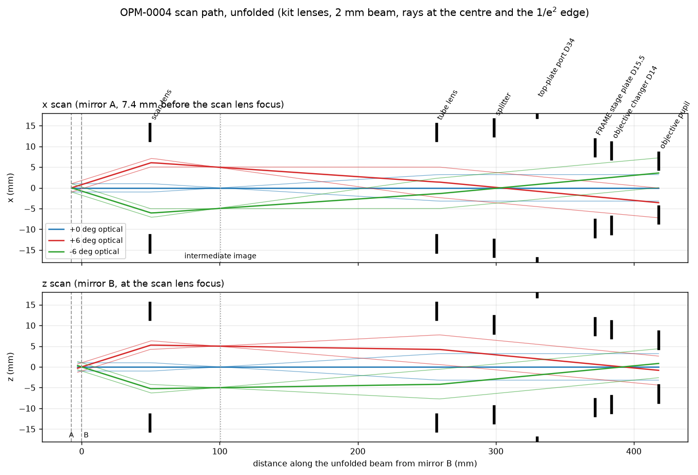
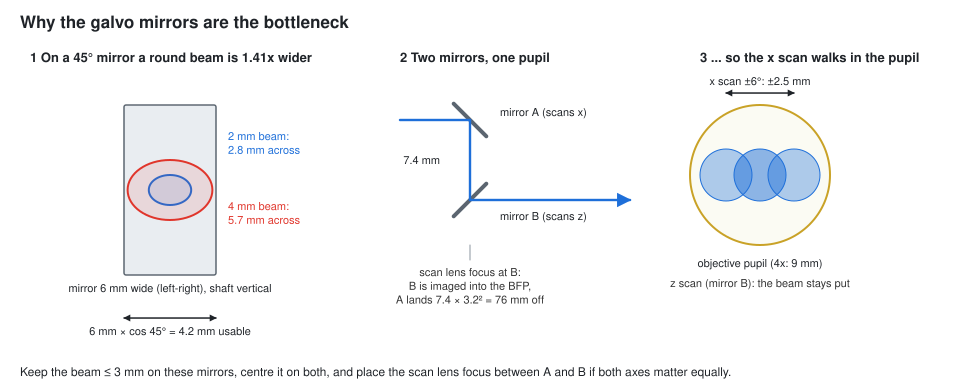
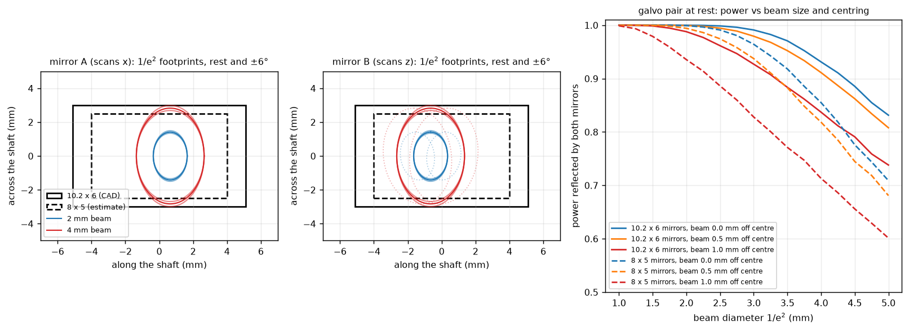
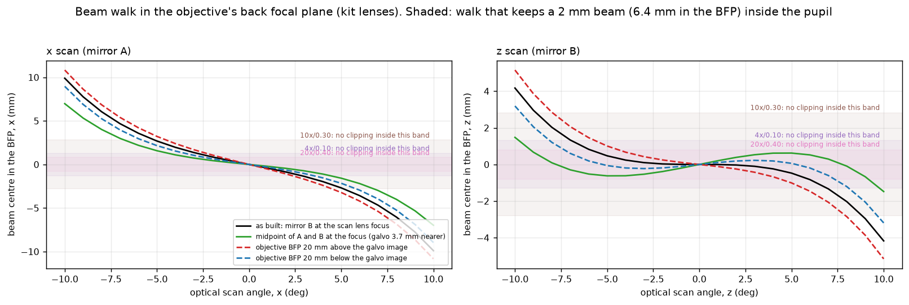
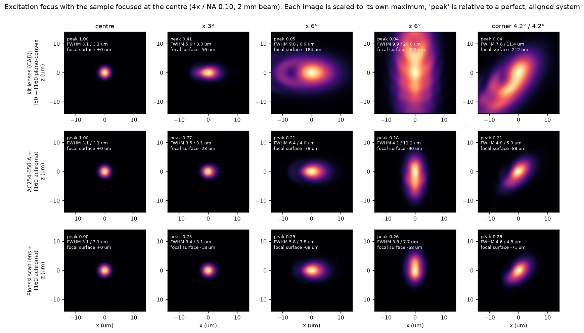
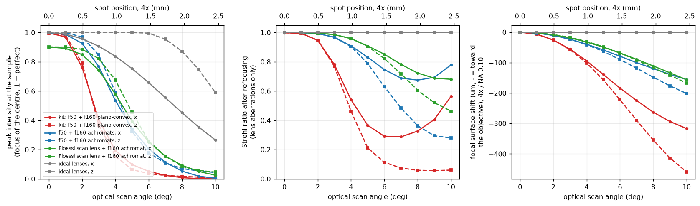
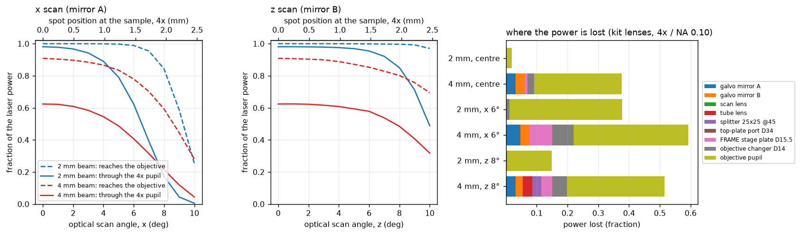
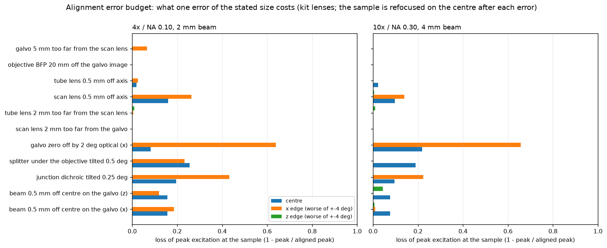

# Optical quality and limits of the scan path

*Understanding-oriented. What the simulation of the module says about where the image
quality goes, and what is worth changing. Numbers are for the CAD module (f50 + f160
plano-convex lenses), a 4x / NA 0.10 objective and a 2 mm beam unless stated.*

The model is described in [Optical simulation](../reference/simulation.md). In short:
a real ray trace of the relay, the exact 3D geometry of the two galvo mirrors, every
aperture from the mirrors to the objective pupil, a Gaussian 488 nm beam, and an ideal
objective.

*The scan path unfolded, for the centre and ±6° optical scan angles. Top: the x scan of
mirror A. Bottom: the z scan of mirror B. Black bars are the apertures.*

## 1. On the axis everything is fine

With the beam parked at the centre, all lens sets give a diffraction-limited spot: a
3.1 µm lateral FWHM and about 100 µm axially with the 4x. The plano-convex lenses of the
module are not the problem there. The beam, the field and the alignment are.

## 2. The galvo mirrors are the narrowest aperture

A round beam that hits a mirror at 45° makes a spot that is 1.41 times wider in the plane
of incidence. That is across the mirror's short side. A 6 mm wide mirror leaves 4.2 mm for
the beam, an 8 × 5 mm mirror 3.5 mm.

*Left: 1/e² footprints of a 2 mm and a 4 mm beam on both mirrors, at rest and at ±6°
(mirror B also shows the walk caused by mirror A, dotted). Right: power reflected by both
mirrors.*

| beam at the galvo | 10.2 × 6 mm mirrors, centred | ... 0.5 mm off | 8 × 5 mm mirrors, centred | ... 0.5 mm off |
|---|---|---|---|---|
| 2 mm | 100 % | 100 % | 100 % | 99 % |
| 3 mm | 99 % | 98 % | 96 % | 94 % |
| 4 mm | 93 % | 91 % | 86 % | 82 % |

The cut is a straight line. In the objective pupil the mirror edge lands about 6.8 mm off
the axis, just inside the Ø14 opening of the FRAME. As long as the beam is centred on that
opening, the round opening hides the straight edge. A D-shaped spot with a straight edge
therefore means two things: the beam reaches a mirror edge, and the beam is shifted
against the opening (see [Fix a clipped beam](../how-to/fix-a-clipped-beam.md)).

## 3. Only one of the two mirrors can sit in the pupil

The telescope images one plane into the objective's back focal plane. In the module that
plane is **mirror B**. Mirror A sits 7.4 mm in front of it. Along the beam its image lands
7.4 mm × 3.2² = 76 mm away from the pupil. So:

- During a **z** scan (mirror B) the beam pivots in the pupil and does not walk.
- During an **x** scan (mirror A) the beam walks across the pupil by about 0.4 mm per optical
  degree, more at large angles with the plano-convex scan lens (3.6 mm at 6°). With the 4x
  pupil (9 mm) and a 6.4 mm beam, the x edges lose 20 % of the power at ±5° and 60 % at
  ±7°.

*Beam centre in the pupil against the scan angle. The plano-convex scan lens adds its own
walk (pupil aberration), visible as the bend of the z curve beyond 5°.*

Putting the scan lens focus **midway between the mirrors** (green) splits the walk between
both axes: 2.2 mm instead of 3.6 mm at 6° for x, and 0.5 mm in z. This is what the
original build guide meant by "the centre between the two mirrors is imaged into the BFP".
In the CAD the focus sits on mirror B.

## 4. The scan lens bends the focal plane

A single plano-convex lens is not a scan lens. Off the axis its focus moves toward the lens
(field curvature) and splits into two lines (astigmatism). The telescope carries this
through to the sample: the focus at the edge of the field lies **closer to the objective**
than at the centre.

*The focus at the sample with the sample focused at the centre. Rows: lens sets. Columns:
scan positions. 3° optical is ±0.74 mm at the sample with the 4x.*

| lens set | peak at 3° (x) | peak at 6° (x / z) | focal surface at 6° | spot at 6° |
|---|---|---|---|---|
| kit: f50 + f160 plano-convex | 0.41 | 0.05 / 0.04 | about 200 µm toward the objective | 7-30 µm, smeared |
| AC254-050-A + f160 achromat | 0.77 | 0.20 / 0.18 | 80-90 µm | 4-11 µm |
| Plössl scan lens (2 × AC254-100-A) + f160 achromat | 0.75 | 0.25 / 0.26 | about 70 µm | 4-8 µm |

*Left: peak intensity at the sample (focused at the centre). Middle: Strehl ratio after
refocusing each point, from the lens aberrations alone. Right: focal surface. Grey: ideal
lenses; there, only the pupil walk of the x axis reduces the peak.*

What this means in practice:

- With the kit lenses the good field is about **±2° optical**, about ±0.5 mm with the 4x.
  Beyond that the spot grows quickly and gets dimmer.
- Achromats or a Plössl scan lens extend it to about **±3°**, with half the peak still left
  at ±4°.
- The focal surface sags with the square of the scan angle. A thin sample looks sharp in
  the middle and blurred at the edges, even when the spot itself is fine.
- In the Strehl curves, the rise at the largest angles is not a real improvement: the
  clipping cuts away the worst part of the beam.

## 5. Where the power goes

*Power reaching the sample against the scan angle (dashed: before the objective pupil), and
which aperture takes it.*

- **2 mm beam:** nothing is lost at the centre except 2 % at the 4x pupil. At the x edges
  the pupil takes most (the walk above). Along z, the tube lens and the splitter begin to
  cut beyond 7-8°.
- **4 mm beam:** 38 % is lost already at the centre. The objective pupil takes 28 % (the
  beam overfills it), the galvo mirrors 3 % each, the FRAME openings about 3 %. Off-axis,
  the FRAME openings take more.

## Alignment error budget

*What one error of the given size costs in peak intensity at the sample. The sample is
refocused at the centre after each error. "Edge" is the worse side of ±4° optical.*

With the 4x and a 2 mm beam:

| error | centre | x edge | why |
|---|---|---|---|
| beam 0.5 mm off centre on the galvo | -16 % | -12 to -19 % | the offset is 3.2x larger in the pupil (1.4 mm) |
| junction dichroic tilted 0.25° | -19 % | -43 % | moves the beam on the galvo (0.5 mm) and shifts the scan centre |
| splitter under the objective tilted 0.5° | -26 % | -23 % | turns the beam by 1°: 1.8 mm in the pupil, 0.8 mm in the sample |
| galvo centre 2° optical off | -8 % | -64 % | the whole x walk shifts to one side |
| scan lens 0.5 mm off the axis | -16 % | -26 % | the beam leaves the scan lens at an angle |
| tube lens 0.5 mm off the axis | -2 % | -3 % | |
| scan lens or tube lens 2 mm off, galvo 5 mm off, objective BFP 20 mm off | 0 % | up to -7 % | only a focus shift (up to 160 µm for 2 mm), which you refocus |

The lesson: **centring matters, distances along the beam hardly do.** Everything that
moves the beam sideways in the objective pupil costs peak intensity. That is the beam on
the galvo (×3.2), the dichroic, the splitter, the galvo centre and the scan lens decentre.
This is why the tutorial spends most of its steps on centring.

## What would make it better

Ordered by cost:

| change | cost | effect |
|---|---|---|
| keep the beam at about 2 mm (the CAD collimator f 11.2) | none | no clipping in the module or the FRAME |
| scan within ±2° (kit lenses) or ±4° (achromats), tile larger areas with the stage | none | full brightness and sharpness across the image |
| centre the beam on both galvo mirrors and in the objective pupil | alignment | avoids 15-25 % losses per error |
| place the scan lens focus midway between the two mirrors (galvo insert or scan lens about 3.7 mm closer) | a new insert | x walk -40 %, small z walk |
| replace the plano-convex lenses by achromats (AC254-050-A, and an f150 / f200 achromat) or a Plössl scan lens | about 90-180 € | twice the good field, a third of the field curvature |
| galvo with larger mirrors (about 10 mm aperture) | galvo set | lets a 3-4 mm beam fill a 10x / 20x pupil without clipping |
| a real scan lens (flat field, f-theta) | expensive | a flat focal surface over the full galvo range |
