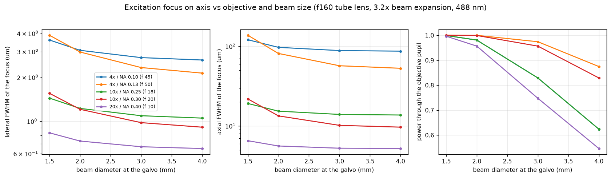

# How to choose an objective for the scanner

*Task-oriented. Use the table to pick an objective, then measure the focus with beads.*

The excitation focus depends on how well the beam fills the objective's back aperture. The
pupil diameter is 2 × NA × f_obj. The beam in the pupil is the beam at the galvo times 3.2
(f160 / f50): a 2 mm beam becomes 6.4 mm, a 4 mm beam 12.8 mm. A smaller beam
under-fills the pupil, so the spot is larger but no power is lost. A larger beam fills the
pupil, so the spot is smaller but power is lost at the pupil edge and at the galvo mirrors.

*Simulated excitation focus on the axis (Optiland model of the module, 488 nm, ideal objective).*

## The numbers

| objective (f) | pupil | beam at the galvo | lateral FWHM | axial FWHM | power into the pupil | field for ±3° / ±5° optical |
|---|---|---|---|---|---|---|
| 4x / NA 0.10 (45 mm) | 9.0 mm | **2 mm** | 3.1 µm | 97 µm | 98 % | 1.5 / 2.5 mm |
| | | 4 mm | 2.6 µm | 87 µm | 62 % | |
| 4x / NA 0.13 (50 mm) | 13.0 mm | 2 mm | 3.0 µm | 81 µm | 100 % | 1.6 / 2.7 mm |
| | | 3 mm | 2.3 µm | 57 µm | 97 % | |
| 10x / NA 0.25 (18 mm) | 9.0 mm | **2 mm** | 1.2 µm | 15 µm | 98 % | 0.6 / 1.0 mm |
| 10x / NA 0.30 (20 mm) | 12.0 mm | **2 mm** | 1.2 µm | 13 µm | 100 % | 0.65 / 1.1 mm |
| | | 3 mm | 1.0 µm | 10 µm | 96 % | |
| 20x / NA 0.40 (10 mm) | 8.0 mm | **2 mm** | 0.73 µm | 6 µm | 96 % | 0.33 / 0.55 mm |

Focal lengths are for a 180-200 mm tube length; check the value for your objective.
The "field" is the full width scanned at the sample. Beyond about ±3-4° optical the
focus at the field edge gets worse with the plano-convex scan lenses of the module (see
[Optical quality and limits](../explanation/optical-quality-and-limits.md)). For larger
areas, tile with the stage.

## What to take

- **Overview, thick samples, robust FLIM:** 4x / 0.10 with the 2 mm beam. The focus is
  3 µm wide, the depth of focus is about 100 µm, and it is forgiving to align.
- **Cells and tissue detail:** 10x / 0.30. It gives a 2.5 times smaller spot (1.2 µm) and
  7 times thinner focus (13 µm) than the 4x, with nearly all the power into the pupil at
  2-3 mm beam. The scan field shrinks by the same factor of 2.25 (about 0.65 mm at ±3°).
  This is the best match for the module as built.
- **20x / 0.40:** the smallest spot, but only a third of a millimetre field. A 2 mm beam
  already fills its 8 mm pupil.

A beam larger than about 3 mm does not pay off with these objectives: the spot hardly gets
smaller, but the galvo mirrors and the objective pupil cut away 20-40 % of the power.

## Confocal sectioning: the detection fibre

The fluorescence is focused into the detection fibre, whose core acts as the pinhole. Its
size in Airy units (AU) decides how much out-of-focus light is rejected:

$$
\text{pinhole (AU)} = \frac{d_\text{core}}{M_\text{det} \cdot 1.22\,\lambda_\text{em} / \text{NA}}
\qquad
M_\text{det} = \frac{f_\text{TL}}{f_\text{obj}} \cdot \frac{f_\text{c}}{f_\text{SL}}
$$

with f_c the focal length of the lens in front of the detection fibre. For f_c = 11 mm, a
50 µm core is about 10 AU with the 4x and about 13 AU with the 10x / 0.30. That gives
efficient light collection but little sectioning. Around 1 AU needs a few-µm core or a
longer f_c.

:::note ✏️ TODO - Benedict
Add the core diameter of the FLIM LABS detection fibre and the focal length of the coupling
lens in the detection arm, then fill in the Airy units for each objective.
:::

## Measure the focus yourself

1. Use sub-resolution fluorescent beads (100-200 nm, e.g. on a coverslip, dried and
   mounted).
2. Scan a small area with pixels of about a quarter of the expected FWHM, e.g.
   0.25 µm with the 10x: 256 pixels then cover 64 µm.
3. Fit a 2D Gaussian to several isolated beads, near the centre and near the edge of the
   field. The FWHM of the fit is your lateral resolution.
4. For the axial size, take a z-stack (steps of about a quarter of the axial FWHM above)
   through the same beads.
5. Compare centre and edge: a larger or elongated spot at the edge means you are scanning
   beyond the good field of the lenses, or the beam is clipped.
