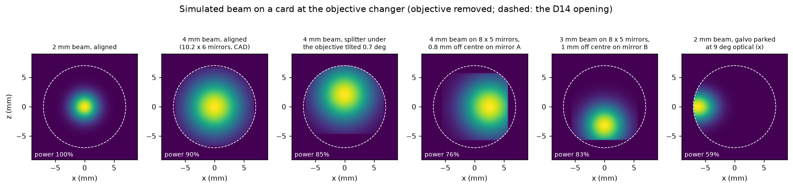

# How to fix a clipped or off-centre beam

*Task-oriented. Use this when the spot on a card at the objective position is not round and
centred, when the scanned image is dark at one side, or when no light comes out of the
objective.*

## Look at the beam

Remove the objective, park the galvo at its centre, put a card on the objective changer and
look at the spot (goggles on, laser at minimum power).

*Simulated spot on a card at the objective changer (Optiland model of the module). The
dashed circle is the Ø14 opening. "Power" is the fraction that reaches the card.*

The shape tells you which aperture cuts the beam:

| what you see | what cuts it | where to look |
|---|---|---|
| round, centred, a few mm wide | nothing | all good (first image) |
| round but filling the whole opening | a beam wider than about 3 mm at the galvo | step 2 |
| **straight edge** on one side (D-shape) | a **rectangular** aperture: the edge of a galvo mirror (or of the splitter) | steps 3 and 4 |
| curved cut, crescent | a **round** opening: the Ø14 / Ø15.5 holes in the FRAME, a lens mount | steps 1, 4 and 5 |
| nothing at all | galvo not centred (parked at an extreme), not powered, or the laser is off | step 1 |

A straight edge inside the opening needs **two** things: a beam that reaches a mirror edge
(too wide, or off-centre on the mirror) **and** a beam that is shifted relative to the FRAME
opening, so that the mirror's edge is no longer hidden behind the round opening. In the
third image, a 0.7° tilt of the splitter under the objective shifts a 4 mm beam enough to
show the flat edge of galvo mirror B at the bottom and the round opening at the top.

## Step 1 - Is the galvo centred and powered?

- Galvo drivers powered, scanner stopped, beam **parked at the centre** (your DAC values
  from the tutorial, default 2048 / 2048).
- A beam parked a few degrees off (last image) is cut by the FRAME openings or misses them
  completely. Then no light comes out of the objective although the laser is on.

## Step 2 - How wide is the beam?

Measure the beam on a card behind the tube lens: it is 3.2 times the beam at the galvo.

| at the galvo | behind the tube lens | effect |
|---|---|---|
| 2 mm (fibre collimator f 11.2, as in the CAD) | 6.4 mm | passes every aperture of the module and the FRAME |
| 3 mm | 9.6 mm | about 1 % loss at the galvo mirrors; fits |
| 4 mm | 12.8 mm | about 7 % lost at the galvo mirrors (10.2 × 6 mm) and 15 % with 8 × 5 mm mirrors; fills the Ø14 opening |

If your beam is about 4 mm, check which collimator is installed. The f 11.2 mm collimator
of the CAD gives about 2 mm with a 488 nm single-mode fibre.

## Step 3 - Is the beam centred on both galvo mirrors?

Look onto mirror A (upper) and mirror B (lower) from above. The critical direction is
across the short side: at 45° the spot is 1.4 times wider than the beam, and a 6 mm wide
mirror leaves only 4.2 mm.

- Off-centre on a mirror: re-centre it as in the tutorial,
  [step 4](../tutorials/align-the-flim-scanner.md). Use the detection fibre holder and then
  the junction dichroic, never the galvo offset.
- Measure the mirrors of your galvo. If they are 8 × 5 mm instead of 10.2 × 6 mm, keep the
  beam at 2-2.5 mm.

## Step 4 - Is the beam centred on the opening?

If the spot is off-centre on the card, centre it with the **splitter's** tip / tilt screws.
Then check far above the port that the beam is vertical (tutorial, step 8).

## Step 5 - Is the scan range too large?

When a scan, not the parked beam, looks clipped (one side of the image is darker):

- Along **x** (mirror A) the beam walks across the objective pupil, about 0.4 mm per optical
  degree. With the 4x the x edges lose 20 % of the power at ±5° optical and 60 % at ±7°.
- Along **z** (mirror B) the beam stays in the pupil up to about ±7°. Beyond that the tube
  lens and the splitter start to cut it.
- Keep the scan within about **±4° optical**. That is ±1 mm at the sample with the 4x and
  ±0.45 mm with the 10x. Tile larger areas with the stage.

The DAC range that corresponds to ±4° depends on the galvo drivers. Calibrate it with the
scanner-camera calibration ([scan parameters](../reference/scan-parameters.md)).

## Why this order

The simulation of the alignment errors ([details](../explanation/optical-quality-and-limits.md#alignment-error-budget))
ranks the causes. A beam 0.5 mm off-centre on the galvo, a 0.25° tilt of the junction
dichroic or a 0.5° tilt of the splitter each cost 15-25 % of the peak intensity. A galvo
zero 2° off costs up to 60 % at one edge. Lens positions along the beam hardly matter once
you refocus.
