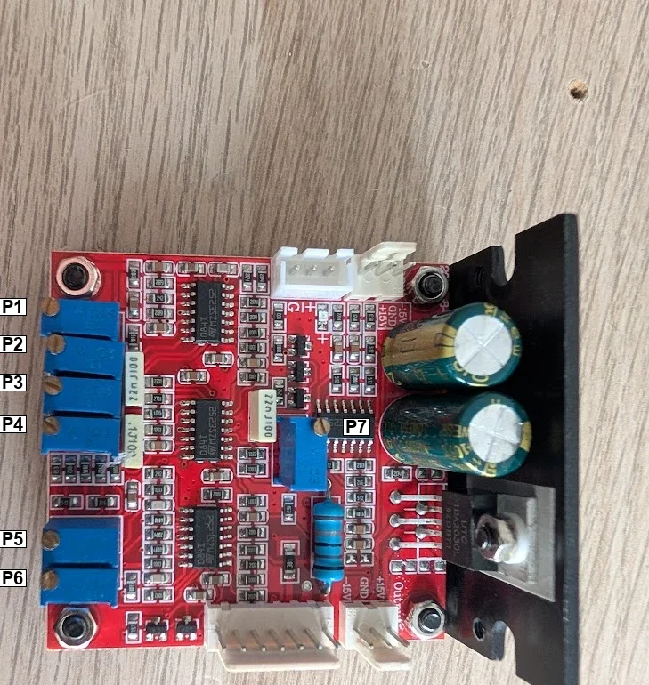
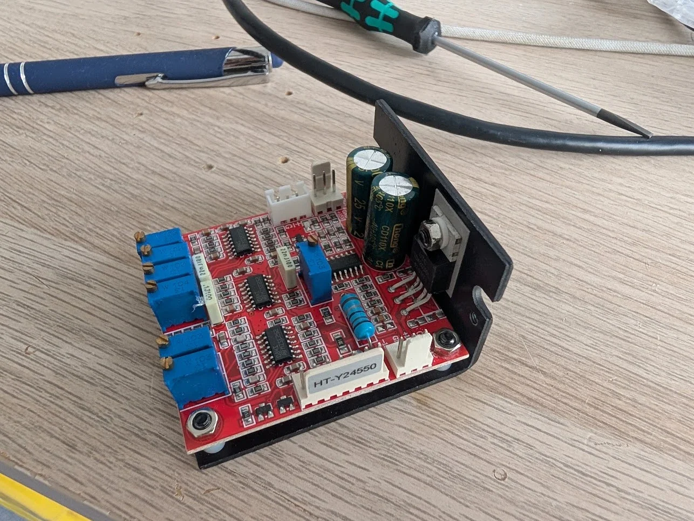

# Galvo driver board

*Reference. The servo driver that turns the differential signal (at most ±8.2 V, from the schematic) of the
[galvo interface board](../../../../dev/hw/electronics/galvo-interface/README.md) into
mirror angle. There is one driver per axis. Status 25 November 2026: the trimmers are named
from the vendor's layout drawing; scale (P1) and offset (P6) are confirmed on the bench.*

## What is on the board

Seen on the boards in the FLIM module (photos above and below):

| part | what we see |
|---|---|
| channels | one per board: one motor connector, one power stage. X and Y each have their own board |
| op-amps | four 5532 dual op-amps (ST) |
| power stage | a TDA2030 audio power amplifier, screwed to the black bracket, which is the heat sink |
| supply | ±15 V; two 25 V electrolytic capacitors |
| trimmers | six side-adjust multi-turn trimmers along the left edge (P1-P4 in one block, P5-P6 below, with fixed resistors in the gap between them) and one top-adjust trimmer in the middle (P7). The printed values read 103 (10 kΩ) or 104 (100 kΩ) |
| film capacitors | 220 nF, 100 nF and 22 nF, next to P1-P4 and P7 |
| connectors | signal input (+ signal, − signal, GND), power input (+15 V, GND, −15 V), the galvo motor, and a 3-pin "Output Power" (+15 V, GND, −15 V) that passes the supply on to the next board, according to the vendor's drawing |

## The trimmers of this board family

No manual for our exact board has turned up. The RGB-SCAN20 from RGB Lasers is a driver of
the same family (20 kpps galvo sets, closed-loop moving-magnet galvos, ±15 V), and its
[two-page manual](https://laserwinkel.nl/bestanden/20kpps.pdf) names six trimmers:

| name | vendor's description | change it? |
|---|---|---|
| IS | input scale, set in the factory | only to match the two axes, as a last resort |
| SG | servo gain: how strongly the position feedback drives the controller | tuning |
| LFD | low-frequency damping, corrects overshoot | tuning |
| HFD | high-frequency damping, corrects undershoot | tuning |
| LIN | zero offset of the driver, set in the factory | no |
| PS | position scale, "DO NOT change it" | no |

The RGB-SCAN20 takes a **±5 V** differential input with 200 kΩ input resistance, needs
+15 V at 1 A and −15 V at 0.6 A, and is specified for ±30° optical and 20 kpps at 20°.

Our board is laid out differently from the RGB-SCAN20. The vendor of our boards sent a layout
drawing with Chinese labels. It shows the seven trimmers of the board family in one row; on our
board that row runs down the left edge (P1-P6), and position 5 is not a trimmer but fixed
resistors (the gap between P4 and P5). The bench tests agree with this order: P1 is the
scale and P6 the shift.

| our trimmer | vendor label | translation | most likely function | bench test, 25 Nov 2026 |
|---|---|---|---|---|
| P1 | 幅度1 | amplitude 1 | input scale (IS) | **scale**: the pattern grows or shrinks |
| P2 | 加速 | acceleration | servo gain or damping: how hard the mirror is driven towards a new position | no visible effect on a slow pattern |
| P3 | 角度 | angle | possibly the position-sensor scale (PS) or an angle limit | no visible effect on a slow pattern |
| P4 | 减速 | deceleration | damping: how the mirror is braked at the target (overshoot) | no visible effect on a slow pattern |
| - | 幅度2 | amplitude 2 | a second scale stage, here set by fixed resistors | - |
| P5 | 对称 | symmetry | balance between the positive and the negative half of the deflection | no visible effect on a small, centred pattern |
| P6 | 移动 | shift | offset (LIN) | **offset**: the pattern shifts |
| P7 | not in the drawing | - | unknown | not tested |

The translations are literal. The functions in the fourth column are our reading of the labels,
not the vendor's description. Acceleration and deceleration only change how the mirror follows
fast steps, which a slow pattern on a wall does not show; watch the corners of a fast square
pattern instead (next section). To see symmetry, scan close to the full range: one half of the
pattern should grow while the other stays.

:::note ✏️ TODO - Benedict
Confirm P2-P5 with a fast square pattern, find out what P7 does, and check the input range of
our boards (±5 V or more). The printed trimmer values are read from a photo and need a check.
:::

## Finding out which trimmer is which

A photo of the top side is not enough to trace the circuit: on a two-layer board many
connections run underneath the parts and on the back. There are two safer ways.

**With a multimeter (power off, galvo unplugged).** For each trimmer, find which op-amp pins
and connector pins its three legs connect to (continuity mode). Then:

- a trimmer in the path from the signal input connector to the first op-amp is the input
  scale (IS);
- a trimmer between +15 V and −15 V whose wiper goes to an op-amp input through a large
  resistor is an offset (LIN);
- a trimmer in the path from the galvo's position sensor (motor connector) is the position
  scale (PS);
- trimmers in series with the film capacitors are the damping adjustments (LFD, HFD); the
  one in the gain path of the stage that drives the TDA2030 is the servo gain (SG).

Photos of **both** sides, taken straight on with the board out of its bracket, make this
easier but do not replace the measurement.

**By watching the beam.** Possible, but each test detunes the galvo for a moment:

1. Note where each trimmer is: count the turns from one end, or turn it exactly one turn and
   later turn it back by the same amount. Multi-turn trimmers have about 25 turns.
2. Scan a small square (about ±3° optical) with the laser at the lowest visible power, and
   watch the corners on a card or in the camera.
3. Turn one trimmer by one turn, note what changes, and turn it back:
   - the square grows or shrinks around its centre, corners unchanged → a scale (IS or PS).
     PS sits in the feedback loop, so it is the one that also changes the ringing;
   - the square shifts → the offset (LIN);
   - the corners overshoot or ring more or less → SG, LFD or HFD.
4. If the galvo buzzes, oscillates or hits its end stop, turn the trimmer back at once.

## Tuning

Only SG, LFD and HFD are meant for tuning. Advice from experienced laser-show users on
[Photonlexicon](https://www.photonlexicon.com/forums/showthread.php/29329-Help-with-galvo-board-tuning-and-do-I-need-a-new-motor):

- leave the scale trimmers alone unless nothing else helps;
- tune on a square test pattern at a few degrees and watch its corners;
- LFD sets the coarse damping and HFD the ringing; the two interact;
- leave about half a cycle of ringing: no ringing at all means the galvo is overdamped and
  slow;
- never let the galvo hit its end stops.

For a FLIM raster, the galvo moves slowly (a 256-pixel line takes 6.4 ms at 25 µs per pixel),
so tuning for speed brings little. A stable, well-damped response matters more.

## Matching the X and Y scale

The two boards never have exactly the same gain. Compensate a remaining difference in
software with the X/Y Output Scale in ImSwitch, see
[Fix a stretched image](../how-to/fix-a-stretched-image.md). Turn the input scale (IS, P1 on our boards) only
for a large difference that the hardware checks there do not explain, and calibrate the
scanner again afterwards.

## Sources

- [RGB-SCAN20 manual](https://laserwinkel.nl/bestanden/20kpps.pdf) (RGB Lasers, 2 pages):
  trimmer names, board layout of that model, input and supply.
- [20 kpps galvo set](http://www.laser-parts.com/20kpps-galvanometer-set.html)
  (laser-parts.com): the same trimmer list and the speed table.
- [Help with galvo board tuning](https://www.photonlexicon.com/forums/showthread.php/29329-Help-with-galvo-board-tuning-and-do-I-need-a-new-motor)
  (Photonlexicon forum): tuning practice for this class of drivers.
