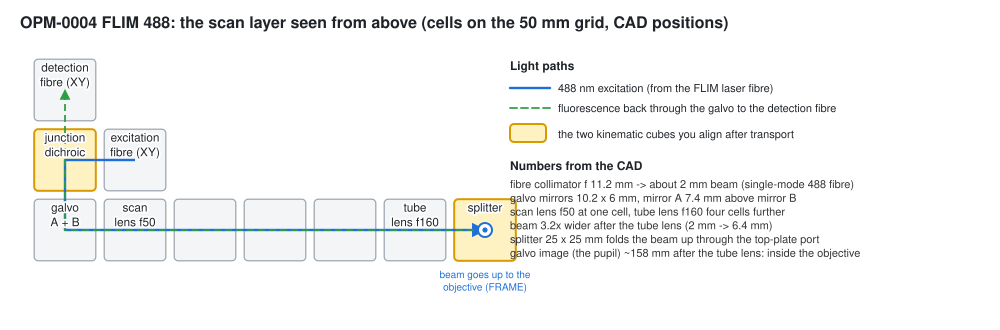

# Optical layout of the FLIM module (OPM-0004)

*Information-oriented. Numbers from the CAD assembly `OPM - 0004 - FLIM 488` and from the
Optiland model of it ([simulation](./simulation.md)).*

## Elements

The scan layer is the upper layer of the module (cube centres at z = 55 mm in the CAD).
Cells are given as (row, column) in the drawing above: rows top to bottom, columns left to
right.

| element | CAD module | cell | key data |
|---|---|---|---|
| excitation fibre collimator | ASS-2084 CUBECCADJFIBHOL+SHLFILLCKVER | (2, 2) | FC/PC collimator f = 11.2 mm on an XY (eccentric) holder; excitation filter slider SUB-0093 |
| junction dichroic | ASS-2078 CUBKINDICSPL45° | (2, 1) | kinematic 45° mount, tip / tilt; reflects the 488 nm excitation into the galvo, transmits the fluorescence |
| detection fibre | ASS-2083 CUBECCFIBHOL+SHLFILLCKVER | (1, 1) | coupling lens + fibre on an XY holder; emission filter slider SUB-0087 |
| galvo pair | ASS-2075 CUBGLV | (3, 1) | mirrors 10.2 × 6 mm (CAD); beam in along x on mirror A (7.4 mm above the cube centre), down to mirror B (cube centre), out along the row |
| scan lens | ASS-2073 CUBLEND25F50 | (3, 2) | f50, Ø25.4 plano-convex (R 25.84 mm, 4.69 mm, N-BK7), convex side toward the galvo |
| empty cubes | ASS-2000 | (3, 3)-(3, 5) | spacers |
| tube lens | ASS-2074 CUBLEND25F160 | (3, 6) | f160, Ø25.4 plano-convex (R 82.62 mm, 2.95 mm, N-BK7), insert offset +9.5 mm, convex side toward the objective |
| splitter | ASS-2077 CUBKINSPL45° | (3, 7) | 25 × 25 × 1 mm plate in a kinematic 45° mount; folds the beam up through the top-plate port to the objective |
| top-plate port | PRT-1052 + PRT-4007 | above (3, 7) | M37 port with a glass disc, clear Ø34 |

:::note What is in your module?
The CAD lists plano-convex f50 and f160 lenses. Some modules carry an f50 achromat and an
f180 or f200 tube lens instead. That changes the magnification (3.6x or 4x), the beam size
in the pupil and the field per degree. The simulation covers both; check the engraving on
your lenses.
:::

## Distances along the beam

Unfolded, measured from mirror B (the plane the telescope images into the pupil):

| plane | distance |
|---|---|
| mirror A | -7.4 mm (before mirror B) |
| mirror B (scan pivot of z) | 0 |
| scan lens (curved vertex) | 49.5 mm |
| intermediate image | 100.6 mm |
| tube lens (first vertex) | 256.8 mm |
| splitter | about 299 mm (39 mm after the tube lens) |
| top-plate port | about 330 mm |
| FRAME stage plate opening (about Ø15.5) | about 372 mm |
| objective changer opening (Ø14) | about 384 mm |
| image of mirror B = objective back focal plane | 418 mm (158 mm after the tube lens, inside the objective) |

The positions of the FRAME openings are taken from the FRAME CAD and are accurate to a few
millimetres.

## Beam and scan

| quantity | value |
|---|---|
| wavelength | 488 nm |
| beam diameter at the galvo (1/e²) | 4 λ f / (π MFD) = 2.0 mm for f 11.2 mm and a 3.5 µm mode-field diameter |
| relay magnification | f_TL / f_SL = 3.2 |
| beam diameter in the objective pupil | 6.4 mm (2 mm beam), 12.8 mm (4 mm beam) |
| optical angle | 2 × mechanical mirror angle |
| angle in the pupil | optical angle / 3.2 |
| spot shift at the sample | 245 µm per optical degree (f_obj 45 mm, 4x), 110 µm (20 mm, 10x), 55 µm (10 mm, 20x) |
| image of mirror A | 7.4 × 3.2² = 76 mm beyond the BFP: the x scan walks in the pupil by about 0.4 mm per optical degree |

## Apertures that can clip the beam

| aperture | size seen by the beam | clips first when |
|---|---|---|
| galvo mirror A, across its shaft | 6 mm × cos 45° = 4.2 mm (8 × 5 mm mirrors: 3.5 mm) | the beam is wider than about 3 mm, or off-centre |
| galvo mirror B, across its shaft | same | same |
| scan lens mount | Ø about 23 mm | optical angles beyond about ±9° |
| tube lens mount | Ø about 23 mm | z angles beyond about ±8° (large beams earlier) |
| splitter 25 × 25 mm at 45° | 25 mm × 17.7 mm (the long side across the fold) | z angles beyond about ±8° |
| FRAME stage plate opening | about Ø15.5 | beams wider than 3 mm at the galvo, and beams off-centre |
| objective changer opening | Ø14 | same |
| objective pupil | 2 NA f_obj: 9 mm (4x / 0.10), 12 mm (10x / 0.30), 8 mm (20x / 0.40) | x angles beyond about ±5° (walk), or when the beam is decentred |

## Adjustable elements

| element | adjusts | used in |
|---|---|---|
| excitation fibre holder XY | position of the excitation beam | tutorial step 3 (near) |
| detection fibre holder XY | position of the detection axis; peak-up of the counts | tutorial steps 3, 4, 11 |
| junction dichroic tip / tilt | direction of the excitation into the galvo | tutorial step 3 (far); after transport |
| galvo centre (DAC) | scan centre = optical axis | tutorial step 5 |
| splitter tip / tilt | direction into the objective: field centre and pupil centring | tutorial step 8; after transport |
