# Build and align the FLIM laser scanner

*Learning-oriented. Work through the steps in order; each one ends with a check you can see.
Plan about two hours for the first time.*

You align the scanner of the FLIM add-on (CAD: `OPM - 0004 - FLIM 488`), one module at a
time, from the fibre to the objective. The rule from the workshop holds: **make the static
beam perfect first, then scan**. Every step adds one element and checks it before the next
one goes in.

*The scan layer of the module seen from above. Blue: 488 nm excitation. Green: fluorescence
back to the detection fibre. Yellow: the two kinematic cubes, the only optics you adjust
after transport.*

## What you need

- the FLIM module with all cubes, the galvo interface board and the galvo drivers powered
- the excitation laser on its single-mode fibre (FLIM LABS), and a **second fibre-coupled
  laser** that is easy to see, e.g. a red fibre tester (635-650 nm)
- laser safety goggles for **both** wavelengths
- an alignment card (fluorescent or white), a ruler, a cross-hair target that fits a cube
  (or a card with a pencil cross), about 1 m of free space or a wall
- ImSwitch with the galvo scanner controller (DAC range 0-4095 per axis, centre 2048)
- a fluorescent slide, later a sample with sparse beads or sharp edges

:::warning Laser safety
Wear goggles from step 1 on. Turn the 488 nm laser down to the lowest power that you can see
on a card. Never look into the port, the open cubes or the objective. The galvo can throw
the beam sideways out of an open cube: keep cards and hands, not eyes, in the path.
:::

## Step 1 - Prepare: safety, centred galvo, two lasers

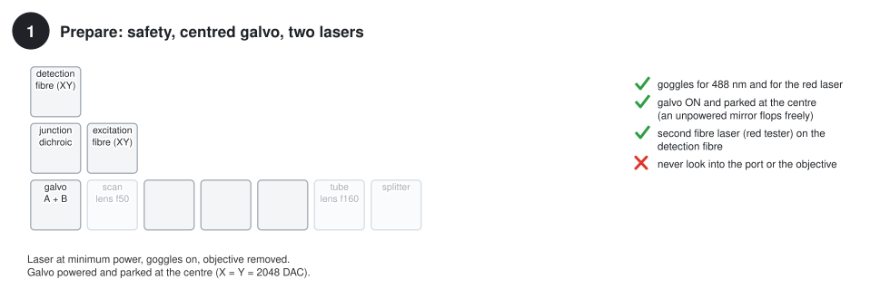

1. Remove the objective from the FRAME. You align the module first; the objective comes back
   in step 10.
2. Power the galvo drivers and **park the galvo at the centre** (X = Y = 2048). A galvo
   mirror without power is not held and can sit at any angle. "Centre" is the reference
   for every later step.
3. Plug the red fibre laser into the **detection** fibre (the one that normally goes to the
   FLIM detector). Its light will run backwards through the detection arm and mark the axis
   along which the fluorescence will later return.

## Step 2 - Collimate the excitation beam

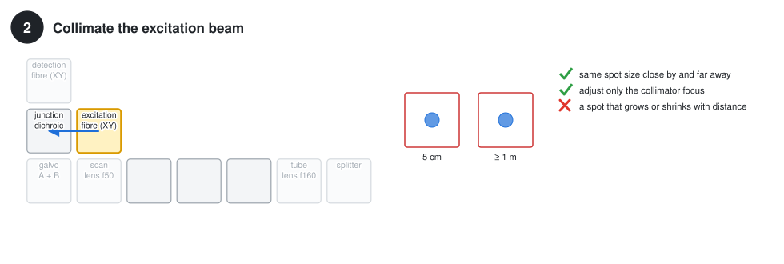

Take the galvo cube out. The excitation beam now leaves the junction dichroic straight
through the empty galvo position.

- Look at the spot on a card 5 cm behind the dichroic and at 1 m or more. Both spots should
  be the same size.
- If the collimator has a focus adjustment, set it now. Fixed collimators need no
  adjustment; just confirm the check.
- **Measure the beam diameter** while you are here: hold a ruler against the card at 5 cm.
  The fibre collimator in the CAD (f = 11.2 mm) gives about **2 mm** with a 488 nm
  single-mode fibre. Write your value down. Beams much larger than 3 mm are clipped by
  the galvo mirrors later (see [Fix a clipped beam](../how-to/fix-a-clipped-beam.md)).

## Step 3 - Overlap excitation and detection (galvo cube removed)

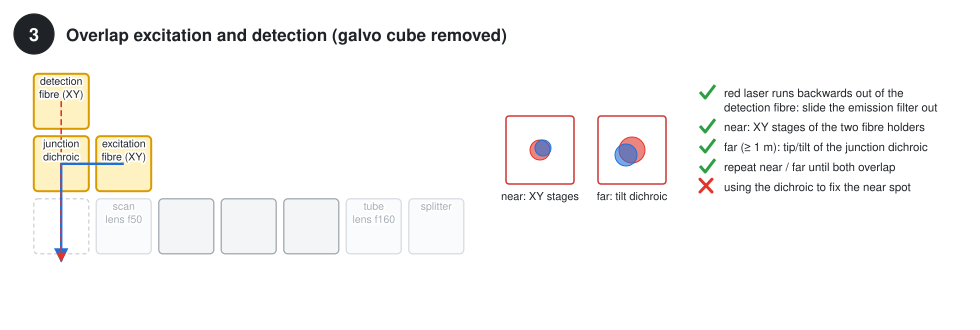

This step aligns the confocal detection with the excitation. Both lasers are on: the red
one comes backwards out of the detection fibre through the dichroic. The blue one is
reflected by the dichroic. Both leave through the empty galvo position.

1. Slide the **emission filter out**; a green emission filter blocks the red laser.
2. Centre the red beam on the cube axis with the XY stage of the detection fibre holder.
   Use your cross-hair target in the galvo cell.
3. **Near** (card right behind the dichroic): bring the blue spot onto the red spot with the
   XY stage of the excitation fibre holder.
4. **Far** (1 m or more): bring the blue spot onto the red spot with the tip/tilt screws of
   the **junction dichroic**.
5. Repeat 3 and 4 until both spots overlap near and far. Each round needs smaller
   corrections; two or three rounds are typical.

Near:

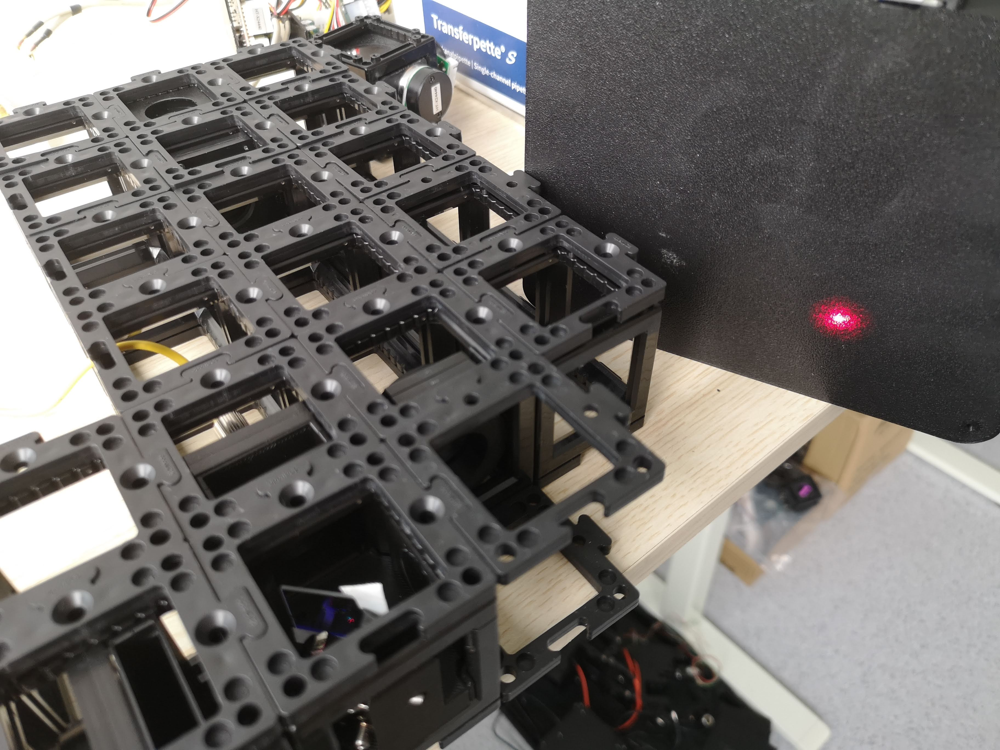

Far away:

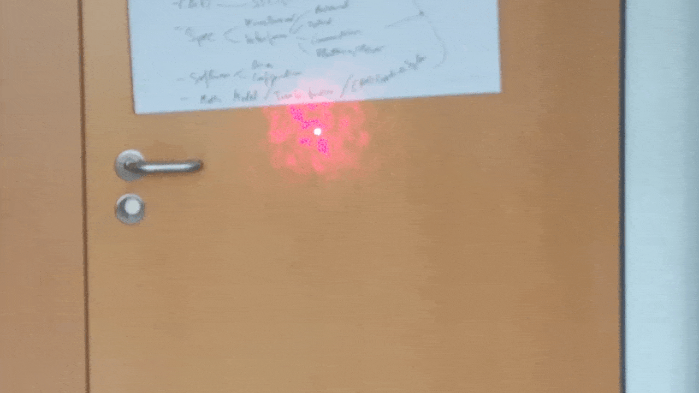

:::tip Why two places?
Two beams that overlap at one place can still cross each other. Overlap at a near and a far
point means they are on top of each other everywhere: same position (fibre holder XY) and
same direction (dichroic tilt).
:::

## Step 4 - Insert the galvo cube: the beam on both mirror centres

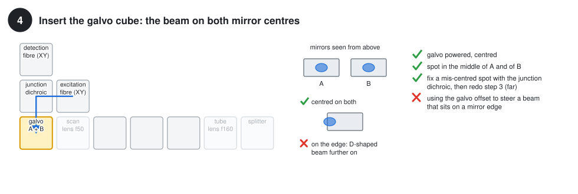

Put the galvo cube back (galvo still powered and centred). The beam meets **mirror A** first
(upper, it scans x) and then **mirror B**, 7.4 mm below it (it scans z).

- Look at both mirrors from above. The spot must sit in the **middle of each mirror**,
  especially across the short side (6 mm): at 45° the spot is 1.4 times wider than the
  beam, so a 2 mm beam covers 2.8 mm of the 6 mm.
- If the spot sits off-centre: move **both** beams together. Shift the red beam with the
  detection fibre holder until it is centred on the mirrors, then repeat step 3 for the blue
  one.

:::danger Don't
Do not correct a spot that sits on a mirror edge with the galvo offset. The beam then
leaves at an angle, and the mirror edge still clips it. This is the most common origin of a
D-shaped beam at the objective.
:::

## Step 5 - Galvo output on the cell axis (lens cubes removed)

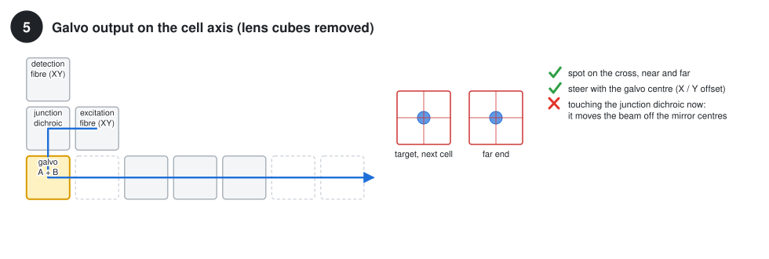

Remove the scan lens, the tube lens and the splitter cube. Put a cross-hair target in the
cell after the galvo, and a second one far away (at the end of the row or on the wall).

- Steer the beam onto both crosses with the **galvo centre** in ImSwitch (X / Y position).
  This makes "galvo centre" equal to "optical axis".
- **Write the two DAC values down.** They are your parking position from now on.
- Leave the junction dichroic alone: it would move the beam off the mirror centres you set
  in step 4.

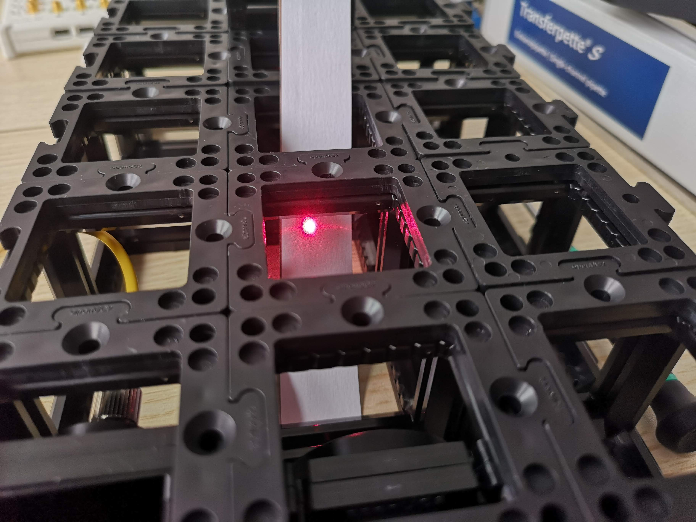

## Step 6 - Insert the scan lens (f50, one cell after the galvo)

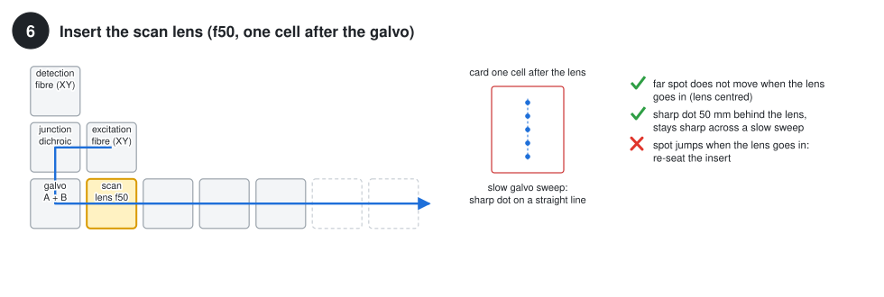

- The far spot is now a large blurred disc, but its **centre must not move** when the lens
  goes in. If it jumps, the insert is not seated: push it down into the notches again.
- Hold a card one cell (50 mm) behind the lens: you see a small, sharp dot (the intermediate
  focus).
- Sweep the galvo slowly with a small amplitude. The dot moves along a straight line and
  **stays sharp**.

## Step 7 - Insert the tube lens (f160): collimated and 3.2 times wider

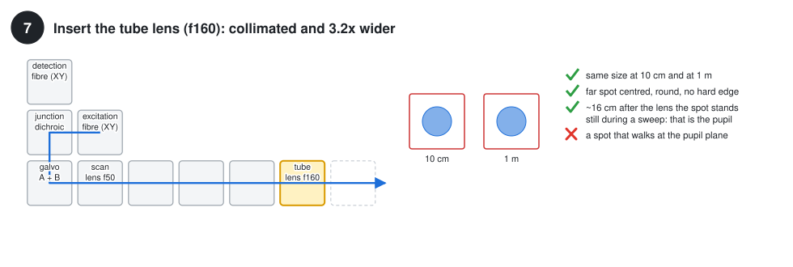

The tube lens sits four cells after the scan lens. Together they form a telescope that
images the galvo into the objective's back focal plane and widens the beam 3.2 times:
2 mm become about 6.4 mm.

- The beam is collimated again: same size at 10 cm and at 1 m, and centred on the far cross.
- Find the **pupil**: hold a card about 16 cm after the tube lens (in line with the beam,
  splitter removed) and sweep the galvo slowly. During a **z** sweep the spot stands still
  there. During an **x** sweep it walks a little, about 0.4 mm per optical degree. That
  walk is expected: mirror A sits 7.4 mm away from the plane that the telescope images
  (explained in [Optical quality and limits](../explanation/optical-quality-and-limits.md)).
- If the spot also walks during a z sweep, the tube lens is not at the right distance:
  re-seat it.

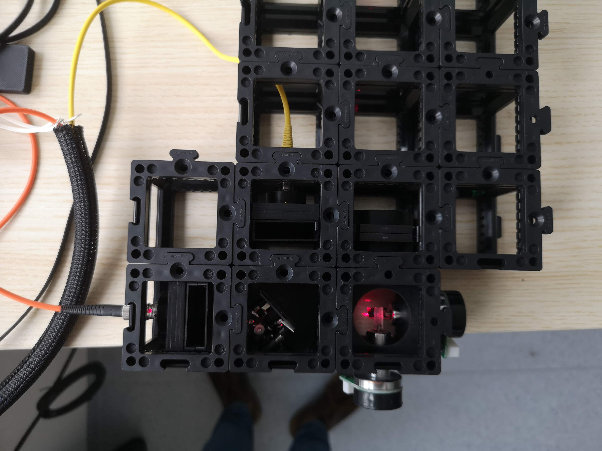

## Step 8 - Insert the splitter cube: straight up through the port

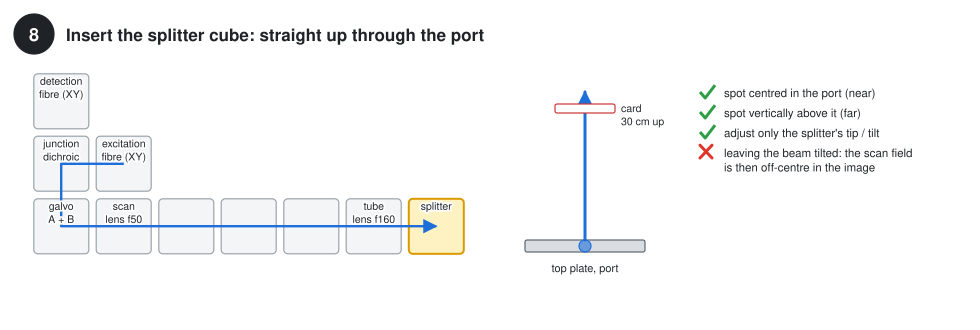

The kinematic splitter at the end of the row sends the beam up through the top-plate port
to the objective.

- **Near:** the spot is centred in the port.
- **Far:** a card about 30 cm above the port: the spot is straight above the port.
- Adjust only the splitter's tip / tilt screws.

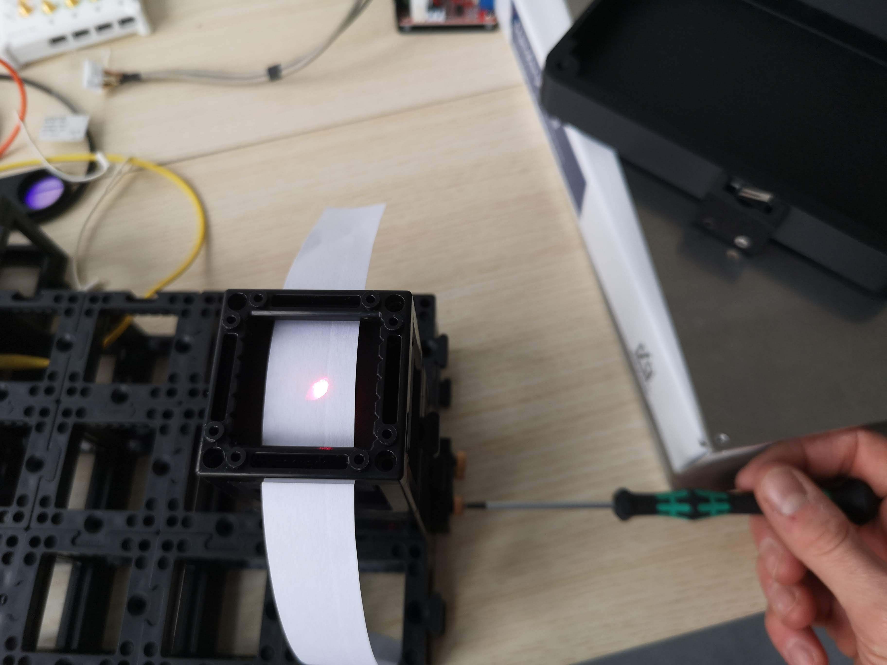

## Step 9 - In the FRAME: the beam at the objective position

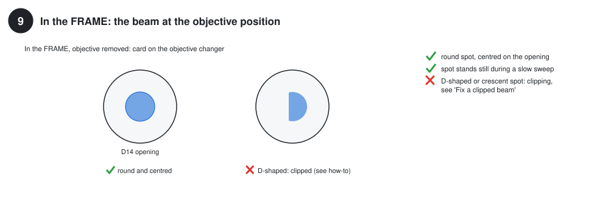

Put the module into the FRAME, objective still removed, and lay a card on the objective
changer.

- The spot is **round** and **centred** on the opening (14 mm).
- During a slow sweep the spot stays where it is. The objective's back focal plane sits
  there, a little above the changer.
- If the spot is D-shaped, crescent-shaped or off-centre, stop here and work through
  [Fix a clipped or off-centre beam](../how-to/fix-a-clipped-beam.md).

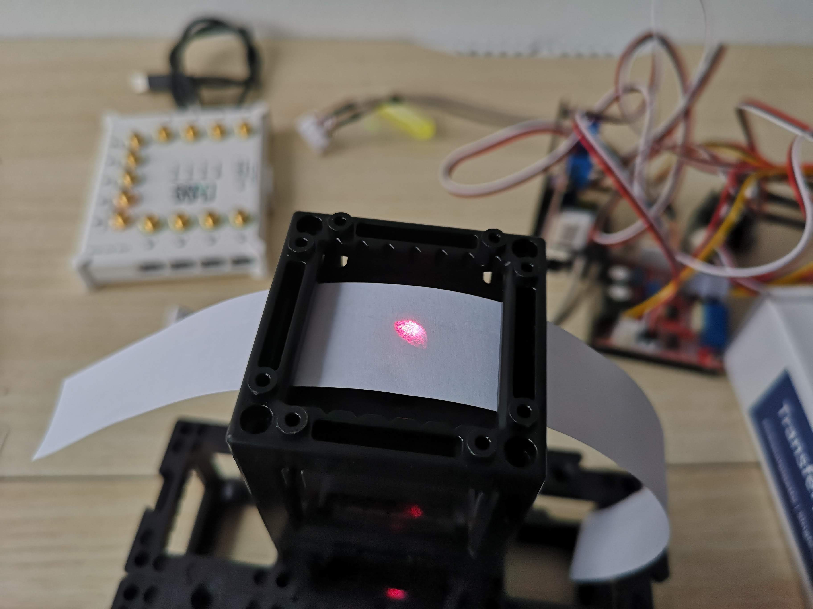

## Step 10 - Check the scan field and calibrate it

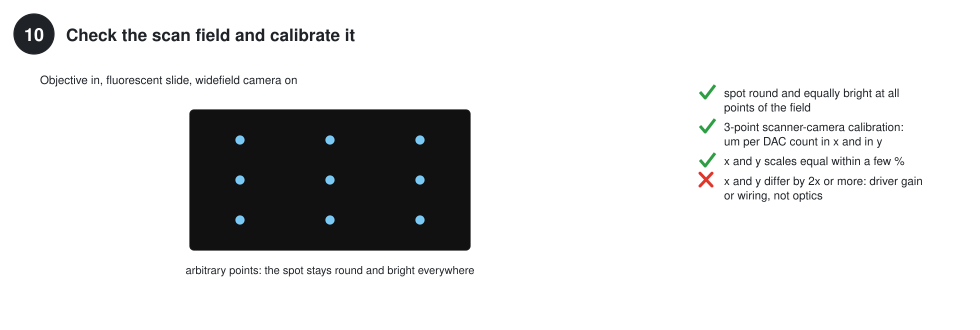

Put the objective back, put a fluorescent slide on the stage and focus it in the widefield
camera.

1. In the **Arbitrary Points** tab, send the beam to a few points spread over the field. The
   spot stays round and equally bright everywhere. A spot that grows, gets dimmer, or turns
   into a line towards the edge means clipping or a field that is too large for the lenses.
   Keep the scan within about ±4° optical (see
   [Choose an objective](../how-to/choose-an-objective.md)).
2. Run the **3-point scanner-camera calibration** (Arbitrary Points tab). It gives the
   scale in µm per DAC count for x and for y.
3. The two scales should agree within a few per cent. The optics give both axes the same
   scale. If they differ by a factor of 2 or more, go to
   [Fix a stretched image](../how-to/fix-a-stretched-image.md).

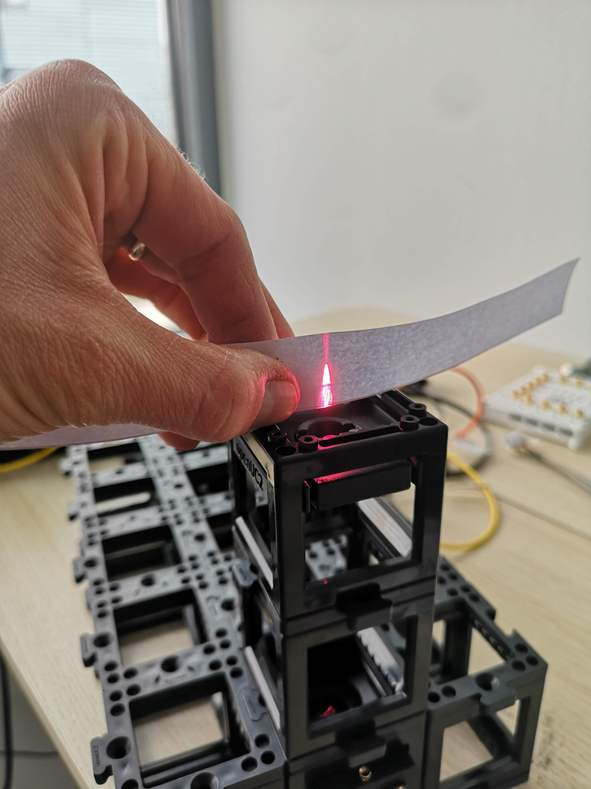

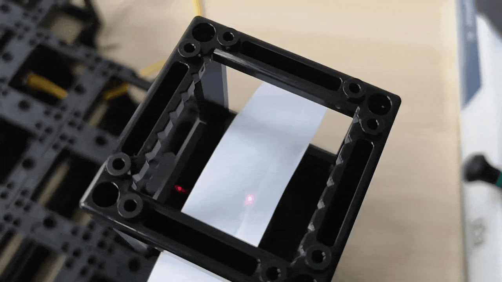

## Step 11 - Peak up the detection

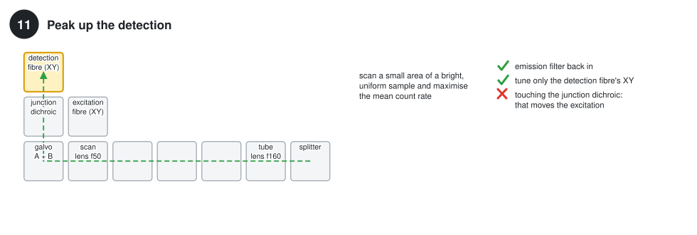

1. Slide the emission filter back in.
2. Put a bright, uniform fluorescent sample in focus and keep the laser power constant.
3. Scan a small area continuously and watch the **mean count rate** of the FLIM detector.
   Averaging over an area is steadier than chasing a single point.
4. Maximise it with the XY stage of the **detection** fibre holder only. If the holder has
   a focus, tweak that too. Leave the junction dichroic alone: it moves the excitation.

## Final checks

1. **Uniform fluorescent slide:** the intensity is nearly uniform and the lifetime map is
   spatially consistent within the noise.
2. **Sparse beads or a sharp edge:** higher contrast and less background than widefield.
   This is where the fibre core acting as a pinhole shows.
3. **Two dyes with different lifetimes:** even with similar intensity, the lifetime
   separates the regions.

This image was taken with the FLIM add-on at 488 nm through a 10x / NA 0.3 objective:

## Where next

- After shipping or moving the instrument:
  [Re-align after transport](../how-to/realign-after-transport.md). Only two cubes are
  needed.
- Why the steps are in this order:
  [How laser scanning works](../explanation/how-laser-scanning-works.md).
