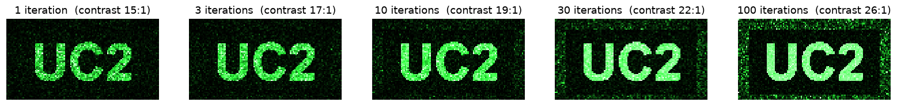
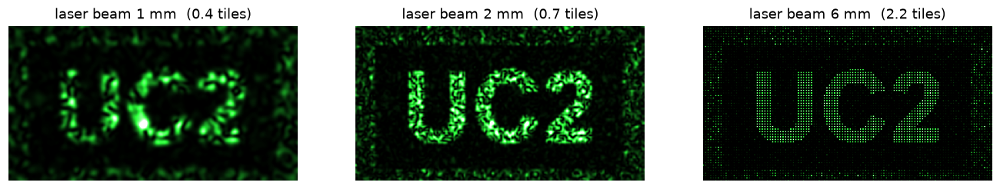

# How a printed hologram works

*Understanding-oriented. The physics and the maths behind [Print your own hologram](../tutorials/print-a-hologram.md). No equipment needed.*

## Calculated, not recorded

A normal hologram is **recorded**: an object wave and a reference wave interfere, and the pattern is stored (see [What is a hologram?](./what-is-a-hologram.md)). In 1966 Byron Brown and Adolf Lohmann realised that the object doesn't have to exist. If you can **calculate** the pattern, you can draw it, and light will rebuild the wave just the same. They drew their holograms with a pen plotter and shrank them photographically. For a simple one, an office laser printer is fine enough today. Such a pattern is called a **computer-generated hologram (CGH)**.

## The wall shows the Fourier transform of the mask

When the laser passes the foil, every clear pixel becomes the source of a small wave (Huygens' principle). Far away, each direction collects the waves of *all* pixels. Whether they add up (bright) or cancel (dark) in a given direction depends on the pattern. Mathematically, the field in direction $(\theta_x, \theta_y)$ is the 2-D **Fourier transform** of the mask transmission $t(x, y)$ (Fraunhofer diffraction):

$$U(f_x, f_y) = \iint t(x, y)\, e^{-2\pi i (f_x x + f_y y)}\, \mathrm{d}x\, \mathrm{d}y, \qquad f_x = \frac{\sin\theta_x}{\lambda},\ f_y = \frac{\sin\theta_y}{\lambda}$$

and the wall shows the brightness $|U|^2$.

You know the simplest case from [Interference and diffraction](./interference-and-diffraction.md): a grating with period $g$ sends the light into a few directions $\sin\theta = m\lambda / g$. Finer stripes give a bigger angle, and rotated stripes give rotated spots. Each bright point of your picture is one such grating, with its own period and direction. The hologram is all of these gratings on top of each other, each with the right strength and the right shift (phase).

"Far away" strictly means infinitely far. A lens, or a beam that converges to a focus, brings infinity to a finite distance: **in the plane where the beam focuses, the field is exactly the Fourier transform of the mask.** That's why the tutorial insists on focusing the laser on the wall.

The finest grating a printer can make has a period of two pixels, so the pixel size $p$ sets the largest angle. The whole pattern repeats every $\lambda / p$ in angle, which is every $\lambda d / p$ on a wall at distance $d$:

| Printer | Pixel size $p$ | Repeat distance per metre to the wall (532 nm) |
|---|---|---|
| 600 dpi | 42.3 µm | 12.6 mm |
| 1200 dpi | 21.2 µm | 25.1 mm |

Small pixels mean big angles. A printer's pixels are huge compared to the wavelength, which is why the picture is small and the wall should be a few metres away.

## The missing phase, and how the IFTA finds it

We know what we want on the wall: $|U|^2$ should be our picture. If we knew $U$ completely, brightness **and** phase, a single inverse Fourier transform would give us the mask. But we only care about the brightness. The phase on the wall is invisible, so we may choose it freely. Most choices, though, give a mask with grey values, negative values or even complex values, and a laser printer can only do two things: toner (0) or clear foil (1).

So there are two requirements in two different places:

- **on the wall:** the brightness inside the picture area must be our picture
- **on the foil:** only 0 or 1

The **iterative Fourier transform algorithm (IFTA)** jumps back and forth between the two places, each time enforcing what is required there. Gerchberg and Saxton came up with it in 1972 to recover phases in electron microscopy, and it is still the workhorse for designing holograms today.

1. Start with the picture and a random phase for every point.
2. Inverse Fourier transform: this is the mask that would make it. It has grey and complex values.
3. **Foil constraint:** keep the real part, set everything above the median to 1 (clear) and the rest to 0 (toner). Now it is printable, with exactly 50 % toner.
4. Fourier transform: this is what the printable mask *really* shows on the wall. It's a bit wrong.
5. **Wall constraint:** inside the picture window, replace the brightness with the picture, but keep the phase the mask produced. Outside the window, leave everything as it is. That is where the errors (noise) are allowed to go.
6. Go back to step 2. After about 100 rounds, the two requirements agree as well as they can.

The heart of [cgh_ifta.py](../tutorials/scripts/cgh/cgh_ifta.py), slightly simplified:

```python
import numpy as np

# target: the picture (0/1) and window: True where the picture is,
# both n x n and in FFT order (zero order at [0, 0])
F = target * np.exp(2j * np.pi * np.random.rand(n, n))   # 1. random phase
for i in range(100):
    mask = np.fft.ifft2(F).real                             # 2. back to the foil
    mask = mask > np.median(mask)                           # 3. printable: 0 or 1
    G = np.fft.fft2(mask)                                   # 4. what the wall shows
    scale = np.sqrt(np.sum(abs(G[window])**2) / np.sum(target[window]**2))
    F = np.where(window, scale * target * np.exp(1j * np.angle(G)), G)  # 5. fix brightness, keep phase
```

The `scale` line matches the picture's brightness to what a black-and-white mask can really deliver. The script adds two tricks on top:

- **Soft start.** For the first 70 % of the rounds, the mask may still contain grey values, which get squeezed to pure 0/1 over time. Jumping straight to 0/1 gets the algorithm stuck: for the UC2 example, the background inside the picture window ends up more than twice as bright (contrast 15:1 instead of 35:1).
- **Weights.** Picture points that came out too dark are asked for more in the next round (*weighted* Gerchberg–Saxton). The brightness variation across the letters drops from about 25 % to 11 %, at the price of a slightly brighter background (26:1).


*The picture after 1, 3, 10, 30 and 100 rounds. The noise gets pushed out of the picture window into the free area around it.*

## Why the picture appears twice

The foil can only **absorb** light; it never delays it. So $t(x, y)$ is a real number, and the Fourier transform of a real function has a built-in symmetry:

$$U(-f_x, -f_y) = U^*(f_x, f_y) \quad\Rightarrow\quad |U(-f_x, -f_y)|^2 = |U(f_x, f_y)|^2$$

Every bright point has a partner mirrored through the centre, so the whole picture appears a second time, rotated by 180°. This is the **twin image**, the same twin you know from [inline holography](./what-is-a-hologram.md#the-catch-the-twin-image): in both cases only a real-valued pattern is stored. That's why the script puts the picture into the **upper half** only. The twin then lands in the lower half instead of on top of the picture, which is the same idea as off-axis holography.

## Where the light goes

For a mask with 50 % clear pixels:

| Where | Share of the laser light |
|---|---|
| Absorbed by the toner | 50 % |
| Zero order (the bright spot) | 25 % |
| Your picture | about 5–8 % |
| The twin | the same |
| Noise and fainter repeats | the rest |

The zero order is simply the average transmission: the mean of $t$ is 0.5, so its amplitude is 0.5 and its brightness $0.5^2 = 25\,\%$. No black-and-white mask can put more than about 10 % ($1/\pi^2$) into one picture.

Swap black and clear, and you get $t' = 1 - t$ and $U' = \delta - U$. That is the same picture, with only the zero order changed (Babinet's principle). So it doesn't matter if your printer prints the pattern inverted.

## Why the tile is repeated

The FFT treats the $n \times n$ tile as if it repeated forever. Printing it many times makes that true. A periodic mask sends light only into discrete directions, just like a grating, and those directions are exactly the $n \times n$ picture points the IFTA designed. In between there is darkness.

On the wall, each picture point is as big as the focused laser spot, about $\lambda d / D$ for a beam of diameter $D$. Neighbouring points are $\lambda d / (n p)$ apart. So the points separate when $D > n p$, that is, **when the beam covers more than one tile**. If they overlap, their random phases make them interfere, and you get speckle. That's why the beam expander makes the picture so much cleaner:



Repeating the tile has a second benefit: every tile contains the whole picture, so dust, scratches or a badly printed corner only make it a little dimmer.

## Beyond the laser printer

- **Smaller pixels, bigger pictures.** Industrial holograms are written with electron or laser beams, with pixels below 1 µm.
- **Phase instead of amplitude.** An amplitude mask throws away at least half the light. A *phase* hologram, made of etched glass, embossed plastic or a liquid-crystal display (spatial light modulator, SLM), delays the light instead of blocking it. With two levels it reaches about 40 % efficiency, with many levels over 90 %. The pattern caps for laser pointers that project stars or arrows are exactly such phase holograms. The IFTA stays the same; only step 3 changes.
- **The same algorithm, the other way round.** The HoloBox reconstruction software uses Gerchberg–Saxton-style iterations to fight the twin image in inline holography: there, the brightness on the camera is known and the missing phase is searched for.

## References

- B. R. Brown and A. W. Lohmann, "Complex spatial filtering with binary masks", *Applied Optics* 5, 967 (1966). The first computer-generated hologram.
- R. W. Gerchberg and W. O. Saxton, "A practical algorithm for the determination of phase from image and diffraction plane pictures", *Optik* 35, 237 (1972)
- J. R. Fienup, "Phase retrieval algorithms: a comparison", *Applied Optics* 21, 2758 (1982)
- F. Wyrowski and O. Bryngdahl, "Iterative Fourier-transform algorithm applied to computer holography", *JOSA A* 5, 1058 (1988)

**Back to:** [Print your own hologram](../tutorials/print-a-hologram.md)
