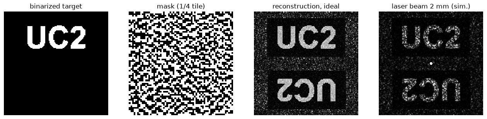
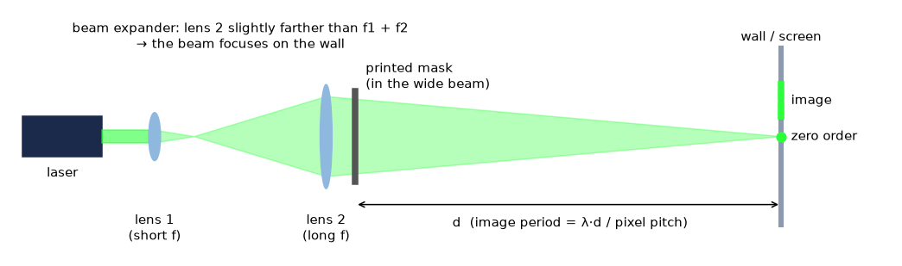
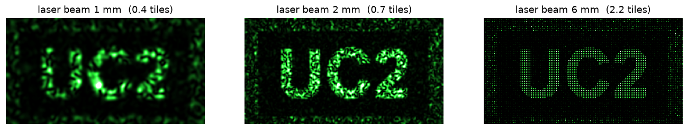
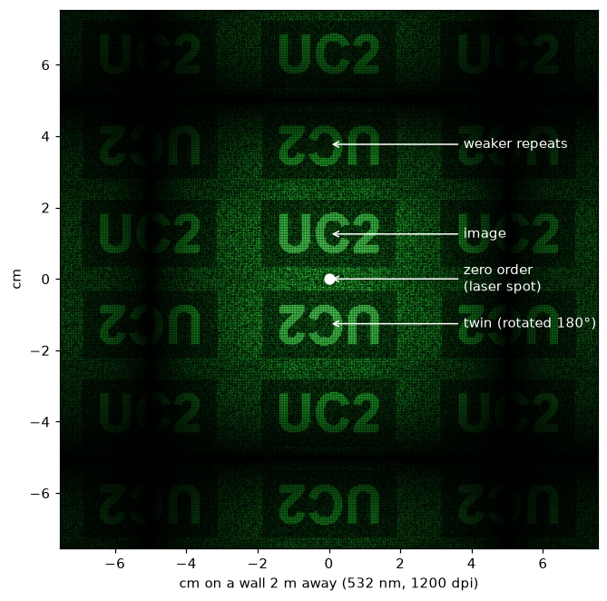
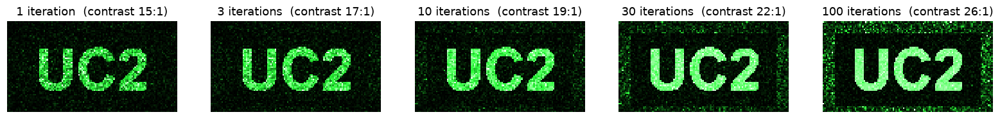

import HologramMaker from '@site/src/components/HologramMaker';

# Tutorial: Print your own hologram

*Learning-oriented. By the end you'll have printed a hologram on a piece of overhead foil and seen your own picture appear on the wall in laser light. About 45 minutes, plus a trip to a laser printer.*

In [Your first hologram](./your-first-hologram.md) the camera *recorded* a hologram and the computer *reconstructed* the image. Here we turn it around: the **computer calculates the hologram** and the **light does the reconstruction**. The printed pattern looks like grey noise, but put it in a laser beam and your picture appears on the wall.


*From left: the picture after binarization (black and white only), a quarter of one hologram tile as it gets printed, what the hologram shows in theory, and a simulation of what you see with a 2 mm laser beam. The upside-down copy and the bright spot in the middle are expected: see [What you should see](#what-you-should-see).*

## What you need

- The HoloBox laser module (532 nm) or a laser pointer of laser class 2 (at most 1 mW)
- Overhead transparency film **made for laser printers**. Film for inkjet printers melts in a laser printer and can damage it.
- A black-and-white laser printer, ideally a real 1200 dpi printer
- Optional, for a much sharper picture: two converging lenses in cubes, a cube with a sample holder, and a base plate
- A computer with Python 3, or skip the Python part and use the ready-made files below
- A dark room and a white wall or sheet of paper 2–5 m away

:::danger Laser safety
Never look into the laser beam. This also applies to the bright spot in the middle of the pattern on the wall, which is the laser beam itself, and to reflections off the foil. Keep the beam below eye level and use a class 2 laser.
:::

## Step 1: Pick a picture

Simple, bold shapes work best: big letters, a logo, a smiley. Fine detail and photos get lost, because the script turns everything into pure black and white. Whichever colour covers **less** of the picture lights up on the wall, so black letters on white paper become bright letters on a dark wall.

Our example: [uc2.png](./IMAGES/CGH/uc2.png).

:::tip No time? Use a ready-made hologram
Skip to [Step 3](#step-3-print-it-on-foil) with one of these files:
- [uc2_cgh.pdf](./IMAGES/CGH/uc2_cgh.pdf) for a 1200 dpi printer (21.7 mm square)
- [uc2_600dpi_cgh.pdf](./IMAGES/CGH/uc2_600dpi_cgh.pdf) for a 600 dpi printer (32.5 mm square, made with `--dpi 600 --size 64 --tiles 12`)
:::

## Step 2: Calculate the hologram

### In your browser

Choose your picture below. The calculation runs on your own computer, nothing is uploaded. After a few seconds you see the preview: if the right-hand panel shows your picture, click **Download PDF** and go on to [Step 3](#step-3-print-it-on-foil). The options are explained [below](#the-options).

<HologramMaker />

The third panel is the ideal case. With a real laser beam the picture is made of blurrier, speckled dots, see [Option B](#option-b-holobox-beam-expander-sharp).

### With Python

The same algorithm as a script, with a more detailed preview. Download [cgh_ifta.py](./scripts/cgh/cgh_ifta.py), put it next to your picture, and run:

```bash
pip install numpy pillow matplotlib
python cgh_ifta.py uc2.png
```

After a second or two it prints:

```
pixel 21.2 um, tile 2.71 mm, print 21.7 mm square <- check with a ruler
far-field pattern repeats every 25 mm per metre of distance (532 nm), 31 mm (650 nm)
light that ends up in the image: 7.8%
wrote uc2_cgh.pdf/.png and uc2_preview.png
```

You get three files:

| File | What it is |
|---|---|
| `uc2_cgh.pdf` | The hologram at exact printer size. **Print this one.** |
| `uc2_cgh.png` | The same pattern as an image, with the dpi stored in the file |
| `uc2_preview.png` | The figure at the top of this page, for your picture. **Look at it before printing.** |

The script uses an **IFTA** (iterative Fourier transform algorithm). It starts from your picture with random phases and goes back and forth between "mask" and "wall" 100 times, until it has a pattern that contains only black and clear pixels and still makes your picture. The [explanation page](../explanation/computer-generated-holograms.md) shows how this works.

### The options

| Browser | Python | Default | What it does |
|---|---|---|---|
| Printer | `--dpi` | 1200 | Your printer's **real** resolution. Look it up in the printer's data sheet. |
| Dots per pixel | `--dots` | 1 | Printer dots per hologram pixel. Use 2 if your printer smears fine dots. |
| Tile | `--size` | 128 | Tile size in pixels. This is the sharpness of the picture on the wall. |
| Tiles | `--tiles` | 8 | How often the tile is repeated in each direction, which sets the print size. |
| Invert | `--invert` | off | Light up the other colour, for example the background instead of the letters. |
| | `--beam` | 2 | Your laser beam diameter in mm. Only used for the preview. |
| | `--iters` | 100 | Number of IFTA rounds |

:::tip Match the tile to your laser beam
The laser beam should cover at least one tile, better two. The script prints the tile size: 2.71 mm by default. A bare laser pointer has a beam of about 2 mm, so keep `--size 128` at 1200 dpi, or `--size 64` at 600 dpi. With the beam expander from [Step 4](#option-b-holobox-beam-expander-sharp) you can go up to `--size 256`.
:::

## Step 3: Print it on foil

1. Load **one sheet** of laser transparency film into the manual feed of the printer.
2. Open the PDF and print it with these settings:
   - Scale **100 %** / "Actual size", **not** "Fit to page"
   - Best quality, 1200 dpi, toner saving **off**
   - Black and white
3. Measure the printed square with a ruler. It must be exactly as big as the script said: 21.7 mm for the default settings. If it isn't, the printer driver rescaled the pattern and has most likely ruined the fine dots. Print again at 100 %.
4. Printers differ a lot. Print two or three copies, and the 600 dpi version as well, then compare them in Step 4.

Under a magnifying glass the printed square looks like a fine black-and-white maze, just like the second panel of the preview. It doesn't matter which side is black and which is clear: the inverted pattern makes exactly the same picture (that's Babinet's principle).

:::note 🖼️ Image placeholder: `cgh-printed-foil.jpg`
**Show:** The printed square on the transparency film next to a ruler, with a close-up through a magnifying glass.
:::

## Step 4: Make the picture appear

The most important rule: **the picture appears where the laser beam is focused.** Physicists call this plane the *far field* or the *Fourier plane*. If the beam isn't focused on the wall, every point of the picture gets smeared out to the size of the laser spot.

### Option A: Laser only (quick)

1. Darken the room and point the laser at a wall 2–5 m away.
2. If your laser has an adjustable lens (many cheap red laser modules do), turn it until the spot on the wall is **as small as possible**.
3. Hold the foil flat in the beam, close to the laser and perpendicular to the beam. Better: tape it onto a sample holder in a cube.
4. Look at the wall. Your picture appears above the bright spot.

If your laser can't be focused, the picture will be blurry. Go further away from the wall, or use option B.

### Option B: HoloBox beam expander (sharp)



1. Put the laser, **lens 1** (short focal length) and **lens 2** (long focal length) in a line. Lens 2 sits at the distance f1 + f2 behind lens 1, so the beam comes out wide and parallel. This is a telescope used backwards.
2. Move lens 2 a few millimetres further away from lens 1 until the beam focuses to a **small spot on the wall**.
3. Put the foil in a cube directly behind lens 2, where the beam is wide.
4. The wide beam now lights up two or more tiles, and the picture becomes a crisp dot image.


*The same hologram with different beam sizes. With a narrow beam each picture point is a big blurry spot and neighbouring spots interfere, which gives speckle. Once the beam covers two or more tiles, the points separate into a clean dot image.*

### Option C: Look through it (no laser)

Put a small, single-colour **LED** at the other end of a dark room, for example the HoloBox LED behind the aluminium-foil pinhole. Hold the foil directly in front of your eye and look at the tiny light: your picture and its twin float next to it. Your eye is focused at the far distance, so the eye lens does the Fourier transform for you.

:::danger
Do this **only with an LED**, never with a laser.
:::

## What you should see


*Simulated view with the green laser on a wall 2 m away, 1200 dpi print. The brightness is exaggerated so that the weak copies are visible.*

- **A bright spot in the middle:** the *zero order*. This is the light that went straight through without being diffracted, about a quarter of the light.
- **Your picture above it.** It is bright but not as bright as the spot. Only about 5–8 % of the laser light ends up in the picture, so darken the room well.
- **An upside-down copy below it:** the *twin image*. A printed mask can only absorb light, and such a mask always produces the picture twice, rotated by 180° (see the [explanation](../explanation/computer-generated-holograms.md#why-the-picture-appears-twice)).
- **Fainter copies further out**, because the pixels are arranged in a regular grid.

How big is it? The pattern repeats every $\lambda d / p$, where $d$ is the distance from the foil to the wall and $p$ the pixel size. With the green laser and the 1200 dpi print that's 25 mm per metre, so at 3 m the picture is about 3 cm tall. A red laser makes it about 20 % bigger.

Try these:

- **Move the foil sideways.** The picture stays where it is. Moving the mask only changes the *phase* of the waves on the wall, and phase is invisible.
- **Rotate the foil.** The picture rotates with it. If the letters are mirrored, turn the foil over.
- **Cover half the beam** with a piece of paper. The picture is still complete, just dimmer and a bit blurrier, because every tile contains the whole picture.

## When it doesn't work

| What you see | What to do |
|---|---|
| Only the bright spot and some haze, no picture | Your printer can't print the fine dots. Use the 600 dpi file or `--dots 2`, and check that toner saving is off. |
| The picture is a blurry mess of speckles | The beam isn't focused on the wall, or it is too narrow. Focus the laser, use a larger distance, or use the beam expander (option B). |
| The picture is very dim | That's normal, only a few percent of the light ends up in it. Darken the room completely and use a white screen. |
| The picture is mirrored | Turn the foil over. |
| The background lights up instead of your picture | Run the script again with `--invert`. |
| The printed square has the wrong size | Print again at 100 % / "Actual size". |
| A smeared or doubled picture | Keep the foil flat and perpendicular to the beam, without wrinkles or fingerprints. |

## What just happened?

You calculated how light has to be blocked so that the waves coming from thousands of tiny clear pixels add up to your picture far away, and cancel each other everywhere else. Nothing on the foil looks like your picture. The picture only exists in the way the waves interfere. That is exactly what a hologram is: not a picture, but a recipe for a wave (see [What is a hologram?](../explanation/what-is-a-hologram.md)).

**Next:** [How a printed hologram works →](../explanation/computer-generated-holograms.md)

## Going further

- **Measure the wavelength of your laser.** The middle of the picture is $s = \lambda d / (4p)$ above the bright spot. Measure $s$ and $d$, use $p$ = 21.2 µm for the 1200 dpi print, and solve for $\lambda$. Compare a red and a green laser.
- **Make it sharper.** Run `--size 256` with the beam expander and compare it with the default.
- **Watch the algorithm learn.** Run the script with `--iters 1`, `10` and `100` and compare the previews:



The figures on this page were made with [make_figures.py](./scripts/cgh/make_figures.py). The script itself also lives in the HoloBox repository under [`ComputerGeneratedHologram`](https://github.com/openUC2/TechnicalDocs-openUC2-HoloBox/tree/master/ComputerGeneratedHologram).
