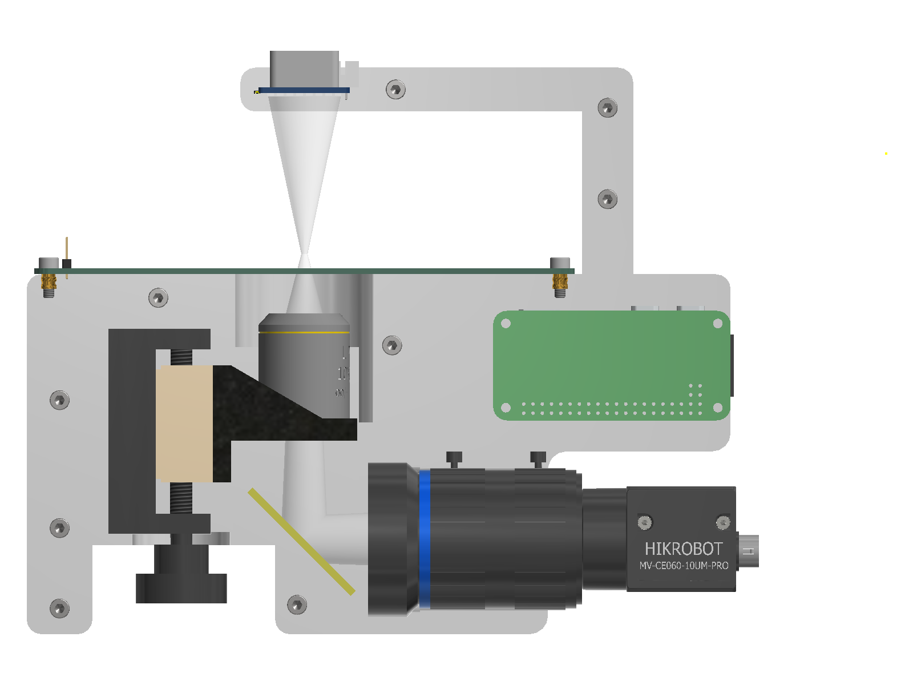
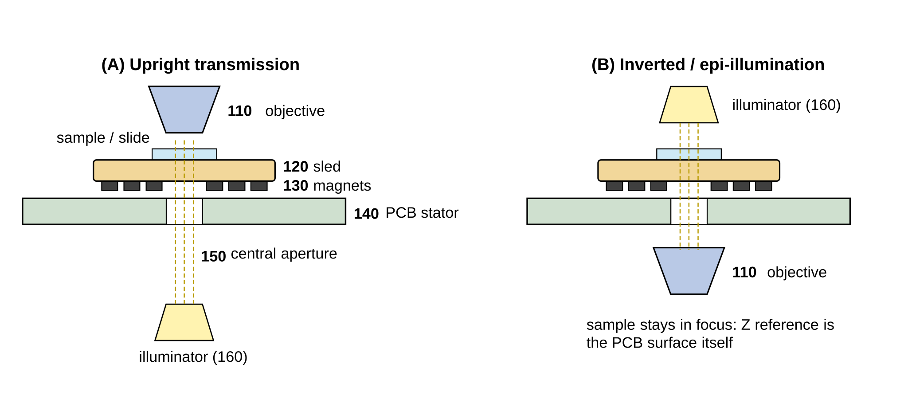
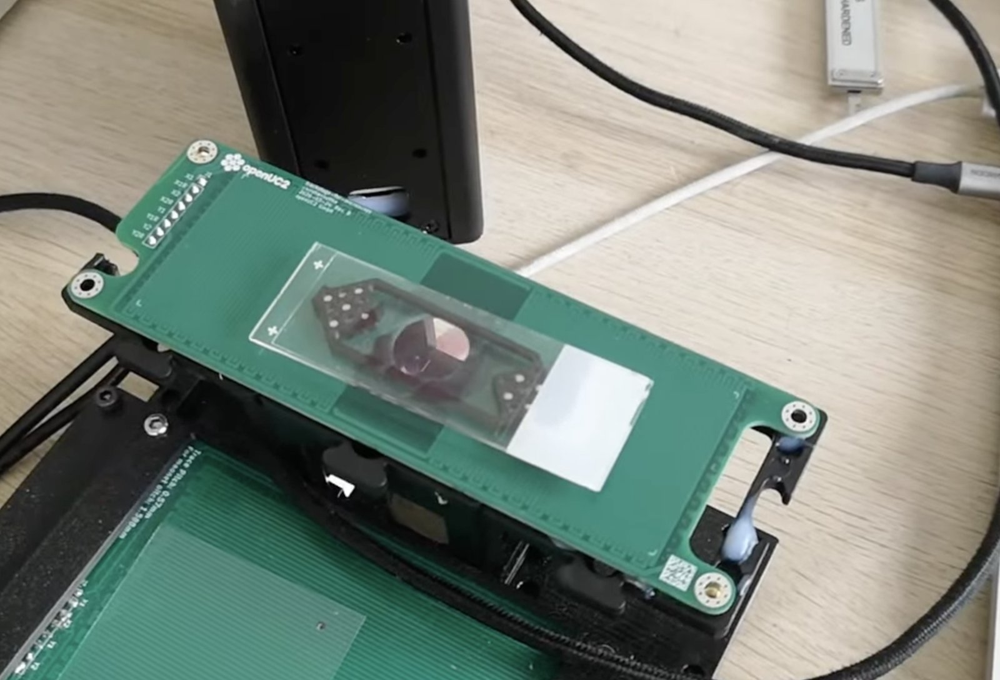
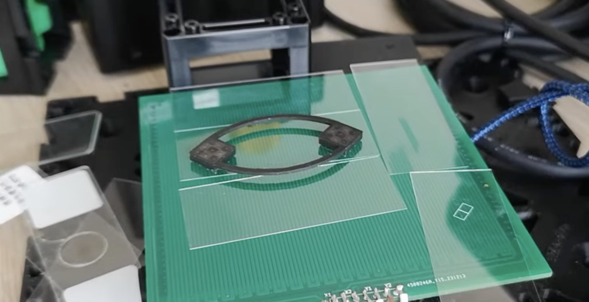

# How the Smearscope works

*The Smearscope with its front half hidden. The translucent cone and tube show the light path.*

## Light path

The Smearscope is an **inverted** microscope: the objective looks up at the sample from below.

1. The **LED matrix** in the arm above the sample shines down through the sample.
2. The light passes the **sample**, which lies on the magnetic sled, and goes through a 15 mm hole in the stage board.
3. The **objective** (10× / 0.25, infinity-corrected) collects it below the board.
4. A **45° mirror** under the objective folds the beam sideways.
5. A **C-mount lens** acts as tube lens and forms the image on the **camera** sensor.

Because the objective is infinity-corrected, the beam between objective and tube lens is parallel. That leaves room for the fold mirror, and it means the objective can move for focusing without changing the magnification.

With a 100 mm tube lens and an objective designed for a 200 mm tube lens, the magnification is 100 / 20 = **5×**. The camera's 7.4 × 4.9 mm sensor then sees about 1.5 × 1.0 mm of the sample, at about 0.5 µm per pixel. The resolution limit of the 0.25 NA objective is about 1.3 µm in green light, so the camera samples it finely enough. These are nominal values from the design.

## Illumination

The illumination is an 8 × 8 RGB LED matrix on an ESP32-S3 board, mounted about 44 mm above the sample. Each LED lights the sample from a slightly different angle, so the illumination pattern sets the contrast:

| Pattern | Effect |
|---|---|
| Central LEDs | brightfield |
| One side of the array | oblique illumination: relief-like contrast in unstained samples |
| Outer ring only | darkfield-like: scattering structures light up on a dark background |
| Left/right or top/bottom halves, alternating | differential phase contrast (DPC), computed from image pairs |
| Single colours | red, green or blue light, for stained samples |

The miniFRAME documentation explains DPC with an LED matrix in more detail: [miniFRAME DPC](../../pro/miniframe/01_miniFRAME_DPC.md).

## The magnetic XY stage

The XY stage is a **planar motor printed on a circuit board**.

- **Stator:** a 4-layer circuit board, 148 × 48 mm, with a 15 mm hole for the light. One copper layer carries traces along X and another carries traces along Y. Each set is split into two phase groups, like the two coils of a stepper motor.
- **Sled:** a small carriage with permanent magnets that holds the sample and slides directly on the board.
- **Drive:** the QuadDriver board sends currents through the four phase groups (X1, X2, Y1, Y2). Shifting the ratio of the currents moves the magnetic field pattern, and the sled follows it, much like the rotor of a stepper motor.

One electrical cycle of the drive moves the sled about **4.16 mm**. The firmware divides this cycle into 32 microsteps of about **130 µm** each.

There are no rails, screws, belts or bearings. The only moving part is the sled. This has two consequences:

- **Flat sample plane.** The sample height is set by one flat board and one sled, not by a stack of mechanical stages. Fields stay in focus over the whole scan.
- **Friction sets the accuracy.** The sled slides with friction, so it moves in small slips and loses a few hundred micrometres when it changes direction. The stage is therefore built to guarantee *overlap* between fields rather than exact positions. The camera measures the true position afterwards (see [scanning and stitching](./03_control.md#scanning-and-stitching)).

The sliding interface is the main topic of ongoing work. Glass coverslips, films and dither in the drive current are being tested to reduce friction.

## Focus

The objective sits on a printed carrier, screwed to a manual linear stage. The stage hangs with its knob down, in an open bay under the housing, where you can reach the knob from the front, the back or below. It gives about 13 mm of focus travel.

## The housing: two mirrored halves

The housing consists of two 3D-printed halves that meet in the plane of the light path. Each half has pockets shaped like one half of each component. When the halves are screwed together, they clamp everything in place:

- the z-stage, in a fitted pocket
- the fold mirror, in a 45° slot
- the tube lens, on its front ring and its knurled barrel
- the camera, in a square pocket plus side screws
- the LED board, in a slot in the arm

Nothing needs to be aligned by hand. The light path is defined by the printed parts. The stage board is screwed onto the top face and the driver electronics sit under a cover on the back.

