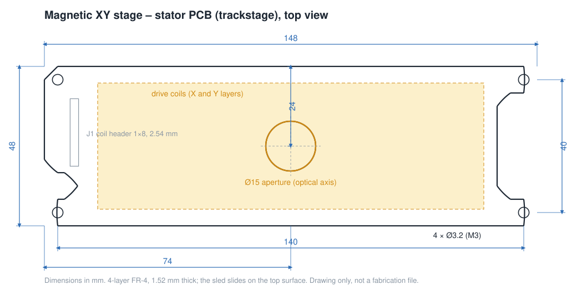
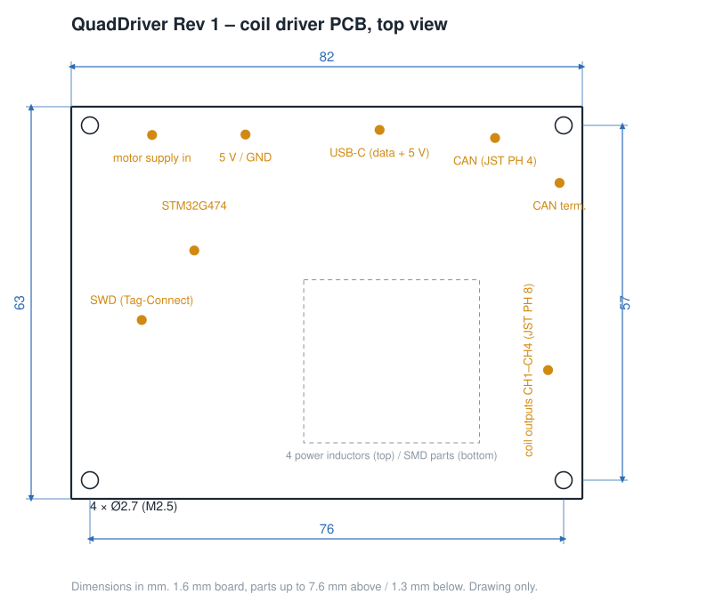
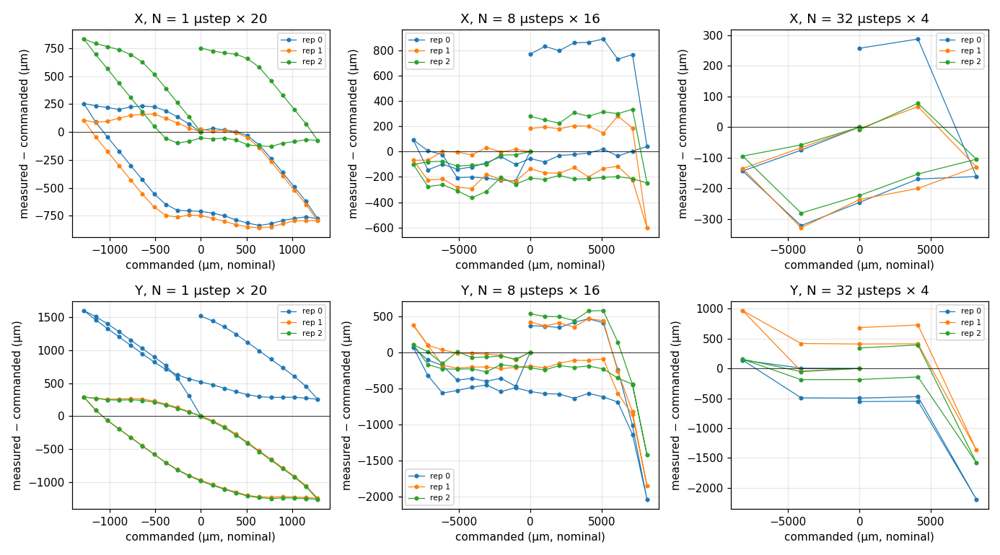
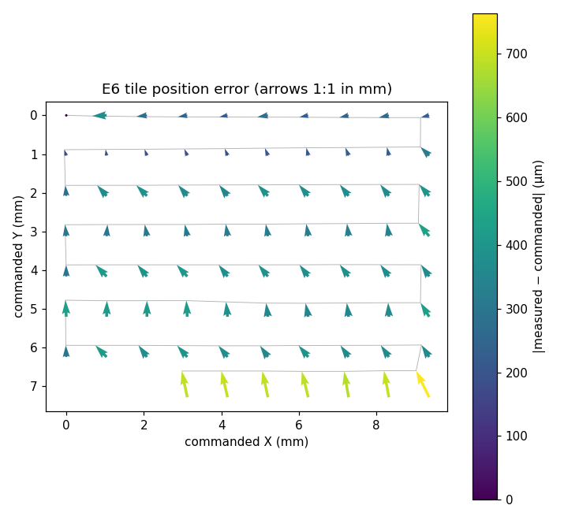

# Technical reference

All values refer to the current prototype. *Nominal* values follow from the design. *Measured* values come from benchmark runs on a prototype stage (see [measured stage performance](#measured-stage-performance)).

## Optics

| Item | Value |
|---|---|
| Configuration | inverted, transmitted light, infinity-corrected, beam folded by a 45° mirror |
| Objective | 10× / 0.25 plan, RMS thread (0.8"-36), parfocal about 45 mm |
| Tube lens | C-mount lens, f ≈ 100 mm (nominal) |
| Fold mirror | first-surface mirror 40 × 30 × 2 mm |
| Total magnification | 5× (nominal, for an objective designed for a 200 mm tube lens) |
| Camera | Hikrobot MV-CE060-10UM: 3072 × 2048 px, 2.4 µm pixels, mono, USB 3, C-mount |
| Pixel size at the sample | ≈ 0.48 µm (nominal) |
| Field of view | ≈ 1.47 × 0.98 mm, 1.77 mm diagonal (nominal) |
| Resolution limit | ≈ 1.3 µm (Rayleigh, 550 nm, NA 0.25) |
| Illumination | 8 × 8 RGB LED matrix (Waveshare ESP32-S3-Matrix), LED plane about 44 mm above the sample |

## XY stage

| Item | Value |
|---|---|
| Principle | planar PCB motor: two orthogonal trace sets, two phase groups each, magnetic sled |
| Stator board | 148 × 48 × 1.52 mm, 4-layer FR-4, Ø15 mm optical aperture in the centre |
| Coil resistance | ≈ 1.4 Ω (X, outer layer), ≈ 3.2 Ω (Y, inner layer) |
| Electrical cycle | ≈ 4.16 mm (measured, X) |
| Microstepping | 16, 32 (default) or 64 microsteps per electrical cycle |
| Step size | ≈ 130 µm per microstep at 32 microsteps (measured, X) |
| Recommended speed | 100 microsteps/s (≈ 13 mm/s commanded) |
| Supply | 12 V motor supply, about 30 W per axis at full drive while moving; coils are off at rest |
| Mounting | 4 × M3 on a 140 × 40 mm pattern |

## Focus (z) stage

| Item | Value |
|---|---|
| Type | manual linear stage (HAJ CTM28H), knob at the bottom |
| Travel | ≈ 13 mm (about +4.5 / −8.5 mm from the nominal focus) |
| Objective mount | printed carrier with an RMS thread |

## Electronics: QuadDriver

The QuadDriver board drives the four coil groups of the stage. Its firmware is open source: [i4-controller-firmware](https://github.com/mcbridejc/i4-controller-firmware) by Jeff McBride, extended by openUC2.

| Item | Value |
|---|---|
| Size | 82 × 63 mm, 4 × M2.5 holes on a 76 × 57 mm pattern |
| Microcontroller | STM32G474RE (Arm Cortex-M4F, 128 MHz) |
| Drivers | 4 full H-bridges (16 N-MOSFETs, 8 gate drivers), 22 µH series inductor per channel |
| PWM | 100 kHz, sine commutation with per-microstep correction |
| Interfaces | USB-C (USB serial), CAN (CANopen, 500 kbit/s, JST PH 4), SWD (Tag-Connect) |
| Connectors | motor supply (screw terminal), 5 V (screw terminal), coil outputs CH1–CH4 (JST PH 8) |
| Firmware | Rust, async RTOS (lilos) |

## Mechanics and dimensions

| Item | Value |
|---|---|
| Overall size | ≈ 200 × 70 × 160 mm (L × W × H, including camera, LED arm and electronics cover) |
| Sample plane | ≈ 104 mm above the table |
| Housing | two mirrored 3D-printed halves, 50 mm thick together, joined with M3 screws into heat-set inserts |
| Fasteners | ISO 4762 (DIN 912) M3, M2.5 and M2 socket head screws, M3 × 4 threaded bushings |
| Printed parts | front half, back half, objective carrier, electronics cover (STL files on the [gallery page](./04_gallery-and-files.md)) |

## Measured stage performance

The figures below come from benchmark runs on a prototype stage with the sled sliding on the bare board. Position was measured with a microscope camera by image registration. They describe one board, one sled and one surface, and the friction of the surface changed within a day. Treat them as indicative.

| Quantity | X axis | Y axis |
|---|---|---|
| Distance per electrical cycle | 4.15–4.16 mm | 3.5–3.9 mm |
| Spread of one full-cycle step | ± 2–32 µm | ± 60–840 µm |
| Return to the start after ± 8 mm with two reversals | within 4–17 µm | within 16–74 µm |
| Loss when the direction reverses | 220–400 µm | 260–650 µm |
| Lowest drive level that moves the sled | 12 % of full scale | 37 % of full scale |
| Time from command to first motion | 50–100 ms | 85–110 ms |
| Peak speed of the sled | ≈ 23 mm/s | ≈ 22–26 mm/s |

The X axis, on the outer copper layer, is the more reliable one. The Y axis needs more drive and varies more. Moving in whole electrical cycles gives the most repeatable steps. Single microsteps move only 45–70 % of their nominal distance.

### Grid scan

A 10 × 10 scan with 1.04 mm steps and 1.7 mm fields (39 % nominal overlap) took about two minutes.

| Quantity | Value |
|---|---|
| Gaps between neighbouring fields | none; smallest overlap 31 % |
| Field position after stitching | ≈ 3 µm (registration residual) |
| Placement error of the stage | 129 µm RMS, largest 435 µm |
| Main error source | ≈ 230 µm lost at each row reversal |
| Angle between the X and Y axes | 90° ± 0.03° |

The stage misplaces fields by up to a few hundred micrometres, but the overlap between fields is always kept. Image registration recovers each field's true position. For surveying a slide, coverage matters more than positioning accuracy, and the camera supplies the accuracy.
