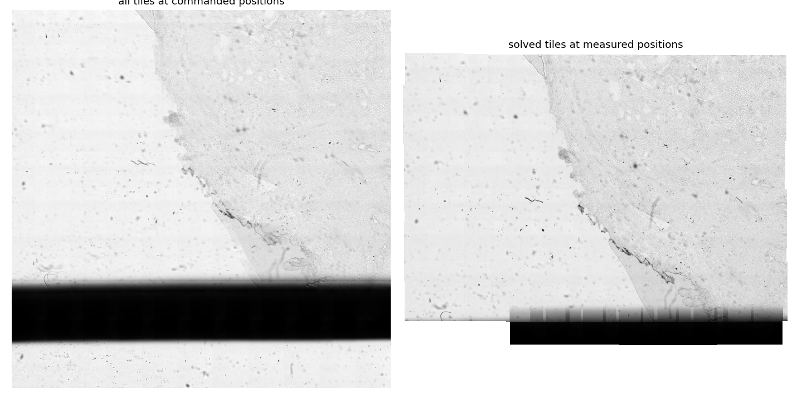

# Controlling the Smearscope

The Smearscope has three devices that you talk to over USB:

| Device | Connection | What it does |
|---|---|---|
| QuadDriver | USB-C (virtual serial port) or CAN | moves the XY stage |
| LED matrix (ESP32-S3) | USB-C | sets the illumination pattern |
| Hikrobot camera | USB 3 | takes the images |

Focus is set by hand with the knob under the stage.

## Moving the stage

The QuadDriver appears as a USB serial port (USB CDC). It takes plain-text commands, one per line, and answers `OK`, a value, or `ERR …`. Any serial terminal works, for example the Arduino serial monitor, PlatformIO's `device monitor`, or Python with `pyserial`. Type `HELP` to get the command list.

Distances are in **microsteps**. At the default 32 microsteps per electrical cycle, one microstep is about 130 µm and one cycle (32 microsteps) about 4.16 mm.

### Motion commands

| Command | Effect |
|---|---|
| `MOVE <x> <y> [speed]` | move relative, in microsteps, at `speed` microsteps/s (default 500; 100 is recommended) |
| `V <vx> <vy>` | run continuously at the given velocities (microsteps/s) |
| `STOP` | stop (same as `V 0 0`) |
| `SNAKE <nx> <ny> <sx> <sy> <speed> <pause_ms> [hold%]` | serpentine scan: `nx × ny` positions, steps `sx`, `sy`, pause at each position |
| `POS` | step counters of both axes, `<x> <y>` |
| `BUSY` | `1` while the stage is moving, else `0` |
| `PING` | answers `OK` |

`MOVE` answers `OK` at once and runs in the background. Poll `BUSY` until it returns `0` before you take an image.

### Settings

| Command | Effect | Recommended |
|---|---|---|
| `POWER [x y]` | peak drive per axis, 0–32767 | `18000 24000` (the Y coils have higher resistance) |
| `ACCEL [n]` | acceleration limit, microsteps/s² | `1500` (default) |
| `HOLD [pct]` | coil current when the stage stands still, 0–100 % | `0`: holding current adds friction and heat |
| `MICROSTEP [n]` | 16, 32 or 64 microsteps per cycle (stored, applies after a restart) | `32` |
| `DITHER [mode amp freq]` | small modulation of the drive to help break friction | `1 16 50` or off |
| `PHASE <X\|Y> <k> [v]` | fine correction of the commutation table | leave at zero |

`POWER`, `ACCEL`, `DITHER` and `PHASE` are not stored and reset on power-up.

### Example in Python

```python
import serial, time

stage = serial.Serial("COM5", 115200, timeout=1)   # macOS/Linux: /dev/cu.usbmodem… or /dev/ttyACM0

def cmd(line):
    stage.write((line + "\n").encode())
    return stage.readline().decode().strip()

def move(dx, dy, speed=100):
    cmd(f"MOVE {dx} {dy} {speed}")
    while cmd("BUSY") == "1":
        time.sleep(0.02)

cmd("POWER 18000 24000")
move(32, 0)          # one electrical cycle in +X, about 4.2 mm
print(cmd("POS"))    # e.g. "32 0"
```

### Tips for reliable motion

- **Move in whole electrical cycles** (multiples of 32 microsteps) when you can. These are the most repeatable steps. Single microsteps are not reliable positioning steps.
- **Approach positions from one direction.** Each reversal loses about 0.2–0.4 mm to friction. For scans, run every row in the same direction, or overshoot and come back.
- **Keep the speed at about 100 microsteps/s.** Much faster profiles can make the sled lose step.
- **Keep holding current off.** Current in the coils while standing still adds friction, so the next move starts worse.
- **Let the sled settle.** A move ends with a short slip. Wait about 50 ms after `BUSY` returns `0` before taking an image.

### CAN bus

The QuadDriver can also join an openUC2 CAN bus (CANopen, 500 kbit/s, default node ID 11). Velocity, acceleration, drive level, holding current and microstep mode are exposed as CANopen objects. The CAN interface is intended for integration into larger openUC2 systems.

## Illumination

The LED matrix is the same ESP32-S3 8 × 8 RGB matrix used in other openUC2 kits. It is set with commands from the computer, for example a pattern of LEDs and a colour. The [How it works](./01_how-it-works.md#illumination) page lists the useful patterns.

## Camera

The Hikrobot camera works with the vendor's MVS software and with ImSwitch. See the [Hikrobot camera documentation](../../components/hik-camera/README.md) for drivers and settings.

## Scanning and stitching

A typical slide scan works like this:

1. Focus on the sample with the knob.
2. Choose a grid with at least 30 % overlap between neighbouring fields.
3. Step through the grid with `MOVE` commands, wait for `BUSY = 0`, and take an image at every position.
4. Stitch the images by registration: the overlap between neighbours gives their true offsets, and a small least-squares fit gives every field's position.

The camera, not the stage, defines where each field lies. In a 10 × 10 benchmark scan, the stage misplaced fields by up to 0.4 mm, but registration recovered every field's position to about 3 µm and no area was missed.



*Benchmark scan: 100 fields in about two minutes, stitched by registration. The dark band at the bottom is an opaque marking on the slide. Example scans of smears will follow.*

## ImSwitch

An ImSwitch stage driver for the Smearscope is in development. It wraps the serial commands above. It handles blocking moves, the per-axis drive levels and the approach direction, and it uses the camera for stage calibration and tiled scans.
