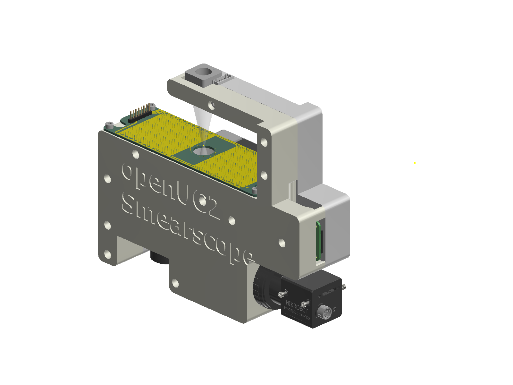
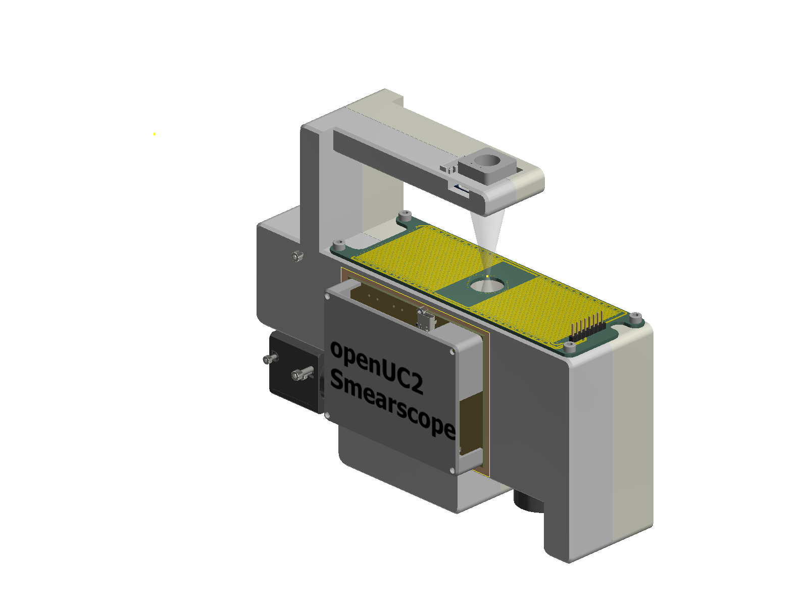
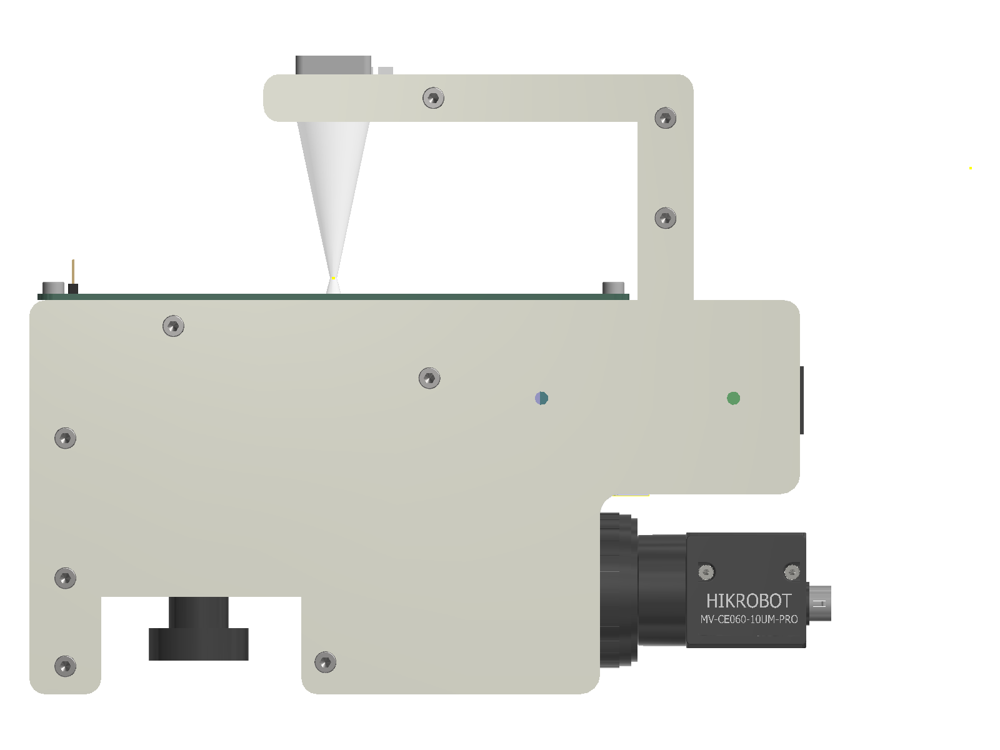
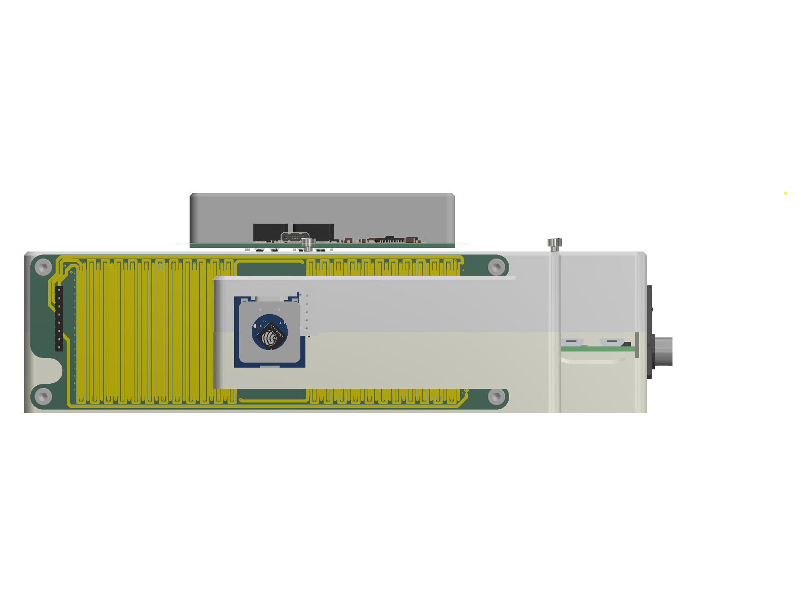
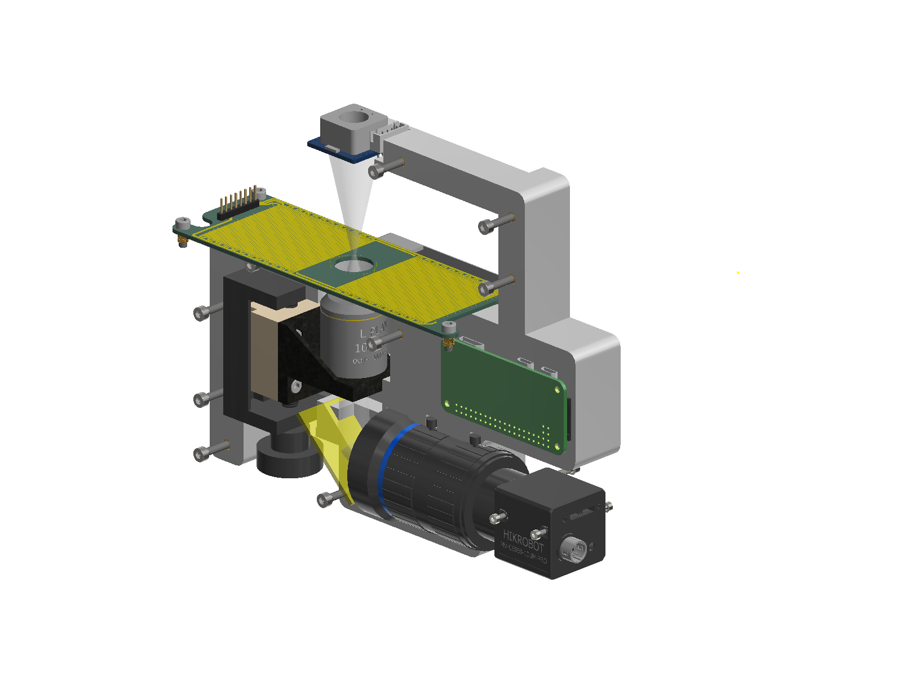
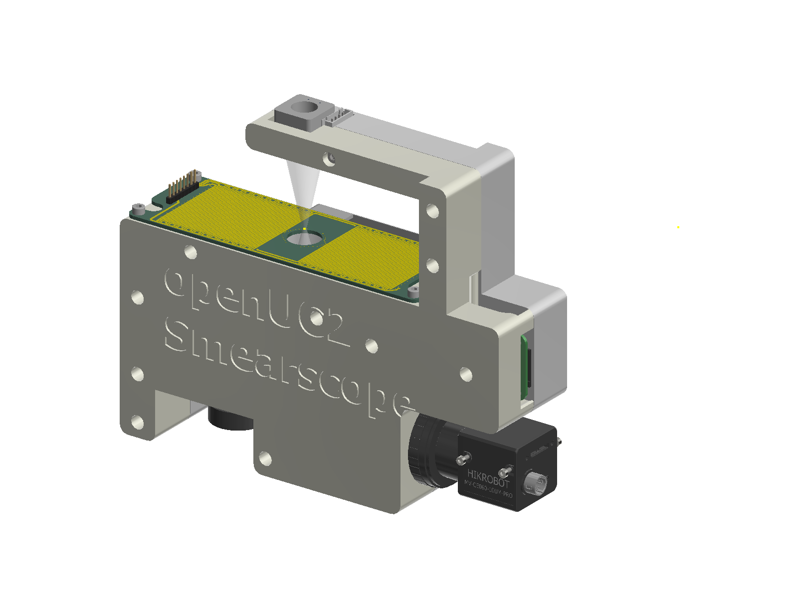
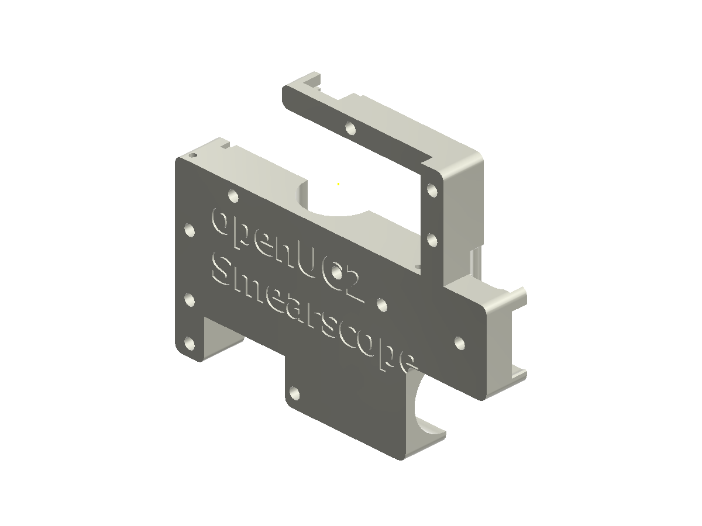
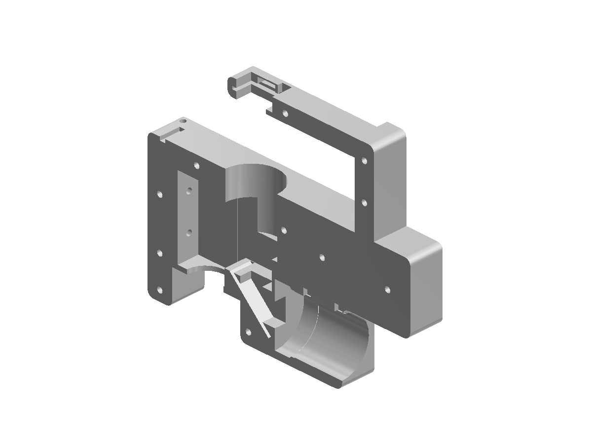
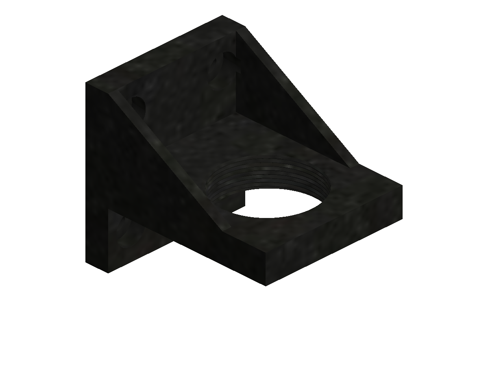
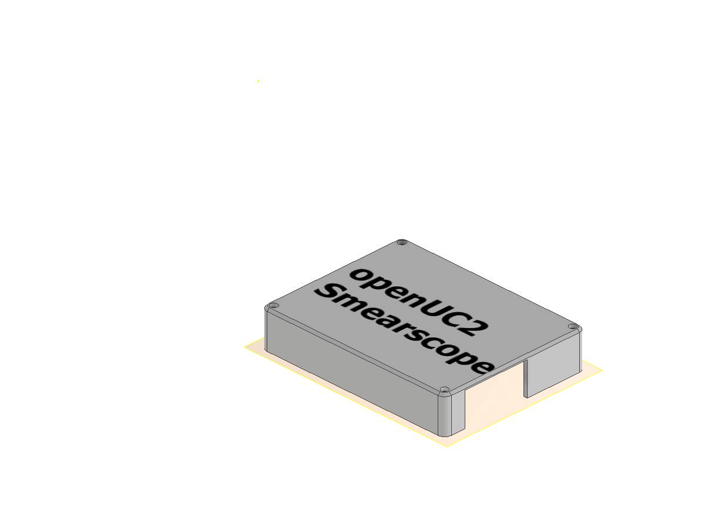

# Renderings and STL files

Renderings of the current design (October 2026). The design is still changing, so details may differ from the instrument you see.

## The assembled instrument

| | |
|---|---|
|  |  |
| Front: stage board on top, LED arm, camera at the end | Back: QuadDriver under its cover |
|  |  |
| Side view | Top view |
|  |  |
| Inside, front half hidden: z-stage, objective, mirror, tube lens, camera | The two halves pulled apart |

## Printed parts

| Part | Rendering | STL |
|---|---|---|
| Front half |  | [smearscope-front-half.stl](./files/smearscope-front-half.stl) |
| Back half |  | [smearscope-back-half.stl](./files/smearscope-back-half.stl) |
| Objective carrier |  | [smearscope-objective-carrier.stl](./files/smearscope-objective-carrier.stl) |
| Electronics cover |  | [smearscope-electronics-cover.stl](./files/smearscope-electronics-cover.stl) |

The halves print lying on their outer face, so every pocket opens upwards and no support is needed. They are about 195 × 155 × 25 mm each. The STL files show the current state of the design. A full parts list and build instructions will follow with the release.

## PCB outlines

Dimensioned drawings of the two circuit boards, for planning mounts and enclosures:

- [Stator board of the XY stage](./IMAGES/pcb_stage_stator_dimensions.svg) (148 × 48 mm)
- [QuadDriver](./IMAGES/pcb_quaddriver_dimensions.svg) (82 × 63 mm)
