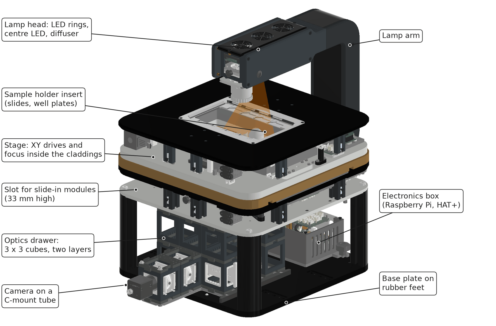

# What is the FRAME?

The FRAME (Fast Rigid Automated Microscope Engine) is an inverted, motorised microscope built from the openUC2 cube system. The optics stay fixed; the sample moves.

*For people deciding whether a FRAME fits their work.*

## The core idea: fixed optics, moving sample

The objective does not move for focus. The sample plate moves in X, Y and Z, and a slider changes between two objectives. Everything below the objective stays in one position relative to the objective's back focal plane.

That matters for anything aligned to that plane: structured illumination, a confocal or laser-scanning add-on, a focus lock. Such a module can be aligned once on the bench, slid in, and stays aligned through a z-stack.

## Modular by design

- Below the stage sits an optics drawer of 3 x 3 openUC2 cubes in one or two layers: fold mirror, tube lens, filter and dichroic cubes, camera. Cubes can be exchanged or rearranged.
- Between the drawer and the stage, a 33 mm slot takes flat slide-in modules such as the focus lock.
- One 12 V supply and one CAN bus feed every motor, lamp and laser board. New modules plug into the same bus.

## Open source

Hardware, firmware (UC2-ESP32) and software (ImSwitch) are open. You can change the optical path, add a board to the bus, or control the instrument from Python or the REST API.

## Who it is for, and its limits

- Automated imaging of slides, well plates and dishes: tile scans, time-lapse, multi-position experiments.
- Brightfield, darkfield and DPC with the LED rings; fluorescence with fibre-coupled lasers or LEDs.
- Research use only. It is not a medical or in-vitro diagnostic device.

Limits of units ID10–ID20 to know before you buy or plan an experiment:

| Limit | Value |
|---|---|
| Field of view | about 10 mm image circle; 0.74 x 0.49 mm at 10x with the standard camera |
| Stage repeatability without encoder | within about ±7 µm over a day of moves |
| Focus travel | 8 mm |
| Temperature | printed parts limit use to 38 °C |

Details: [Hardware ID10–ID20](../../reference/hardware-id10-id20/README.md).

## Related

- [Specifications](../../reference/specifications/README.md)
- [How scanning works](../how-scanning-works/README.md)
