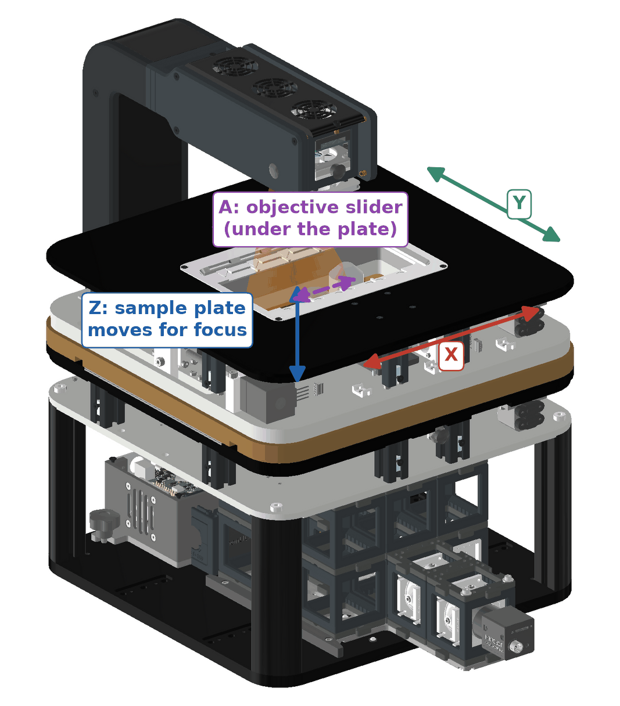

# Coordinates and axes

The FRAME has four motorised axes. X, Y and Z move the sample; A moves the objectives.

| Axis | What moves | Travel | Drive |
|---|---|---|---|
| X | sample plate, left and right as seen from the front | 127 mm | NEMA 11 motor, 1 mm ball screw |
| Y | sample plate, front and back | 86 mm | NEMA 11 motor, 1 mm ball screw |
| Z | sample plate, up and down (focus) | 8 mm | two NEMA 8 actuators on wedge stages |
| A | objective slider under the plate, along X | two positions, 29.8 mm apart | NEMA 11 motor, 1 mm ball screw |

The objectives never move up or down. Focus always moves the sample. Details: [Mechanics](../hardware-id10-id20/mechanics.md).

## Origin and offsets

- The stage zero corresponds to well A1 of a standard multiwell plate in the holder.
- ImSwitch shows positions relative to that zero. The physical position differs by an offset per axis, stored in the configuration (`stageOffsets`); see [Configuration (JSON)](../config-json/README.md).
- The calibration target supplied with the unit has a centre cross at x = 63.5 mm, y = 46 mm in stage coordinates. Use it to check the offsets; see [Calibrate stage](../../guides/day-2/calibrate-stage/README.md).

## Directions and homing

- The positive direction and the homing direction of each axis are set in the configuration (`homeDirection`, `homeEndstoppolarity` per axis). They can differ between units; check yours before you script moves.
- X, Y and A home at start-up by default; Z does not. See [Homing](../../guides/day-2/homing/README.md).
- Units ID10–ID20 run without position feedback: after a crash or an emergency stop, home again before you trust a coordinate.

## Entering coordinates

Positions are entered in micrometres in ImSwitch and in the REST API. One microstep is 0.3125 µm on X, Y and A. See [ImSwitch UI reference](../imswitch-ui-reference/README.md).
