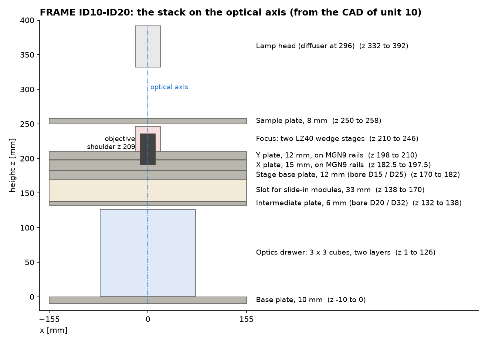

# FRAME hardware, units ID10–ID20

This section describes the hardware of the FRAME units with serial numbers 10 to 20. It is the technical reference for anyone who builds on, services or evaluates one of these units.

All dimensions come from the CAD of unit 10 and from the FR120 part revision. Measured performance comes from two internal test series in 2026. Where a number is from CAD or a data sheet and not from a measurement, the page says so.

| Page | What it covers |
|---|---|
| [Optical path](./optics.md) | Openings on the axis, tube lens, field of view, sampling, illumination |
| [Mechanics](./mechanics.md) | Frame, XY stage, focus drive, objective slider, optics drawer |
| [Electronics and safety functions](./electronics-and-safety.md) | Boards, bus, power, emergency stop, laser interlock |
| [Stage repeatability and drift](./stage-repeatability-and-drift.md) | Measured: open loop against encoder, backlash, drift over 12 to 24 h |

## What is the same on every unit in this range

- Inverted layout: the sample lies on a motorised XY stage, the objectives sit below it on a two-position slider.
- **The sample moves for focus, the objective does not.** The optics below the objective stay in a fixed position relative to the objective's back focal plane.
- A removable optics drawer with 3 x 3 cube positions in one or two layers, below the stage.
- A slot of 33 mm height between drawer and stage for flat slide-in modules such as the focus lock.
- One 12 V supply, one CAN bus, one driver board per motor, a Raspberry Pi 5 running ImSwitch.

## What differs inside the range

Two part revisions exist in the CAD. Check your unit before you rely on an opening diameter.

| Property | FR110 | FR120 |
|---|---|---|
| Bore in the objective plate | 14 mm | 23 mm |
| Bore in the stage base plate | 15 mm | 25 mm |
| Bore in the intermediate plate | 20 mm | 32 mm |
| Cube layers under the stage | two | one (stage 55 mm lower) or two |
| Position feedback | none | linear encoders on X and Y, rotary encoder on Z, none on the objective slider |
| Crash detection under the objective | none | optional thin-film force sensor |

Unit 10 was built as FR110 and is the unit on which the encoder tests ran. The parts lists name FR110 for units 7 to 12 and FR120 for the following order; ask openUC2 which revision your serial number carries.

## The stack

Heights are measured from the top of the base plate. The focus stages stand at the front and back of the Y plate, 178 mm apart; the figure shows them projected onto the axis.

## Key data

| Property | Value | Basis |
|---|---|---|
| Footprint of the stand | 310 x 310 mm; 410 mm deep with the lamp arm | CAD |
| Height | 258 mm to the sample plate, 392 mm with the lamp head | CAD |
| Mass | Not confirmed. Documents state under 16 kg, 20 kg and 25 kg | weigh your unit |
| XY travel | 127 x 86 mm | manual |
| Focus travel | 8 mm used; 12.7 mm actuator stroke | manual, data sheet |
| XY drive | NEMA 11 motor with 1 mm ball screw, 5 µm per full step, 0.3125 µm per microstep (1/16) | data sheet |
| Focus drive | two NEMA 8 captive actuators, 0.5 mm lead, wedge stage 1:1, 2.5 µm per full step | data sheet |
| Objectives | two, RMS or M25, each on its own parfocal support | CAD |
| Tube lens | f = 180 mm, 23 mm diameter | CAD |
| Camera | Hikrobot MV-CS060-10UC/UM-PRO, Sony IMX178, 3072 x 2048 pixels of 2.4 µm, 8.9 mm diagonal | data sheet |
| Fully lit image circle | about 10 mm for objective pupils up to 9 mm | ray model, see [Optical path](./optics.md) |
| Supply | 12 V DC, 6.67 A (Mean Well GSM90A12-P1M) | assembly |
| Computer | Raspberry Pi 5 with HAT+ | assembly |
| Bus | CANopen, 500 kbit/s, 4-pin JST XH with 12 V | [Electronics](./electronics-and-safety.md) |

## Design decisions

**Why the sample moves for focus.** Structured illumination, confocal and other scanned paths are aligned to the back focal plane of the objective. If the objective moved for focus, that plane would move against the pre-aligned optics, and the illumination would pick up defocus. With a fixed objective, a module can be aligned once on the bench and stays aligned through a focus stack.

The price is a heavier focus axis: the whole sample plate is lifted. The focus section of [Mechanics](./mechanics.md) describes the consequences and the planned improvements, including a piezo fine axis.

**Why the optics sit in a drawer.** The drawer separates from the stand inside the collimated beam. A sideways error of the drawer does not move the image; only a tilt does. The drawer rests on three ball points and is pressed down inside their triangle.

## Known limits of this hardware range

| Limit | Consequence | Status |
|---|---|---|
| The tube lens is the smallest opening on a 169 to 224 mm long path | Sensors larger than 1/1.8 inch are not fully lit | a larger lens ahead of the fold mirror is planned |
| FR110 bores of 14 to 20 mm | A 4x/0.20 objective works at NA 0.14 | fixed in FR120 |
| No position feedback as shipped | Lost steps are not seen; backlash of 1 to 15 µm | encoders validated on unit 10 |
| Two independent focus drives | The sample plate can tilt if the drives lose step against each other | rotary encoder planned |
| Printed PLA parts in the lamp arm, drawer guides and sensor flags | Use above 38 °C is not supported | material change planned |
| Transmitted light is diffuse, not Köhler | Illumination NA 0.29; no field or aperture stop | by design in this range |
