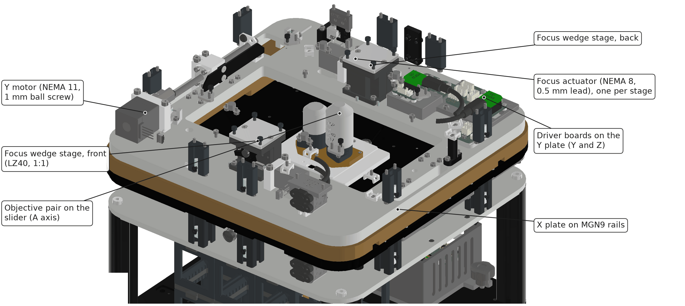
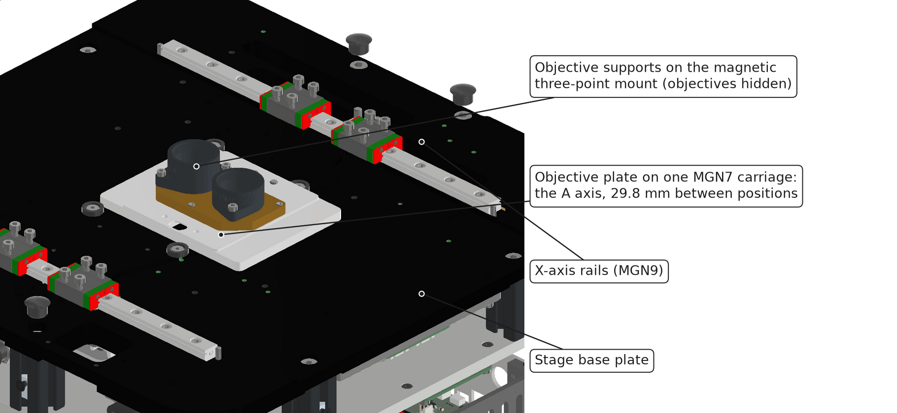
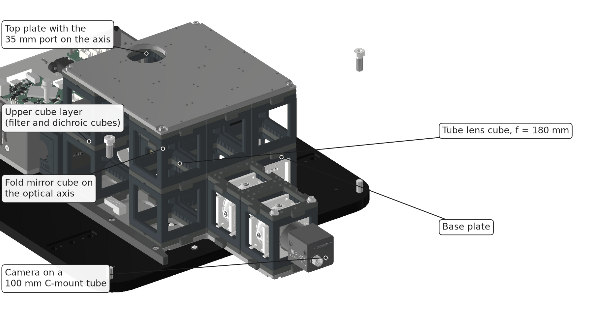

# Mechanics (ID10–ID20)

The stand is a stack of machined aluminium plates on four corner columns. The stage plates carry X, Y and focus; the optics drawer slides in below. All values are from the CAD of unit 10 unless a measurement is named.

## Frame

| Part | Size | Material |
|---|---|---|
| Base plate | 306 x 306 x 10 mm, 2.4 kg | EN AW-6082 |
| Corner columns | 4 x item profile R30-90°, 133 mm (78 mm in the one-layer version) | EN AW-6063 |
| Intermediate plate | 306 x 306 x 6 mm, 1.35 kg | EN AW-6082 |
| Stage base plate | 310 x 310 x 12 mm, 2.1 kg | EN AW-6082 |
| X plate | 310 x 310 x 15 mm, 1.8 kg | EN AW-6082 |
| Y plate | 304 x 304 x 12 mm, 1.5 kg | EN AW-6082 |
| Sample plate (cover plate) | 310 x 310 x 8 mm, pocketed, 1.2 kg | EN AW-5754 |
| Claddings | sheet | EN AW-5005, anodised |
| Lamp arm, lamp shell, drawer guides, sensor flags | printed | PLA |
| Feet | 4 adhesive rubber feet (3M Bumpon SJ6125) | |

The unit stands on four small rubber feet and has no levelling screws. Printed PLA parts soften near 55 °C; the manual limits use to 38 °C.

A complete unit without optics modules has about 1,050 parts in CAD, of which about 580 are screws and standard parts. A circuit board counts as one part; its components are not counted.

## XY stage

*Stage with the cover plate, claddings and lamp arm hidden. Axis directions: [Coordinates and axes](../coordinates-and-axes/README.md).*

| Property | X | Y |
|---|---|---|
| Travel | 127 mm | 86 mm |
| Guides | 2 x HIWIN MGN9, rail 220 mm, two carriages per rail | 2 x HIWIN MGN9, rail 180 mm |
| Rail pairing | one rail with zero clearance, one with a floating carriage | same |
| Carriage spacing along the travel | 48 mm | 48 mm |
| Drive | DINGS 11E2110BS14 NEMA 11 motor, ball screw 6 mm diameter, 1 mm lead, grade C7 | same |
| Step | 5 µm per full step, 0.3125 µm per microstep (1/16) | same |
| Motor | 1.0 A, 2.1 Ω per phase | same |
| Home sensor | Panasonic PM-L25 fork light barrier with a printed flag | same |
| Feedback | none as shipped; linear magnetic encoder (AS5311 type, 1.95 µm per count) in validation | same |

The X axis sits on the stage base plate. The Y axis, both focus drives and their driver boards ride on the X plate and are fed through a drag cable.

The sample sits about 70 mm above the X rails. Rail straightness therefore shows up as a sideways error at the sample that an encoder at plate level does not see.

Measured behaviour is on the page [Stage repeatability and drift](./stage-repeatability-and-drift.md).

## Focus drive

Focus lifts the sample plate; the objective is fixed. See [Design decisions](./README.md#design-decisions) for the reason.

| Property | Value |
|---|---|
| Mechanism | two LZ40 wedge stages (ratio 1:1, low spring force), 178 mm apart on the Y plate, at the front and back of the sample plate |
| Actuators | two DINGS L8K2105AD4 NEMA 8 captive actuators, one per wedge stage |
| Lead | 0.5 mm, plastic (POM) nut |
| Step | 2.5 µm per full step; 0.156 µm at 1/16 microstepping |
| Travel | 8 mm used (±4 mm); 12.7 mm stroke |
| Thrust | about 30 N per actuator |
| Lifted mass | sample plate 1.2 kg (CAD) plus holder and sample, about 1.5 to 1.8 kg |
| Home sensor | fork light barrier |
| Feedback | none as shipped; one rotary encoder planned |

:::caution Check the Z step size of your unit
The example configuration lists 0.3125 µm per step for Z, the same as X and Y. With a 0.5 mm lead and a 1:1 wedge that value is right only if the Z drivers run at 1/8 microstepping. Verify on your unit by focusing on both faces of a cover glass of known thickness.
:::

Do not lift the unit by the sample plate and do not load the plate by hand: the plate is held down by its weight and the stage springs only.

### Known weaknesses of the focus drive

1. **Two drives, one plate.** If one side loses steps, the plate tilts. 100 full steps of difference tilt it by 1.4 mrad, which is 120 µm of focus across the Y travel.
2. **Both supports stand on one line** (x = 0). A push on the left or right edge of the plate is resisted only by the roller guides of the two wedge stages.
3. **Downward motion relies on a weak spring and gravity.** With the plastic nut this gives backlash and stick-slip on reversal.

### How to measure the focus repeatability

The camera's own focus measure is too coarse for this: the depth of field of a 20x/0.40 is several micrometres. Use a displacement measurement:

| Method | Resolution | What you need |
|---|---|---|
| Focus-lock module as a displacement sensor on a cover glass | 0.08 µm at 20x (0.75 µm per pixel, fitted to 0.1 pixel), range ±0.9 mm | the [focus lock add-on](../../addons/focus-lock/README.md) |
| Digital length gauge on the sample plate | 0.1 µm | a gauge with a plunger force under 1 N, on a stand fixed to the stage base plate |
| Capacitive or confocal distance sensor | 0.01 to 0.05 µm | lab sensor, no contact force |
| Tilted grid target: the line of best focus moves sideways by z / tan(tilt) | about 0.3 µm at 10x with a 5° tilt | a grid slide on a 5° wedge |

Procedure, following the logic of ISO 230-2:

1. Warm up for 30 minutes with the motors energised.
2. Pick five target heights across the travel.
3. Approach each target seven times from below and seven times from above, with a 2 s pause before reading.
4. Report for each target: the spread of the approaches from one side (unidirectional repeatability), and the difference between the two means (reversal error).
5. Repeat with gauges at the front and back wedge stage at the same time. The difference between them is the tilt.
6. Repeat with a loaded well plate and at three XY positions.

### Planned improvements

The sample keeps moving for focus. The changes address the three weaknesses above:

| Change | Effect |
|---|---|
| One encoder per focus actuator, and one home switch per side compared at every start | a lost step on one side is detected before the plate tilts |
| Always approach the target from below, with an overshoot on downward moves | removes the reversal error from the images, with no hardware change |
| Stronger return springs or an anti-backlash nut | removes stick-slip on the way down |
| A third support, or one motor that drives both wedge stages through a shaft | the plate can no longer tilt by drive error |
| Piezo fine axis: one piezo stack per wedge stage, driven in tandem (two-channel driver, 0 to 138 V, 12 bit; board in design) | fine focus without stepper noise or backlash; with a 100 µm stack about 25 nm per step |
| Light piezo insert that lifts only the sample holder instead of the whole plate | a few hundred grams of moving mass; fast z-stacks |

A piezo stack without a position sensor shows 10 to 15 % hysteresis and creep. Close the loop with the focus lock or a strain gauge when absolute height matters.

## Objective slider

*Stage base plate with the X and Y plates hidden. The objectives themselves are hidden; their supports sit on the slider.*

| Property | Value |
|---|---|
| Positions | two, 29.8 mm apart |
| Guide | one HIWIN MGN7 carriage on a 57 mm rail |
| Drive | same NEMA 11 ball-screw motor as X and Y |
| Positioning | by motor steps from a home sensor; no hard stop and no encoder |
| Objective mount | three-point mount held by two magnets; one support per objective sets the parfocal height |
| Largest objective diameter | about 28 mm |
| Crash detection (FR120, optional) | thin-film force sensor under one support point of the mount |

One full step moves the objective 5 µm, which is 42 camera pixels at 20x. Calibrate both positions on your unit; see [Calibrate objective](../../guides/day-2/calibrate-objective/README.md).

The force sensor is intended as a crash detector: it reports when the objective touches the sample plate or a holder. It does not replace a height limit per objective in software.

## Optics drawer

*The drawer with the stage, the intermediate plate and the columns hidden.*

| Property | Value |
|---|---|
| Grid | 3 x 3 cubes of 50 mm, one or two layers of 55 mm height |
| Plates | aluminium, 150 x 150 x 5 mm, top plate with a 35 mm port on the axis |
| Support | three ball points (Ganter GN 605) on the base plate, at the front centre and at the left and right of the axis |
| Clamp | an inverted LZ40 stage with nine rubber buffers presses on the drawer from above, inside the triangle of the ball points; tightened from the front with a hex key |
| Side guides and end stop | printed, 8 mm high |
| Slot above the drawer | 33 mm high, for slide-in modules; entry from the side |

Unplug the camera's USB cable before you pull the drawer. Push the drawer against its end stop before you clamp it; pressing it in while clamped can move it off the axis.

## Lamp arm

The lamp head hangs on a printed arm, 185 mm in front of its column, with its diffuser 38 mm above the sample plate. A fan sits on top of the LED heat sink. A hinged version of the arm exists.
